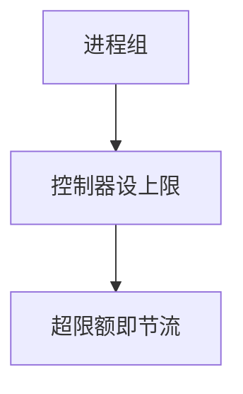
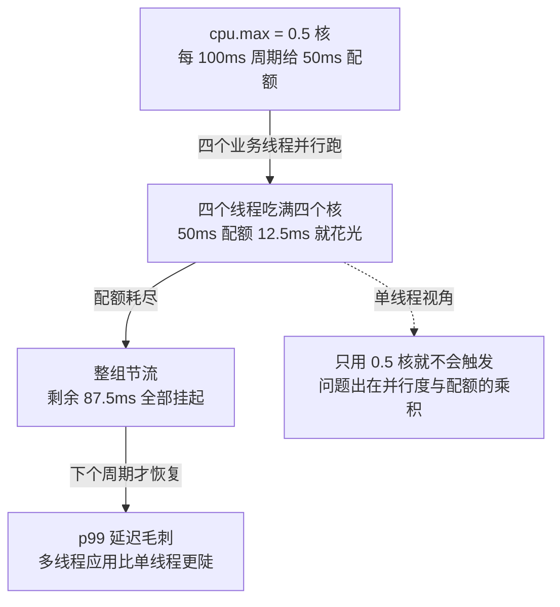

# cgroups把机器切成可调度的资源单元

**裸机上跑一百个进程，一个失控进程能把整台机器的内存、CPU、IO 全吃光，其余进程跟着陪葬**。要解决的问题：**把一台机器的资源切成按组隔离的配额单元，让"谁用了多少、谁超了被限制"变成内核强制执行的事实，而不是靠进程自觉**。cgroups（control groups，控制组）就是内核提供的这个机制，容器的资源隔离底座。

## cgroups 怎么把机器切成可调度的资源单元



配额是把机器切成可调单元的手段：


*图示：Kubernetes（容器编排平台：管容器调度、扩缩与自愈） 的集群构成——控制面做调度与状态维护，各节点上的 kubelet 管着 Pod（Kubernetes 调度的最小部署单元，可含一个或多个共享网络的容器）。图源：Kubernetes 官方文档《Kubernetes Components》，CC BY 4.0，https://kubernetes.io/zh-cn/docs/concepts/overview/components/。调度器把 Pod 放到哪个节点，是这张图的上一层；放进节点之后 Pod 真正能拿到多少 CPU 和内存，是 cgroups 这一层——两者是同一笔账的两次记账。*

**cgroups v2 的统一层级把资源控制器（controller）挂到同一棵树上，按路径继承**。**层级与子系统的关系是理解配额的前提：每个层级是一棵控制组树，树节点（控制组）挂接一个或多个子系统，进程按组归属拿到各自的资源上限**。美团技术博客的经典示意图把这条关系画清——左侧层级挂 cpu 与 cpuacct 子系统（cpu_cgrp 组下 cgrp1 拿 60% 时间片、cgrp2 拿 20%），右侧层级挂 memory 子系统做内存限额，两组互不干扰：


*图源：美团技术团队《Linux 资源管理之 cgroups 简介》，https://tech.meituan.com/2015/03/31/cgroups.html（hierarchy 层级 / subsystem 子系统 / control group 控制组）。*

**v2 相对这张 v1 示意图的变化是把所有子系统收进同一棵统一树，挂接方式合并、按路径继承**。常用控制器：

| 控制器 | 管什么 | 关键参数 | 超限行为 |
| --- | --- | --- | --- |
| memory | 内存上限与回收 | memory.max | 超限触发 OOM（Out Of Memory，内存耗尽后被系统强制终止进程） kill 或回收 |
| cpu | CPU 带宽配额 | cpu.max（ period/quota ） | 超限节流（throttle），不杀进程 |
| io | 块设备带宽与 IOPS（Input/Output Operations Per Second，每秒 IO 操作数） | io.max | 超限排队延迟 |

上游怎么说这件事，Red Hat 官方文档的定位最权威：控制组（cgroups）是内核功能，把进程组织成按层级排序的组，再用它们限制或隔离系统资源的使用——为系统资源分配设限、给硬件资源分配排优先级、把某些进程与其他进程隔开，全部经 /sys/fs/cgroup（Linux 的资源限制机制，把进程分组并限制 CPU/内存上限）/ 挂载点由 systemd（Linux 的服务管理器）统一管理：


*图源：Red Hat Enterprise Linux 8 文档《Managing, monitoring, and updating the kernel》Chapter 23 页面截图，Red Hat 文档以 CC BY-SA 4.0 许可发布，https://docs.redhat.com/en/documentation/red_hat_enterprise_linux/8/html/managing_monitoring_and_updating_the_kernel/setting-limits-for-applications_managing-monitoring-and-updating-the-kernel。术语对照：control groups＝控制组，resource allocation＝资源分配。*

**资源视角的关键区分：cgroups 限制的是"这个组能用多少"，CPU 亲和性（cpuset）决定"这个组在哪跑"。两者叠加出容器场景的完整资源画像**。收益是**隔离与可预测**（noisy neighbor 邻居噪声被挡在配额外）；代价是**配额语义的坑：cpu.max 按周期分片**（把数据按规则切开存到不同节点）给时间片，**Java 这类多线程进程在配额边界会被节流出延迟毛刺（周期内配额用完就等到下个周期），这是 JVM（Java 虚拟机，Java 程序的运行时）容器化的经典问题，JVM 后来加了容器感知（UseContainerSupport）来感知配额**。



**毛刺的机制在「并行度乘配额」：0.5 核的配额按 100ms 周期折成 50ms 时间片，JVM 这类多线程进程四个线程并行吃满四个核，50ms 配额 12.5ms 就花光，剩下 87.5ms 整组挂起等下个周期——单核跑满的进程反而没有这个问题**。所以**容器里的 JVM 要开 UseContainerSupport 让线程池（预先建好一组线程反复取用、避免频繁创建销毁）按配额缩减，CPU 毛刺排查第一步看 `cpu.stat` 的 `nr_throttled`**。

**与 NUMA（非统一内存访问，多路服务器内存分槽、跨槽访问更慢）的关系：cpuset 可以绑定 NUMA node，把"内存位置"这个硬件约束映射进调度域**，见 [[工程知识/性能工程：从用户等待到资源瓶颈/处理器与内存/NUMA让跨槽访问付出带宽与延迟代价|NUMA让跨槽访问付出带宽与延迟代价]]。

## 怎么自己动手验证

```bash
# 建 v2 控制组、限额、观察节流
mount -t cgroup2 none /sys/fs/cgroup
echo "+cpu +memory" > /sys/fs/cgroup/cgroup.subtree_control
mkdir /sys/fs/cgroup/demo
echo "100000 50000" > /sys/fs/cgroup/demo/cpu.max   # 0.5 CPU
echo $PPID > /sys/fs/cgroup/demo/cgroup.procs
cat /sys/fs/cgroup/demo/cpu.stat                    # 看 nr_throttled
# 对比：无限制 vs 0.5 CPU 下的 sysbench
sysbench cpu --threads=4 --time=10 run
```
**预期：0.5 CPU 配额下 nr_throttled 随负载上升，吞吐约减半；memory.max 下超限进程被 OOM kill（dmesg 可见）**。**数字对不上时先查是否混用 v1（v2 需要 unified hierarchy，`stat -fc %T /sys/fs/cgroup/` 输出 cgroup2fs 才对）**。内核 cgroup-v2 文档是参数语义的权威来源，Facebook 的 cgroup2 运维报告是大规模实践的一手参考。

## 这套说法在哪儿会失效

本篇讲内核资源隔离机制。cgroups 之上的打包与交付（容器镜像、namespace 进程视图隔离）见 [[工程知识/后端系统：在并发、失败与变化中维持服务/基础设施/容器隔离资源边界与镜像身份|容器隔离资源边界与镜像身份]]，两篇分工：cgroups 管资源量、容器打包把它变成交付单元。调度器怎么在配额约束下放进程，见 [[工程知识/性能工程：从用户等待到资源瓶颈/操作系统与运行时/进程线程与系统调用构成执行边界|进程线程与系统调用构成执行边界]]。IO 控制器的队列视角见 [[工程知识/性能工程：从用户等待到资源瓶颈/存储与网络/存储IO性能取决于访问模式、队列与持久化语义|存储IO性能取决于访问模式、队列与持久化语义]]。容器 JVM 的延迟毛刺问题属于运行时适配，见 [[工程知识/性能工程：从用户等待到资源瓶颈/操作系统与运行时/垃圾回收与内存分配决定延迟尾部|垃圾回收与内存分配决定延迟尾部]]。

## 接着读哪几篇：cgroups 的容器化封装

- [[工程知识/后端系统：在并发、失败与变化中维持服务/基础设施/容器隔离资源边界与镜像身份|容器隔离资源边界与镜像身份]]——cgroups 的容器化封装
- [[工程知识/性能工程：从用户等待到资源瓶颈/处理器与内存/NUMA让跨槽访问付出带宽与延迟代价|NUMA让跨槽访问付出带宽与延迟代价]]——cpuset 与 NUMA 的交汇
