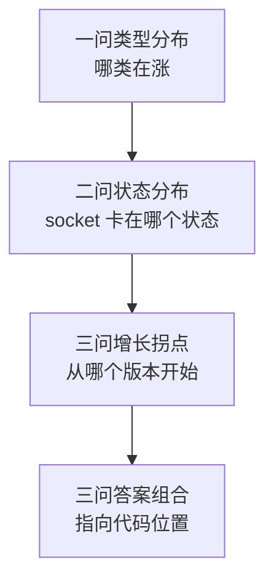
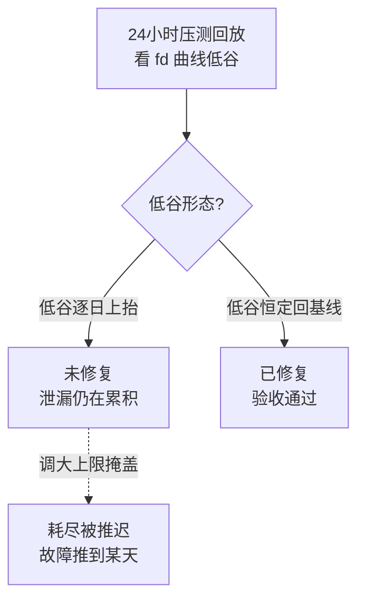

# fd 泄漏先用 lsof对账：每类套接字都有名有姓才算干净

**等到报 too many open files 已经是终场哨，判定要在哨响之前做**。读完这一页你能用 lsof（列出进程打开的文件与套接字的命令） **按类型把描述符对上账**，**找出涨势和业务量对不上的那一类**。

> **要点**：**文件描述符是进程对内核对象的引用票据**，**泄漏的形态是"票据发出去了没人还"**——`too many open files` 报错是终场哨，判定要在哨响之前做：`lsof -p` 按类型对账，数清 socket、文件、epoll（Linux 的 I/O 事件通知机制，一个进程用它能同时监视大量连接）、eventfd（事件通知的文件描述符） 各多少、归谁，**涨势与业务量对不上的类型就是嫌疑人**；**fd 上限要用软硬两层设置，告警挂在软限的七成**。

## 要解决的问题是什么：涨势对不上业务的 fd 为什么就是泄漏

fd 泄漏的经典场景：**连接池（预先建好连接反复取用、省去反复握手建连的开销）的连接借出不还**、**日志句柄（程序持有的资源引用标识）滚动后旧句柄没关**、每请求新开 socket 不关闭、**epoll fd 与 eventfd 在热更新路径上累积**。

**泄漏与高占用的区分**：**fd 用量高但随业务量等比波动（高峰高、低谷回落）是正常**；**用量单调上涨且低谷不回落，涨势与业务量对不上——这就是泄漏**，涨到软限报 EMFILE（进程打开文件数达到上限时报的错误码），**进程丧失一切需要 fd 的能力（建连、读文件、收信号管道）**。本库"资源与容量"域讲过连接泄漏的个案；本篇给 fd 维度的**通用对账方法**——**不定位到具体泄漏点也能先圈定类型与涨速，为代码定位缩小范围**。

## 它是怎么做到的：对账、上限与告警三层

**fd 泄漏查到最后，往往是连接与线程的账对不上**。**协调器管着的连接，本该逐个交给线程去用；线程用完了没还，账就对不上了**。


*图源：ToolsBook《干翻 nio，王炸 io_uring 来了，史上最详细说明及最全图解》，CC 4.0 BY-SA，https://www.toolsbook.org/2024/05/nio-iouring.html。*


**fd 增长最终会体现为等待：连接没关闭，进程卡在等待对端或等待可用描述符上**。off-CPU 火焰图（按调用层级堆叠的耗时分析图、越宽的块越耗时）把这类不在处理器上的时间摊开，**等待点会集中成很宽的一段，比单纯看 fd 计数更能定位是哪条路径在积累**：


*图示：Off-CPU 分析中线程的阻塞时间分布。图源：[Brendan Gregg · Off-CPU Analysis](https://www.brendangregg.com/offcpuanalysis.html)。*

**第一层：lsof 按类型对账**。`lsof -p <pid>` 列出进程全部 fd，**按 TYPE 分组统计**：IPv4/IPv6 socket（连接类，对应连接池与客户端）、REG（文件类，日志与数据文件）、Unix（贝尔实验室开发的分时操作系统） socket、epoll/eventfd/pipe（内核机制对象）。**对账的预期**：**每类的数量能对上业务事实**——**socket 数 ≈ 连接池大小 × 目标数 + 活跃请求**，REG 数 ≈ 日志文件数（**同名日志多个 fd 指向已滚走的 inode，即日志句柄泄漏的特征**），**epoll/eventfd 数应恒定（每线程或每 loop 一个，随重启次数上涨就是热更新泄漏）**。**对不上账的类型就是嫌疑人**，进一步用 `ss -tanp` 看socket 状态分布（**CLOSE_WAIT 堆积 = 对端关了我没关，读路径忘了处理关闭事件**）。

**第二层：涨速与上限的账**。抓两个时间点的 fd 数（间隔小时级），算出涨速（个/小时），**与软限（ulimit -n）对比得出"还剩多少小时"**——**这个账决定处置节奏**：**涨速低（天级耗尽）走修复排期，涨速高（小时级耗尽）先重启止血再修**。**上限的设置**：systemd（Linux 的服务管理器）的 `LimitNOFILE`、容器的 `ulimits`、进程内 setrlimit 三处要一致，软限（告警线）与硬限（天花板）分层——**软硬同值会让"先报错先降级（主动牺牲部分功能或精度，保住核心链路）"失去空间**，软限给到峰值用量预期之上留一档余量、硬限再抬一档，两档都按本机实际峰值画像定，**起点数字从画像来，不从拍脑袋来**。

**第三层：告警挂在趋势上**。fd 数进指标（进程级 gauge），告警两条：绝对值超软限七成（预警）与线性上涨趋势（连涨 N 个采样点且低谷不回落，确诊级）——**绝对值告警对慢泄漏不敏感（从 1 万涨到 1.2 万不触发阈值）**，**趋势告警抓的是"该回落时没回落"**。**容器环境的 fd 计入 cgroup（Linux 的控制组机制，给一组进程划定 CPU、内存等资源上限）的 files 维度**，**节点级与容器级双层盯**。
三层各自回答一个问题：**对账层回答「哪类 fd 在涨」**（每类都能对上业务事实才算干净，对不上的就是嫌疑人），**涨速层回答「还剩多少时间」**（涨速对软限的余量，决定走修复排期还是先重启止血），**告警层回答「耗尽前谁来拉哨」**（绝对值告警抓不住慢泄漏，趋势告警抓「该回落时没回落」）。**三问的答案组合起来直接指向代码位置，这也是排查不跳步的顺序**。


来源：[博客园《TCP 三次握手和四次挥手图解（有限状态机）》](https://www.cnblogs.com/huansky/p/13951567.html)（CC 4.0 BY-SA）


## 读完这一段你能判断什么：泄漏嫌疑的定位路径

**症状"EMFILE 报错"**：**先 `ls /proc/<pid>/fd | wc -l` 确认用量顶到限，再 lsof 分类型**——**socket 型大头（CLOSE_WAIT 多）查连接关闭路径**（**HTTP 客户端连接是否 `release` 回池、响应体是否读完才归还**）；**REG 型大头且多个 fd 指向同一文件的旧 inode，查日志库的滚动配置（滚动后旧句柄未重开）**；**epoll/eventfd 型随部署次数上涨，查热加载路径**。**三问定位法**：一问类型分布（哪类在涨）、二问状态分布（socket 卡在哪个状态）、三问增长拐点（涨势从哪个版本/部署开始——`ls -l /proc/<pid>/fd` 的时间戳与版本发布时间摆到一起比对）。**三问的答案组合直接指向代码位置，修复后用同样三问验证回落**。

三问有先后顺序：**先问类型才知道去哪一类里查**，**再问状态才能确认是"没关"还是"关得慢"**，**最后问拐点才能把嫌疑范围收窄到某次变更**——**顺序反过来会先得到一堆可疑时间点，却不知道该看哪类 fd**。



**修复的验证**：压测回放（按产线峰值的请求形态跑 24 小时），**fd 曲线预期随负载波动且低谷回落到基线（正常状态下的指标水平、用来对比异常）**——**回落的低谷值**是泄漏修复的验收线（**修复前低谷单调上抬，修复后低谷恒定**）。修复前后同一段压测曲线的对照：

修复前后跑同一段压测，**要看的是低谷的形状，峰值反而不说明问题**——**低谷逐日上抬与低谷恒定回基线，是同一条曲线上的两种判读**。


峰值随流量起伏，看不出句柄是不是在持续积累，所以验收线落在低谷值：**峰值被流量牵着走说明不了问题，只有低谷不再上抬才证明「没有新的积累」**；**走「调大上限」那条虚线到底也只是把耗尽推迟，低谷照样在抬**。


## 用了能拿到什么，要付什么代价

**fd 对账的收益是泄漏在耗尽前数天到数周被趋势告警接住**（**EMFILE 的全面瘫痪变成计划内重启与修复**），代价是三处上限配置与指标告警的初始建设（一次性）与 lsof 对账的排障时间（每次泄漏半小时级）。不做的代价不对称——**一次 EMFILE 的损失（服务不可用时长 × 修复定位时间）远超数年的建设成本**。

## 这套说法在哪儿会失效

三条边界防止防线走形。

**fd 上限不是泄漏的解药**：**调大上限（65535 → 100 万）只是延后耗尽时刻，泄漏照旧**——**上限按真实需求定（连接规模 × 安全系数）**，**调大后内存与内核对象成本随之上涨**，**用调大上限掩盖泄漏**是把故障从今天推到资源耗尽的某天。

**fd 泄漏不止 socket**：**文件、epoll、inotify、timerfd（把定时器变成可读事件的描述符）都在票据系统里**——**对账要覆盖全部类型，只盯连接数会漏掉 inotify watch 泄漏这类"监控自己的代码把自己拖垮"的形态**。

**子进程继承 fd 要显式防**：**fork（复制出子进程的系统调用）/exec 的子进程默认继承全部 fd（close-on-exec 标志没开的）**，后台任务的守护链（本库"后台任务的守护链"）里**父进程的 fd 会被一堆子进程共同持有**——**`O_CLOEXEC`（exec 时自动关闭的描述符标志）纪律**在创建 fd 的代码里统一开，**审计用 `lsof` 看子进程列表与 fd 复用情况**。

## 怎么自己动手验证

可复现的验证路径：

1. 泄漏复现：写一个"每请求新开 socket 不关"的小服务，**压测下观察 fd 曲线单调上涨、EMFILE 触发、lsof 分类中 socket 型独大**——**复现即完成验证判定法**；
2. 对账验证：连接池服务正常态的 lsof 分类统计与配置对账（socket 数 ≈ 池大小 × 目标数），**数字对上说明对账方法可用**；
3. 告警验证：注入 fd 缓慢上涨（每分钟 +10），**预期趋势告警先于 EMFILE 触发**；
4. 断言锚点：**fd 数有指标与趋势告警、软硬上限分层且三处设置一致、泄漏处置有 lsof 对账路径**——三件齐备，**fd 从"报错了才知道"变成"涨势不对就有人管"**。

```text
对账断言 = 每类fd有名有姓对上业务
上限断言 = 软硬分层三处一致
趋势断言 = 告警抓该回落而未回落的低谷
```

**fd 泄漏的治理是一套对账术**：**lsof 把每张票据的名字念出来，涨速与上限算出剩余时间，趋势告警在耗尽之前拉响**——`too many open files` 从突然的全面瘫痪，**变成三问定位路径上的一个已知章节**。

## 接着读哪几篇：子进程 fd 继承的守护链
[[工程知识/性能工程：从用户等待到资源瓶颈/操作系统与运行时/页缓存是内核替你管的第一层缓存：读写路径、预读与O_DIRECT的取舍.md]]
[[工程知识/性能工程：从用户等待到资源瓶颈/操作系统与运行时/内存回收与OOM把内存压力变成延迟与终止的分配问题.md]]

- [[工程知识/缺陷分析：从个案到体系/资源与容量/案例六：容量与泄漏——连接泄漏和 SST 堆积]] —— 连接泄漏的个案层
- [[工程知识/后端系统：在并发、失败与变化中维持服务/任务与并发/后台任务的守护链：进程托管与会话脱离是可靠性的底线配置.md]] —— 子进程 fd 继承的守护链
- [[工程知识/性能工程：从用户等待到资源瓶颈/操作系统与运行时/进程线程与系统调用构成执行边界.md]] —— fd 所在的系统调用（程序请求内核提供服务的入口）边界
- [[工程知识/软件构建：让变化可以理解、验证与交付/开发工具/Linux调查先收集事实再改变状态.md]] —— 先看事实再动手的纪律
- [[工程知识/性能工程：从用户等待到资源瓶颈/存储与网络/应用内存泄漏先用RSS曲线定位再谈分析：涨势、归零与平台池]] —— 泄漏排查的另一半：RSS 曲线的平台期（缓存填满后稳定）与泄漏的斜率（永不回头）要分开看，先定性再谈分析
