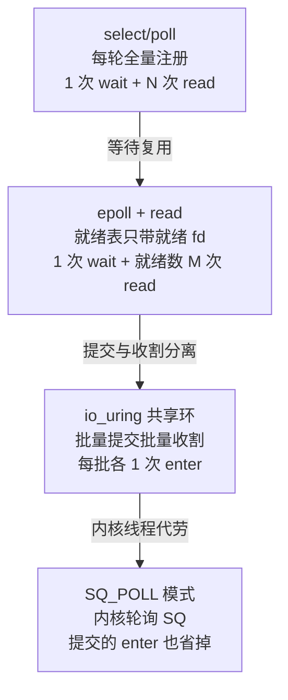
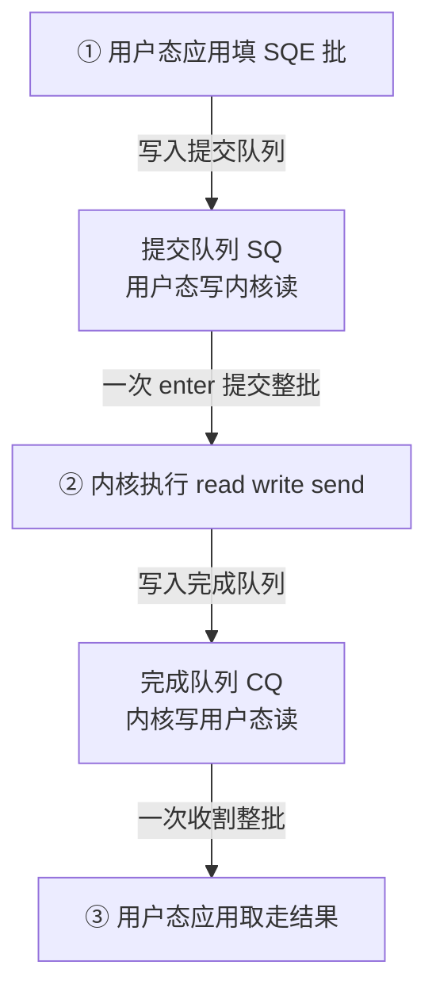

## 要解决的问题是什么

一次 read() 或 write() 要 CPU 从用户态（普通程序运行的低权限受限状态）切到内核态（内核代码运行的高权限状态）再切回来，**单次开销约 50-100ns，还要付模式切换的缓存污染**。select（最早的 IO 多路复用，有 1024 上限）/poll（无上限但每次要全量传的 IO 多路复用）/epoll（三种让一个线程同时等待多个连接的方式，epoll 是 Linux 上最常用的那种）**解决了"多 fd（文件描述符，程序里代表一个打开文件或连接的编号）同时等"的复用问题**，但**每次就绪后仍要逐个调用 read/write**，**高连接高频率场景 syscall（系统调用，程序请求内核帮忙做事）开销积少成多**。

问题的本质：**同步阻塞模型把"提交请求"与"等待完成"绑定在一次切换里，epoll 把等待复用了，提交与收割仍是每操作两次穿越**——**异步 IO 的目标就是把这两个动作也批量化，让一次切换提交一批、收割一批**。

读完这一篇，你能**判断自己的服务该不该换到 io_uring（Linux 的异步 I/O 接口：用一对共享环形队列批量提交与收割请求）**，以及它省下的究竟是哪一段开销。

io_uring 是 Linux 5.1 引入的一套异步 IO 接口，**名字里的"ring"指它在用户态和内核态之间共享的两个环形队列（提交队列和完成队列）**，像两条流水线：**应用往提交那条线上放活儿，内核从里面取走干完，再把结果放到完成那条线上，应用回头去取**——**全程几乎不用反复切换**。**这个比喻到"省的是切换不是计算"为止**：**流水线减少的是来回跑腿的次数，真正干活的时间一点没少**，如果活儿本身不密集，省下的那点开销看不出来。

## io_uring 到底省掉了哪一段开销

**要明白 io_uring 省在哪，先看传统做法的代价**。**一次 `read()` 就是从用户态跨到内核态再跨回来，来回这一趟正是它要省掉的东西**。

*图源：腾讯云开发者社区《图解原理 Linux I/O 神器之 io_uring》中共享环形队列一节，CC 4.0 BY-SA，https://cloud.tencent.cn/developer/article/2187655。*

*图源：Wikimedia Commons《Linux kernel interfaces》，作者 ScotXW，CC BY-SA 3.0，https://commons.wikimedia.org/wiki/File:Linux_kernel_interfaces.svg。图中间那条用户态与内核态的分界线，就是本篇的主角：每一代异步 IO 接口想省下的，都是跨这条线的次数与代价——下面这张阶梯表里，每一次收缩都发生在这条线上。*

**演进三阶段：复用等待 → 提交/收割分离 → 全异步**。select（1983，fd_set（select 用的描述符集合） 1024 上限）→ poll→ epoll解决了等待复用。但 epoll + read 模型里，**每次 IO 仍是"epoll_wait（等待事件就绪的 epoll 系统调用）一次 + 每就绪 fd 一次 read"，提交开销没省**。Linux AIO（libaio，2002 时代的 Linux 原生异步 IO 库）**尝试真异步但接口残废（只支持 O_DIRECT（绕过页缓存直接读写磁盘的打开标志），语义坑多），工业界用不成**。io_uring成建制解决：**提交队列（SQ）与完成队列（CQ）两个环形缓冲，用户态写 SQ、内核消费，内核写 CQ、用户态收割，两边各自批量，syscall 次数从 N 次降到接近每轮一次**。

同一次「N 个操作」在各代接口下的 syscall 次数逐级收缩，**阶梯每一级的约束对象都是 syscall 边界**：

**每一代省掉哪段 syscall：select 到 epoll 省等待侧的全量注册**，**epoll 到 io_uring 省提交与收割的逐次穿越**，**SQ_POLL 再省提交那次 enter，省下的开销就是各级之间的次数差**。

**SQ/CQ 环的本质：共享内存 + 内存序（规定多核读写操作可见与先后顺序的规则）**。**SQ 与 CQ 是用户态与内核共享的映射内存 mmap（把文件直接映射进内存地址空间，读写内存即读写文件）**，**生产者消费者各写各的尾指针**。**批量收割时 `io_uring_enter(IORING_ENTER_GETEVENTS)` 一次进出收全部就绪**；**SQ_POLL 模式甚至让内核线程轮询 SQ，用户态连 enter 都不用调**（代价是**内核线程常驻烧核**，**适合超高吞吐低延迟场景**）。**这个设计把 syscall 的边界从"每个操作"推到"每批操作"，开销摊薄到接近零**。

**链式请求（linked SQE）与操作谱**。**SQE 可链（IOSQE_IO_LINK）：send 后自动 recv、读后自动写，内核内完成依赖编排，免中间唤醒**。操作谱从 read/write 扩到 openat/stat/splice/sendmsg/timeout/取消，**把"文件操作 + 网络操作 + 定时"统一进一个异步模型**，**这是与 epoll 模型的本质差异——epoll 只管 socket 等待，io_uring 管整个 IO 生命周期**。

**供给决定收益**。**syscall 开销占比高的场景（小包高频、百万 IOPS（Input/Output Operations Per Second，每秒 IO 操作数）的 NVMe（Non-Volatile Memory Express，面向闪存的存储接口协议）、海量连接的 echo/proxy 类）收益最大**；**单次大块传输（大文件顺序读写）syscall 占比本就低，收益有限**。NVMe是面向闪存的高速存储接口协议，IOPS 可以到百万量级，**正是 syscall 开销被放大的场景**。**syscall 次数与 CPU 上下文切换（CPU 从一个任务换到另一个任务、保存并恢复现场的过程）次数（procfs 的 ctxt 项）是收益的直接观测面**。

## 这套接口付出了什么代价

**省的办法是把请求与结果都放进共享内存**。用户进程往里写要做什么，内核线程从同一块内存里取走去做，做完再把结果写回——**两边都不用跨态**。

*图源：腾讯云开发者社区《图解原理 Linux I/O 神器之 io_uring》中提交队列与完成队列关系一节，CC 4.0 BY-SA，https://cloud.tencent.cn/developer/article/2187655。*

异步 IO 的概念早于 Linux——**Windows IOCP（I/O Completion Port，Windows 的完成端口异步 I/O 模型） 1990s 就是完成端口模型**，FreeBSD kqueue（BSD/macOS 上与 epoll 同类的事件通知机制）出现在 2000 年前后，**Linux 社区长期缺一等公民方案**。Jens Axboe（块层维护者）2019 年的 io_uring 从块层 IO 加速需求出发，**一年内覆盖全 IO 子系统，成为 Linux 近十年最大的 syscall 级革新**。Google 的 FlexSC（2010 前后，系统调用批量化研究）与 SPDK（用户态轮询存储路径）是同一方向的两个先行坐标。

**把 syscall 从"操作粒度"改写成"批次粒度"**：**传统模型里 API 边界与操作边界重合（一次 read 一次切换）**，**io_uring 用共享内存环把两者解耦，API 边界退到批次尾（一次 enter 提交收割一整批）**。**syscall 开销从每操作 50-100ns 摊薄到每批几 ns**，**这跟 SIMD（Single Instruction Multiple Data，一条指令同时处理多个数据）把指令从标量改批量是同构的批发思路**。

**图的骨架是两个环四条边**：**提交侧用户态填 SQE、一次 enter 整批下推，收割侧内核写 CQE（Completion Queue Entry，io_uring 完成队列里的条目）、一次调用整批上收**。**syscall 的边界从「每个操作各穿一次」移到「每批各穿一次」，这就是摊薄的来源**；SQ_POLL 模式连提交那一次也省掉，代价是**内核线程常驻烧核**。

**io_uring 的安全与稳定性争议**——**共享内存环 + 内核消费的攻击面大**：**任意地址读写类 CVE（Common Vulnerabilities and Exposures，公开披露的安全漏洞编号），即公开披露的安全漏洞，逐年出现**，Google Project Zero 曾建议禁用，**容器/沙箱环境默认 seccomp（系统调用过滤机制）封锁 io_uring syscall**，Docker 2023 起默认 mask 它；**内存开销在于 SQ/CQ 环常驻、每连接多出环形缓冲**；**编程模型复杂：错误处理异步化、调试时调用栈变深，io_uring 上的 bug 释放时机在收割端**。**适用判定与零拷贝（数据不经用户态中转、由内核直接转发以省去复制）同款逻辑：syscall/切换开销占比可观才有账可算**。**多数业务服务是每秒几十到几千请求、大包为主，epoll + 同步读写的开销占比不足 1%**，**迁移收益不抵复杂度**。

## 这套说法在哪儿会失效

共享内存里是两条环形队列：请求从提交队列进，结果从完成队列出。**两条队列各有自己的头尾指针，一边只动头，一边只动尾，所以连锁都不需要**。

*图源：腾讯云开发者社区《图解原理 Linux I/O 神器之 io_uring》中内核轮询模式的流程图，CC 4.0 BY-SA，https://cloud.tencent.cn/developer/article/2187655。*

**提交队列本身是一块连续内存上的环**。**头尾指针在环上循环推进，写满就绕回开头**，**这也是它能批量提交、一次带走一批请求的原因**。

*图源：腾讯云开发者社区《图解原理 Linux I/O 神器之 io_uring》中提交队列环形结构一节，CC 4.0 BY-SA，https://cloud.tencent.cn/developer/article/2187655。*

内核这一侧的流程：从提交队列取出请求，执行完把结果放回完成队列。**轮询模式下连这一步都不等中断，取了就做**。

*图源：腾讯云开发者社区《图解原理 Linux I/O 神器之 io_uring》中共享内存环的全景示意图，CC 4.0 BY-SA，https://cloud.tencent.cn/developer/article/2187655。*

*图源：腾讯云开发者社区《图解原理 Linux I/O 神器之 io_uring》中系统调用（程序请求操作系统内核服务的入口）阶梯收展示意，CC 4.0 BY-SA，https://cloud.tencent.cn/developer/article/2187655。*

- **吞吐与延迟的目标场景分离**。**吞吐场景（代理、CDN（Content Delivery Network，内容分发网络：把内容提前放到离用户近的节点）的边缘、NVMe 存储）batch（批，一次同时送进 GPU 的多个请求）提交摊薄 syscall，收益明确**；**延迟敏感场景要小心 SQ_POLL 的常驻核与批内最长等待（batching 天然攒延迟，IOPOLL 模式还要独占）**。**延迟 P99（把所有请求响应时间从小到大排，第 99 百分位的值，99% 的请求比它快）敏感的服务先测再上**。
- **安全策略与沙箱封锁**。**seccomp/AppArmor 与主流容器运行时对 io_uring 默认封锁（攻击面考量），沙箱化部署（gVisor、部分 serverless）不可用**。**上生产前确认运行环境是否放行**。
- **不是 epoll 的全面替代**。**跨平台代码（BSD/macOS 用 kqueue）与存量 epoll 生态（Nginx（Web 服务器与反向代理，常做流量入口与负载均衡） 的 reuseport、Redis 的事件循环）迁移成本高**，**io_uring 的红利集中在 Linux-only 的新高性能组件（RocksDB 新版、QEMU、新型 proxy）**。混合方案：libuv 通过 `UV_USE_IO_URING` 渐进启用。
- **版本与特性门控**。**5.1 引入、5.10 后操作谱才齐（openat/stat/timeout），5.15+ 提供 buf ring 等新特性**；**目标内核版本决定可用面，写代码前按 `io_uring_register` 的特性探测分支**。

## 怎么自己动手验证

- **syscall 计数实验**：**同一 echo 服务（epoll+read/write 版 vs liburing 批量版），同连接压测**，`perf stat -e context-switches,syscalls:sys_enter_read` 对比。**预期：io_uring 版 syscall 计数塌降一两个量级，同吞吐 CPU 占用下降**。批量化收益的可复现证据。
- **批大小扫描实验**：**SQE 批大小从 1 扫到 256，测每操作均摊开销与延迟**。**预期：批越大均摊越低，延迟中位数缓升（攒批代价），交叉点给出该负载的最优批大小**。批量化权衡曲线的实测。
- **安全封锁验证**：**Docker（主流容器运行时）默认配置下跑 liburing 程序**。**预期：seccomp 拒绝 io_uring_enter（Operation not permitted），显式放行（seccomp 放行或不放行 io_uring 系统调用的配置项）后可用**。**部署环境约束的一手确认**。

## 接着读哪几篇：syscall 是执行边界上的税

- [[工程知识/性能工程：从用户等待到资源瓶颈/操作系统与运行时/进程线程与系统调用构成执行边界.md]] —— syscall 是执行边界上的税，io_uring 把税从操作粒度摊到批次粒度
- [[工程知识/性能工程：从用户等待到资源瓶颈/操作系统与运行时/零拷贝把数据通路的CPU让给业务.md]] —— 消拷贝与消切换是数据通路降本的两条轴，两篇互补
- [[工程知识/性能工程：从用户等待到资源瓶颈/存储与网络/Socket与TCP把连接可靠性分成多层.md]] —— socket 缓冲区与多路复用（一条连接上同时承载多个请求、互不阻塞）是 epoll 模型的底盘，io_uring 是它的批量化后继
