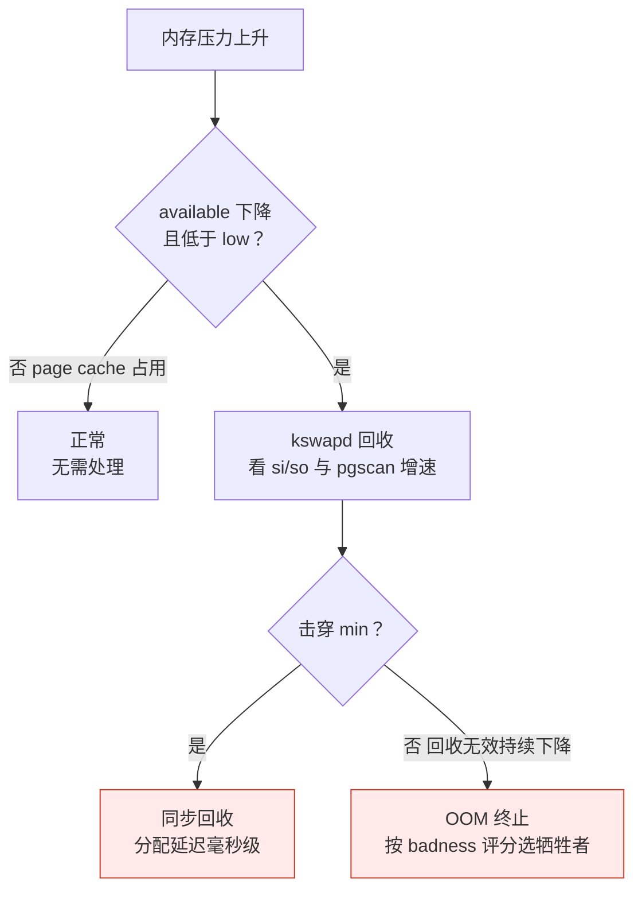

# 内存回收与OOM把内存压力变成延迟与终止的分配问题

**Linux 不让内存「用完」，它把内存压力翻译成两种后果：先变慢（回收与交换），后变死（OOM 终止）——两种后果之间隔着 watermark 与 oom_score，读懂翻译规则，性能事故与进程消失就都能归因。** 读完你能回答：空闲内存为什么越走越低是正常的、page cache 与工作集怎么抢内存、OOM killer 按什么顺序杀、容器内存限制在哪个层面生效。

## 要解决的问题

监控面板上内存用量只增不减，是故障还是正常？**答案取决于读的是哪个数字：`free` 的 free 列低是常态（内核把空闲内存拿去做了 page cache，文件缓存越多读越快），available 列才是真实余量。**真正的问题在 available 也持续下降时——**内存压力开始驱动回收：干净页直接丢弃，脏页写回，匿名页换出到 swap 或被压缩。压力再升级，分配延迟从微秒级涨到毫秒级，最后内核挑选牺牲者直接终止。内存压力的每一级都有可观测的指纹，读对数字才能分级响应。**

## 机制：watermark 三线与 OOM 的选择

### 三条水位线驱动回收

内核为每个内存区域维护三条 watermark（水位线，触发回收行为的阈值）：

```text
free < min      → 分配阻塞，内核同步回收（kswapd 追不上，直接回收）
free < low      → kswapd 后台回收启动（异步，不阻塞分配）
free < high     → 回收进行中，回到 high 以上停止
```

正常状态 free 在 low 与 high 之间波动。**分配延迟突变的第一怀疑对象是 min 水位被击穿——同步回收意味着分配路径里嵌入了 I/O（写回脏页、swap 出页），延迟从纳秒级跳到毫秒级，表现为「进程突然变慢但 CPU 不高」。**

### OOM killer 的选择：坏度评分

回收也挤不出内存时，内核按 `badness` 评分挑牺牲者：**大致正比于该进程的 RSS（常驻内存）÷ oom_score_adj**。`oom_score_adj`（-1000 到 1000）是**唯一的调节旋钮：-1000 永不选中（基础设施组件），+1000 最先选中**。容器里 cgroup 的 memory limit 触发的 OOM 是 cgroup 层的 OOM killer，只在组内选——**宿主机 OOM 与容器 OOM 是两个裁判，日志分别在 dmesg 与容器事件里。**

### 容器内存限制的三笔账

cgroup v2 的 memory.max 是硬顶，触顶时组内回收组内 OOM。**容器内存要算三笔：RSS（进程真实占用）+ page cache（读写文件产生的缓存，计入 cgroup）+ 内核内存（socket 缓冲等）。**Java/Go 等运行时的堆外内存、页缓存都算在容器头上，**limit 只按堆大小设必然 OOM——运行时要用 cgroup 感知模式（`-XX:+UseContainerSupport`、`GOMEMLIMIT`），预留堆外与缓存的份额。**



## 案例：静默的压力分级与泄漏的账本

[[工程知识/缺陷分析：从个案到体系/资源与容量/资源泄漏的三段式排查法：预筛确认与归因]] 给了「内存持续上涨」的排查闭环：预筛（区分泄漏与缓存）、确认（抓堆快照对比）、归因（定位持有者）。本篇提供它的底层依据：**上涨不一定是泄漏（page cache 本来就只增不减），泄漏的判定锚在「回收也拿不回来」——swap in/out 与 page cache 回收行为正是分界证据。**[[工程知识/后端系统：在并发、失败与变化中维持服务/基础设施/requests与limits各管一段：调度装箱、QoS判定与节点压力驱逐顺序]] 是本篇在编排层的镜像：**内核 watermark 驱动回收与 OOM，cgroup limit 驱动容器 OOM 与节点驱逐——同一份内存压力在两层各有一套翻译规则，两层都要读。**

## 怎么测

- **压力注入：用 `stress-ng --vm` 逐级逼近内存上限，记录 free 跌破 low 与 min 的时刻，对照 `/proc/vmstat` 的 pgscan/pgsteal 增速与分配延迟变化。**
- **OOM 演练：容器内构造超 limit 的分配，确认 cgroup OOM 事件、被选中的进程与 `memory.events` 的 oom_kill 计数。**
- **参数核对：`oom_score_adj` 对基础设施组件是否已设 -1000、关键服务是否设负值。**
- **交换行为核对：数据库类延迟敏感服务确认 `swappiness` 已调低或关闭 swap，验证换入换出不发生在服务内存上。**

## 哪些认识一看就错

- **「free 显示内存快没了」——free 低是 page cache 的常态，available 才是余量；按 free 报警是最常见的误报来源。**
- **「swap 关了就安全」——无 swap 时内存压力直接走回收→OOM 路径，连缓冲带都没有；延迟敏感服务关 swap 成立，通用服务保留少量 swap 更稳。**
- **「容器 limit 设成堆大小就行」——堆外内存、元空间、页缓存全算容器头上；limit 按运行时全量画像设，不是按堆设。**
- **「OOM 是随机的」——评分规则确定：大 RSS、高 adj 先被选中；「随机杀进程」的观感来自没读 dmesg 的 OOM 报告。**

## 效果从哪来、要付什么代价

**watermark 分级让压力响应按严重度递进（后台回收→同步回收→终止），oom_score_adj 让牺牲者选择可控，容器 limit 让组内故障不外溢。**代价是**持续的容量纪律：内存画像随版本与流量漂移**，limit 与运行时配置要跟着对账；**判读能力要落到监控（available、vmstat、memory.events 三个面板）——读错数字的告警比没有告警更贵。**

关系：[[工程知识/后端系统：在并发、失败与变化中维持服务/基础设施/requests与limits各管一段：调度装箱、QoS判定与节点压力驱逐顺序]] —— 编排层的内存压力翻译：驱逐顺序与 QoS。[[工程知识/缺陷分析：从个案到体系/资源与容量/资源泄漏的三段式排查法：预筛确认与归因]] —— 内存上涨的排查闭环，本篇提供底层判据。[[工程知识/性能工程：从用户等待到资源瓶颈/操作系统与运行时/页缓存是内核替你管的第一层缓存：读写路径、预读与O_DIRECT的取舍]] —— page cache 的读写路径细节，内存压力的最大占用者。
