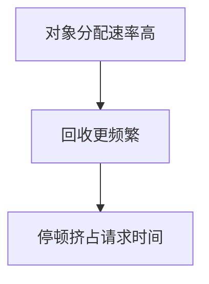
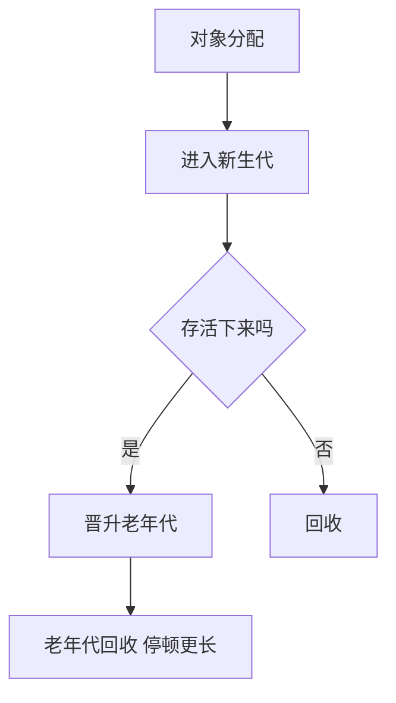
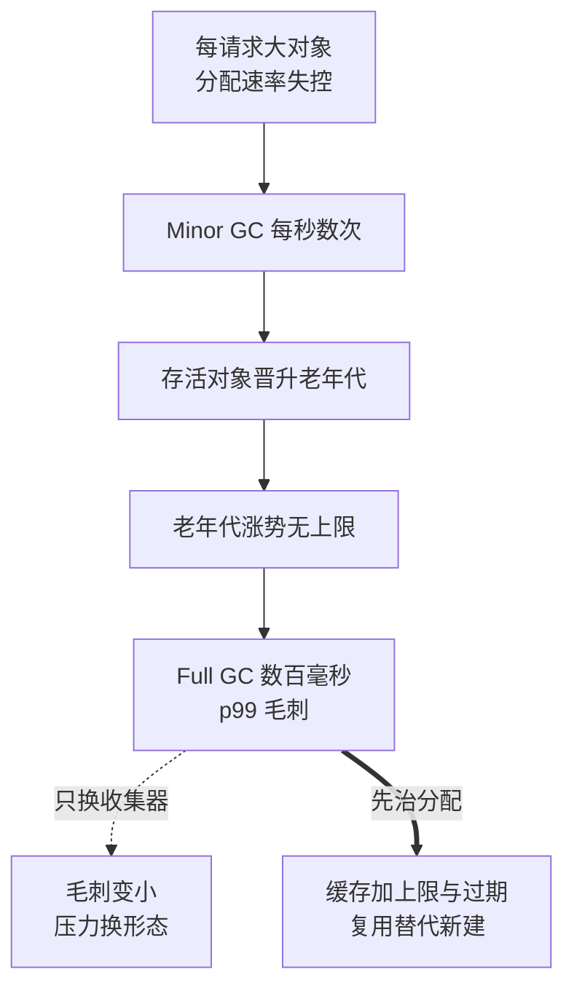

# 垃圾回收与内存分配决定延迟尾部

**平均延迟正常，p99 却因分配尖峰、暂停或内存压力失控**——这类尾部问题几乎都出在分配与回收上。读完这篇你能用固定负载和内存压测定出尾部的真正来源。

**核心机制是分配速率和存活集驱动回收与扫描，运行时再与堆上限、cgroup（Linux 的控制组机制，给一组进程划定 CPU、内存等资源上限）和调度竞争**；收益是**自动回收和更高开发效率**，代价是**暂停、CPU、内存和不可预测尾部**。用固定负载测 p50/p99、分配率、GC（垃圾回收，运行时自动回收不再被引用的内存）、RSS（常驻内存集，进程实际占用的物理内存大小）和 page fault，并注入内存压力验证。

自动内存管理用运行时追踪对象、回收不可达空间并在必要时压缩/整理；手动管理则把释放责任交给代码。**两者都可能因分配速率、对象存活、碎片（存储空间里零散不连续的小块）、锁、页错误和回收暂停影响 p99**，而不只是平均 CPU。

**平均请求可能没有变化，但突发分配、长存活对象或 cgroup 回收会把少数请求推入 GC、缺页或 OOM（内存耗尽，进程被系统终止）路径，形成尾部延迟**。优化目标是"**在目标内存上限下让暂停、吞吐和回收进度可预测**"，**GC 次数本身只是输入变量**，单独压次数会牺牲吞吐换暂停，账要一起算。

## 要解决的问题：分配速率与存活集合怎样决定扫描成本



分配速率决定延迟尾部：


服务在压力下出现延迟尾部上翘，平均延迟正常但分位数（把耗时排序后取某个百分比位置的值、如 P99）据恶化，堆内存与暂停时间的曲线在对不上预期的位置发生跳变。本篇回答：分配速率与存活集合怎样决定扫描成本、暂停时间在端到端预算里占多少、对象可回收与内存归还之间的差别在哪里，以及回收器选型的依据是什么。

## 最小 GC 实验怎么做

固定堆/容器上限、并发和输入大小，比较短命对象突发、长存活对象和对象复用三种负载；记录分配率、live set、暂停分位数、GC CPU、RSS、page fault、p99 和错误。再注入内存压力与取消，确认释放路径不会把回收收益转成泄漏或 OOM。


来源：[小林coding《揭开 Buffer Pool 的面纱》](https://www.xiaolincoding.com/mysql/buffer_pool/buffer_pool.html)


## 观察对象

- allocation rate、对象大小和短命/长命比例；
- heap/live set、GC 次数、暂停/并发阶段和回收效率；
- 堆外内存、线程栈、缓存、映射、碎片和 cgroup limit；
- 请求生命周期中是否保留了不必要的对象或上下文。

减少分配、对象复用和增大堆可能降低某一项开销，也可能增加扫描、内存占用和 OOM 风险。GC 参数必须结合 SLO（服务等级目标，服务对可用性或延迟作出的量化承诺）负载和运行时版本调整，不能复制课程默认值。

## 真实案例里发生了什么：分配速率与 fd 的同构教训

GC 尾延迟（P99 一类的慢请求耗时指标）的治理与 [[工程知识/性能工程：从用户等待到资源瓶颈/操作系统与运行时/fd 泄漏先用 lsof 对账：每类套接字都有名有姓才算干净]] 的 fd 对账同构：**都是"资源生命周期没有显式所有者"的病**——GC 语言里对象何时可回收不显式，**分配速率失控（每请求大对象、缓存无界增长）时 GC 压力先于内存告警现形**；fd 泄漏是票据发出去没人还。两者的监控姿势也同构：**GC 看 pause 时间分布与分配速率趋势，fd 看数量趋势，"该回落不回落"都是确诊信号**。

## 这些量在什么数量级：暂停预算的分配

延迟尾部的预算账：P99（把所有请求响应时间从小到大排，第 99 百分位的值，99% 的请求比它快）.9 要求 100ms 的服务，**单次 GC 暂停必须 < 10ms**（GC 只能占错误预算的一小份，还有网络、锁、调度排队）。**分代收集的 Young GC 暂停与新生代大小成正比**（256MB 新生代典型暂停 5-20ms），堆 8GB 以上 Young GC 频繁时**暂停预算先爆**；并发标记类收集器 G1/ZGC（低延迟垃圾回收器，停顿毫秒级以内）把主暂停压到毫秒级，代价是**吞吐税 5-15% 与更复杂的调参**。**选型按暂停预算表上剩余的份额定**，收集器的先进程度只决定它能不能进这张表。


*图示：标记-清除式垃圾回收的执行过程。图源：Wikimedia Commons「Animation of the Naive Mark and Sweep Garbage Collector Algorithm」，作者 M17，许可 CC0（公有领域）。*

## 怎么自己动手验证



**延迟尾部的形状由回收发生在哪一代决定**：JVM（Java 虚拟机，Java 程序的运行时）堆按分代假说划成新生代（Eden 加两块 Survivor，8:1:1）与老年代（约 2/3 堆），**新对象在 Eden 分配，熬过多次 Minor GC 的对象晋升老年代——回收发生在哪一代，暂停量级就落在哪一档**：


分代假说的量化后果在 Oracle 官方曲线里直观看得到：**GC 开销占比 1%-3% 时，加处理器几乎不损吞吐**；**占比到 10% 以后，处理器越多吞吐掉得越快，30% 开销加到 30 核时吞吐趋近于零**——**GC 停顿是全员到场式的，核越多集合越大，回收反而更贵**：


*图源：[Oracle Java 17 GC Tuning Guide](https://docs.oracle.com/en/java/javase/17/gctuning/introduction-garbage-collection-tuning.html)，官方文档图，文档引用。*

*图源：阿里云开发者社区《【JVM虚拟机】堆内存分代模型：年轻代(Eden+Survivor)、老年代、元空间Metaspace》（https://developer.aliyun.com/article/1737214，转载见原页版权声明）。分代结构、比例与晋升规则一张图收拢，本段的「回收发生在哪一代决定暂停量级」对应图中「三、老年代」与「六、常见分代垃圾收集器」两枝。*


分配率要与暂停时间对账——**预写加大对象分配后 GC 暂停应随之上升，实测分配率翻倍而 p99 不动，与预期对不上，说明该负载受限于别处**。

固定堆/容器限制、并发、输入大小和预热（提前加载或执行，让系统进入稳定状态），比较**分配率、GC、RSS、page fault、p50/p99、吞吐和错误**；注入突发流量、长任务、内存压力、节点驱逐（按策略移除条目或实例）和取消，**验证资源最终释放**。

关系：[[工程知识/性能工程：从用户等待到资源瓶颈/操作系统与运行时/虚拟内存与文件系统把地址和持久化分层]] · [[工程知识/性能工程：从用户等待到资源瓶颈/观测与诊断/性能问题定位]]

## 动手跑一遍会看到什么：GC 停顿的账

```text
分代假说的应用账（以 JVM 为例，通用机制）：
对象绝大多数生命周期极短 → 新生代频繁 Minor GC
  活得久的进老年代 → Major/Full GC

延迟毛刺的来源链：
  P99 毛刺 200ms → GC 日志对时间戳 → Full GC 恰好同刻
  → 查老年代涨势 → 缓存对象无上限（软引用当缓存用）
  → 修复：缓存加容量上限与过期 → Full GC 频率从小时级降到天级

分配速率的账：
  每秒分配 2GB（每请求新建大对象）→ Minor GC 每秒数次
  对象复用/池化后 200MB/s → Minor GC 频率降一个量级
  → 分配速率是 GC 压力的先行指标，监控先看它再看停顿
```

[[工程知识/缺陷分析：从个案到体系/稳定性/案例一：垃圾回收线程的终止——BookKeeper 磁盘写满.md]] 是 GC 与外部资源耦合的实录形态——磁盘写满让 GC 日志写出阻塞，GC 线程卡死，整个进程无响应：**GC 的健康不只在停顿长短，还在它依赖的每一份外部资源（日志盘、元数据）是否可用**；[[工程知识/性能工程：从用户等待到资源瓶颈/处理器与内存/CPU缓存与分支决定有效执行时间.md]] 的伪共享是分配布局层的同族问题（两线程踩同一缓存行，GC 之外的延迟来源）。调优的边界实录：参数换收集器CMS（Concurrent Mark Sweep，老年代并发垃圾回收器） 换 G1降低的是毛刺（延迟曲线上偶发的短时尖峰）幅度，**分配速率不降则压力只是换了形态——先治分配，再谈收集器**。



**分配速率如何变成 p99 毛刺：分配失控先推高 Minor GC 频率（先行指标，先于停顿出现），存活对象晋升把老年代顶上去，Full GC 的数百毫秒才在分位数据现形**。两条出路摆在末端：**只换收集器毛刺变小但压力换形态；先治分配（缓存上限与过期、复用替代新建）才动到根因**。监控顺序同理：**先看分配速率趋势，再看停顿分布**。

## 这套说法在哪儿会失效

- **减少分配与增大堆互为代价**：降低分配率能减少回收次数，堆增大则单次扫描与暂停的绝对时间上升。
- **暂停预算在多处共享**：端到端延迟里 GC 暂停只占一份，网络、锁与调度排队同样占用，给 GC 的份额要按剩余预算分配。
- **回收器选型受运行时与负载形态约束**：并发回收器把暂停压低的同时带来吞吐损失，短命对象密集的服务与长存活对象多的服务适用不同的回收器。
- 对象可回收不等于**内存立即归还：回收只保证堆内空间可复用**，堆外内存、线程栈与映射文件不随回收释放。
- **分配速率本身是症状来源**：无界的缓存与每请求的大对象让 GC 压力先于内存告警出现，调整参数不解决这类增长。

