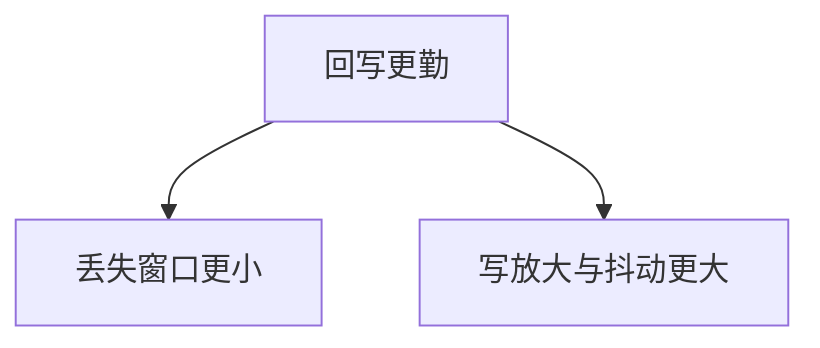
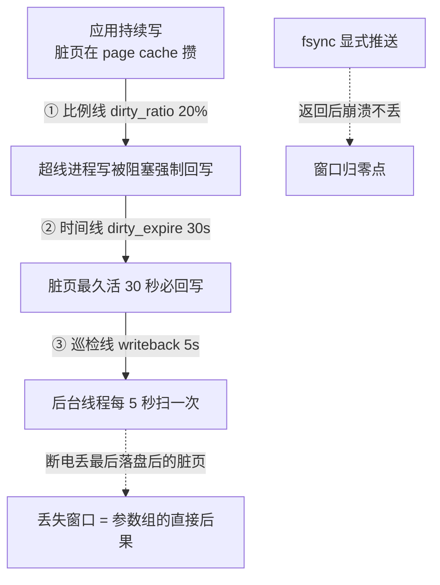

# 脏页回写在性能与崩溃丢失窗口间权衡

**写文件 `write(2)` 返回成功不代表数据在盘上，只代表进了页缓存（page cache，内核把磁盘内容缓存在内存里的机制）**。要解决的问题：**什么时候把这些脏页（已修改未写入磁盘的缓存页）真正写回磁盘，这个决策同时决定写吞吐与断电丢失多少数据，两个目标方向相反**。

## 脏页回写在什么条件下触发，参数怎么定



回写策略是在两者之间取舍，对照见下图：


**脏页的回写发生在内存与持久化介质的分层之间：页面在内存中被修改后标记为脏，需要按触发条件写回底层存储**。**这个分层的存在，正是"崩溃会丢失多久的写入"这个问题的来源**。


*虚拟地址到物理地址的翻译：虚拟页号作页表（虚拟地址到物理地址的映射表）下标查到物理页号，页内偏移原样保留（图源：CSDN 博客）*

*图示：内存与磁盘的分层。回写的时机决定了**崩溃时的丢失窗口有多大**。*

回写由后台线程（writeback 线程）按三条触发线执行，见下图：

| 触发线 | 默认参数 | 含义 |
| --- | --- | --- |
| 脏页比例 | vm.dirty_ratio（20） | 脏页占内存超 20%，进程写被阻塞强制回写 |
| 时间上限 | vm.dirty_expire_centisecs（3000，即 30 秒） | 脏页最长停留 30 秒后必回写 |
| 周期扫描 | vm.dirty_writeback_centisecs（500，5 秒） | 后台线程每 5 秒醒来巡检 |

**参数组之外还有一个更底层的变量：磁盘自身的写缓存。写请求从总线接口进来后先停留在盘载缓存（下图黄色块），由缓存再写入存储介质——这块缓存通常是易失的，断电即丢失**。**fsync（强制把操作系统缓存里的数据写到磁盘的调用） 要把数据推到的"盘上"，指的正是穿过这层缓存到达非易失介质；`hdparm -W` 查到的写缓存开关、数据库文档里"禁用磁盘写缓存"的建议，说的都是这个环节**：


*图源：Wikimedia Commons《Disk buffer fused with write cache》，CC BY-SA 4.0，https://commons.wikimedia.org/wiki/File:Disk_buffer_fused_with_write_cache.png。*

**权衡的三种典型调法：数据库与消息队列（生产者写入、消费者读取的缓冲中间层）这类自己管理写入的软件倾向 `dirty_ratio` 调小、缩短窗口（它们自己 fsync，内核回写越少干预越好）；大文件批处理（把多个请求合并成一批同时计算、提高硬件利用率）倾向调大窗口攒顺序写（吞吐优先，接受更大丢失窗口）；默认值是两端的折中**。**收益与代价的换算关系：窗口越大写吞吐越高（攒出大块顺序 IO），但断电时丢掉的最近写入越多——这个矛盾调不掉，只能按业务能承受的丢失量选一个位置**。



**三条触发线各管一个维度：比例线管「脏多少必须动手」（超线的代价是写进程被阻塞），时间线管「最久允许拖多久」，巡检线是后台线程的巡逻节奏**。**虚线指向的丢失窗口是这套机制的真实含义——断电那一刻，最后一次落盘之后的所有脏页都丢，窗口大小就是参数组的直接后果；fsync 是应用把窗口手动归零的动作，数据库的 WAL（Write-Ahead Log，预写日志：改动先记进日志再改数据，崩溃后靠日志重放恢复）靠它把关键路径的丢失窗口压到一笔写入**。

**fsync 的角色：应用层强制把指定文件的脏页与元数据推到盘上，是数据库 WAL可靠性的基石。fsync 成功返回后，崩溃不丢该数据；代价是绕开页缓存优化、每次都真实写入磁盘，IOPS（每秒读写次数）数量级下降**。**什么场景必须 fsync：数据丢失不可接受的写入（事务日志、元数据变更）；什么场景可以不 fsync：可重新生成的数据（缓存、临时文件、可重算的中间产物）**。


来源：[腾讯云开发者社区《一篇文章讲透MySQL为什么要用B+树实现索引》](https://cloud.tencent.com/developer/article/1543335)（CC 4.0 BY-SA）


## 怎么自己动手验证

```bash
# 观察脏页水位与回写速率
grep -E 'Dirty|Writeback' /proc/meminfo
# 攒脏页观察回写行为（写 4GB 不 fsync）
dd if=/dev/zero of=/tmp/bigfile bs=1M count=4096 &
watch -n1 'grep -E "Dirty|Writeback" /proc/meminfo'
# 对比 fsync 成本：攒批 fsync 与每块 fsync
python3 -c "
import os, time
f = open('/tmp/fsynctest', 'wb')
t0 = time.time()
for i in range(1000): f.write(b'x' * 4096); os.fsync(f.fileno())
print('per-block fsync:', time.time() - t0)"
```
**预期：只写不 fsync 时 Dirty 快速上升、按回写参数回落；每块 fsync 的耗时比攒批（把多个小操作攒成一批一次处理）高一到两个数量级**。**数字对不上时先确认盘是不是带易失写缓存的（`hdparm -W` 查看写缓存状态），硬件层缓存会让 fsync 的保证打折**。内核文档 watermark 与 vm.txt 是这些参数语义的权威来源。

## 这套说法在哪儿会失效

本篇讲 OS 页缓存层的回写决策。文件系统在崩溃时的元数据一致性（journal、copy-on-write 两类方案）见 [[工程知识/数据系统：在并发与故障中保存事实/事务与存储/崩溃一致性给文件系统补上POSIX未定义部分|崩溃一致性给文件系统补上POSIX未定义部分]]，该篇讲的是 fsync 之上的应用层事务问题。存储介质层的写入代价（SSD，即固态硬盘，先擦后写）见 [[工程知识/性能工程：从用户等待到资源瓶颈/存储与网络/SSD的写放大来自介质要先擦后写|SSD的写放大来自介质要先擦后写]]。页缓存与虚拟内存（给每个进程独立地址空间、按需映射物理内存）的分层关系见 [[工程知识/性能工程：从用户等待到资源瓶颈/操作系统与运行时/虚拟内存与文件系统把地址和持久化分层|虚拟内存与文件系统把地址和持久化分层]]。IO 队列与持久化语义见 [[工程知识/性能工程：从用户等待到资源瓶颈/存储与网络/存储IO性能取决于访问模式、队列与持久化语义|存储IO性能取决于访问模式、队列与持久化语义]]。数据库怎么在 fsync 之上组事务，见 [[工程知识/数据系统：在并发与故障中保存事实/可靠性与运维/InnoDB用日志连接事务、恢复与复制|InnoDB用日志连接事务、恢复与复制]]。

## 接着读哪几篇：页缓存的分层位置

- [[工程知识/性能工程：从用户等待到资源瓶颈/操作系统与运行时/cgroups把机器切成可调度的资源单元|cgroups把机器切成可调度的资源单元]]——回写速率与配额相互作用：cgroup（Linux 的资源限制机制，把进程分组并限制 CPU/内存上限） 的 blkio 限制会反过来约束回写带宽
- [[工程知识/性能工程：从用户等待到资源瓶颈/操作系统与运行时/虚拟内存与文件系统把地址和持久化分层|虚拟内存与文件系统把地址和持久化分层]]——页缓存的分层位置
- [[工程知识/性能工程：从用户等待到资源瓶颈/存储与网络/存储IO性能取决于访问模式、队列与持久化语义|存储IO性能取决于访问模式、队列与持久化语义]]——回写写入磁盘的队列视角
- [[工程知识/数据系统：在并发与故障中保存事实/事务与存储/崩溃一致性给文件系统补上POSIX未定义部分|崩溃一致性给文件系统补上POSIX未定义部分]]——同一枚硬币的另一半
- [[工程知识/后端系统：在并发、失败与变化中维持服务/分布式可靠性/电源与时钟：UTC与单调钟的工程含义.md]] —— 电源故障与存储一致性的另一投影
