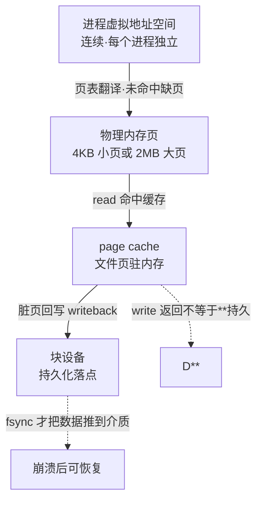

# 虚拟内存与文件系统把地址和持久化分层

它解决的是**应用地址、物理内存、文件缓存和持久化被混为一谈，导致错误的容量和崩溃恢复判断**。核心机制是**页表（虚拟地址到物理地址的映射表）、page cache、脏页回写和 fsync（强制把内核缓冲刷入磁盘的系统调用）分别管理映射、缓存与耐久性**；收益是**隔离和吞吐**，代价是**缺页（进程访问的页不在物理内存里，要先停下来等内核把页搬进来）、回写尖峰和复杂恢复语义**。用冷/热缓存、磁盘满、重启和断电模拟验证可见性与恢复。

进程看到的是**虚拟地址空间**，内核通过**页表把它映射到物理页、文件映射或共享页**。文件系统把文件名映射到 inode（文件索引节点：文件在磁盘上的身份档案，记着权限、位置与时间戳）、块和缓存；`write` 返回只说明**数据进入内核路径**，不等于**已经持久化到设备**。

这三者的概念分层，小林 coding 的中文图一眼可辨：进程活在虚拟内存里，虚拟内存靠页表落到物理内存上——本篇后面所有的机制（缺页、回写、fsync）都发生在「虚拟内存以下」的那两层：


*图源：[小林 coding《图解系统：内存管理》](https://www.xiaolincoding.com/os/3_memory/vmem.html)，原创图注明出处转载。*

分页翻译的分工画出来是三层各管一段：用户态（普通程序运行的低权限受限状态）进程只看见自己的虚拟页，CPU 持有进程私有的页表做地址翻译，内核为每个进程核对页表元数据并把暂换出的页放回 RAM 与磁盘：


*三个进程各自的地址翻译链（图源：Wikimedia Commons，FranchuFranchu 绘，CC0；另见 [Wikipedia「Virtual memory」条目](https://zh.wikipedia.org/wiki/%E8%99%9A%E6%8B%9F%E5%86%85%E5%AD%98) Ehamberg 绘的同主题图，CC BY-SA 3.0）*

左边连续、右边离散再加底部磁盘，就是「地址的连续性来自翻译层而不是**物理」这件事的形态**；右侧那两块存储对应下面最常见的误判——数据被换出或还没落盘，进程却以为已经写完了。

## 要解决的问题

虚拟内存这块要理清的，是几件事之间的从属关系：虚拟内存、分段、分页、段页式，再到 Linux 的实际做法。


*图源：腾讯云开发者社区《30 张图揭开「内存管理」的迷雾，瞬间豁然开朗》，CC 4.0 BY-SA，https://cloud.tencent.com/developer/article/2671629。*

**应用看到的地址、物理内存、文件缓存与持久化存储被混为一谈，容量评估与崩溃恢复的结论因此与实际情况不符**。本篇回答：**页表、文件缓存、脏页回写与持久化刷写各自管理什么、写入之后数据在什么条件下才算持久、缺页与回写尖峰为什么会出现在延迟曲线上**，以及验证可见性与恢复要构造哪些场景。



四层从上到下各管一件事：**虚拟地址管「应用看到的连续性」，物理页与页表管「翻译与缺页代价」，page cache 管「读写的快与慢」，块设备加 fsync 管「写完之后算不算数」**。上面那条实线链是数据流，下面两条虚线是**两处最容易误判的地方**——`write` 返回只说明到了缓存层，`fsync` 返回才是持久化边界。**缺页与回写尖峰正是这两层衔接处的代价**。

## 性能与正确性各由哪一层决定

地址转换这件事由三方分担：**CPU 只产出虚拟地址，MMU（内存管理单元，把虚拟地址翻译成物理地址的硬件）负责换成物理地址，物理内存只认物理地址**。


*图源：同上（腾讯云开发者社区《30 张图揭开「内存管理」的迷雾》系列）。*


- **page fault、TLB miss（TLB 即地址翻译快表：CPU 里缓存虚拟地址到物理地址的小表）、内存回收和 swap 会把 CPU 计算变成等待**。
- **page cache 让文件读写看似很快，但脏页回写和 `fsync` 会产生延迟尖刺**。
- `mmap`（把文件直接映射进进程地址空间，读写文件像读写内存）**共享地址空间和文件页，减少拷贝但引入缺页、截断、并发和错误处理边界**。
- `fsync`、目录同步、文件系统和设备缓存**共同决定崩溃后哪些写入可见**；**应用不能只看返回码**。

## 常见错误

分段那套映射关系看这张最直观：代码、数据、堆、栈四个段各占一段，每段有自己的段基址与段界限，物理地址就是段基址加段内偏移，偏移越过段界限就是越界。


*图源：同上（腾讯云开发者社区《30 张图揭开「内存管理」的迷雾》系列）。*


**把 RSS（resident set size，进程实际占住的物理内存量）当作「真实使用内存」、把 page cache 当作泄漏、把 `close` 当作持久化、把磁盘写入吞吐当作 fsync 延迟，都会导致错误容量和恢复判断**。这四条不是比喻能覆盖的，**每条都要按下面各自的机制段落单独看**。

## 最小映射实验怎么做

对同一文件分别使用 buffered I/O、`mmap` 和 direct/sync 写入，先测冷缓存再测热缓存，并在**写入返回后模拟进程崩溃或重启**。**比较 page fault、dirty/writeback、fsync 延迟、可见数据和恢复结果**，明确**每种路径提供的是缓存性能还是持久性保证**。

## 动手跑一遍会看到什么：一次缺页的完整旅程

用 `/proc` 的缺页计数器看虚拟内存的真实动作，按下面的字段读：

```bash
grep -E "min_flt|maj_flt" /proc/self/status
# 次缺页（min_flt）：页在内存，只补页表——微秒级
# 主缺页（maj_flt）：数据在磁盘，要发起 IO——毫秒级，差三个数量级

# 观察一次顺序读的缺页过程
dd if=/path/to/bigfile of=/dev/null bs=1M count=100
# 回收页缓存后再读（测试机专用，生产禁用）：echo 3 > /proc/sys/vm/drop_caches
```

mmap（把文件直接映射进内存地址空间，读写内存即读写文件） 与 read 的分野在同一台机器上可复现：**mmap 随机读命中页缓存（内核把磁盘数据缓存在内存里、减少重复读盘）时省去拷贝（次缺页代价），未命中时每个缺页一次 IO（主缺页代价）；read 系统调用（程序请求内核提供服务的入口）批量预读（默认 128KB），顺序场景反而更稳**。**差异的根源就是"地址空间"与"文件缓存"合流的那个页**。

## 这些量在什么数量级：页大小与 TLB

查表不是白查的。虚拟地址先拆成段选择因子与段内偏移，再用段号去段表里取段描述符——里面有段基地址、段界限和特权级 DPL（descriptor privilege level，描述符里标注的访问权限等级），越界或权限不够都会被挡下来。


*图源：同上（腾讯云开发者社区《30 张图揭开「内存管理」的迷雾》系列）。*

x86-64 默认 4KB 页，**1GB 数据 = 26 万个页表项；2MB 大页把条目压到 512 个**，TLB 命中率（请求直接从缓存拿到结果的比例）敏感的负载（大内存随机访问）**用大页可省 10-30% 的访问时间**。代价是**分配与回收的粒度变粗——数据库类常驻进程开透明大页**（THP）**反而引入延迟毛刺**（khugepaged 的整理停顿），**禁用 THP（Transparent Huge Pages，透明大页：内核自动合并成 2MB 大页） 是数据库部署清单的常规项**，`/sys/kernel/mm/transparent_hugepage/enabled` 一查便知。

## 怎么自己动手验证

分层结论要与冷热对照对账——**预写首次访问应出现主缺页、二次访问命中缓存，实测页错误数与预期对不上就说明换入换出发生在别的层**。

观察 **minor/major faults、RSS/匿名页/缓存页、dirty/writeback、IO wait、fd 和文件系统队列**；分别测试**冷/热缓存、随机/顺序、同步/异步写、磁盘满、重启和断电模拟**。**数据库和 RAG（检索增强生成：先从资料库里找出相关片段，再让模型照着这些片段回答）索引的持久化、快照（某一时刻的完整只读副本）和恢复必须基于这些语义**。

关系：[[工程知识/性能工程：从用户等待到资源瓶颈/存储与网络/存储IO性能取决于访问模式、队列与持久化语义]] · [[工程知识/数据系统：在并发与故障中保存事实/可靠性与运维/备份恢复是可验证的时间边界]]

## 接着读哪几篇：大页是页表粒度的配置维度

- [[工程知识/性能工程：从用户等待到资源瓶颈/操作系统与运行时/零拷贝把数据通路的CPU让给业务|零拷贝把数据通路的CPU让给业务]]——讲 sendfile/mmap 一系如何消掉通路上的重复搬运，是页缓存角色的下游
- [[工程知识/性能工程：从用户等待到资源瓶颈/处理器与内存/大页与TLB：地址翻译的隐藏成本.md]] —— 大页是页表粒度的配置维度，翻译成本在这里专门展开
