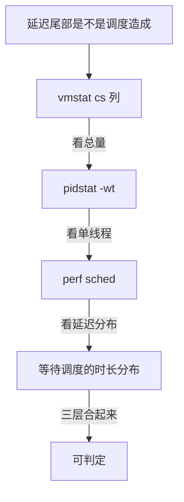

# 进程线程与系统调用构成执行边界

进程是**地址空间、文件描述符（进程打开文件的编号句柄）、凭据和资源限制**的隔离单位；线程共享进程资源，但**拥有自己的调用栈、寄存器和调度状态**；系统调用（程序请求操作系统内核服务的入口）是用户态（普通程序运行的低权限受限状态）请求内核执行文件、网络、内存、进程和时间操作的边界。理解这三者，才能解释**后台任务、容器、超时、信号和资源清理**。读完你能解释一次后台任务的超时、信号和资源清理发生在哪个边界上。

## 要解决的问题：隔离单位各自包含哪些资源

进程看到的那片连续地址，底下是分段的：代码、数据、堆、栈各占一段，各有各的基址与界限。


*图源：腾讯云开发者社区《30 张图揭开「内存管理」的迷雾，瞬间豁然开朗》，CC 4.0 BY-SA，https://cloud.tencent.com/developer/article/2671629。*

**后台任务在会话结束后消失、容器的资源限制没有生效、超时之后子进程仍在运行、描述符耗尽但看不出是谁持有的**，这些现象都涉及执行与资源之间的边界。本篇回答：**隔离单位各自包含哪些资源、线程与进程在共享与独占上差在哪里、系统调用承担什么职责**，以及定位这类问题要看哪些记录。

## 它是怎么做到的，本质是什么

进程每次访存都要过一遍地址转换：**CPU 产出虚拟地址，MMU（内存管理单元，把虚拟地址翻译成物理地址的硬件）查表换成物理地址，物理内存只认后者**。这一趟是**每条访存指令都要走的**。


*图源：同上（腾讯云开发者社区《30 张图揭开「内存管理」的迷雾》系列）。*

**进程提供地址空间、描述符表、凭据与资源限制四类隔离单位，线程在同一地址空间内共享这些资源而各自持有调用栈与调度状态，系统调用是用户态请求内核代办文件、网络、内存、进程与时间操作的入口**。三者划定了执行与资源之间的边界，**后台任务的存活范围、容器的隔离范围、超时的作用位置与资源清理的责任归属都由这条边界决定**。

## 一个进程的生命周期怎么走

好比一名员工的完整周期：**办入职领工牌和工位**（fork/clone 继承资源）、**转岗换岗**（exec 替换地址空间）、**在职与请假各种状态**（run/blocked/stopped）、**办离职**（exit）、**人事归档才算结束**（wait/reap 收尸）。比喻到「离职要人事归档」为止——归档没做完就是僵尸进程（**已退出但父进程未回收、进程表残留的空壳**）。

```text
fork/clone -> 继承或共享资源 -> exec 替换地址空间
           -> run/blocked/stopped -> exit -> wait/reap
```

上面那行文本链里的状态不是线性推进的，各状态之间有明确的转换条件，并且分处内存与交换空间两个区域：


*进程状态转换：创建、就绪、运行、阻塞、终止之间的路径，等待与运行互相转换，终止后由父进程回收（图源：CSDN 博客）*

*图示：进程状态及其之间的迁移条件。图源：Wikimedia Commons《Process states.svg》，作者 No machine-readable author provided. A3r0 assumed (based on copyright claims).，Public domain，https://commons.wikimedia.org/wiki/File:Process_states.svg。*
来源：Wikipedia「Process state」条目（Public domain）。图上虚线分区说明一件常被忽略的事：Waiting 与 Blocked 都可能被换出到交换空间，这时候进程还在但因内存不足而没有被装载——「进程还在但不占内存」正是这张图比文本链多出来的信息。

父子进程、进程组、会话和信号决定**终端断开、超时取消、子进程清理和僵尸进程行为**。`kill` 发送信号不等于**进程立即停止**；优雅终止需要**处理信号、关闭连接、保存状态和等待子进程**。

## 进程的资源边界在哪里

文件描述符指向**打开文件描述（偏移和状态可共享）**，不是「文件名计数」；管道、socket、epoll（Linux 的多路复用接口，一个线程盯住成千上万个连接）、共享内存和锁**拥有不同阻塞/关闭语义**。线程共享堆和 fd，数据竞争（多个执行流同时读写同一数据且无同步，结果随时间顺序变化）与一处未关闭资源**会影响整个进程**。

## 这些量在什么数量级：切换成本的数量级

好比工厂里工人来回换工位：**起身走过去只要几秒**（直接成本），但到了新工位发现工具和图纸都不在手边，要重新熟悉半天（缓存与 TLB（Translation Lookaside Buffer，地址翻译缓存：把虚拟地址到物理地址的翻译结果缓存起来） 污染的间接成本），**后者才是真正的时间黑洞**。上下文切换（CPU 从一个任务换到另一个任务、保存并恢复现场的过程）的**直接成本（寄存器与页表切换）约 1-5 微秒，间接成本（缓存与 TLB 污染）可达 10-50 微秒**——高并发服务每秒百万次切换时，**仅切换就吃掉 10-50% 的 CPU**。**协程（用户态调度的轻量执行单元）的价值就是把切换压回 0.1-0.2 微秒**（用户态无页表切换）；系统调用的成本（模式切换）约 0.1-1 微秒，批量化手段（io_uring（Linux 的高性能异步 IO 接口，用两个共享环在用户态与内核间递请求收结果），把多次提交合并、writev 合并写）**在 syscall 密集负载下可省 30% 以上**。**数字的用法是定数量级，实测用 `perf stat` 的上下文切换计数（procfs 的 ctxt 项）对账**。比喻到「搬工具比走路慢」为止。

切换成本之外，调度行为对服务延迟的影响有自己的观测面。多线程服务在 CPU 配额不足时出现**频率削峰（用队列把瞬时高峰摊平到更长的时间段）**——cgroup（把一组进程的资源用量隔离开并限额） 的周期配额把高频线程切成间歇运行，cgroup 即 Linux 的控制组机制，给一组进程划定 CPU、内存等资源上限，**表现为吞吐正常但 P99（把所有请求响应时间从小到大排，第 99 百分位的值，99% 的请求比它快） 抖动（性能指标不稳定的起伏）**——这时 `pidstat -wt` 的线程级切换计数能分出「线程间竞争切换」与「配额强制切换」两类（后者伴随 cgroup `cpu.stat` 的 `nr_throttled` 增长）。观测的分工：`vmstat` 的 cs 列看全机切换总量，`pidstat -wt` 看单线程的自愿与非自愿切换（非自愿切换多意味着**时间片被抢、线程数超过核数**）。**三层数字合起来才能回答「延迟尾部是不是调度造成的」，单看进程级 CPU 利用率回答不了**。

## 真实案例里发生了什么：fd 与守护链的衔接

排查的顺序是：**先查这个人是谁、父母是谁（父子进程）、名下有哪些财产（fd 列表）、名下财产的处置权归谁（守护链）**——只看本人问答（单看进程）**永远对不上账**。


单看进程级 CPU 利用率回答不了「延迟尾部是不是调度造成的」，三层观测各答一问：



**三层数字合起来才构成判据：总量定是否异常，线程级分出竞争与配额，调度延迟分布给出尾部形状**。

执行边界漏资源是缺陷域的高发区：[[工程知识/性能工程：从用户等待到资源瓶颈/操作系统与运行时/fd 泄漏先用 lsof 对账：每类套接字都有名有姓才算干净]] 讲的 fd 泄漏，本质是**"打开的系统调用没有配对的关闭"跨过边界漏走**；[[工程知识/后端系统：在并发、失败与变化中维持服务/任务与并发/后台任务的守护链：进程托管与会话脱离是可靠性的底线配置]] 讲的守护链，本质是**进程生命周期的所有权纪律**。两者都是执行边界这条主线在资源维度的展开。

## 怎么自己动手验证

**验收不看不练：拉一次火警（注入信号）、断一次电（终端断开）、堵一次通道（fd 耗尽）**，看全员是否按预案归位（状态与资源收敛到基线），**只听汇报不算验收**。资源收敛要与信号注入对账——**预写终端断开与 SIGTERM（请求进程正常退出的终止信号）后内存、文件描述符与子进程数应回到基线**（正常状态下的指标水平、用来对比异常），**实测缓慢增长，与预期对不上**。具体注入项见下段。

用 `ps`、`/proc`、`lsof`、`strace/dtruss` 或语言 trace 观察父子关系、fd、信号、系统调用和等待；**注入终端断开、SIGTERM、超时、OOM（Out Of Memory，内存或显存不够分配而崩溃）、（内存耗尽，进程申请不到需要的内存）子进程崩溃和 fd 耗尽，确认状态和资源最终收敛**。

关系：[[工程知识/后端系统：在并发、失败与变化中维持服务/任务与并发/任务生命周期必须覆盖进程、日志、超时与清理]] · [[工程知识/软件构建：让变化可以理解、验证与交付/语言与运行时/Python并发先区分协程、线程、进程与解释器]]

- [[工程知识/性能工程：从用户等待到资源瓶颈/处理器与内存/无锁数据结构的证据门槛：CAS与内存序.md]] —— futex 无竞争时退化为一条原子指令，等待才进内核
- [[工程知识/性能工程：从用户等待到资源瓶颈/操作系统与运行时/io_uring与异步IO演进：系统调用省下的开销.md]] —— syscall 是执行边界上的税，io_uring 把税摊到批次粒度
- [[工程知识/软件构建：让变化可以理解、验证与交付/语言与运行时/动态链接把符号绑定推迟到装载与首次调用]] —— execve 之后交接的那一段：装载器怎么找库、怎么把符号绑定推迟到首次调用

