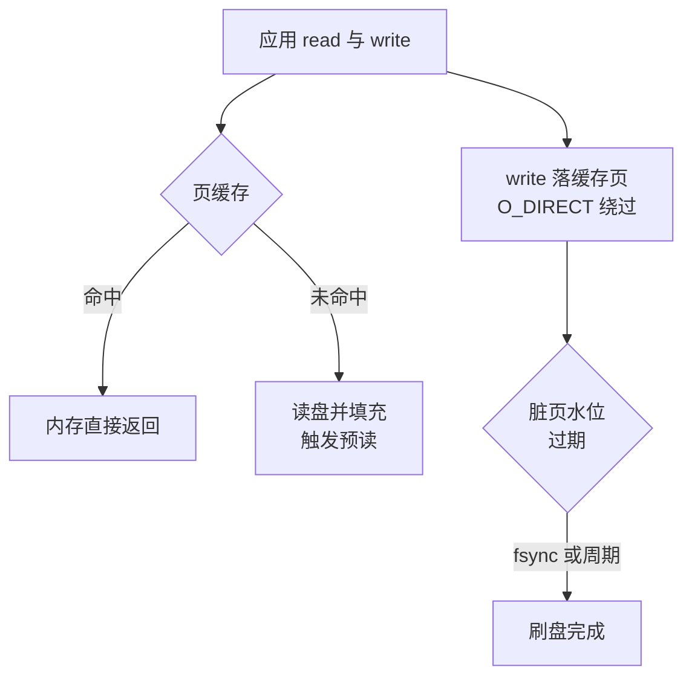

# 页缓存是内核替你管的第一层缓存：读写路径、预读与O_DIRECT的取舍

**页缓存（page cache，内核用空闲内存缓存文件内容的机制）是磁盘读写之间的一层：读命中内存、写先落缓存再批量刷盘——应用说自己「读写磁盘」时，多数时候读写的是这层内存。** 读完你能回答：为什么刚写完的数据没到磁盘、掉电会丢多少、预读怎么帮顺序读提速、数据库为什么常绕开页缓存用 O_DIRECT。

## 要解决的问题

**磁盘比内存慢五到六个数量级。**内核把空闲内存统一做成文件内容缓存：读文件先查页缓存，未命中才读盘并把页存进缓存；写文件先写进缓存页（标记为脏页，dirty page，已修改未刷盘的缓存页）就返回，由内核回写线程（writeback，内核周期性把脏页写盘的机制）批量刷盘。**读得到加速，写得到合并——两层收益来自同一个结构。** 代价是**语义变化：写返回时数据还在内存里，掉电丢失窗口存在；应用必须知道自己的数据什么时候真正落盘。**

## 机制：读写路径与三个控制点

### 读路径与预读

**读请求先查页缓存，命中直接返回（内存速度）；未命中触发盘 IO 并填充缓存。**内核对顺序读做预读（readahead）：**检测到连续读模式后，提前把后续页批量读入——顺序大文件读的吞吐因此能逼近盘的顺序带宽。**`posix_fadvise(POSIX_FADV_SEQUENTIAL)` 可显式加大预读窗口，`POSIX_FADV_DONTNEED` 主动把不再需要的页从缓存踢出（备份工具扫完立即释放，不挤占别的缓存）。

### 写路径与三个控制点

脏页何时写盘由三个参数驱动：`vm.dirty_ratio`/`dirty_background_ratio`（脏页占总内存的比例水位）、`vm.dirty_expire_centisecs`（脏页最长存活时间）、fsync/fdatasync（应用显式强制刷盘的调用）。**掉电丢失窗口 = 两次落盘之间的脏页——fsync 是应用层唯一的确定落盘点**，**日志、账务、消息确认等关键路径必须显式 fsync**；只依赖内核周期回写的写入，**丢失窗口是「比例参数 × 刷盘速度」的隐式函数。**

### O_DIRECT：绕开缓存的显式选择

`O_DIRECT` 打开文件后读写绕过页缓存，直接在应用缓冲区与盘之间搬运。选它的场景有三个特征：**应用自管缓存**（数据库有自己的 buffer pool，双重缓存只浪费内存）、**写路径要求精确的落盘控制**、**大文件顺序读写**（缓存命中率为零，白白经过一层拷贝）。代价是**失去预读与写合并——内核替你做的那部分优化要自己在应**用层重做。**判定句：默认走页缓存；应用自带缓存管理时才评估 O_DIRECT，两者选其一不并存。**

## 案例：缓存的账要跟内存对账

[[工程知识/性能工程：从用户等待到资源瓶颈/操作系统与运行时/内存回收与OOM把内存压力变成延迟与终止的分配问题]] 是本篇的邻居：**page cache 是内存压力的最大占用者，「内存只增不减」的多数解释权在页缓存——回收机制优先回收干净页，脏页要先写回。`free` 命令 buff/cache 列的大数字多数时候是健康信号。**[[工程知识/缺陷分析：从个案到体系/正确性/案例十：类型说谎时——静默删数据的 TTL 与算错的比较]] 的「静默失败」教训在写路径同样成立：**以为落盘了其实还在缓存——掉电后数据消失但应用代码无任何报错，这类事故的复盘结论几乎总是「关键路径缺 fsync」。**两案合起来：**页缓存的收益是默认的，风险也是默认的，显式控制点（fadvise、fsync、O_DIRECT）是把它纳入工程管理的手段。**

## 怎么测

- **落盘验证：写关键数据后立即断电（VM 快照回滚模拟），验证丢失窗口与 fsync 策略的推导一致。**
- **命中率观测：`cachestat`/`perf stat -e cache-misses` 或 `/proc/meminfo` 的 Cached 与 Dirty 变化，确认读路径真在命中。**
- **预读效果：顺序大文件读的 `iostat` r/s 与 rMB/s 对比（预读开启 vs `DONTNEED`），验证预读贡献。**
- **O_DIRECT 对照：数据库开启/关闭 O_DIRECT（多数引擎可配）跑基准，确认双重缓存的内存节省与直接 IO 的吞吐代价哪个占优。**

## 哪些认识一看就错

- **「write 返回就是写进磁盘了」——返回时数据在页缓存，掉电窗口真实存在；落盘以 fsync 返回为准。**
- **「内存用得少性能才好」——空闲内存被页缓存用掉是加速不是浪费；「free 很小」不是问题，available 小才是。**
- **「O_DIRECT 一定更快」——它省掉一层拷贝与双重缓存，也丢掉预读与写合并；小 IO 场景直接 IO 更慢，选型看应用是否自管缓存。**
- **「fsync 很慢所以要避免」——慢的是强制把脏页写盘的真实代价，之前只是把代价推迟了；关键路径省 fsync 等于把丢失窗口换成隐性债务。**

## 效果从哪来、要付什么代价

**页缓存把热文件读变成内存速度，把随机小写合并成批量刷盘，预读把顺序读推到带宽上限。**代价是**语义模糊（写返回与落盘分离）与内存占用（缓存的内存与工作集竞争）**。**控制点全部显式化后——fadvise 管缓存驻留、fsync 管落盘点、O_DIRECT 管绕行——模糊语义变成可配置的权衡。**数据库与消息队列这类自管缓存的应用用 O_DIRECT 拿回内存控制权，通用应用默认接受内核托管，**两条路线都能跑出好性能，混着用（一半 O_DIRECT 一半页缓存抢同一块盘的内存）才是最差解。**

关系：[[工程知识/性能工程：从用户等待到资源瓶颈/操作系统与运行时/内存回收与OOM把内存压力变成延迟与终止的分配问题]] —— 页缓存是内存压力的主要占用者，回收机制先动它的干净页。[[工程知识/数据系统：在并发与故障中保存事实/事务与存储/崩溃一致性给文件系统补上POSIX未定义部分]] —— fsync 语义与崩溃一致性：落盘点的完整性保证。[[工程知识/数据系统：在并发与故障中保存事实/事务与存储/SSD与HDD的IO特性差异：随机写与写放大]] —— 刷盘的真实代价取决于盘的类型，写合并的价值随介质变化。
