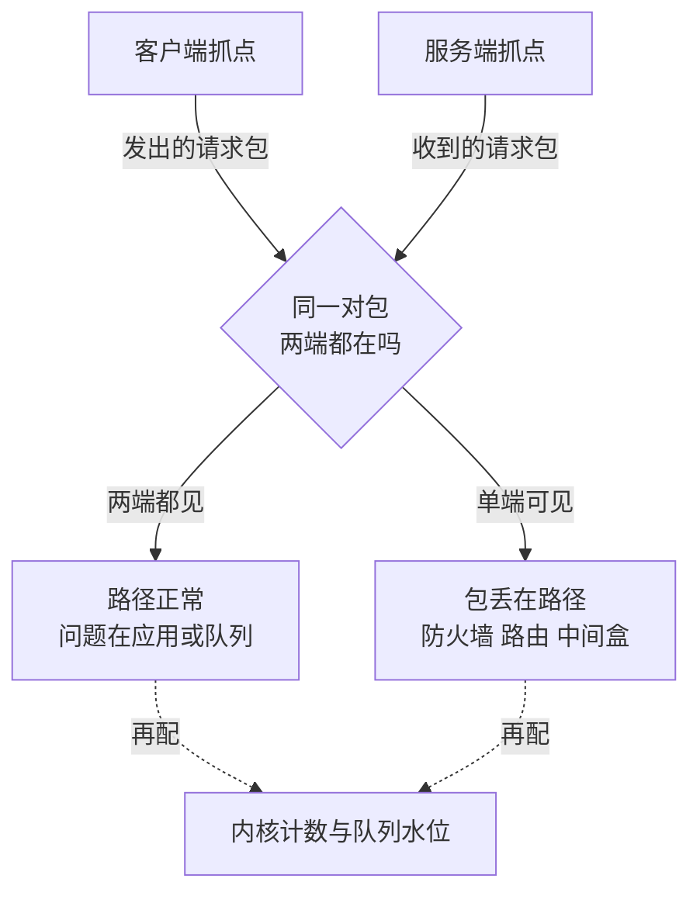

# tcpdump与抓包定位网络问题的现场方法

"网络不通"是最含混的报障。要解决的问题：网络层的"怎么看见、怎么定位"是知识库当前真空格，本篇给出从报障到根因的抓包诊断现场方法，**把"感觉网络有问题"变成"第几个包、哪一层、什么证据"**。读完你能**照着文末命令在几分钟内区分连不上、慢、被重置三类问题，并指认责任在客户端、服务端还是路径**。

## 抓包怎么按层下钻定位问题

抓包看到的现象，大多能归到这四块里：重传机制（包丢了或超时后重新发送）、滑动窗口（控制对端一次能发多少未确认数据）、流量控制（接收方按自己的处理能力抑制发送方）、拥塞控制（网络拥堵时收着点发）。先归块，再下钻。


*图源：小林 coding（博客园）《30 张图解：TCP 重传、滑动窗口、流量控制、拥塞控制》，CC 4.0 BY-SA，https://www.cnblogs.com/xiaolincoding/p/12732052.html。这张图就是上面「先归块」的块清单：每块下面各分具体做法，抓到的异常现象先对号入座再下钻。*

**抓包诊断本质是按 TCP/IP 分层（网络接口层、网络层、传输层、应用层）逐层验证"这一层收到的包是否正常"，异常在哪一层出现，问题就在哪一层或其下层**。

| 症状 | 先抓什么 | 看什么证据 | 常见根因 |
| --- | --- | --- | --- |
| 连不上 | 三次握手包 | SYN（Synchronize，TCP 建连第一步的握手信号） 无 SYN-ACK（TCP 握手第二步：应答同步并回同步）：**对端或路径问题** | **防火墙、服务未监听** |
| 连上但慢 | 双向包流 + 时间戳 | **重传率、RTT（Round-Trip Time，一个数据包从发出到收到应答的往返时间） 抖动（性能指标不稳定的起伏）** | **丢包、拥塞、bufferbloat** |
| 连接重置 | RST（Reset，TCP 强制断开连接的信号） 包上下文 | **谁发的 RST、第几秒** | **超时、中间盒、应用主动断** |
| 数据错乱 | 序列号与校验 | **校验错、序号跳** | **网卡/驱动 checksum offload bug（网卡代替系统计算校验和；开启时抓到的校验值可能失真）** |

「连不上」这一行的证据形态，就是教科书上的三次握手（TCP 建立连接前、双方交换三个报文确认彼此收发能力的流程）状态迁移：**SYN 发出后客户端进 SYN_SENT，收到 SYN+ACK 回 ACK 才双双进入 ESTABLISHED——抓包里这条时间线断在哪一步，责任就在哪一侧**——**只有 SYN 没有回应，责任在客户端侧或对端与路径；SYN+ACK 回了但 ACK 没到，责任在回程路径**：


*图源：小林 coding《TCP 三次握手与四次挥手（TCP 断开连接时、双方交换四个报文释放资源的流程）面试题》，CC 4.0 BY-NC-SA，https://www.xiaolincoding.com/os/1_hardware/tcp_interview.html。抓包定位「连不上」就是拿真实包序对照这张图：只有 SYN 没有回应是路径或对端问题，SYN+ACK 回了但 ACK 没到是回程丢包，每断一步对应一行排查路径。*

方法要点：**先定边界（客户端抓、服务端抓、还是两边对抓——单边只能证明这一侧的收发），再定切片**——BPF（Berkeley Packet Filter，内核里的包过滤与可编程虚拟机）按规则挑选要抓的包：**抓取时就丢弃不需要的包，省内存、不易丢包；高流量下全抓反而会把证据冲掉**，后看时间线（把包按时间轴展开，重传/RST 的相对时间揭示因果）。收益是**把不可见的网络行为变成可指认的证据**；代价是**抓包本身有开销**（高流量下 cpu 与丢包风险），生产环境用**更窄的过滤器与环形缓冲（一块循环覆盖旧包的内存区，满了丢最旧的，用来限制抓包占用的空间）**。



抓点的选择逻辑：**单边抓包只能证明这一侧的收发，「客户端发出了」与「服务端收到了」是两个独立命题**——**同一对包两端都在，路径洗清，问题在应用或队列；只有一端见到，包丢在路径上，按防火墙、路由、中间盒逐个排查**。**两类结论都要配上内核计数（`netstat -s`、`ss -lnti`）才能从「包层的证据」走到「队列层的成因」**。内核计数里的 **overflow 通常对应 accept 队列溢出**，drop 要结合 `ss`/`netstat` 的具体字段判断来源（队列溢出、策略丢弃、socket 缓冲满都可能），**把抓到的包异常指认到具体环节**。

## 真实案例的边界在哪儿：抓包现场的实录

案例回流（通用形态）："偶发接口超时"抓包五分钟拿到证据链——**过滤目标端口，看到三次握手正常、请求发出后约 40 秒未收到任何回应，随后出现 RST 重置连接；对照内核计数（`netstat -s` 的 overflow）定位为 accept 队列溢出，应用层零日志、网络层证据完整**——**抓包的价值就是把"应用看不到的层"的证据拿到手**——这个比喻只到"指出异常发生在第几个包"为止，不等于能证明应用错在哪；**队列水位（队列或资源的当前占用程度）与加密内容仍要配 ss（查看套接字统计的命令）、netstat（老的网络统计命令） 与应用日志**。过滤条件的实录教训：**抓包先带 `port` 与 `host` 过滤再写入磁盘（生产机全量抓包一分钟就能写满磁盘，反而把现场冲掉）**，加 `-s 96`（每个包只抓前 96 字节，即 snaplen 快照长度）截断载荷（**定位网络层问题不需要业务数据，还顺带满足数据安全**）。边界：**抓包看得到包的时序与控制位，看不到内核队列水位与缓冲区计数（要配 `ss -lnti` 与 `netstat -s`），也看不到加密内容**（TLS，Transport Layer Security，传输层加密协议，HTTPS 里的 S）——**加密流量只能看握手与时序，语义层要靠应用日志对时，两边的证据按时间戳并排核对**。工具链的分工见 [[工程知识/性能工程：从用户等待到资源瓶颈/存储与网络/网卡丢包先看环形缓冲区溢出：队列、中断与软中断的接力.md]]（内核计数器层）与本篇（线上的包层，**两层证据交叉验证才是完整现场**）。


*图示：tcpdump 抓到的数据包列表。图源：Wikimedia Commons「Fedoratcpdump」，作者 Lars martin4，许可 CC BY-SA 4.0。*

## 怎么自己动手验证

```bash
# 三次握手是否完整
tcpdump -i eth0 -n 'tcp[tcpflags] & (tcp-syn|tcp-fin) != 0' and host 10.0.0.5
# 重传率统计（看拥塞窗口行为）
tcpdump -i eth0 'tcp[13] & 0x04 != 0' -w /tmp/ret.pcap
# tshark 的 I/O 统计看流量分布；重传帧数用 retransmission 显示过滤器统计（Wireshark 的 Expert Information 面板也能聚合看重传/乱序）
tshark -r /tmp/ret.pcap -q -z io,stat,1
tshark -r /tmp/ret.pcap -Y "tcp.analysis.retransmission" | wc -l
```
预期：**健康连接的重传率低于 1%，握手在一两个 RTT 内完成——正常一次握手约等于一个来回时延，超过两三个来回就说明有丢包或路径绕远**。数字对不上时**先确认过滤器没把证据滤掉（把过滤器放宽到 host 级重抓一次）**。**tcpdump（抓包工具，按条件截获网卡上经过的报文） 手册的 BPF 表达式与 Wireshark（图形化抓包分析工具）的 display filter 是两套语法，混用是新手常错**。

## 这套说法在哪儿会失效

**抓包里判断重传是否合理，看 RTO（重传超时时间）与 RTT的关系：RTO 远大于 RTT 就是空等，RTO 小于 RTT 就是没丢也重传，徒增网络负荷**。


*图源同上：小林 coding 博客园同文（CC 4.0 BY-SA）。这张图把 RTO 取大取小两种后果画在两条时间轴上：过长是空等，过短是无谓重传；取值由 TCP 按往返时延自动调节，没有统一固定值。*

本篇讲网络层的现场抓包方法。单机侧的性能观测（火焰图、系统调用）见 [[工程知识/性能工程：从用户等待到资源瓶颈/观测与诊断/性能剖析与火焰图|性能剖析与火焰图]]。

慢在哪一跳的定量方法（traceroute 变体）与 DNS（Domain Name System，域名系统：把域名解析成 IP 地址） 层诊断见 [[工程知识/性能工程：从用户等待到资源瓶颈/存储与网络/DNS解析是延迟与故障的隐形入口|DNS解析是延迟与故障的隐形入口]]。抓到包之后的 TCP（传输控制协议，负责把数据完整、有序地送达） 行为解读（重传机制、拥塞控制语义）见 [[工程知识/性能工程：从用户等待到资源瓶颈/存储与网络/拥塞控制在吞吐与公平之间动态调节|拥塞控制在吞吐与公平之间动态调节]]。

应用层协议在包里的样子（HTTP/TLS）见 [[工程知识/性能工程：从用户等待到资源瓶颈/存储与网络/TLS握手与证书链决定连接建立成本|TLS握手与证书链决定连接建立成本]] 的握手包结构段。

## 接着读哪几篇：抓到重传后的语义解读

- [[工程知识/性能工程：从用户等待到资源瓶颈/存储与网络/拥塞控制在吞吐与公平之间动态调节]]——抓到重传后的语义解读
- [[工程知识/性能工程：从用户等待到资源瓶颈/观测与诊断/性能剖析与火焰图]]——单机侧对照方法
- [[工程知识/性能工程：从用户等待到资源瓶颈/观测与诊断/连通性诊断的分层顺序：从链路到应用逐层收窄，不跳层]]——抓包在四环收窄链中的位置与双端取证纪律
