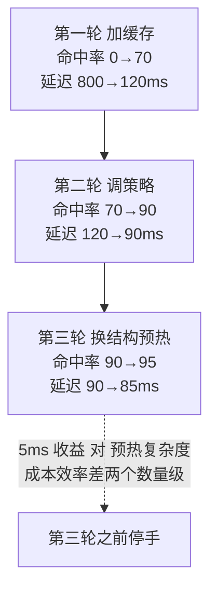
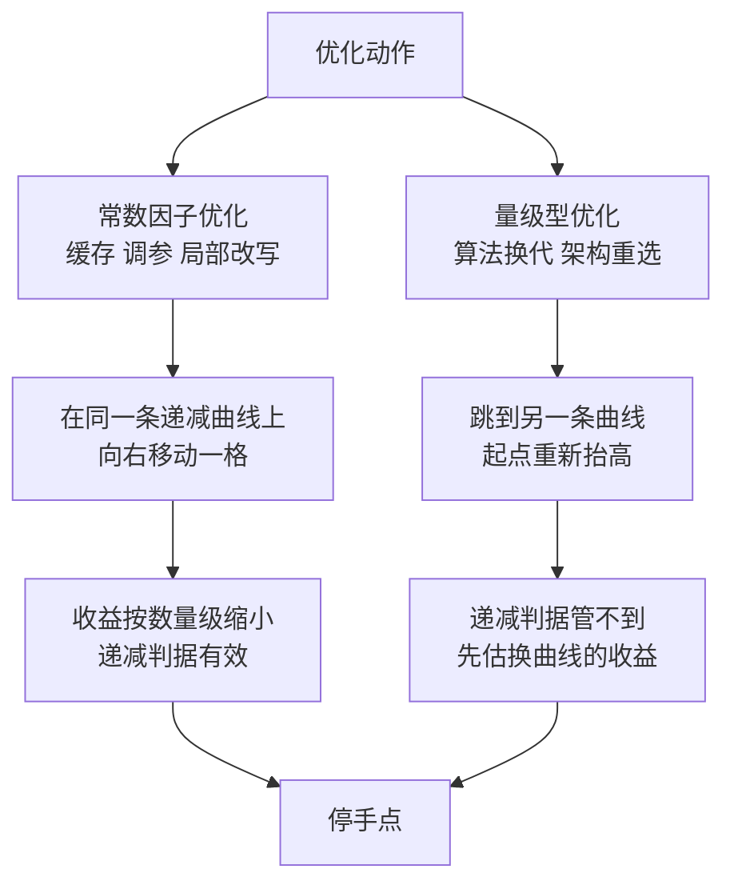

# 优化收益递减决定何时该停手

性能优化和经济学一样有收益递减：**前两个优化吃掉最大瓶颈，之后每一步换来的改善按数量级缩小**。读完这篇你能显式设定停手判据，避免优化本身变成新的工程风险。

第一个优化通常吃掉最大的瓶颈（从 10s 到 2s），第二个吃掉次大的（2s 到 1.2s），**第三、四个开始与复杂度成本打平，之后每一步的努力换来的改善按数量级缩小**。优化没有天然的终点，**停手判据必须显式设定**——没有停手线，每轮优化都显得「还能再快一点」，于是持续加复杂度，最终为微小收益背上维护与缺陷的债，**优化本身变成新的工程风险**：代码复杂化、为 5% 的收益引入新缺陷，优化引入回归的实例见 [[工程知识/缺陷分析：从个案到体系/正确性/案例三十四：省下的句柄与多出的删除——一次优化引入的回归]]。

优化的总账不是只有延迟：`净收益 = 性能改善的业务价值 − 复杂度成本 − 缺陷风险 − 优化本身的工时`。四个减项里只有第一项可见，**其余三项都是隐藏负债**——成本看不见，继续优化就显得是免费的，于是没有停手线也一直投，直到复杂度压过收益。**这正是优化容易做过头的结构性原因。**

## 要解决的问题：收益随轮次变化的规律是什么

**本篇回答：收益随轮次变化的规律是什么、停手判据怎样在开始之前设定、常数因子优化与算法换代如何区分，以及每一轮优化要留下哪些记录用于校准判断。**停手依据从总账来：第一轮优化常能砍掉数量级的延迟，第二轮起改善翻倍地缩水，复杂度与回归风险却逐轮累积——**继续投工时的收益曲线，就是停手判据的底稿**。

## 优化到哪三条判据就该停手

| 判据 | 问的问题 | 量化的样子 |
| --- | --- | --- |
| 目标达成 | 业务指标（转化、成本、SLO——服务等级目标，团队对外承诺的服务质量目标）已达标？ | P99 < 200ms 的 SLO 已绿 |
| 瓶颈转移 | 剩余瓶颈在哪、它值多少？ | 新瓶颈改善的边际收益 < 工时成本 |
| 负债临界 | 复杂度增加开始伤维护？ | 优化后代码评审通过率下降、新人上手变难 |

**目标判据优先**：优化的目标从业务倒推（延迟低到不影响转化、成本低到预算内），**达标后继续优化就只剩工时消耗，没有业务回报**。瓶颈转移判据是技术面的：按性能剖析（profiling，对程序运行时采集耗时分布）数据排序（方法见 [[工程知识/性能工程：从用户等待到资源瓶颈/观测与诊断/性能剖析与火焰图]]），**当前瓶颈修完后的下一个瓶颈改善空间值不值得一轮工时，数字上就能比**。

停手判据的实物原型在蒸汽机时代就有了：离心调速器在转速超过阈值**时自动收油门——转速贴着设定线最好**，冲高没有收益。优化与这台蒸汽机是同一套反馈：指标贴线即停手，继续踩油门的每一分投入都变成损耗。边界在于**调速器自动收油门**，优化停手靠人判断——人得自己设这条线并主动停，机器不会替你停：

*图源：Wikimedia Commons，Acroterion，CC BY-SA 4.0，https://commons.wikimedia.org/wiki/File:Frick_Eclipse_steam_engine_VA3.jpg。*

## 递减怎么量化

以缓存层优化为例的三轮递减：加缓存（命中率 0%→70%，延迟 800ms→120ms）、调缓存策略（70%→90%，120ms→90ms）、换缓存结构与预热（90%→95%，90ms→85ms）。**第三轮 5ms 的收益要付出预热的复杂度与失效路径的额外风险**——按每毫秒的工时算，第三轮的成本效率是第一轮的百分之一量级。**判断发生在第三轮之前**：把三轮的预估收益与成本摆出来，**第三轮大概率不该做**。

收益递减在经济学里有现成的曲线形状：**总产出（Total Product）随投入继续上升但增速变慢，边际产出（Marginal Product）与平均产出（Average Product）先后见顶回落**——优化投入与性能收益的关系同构，**拐点之后每一分投入换来的是更少的改善**：

*图源：同上（Wikimedia Commons），Greentharp。*

判定"该停手"与判定"该熔断（依赖持续报错时暂时不再调用它，直接走失败路径，防止拖垮自己）"是同一套开关逻辑：**连续多轮优化都没有改善就断开继续投入，隔一段时间再试探一次，有改善才继续**——断路器三态正好是这个判定的形状，Closed（闭合）是正常优化、Open（断开）是停手、Half-Open（半开）是试探性小改动。边界在于**断路器按故障自动触发且能自愈重试**，优化停手要人按收益手动判定，只在「多轮无改善就断开投入」这一步形状相似：

*图源：Microsoft Learn 中文文档《断路器模式》，CC BY 4.0，https://learn.microsoft.com/zh-cn/azure/architecture/patterns/circuit-breaker。*

三轮的命中率（请求直接从缓存拿到结果的比例）涨幅与延迟收益摆在一起，递减的形状在图上直接可见：

图：递减出现在哪一轮——第一轮加缓存、第二轮调策略、第三轮换结构预热，命中率涨幅 70、20、5 逐轮收缩，延迟收益从 680ms 缩到 30ms 再缩到 5ms，第三轮的成本效率比第一轮低两个数量级，停手判据在动手前就能算出来。

**递减判据管的是同一条曲线上的移动，管不到换曲线**——常数因子优化（缓存、调参、局部改写这类只改常数倍、不改量级的优化）沿着曲线向右挪一格，算法换代（换更快的算法）与架构重选（换整体方案）是**跳到另一条曲线、起点重新抬高**。

分清这两类动作，停手点才算得出来；尾延迟之所以要单独说，正是因为它常常已经不在原来那条曲线上。

尾延迟的特殊性要单独说：P99（把所有请求响应时间从小到大排，第 99 百分位的值，99% 的请求比它快）与 P999（99.9% 的请求比它快的响应时间）的优化是**另一条递减曲线**，尾巴的来源至少三类：GC 停顿（垃圾回收不再使用的内存时短暂暂停程序）、锁竞争（多个线程争同一把锁互相等待）、后台任务自身的抖动，**修 P50（一半请求快于此值的响应时间）到 P99 的收益可能大于修 P99 到 P999**。**修哪个尾巴按业务人群算**：P99 影响 1% 请求，值不值，看这 1% 是不是关键用户（尾延迟的机制见 [[工程知识/性能工程：从用户等待到资源瓶颈/操作系统与运行时/垃圾回收与内存分配决定延迟尾部]]）。

## 过度优化长什么样

过度优化的一种典型形态是：**为某个调用方把资源调到了极限，结果这一路把资源占满，其余几路全部受影响**。资源要按调用方切分，某一路占满时其他路仍能正常响应——这就是隔舱模式——为每个调用方预留独立资源配额、互不侵占，展开见 [[工程知识/后端系统：在并发、失败与变化中维持服务/基础设施/容量规划与压测要用同一个负载模型说话]]。

三种常见的"过"：

1. **微观优化多数无效**。手写循环替代标准库、位运算替代乘法——**在现代编译器与流水线下多数无效，除非 profiling 数据证明这里是热点**（有效执行的判断见 [[工程知识/性能工程：从用户等待到资源瓶颈/处理器与内存/CPU性能来自有效执行与数据供给]]）。

2. **为想象负载优化**。预估"未来可能百万 QPS（每秒查询数，系统每秒处理的请求量）"而提前做的分布式化，**在真实量级到来前都是负债**（容量问题的正确姿势见 [[工程知识/后端系统：在并发、失败与变化中维持服务/基础设施/容量规划与压测要用同一个负载模型说话]]）。

3. **单点优化破坏整体**。某层吞吐提上去，把压力转移给下游没有容量的层，**系统整体反而更脆**——优化要回到端到端视角（端到端的延迟分解见 [[工程知识/性能工程：从用户等待到资源瓶颈/存储与网络/端到端网络延迟来自排队、协议、传输与处理]]）。

## 动手前先回答哪几问

动手前先回答：**瓶颈有 profiling 证据吗（不是直觉）？目标是业务倒推的吗？这个优化的回退方案是什么？复杂度增加多少？**四个问题答不清就动手，**投入大概率打水漂**。清单与通用的技术方案约束书写法一致（见 [[工程知识/软件构建：让变化可以理解、验证与交付/架构与代码/技术方案先写清约束、取舍与验证]]）。

## 这套说法在哪儿会失效

递减规律有例外：**量级型优化**（算法换代、O(n²) 到 O(n log n)）落在一条新曲线上，**递减判据管不到它**。所以"收益递减"判据适用于常数因子优化（缓存、调参、局部改写），算法与架构级的重新选择要先评估换曲线的收益——**profiling 数据里"占比最高的那块"如果用当前思路怎么优化都压不下去，就是该考虑换曲线的信号**。

## 怎么自己动手验证

停手时机要与递减曲线对账——**预写优化序列的收益应在某轮之后显著收窄，若实测每轮收益基本持平，与预期对不上，说明还没到拐点**。

**每次优化记录三件事**：优化前后的指标对比（同一负载、同一测量方法，误差控制见 [[工程知识/性能工程：从用户等待到资源瓶颈/观测与诊断/基准测试必须先定义负载和测量误差]]）、付出的复杂度（代码行数、新增依赖、评审轮次）、有没有引入回归（全量测试 + 回归监控）。

优化决策复盘：把一个已完成的优化序列摆出来，标注每轮的收益与成本，**检验停手点是否与递减曲线的拐点一致**。停在拐点前的，说明该做的没做完；停在拐点后的，说明过度了——**两种偏差都校准下一轮的预估**。

## 想往下钻，该接着读哪几篇？

容量规划是目标判据的容量侧输入。

- 关系：[[工程知识/性能工程：从用户等待到资源瓶颈/观测与诊断/性能剖析与火焰图]] · [[工程知识/性能工程：从用户等待到资源瓶颈/观测与诊断/基准测试必须先定义负载和测量误差]] · [[工程知识/缺陷分析：从个案到体系/正确性/案例三十四：省下的句柄与多出的删除——一次优化引入的回归]]
- [[工程知识/后端系统：在并发、失败与变化中维持服务/基础设施/容量规划与压测要用同一个负载模型说话]] —— 目标判据的容量侧输入
- [[工程知识/AI 系统工程：从模型能力到生产能力/推理服务与平台/推理服务的单位请求成本从token定价推出来]] —— 成本优化的同构停止条件
- [[工程知识/软件构建：让变化可以理解、验证与交付/架构与代码/技术方案先写清约束、取舍与验证]] —— 优化方案的事前对账
- [[工程知识/性能工程：从用户等待到资源瓶颈/性能工程：从用户等待到资源瓶颈]] —— 域内优化的整体地图
- [[工程知识/性能工程：从用户等待到资源瓶颈/观测与诊断/性能回归门禁：把性能预算写进CI.md]] —— 优化停手点决定门禁预算线的松紧
