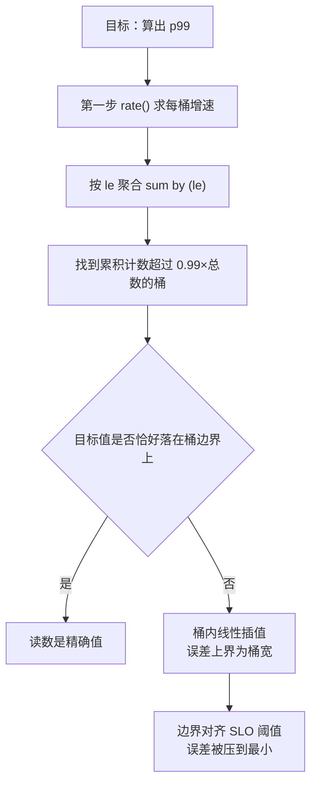

# 分位数是估算出来的：直方图分桶、插值误差与跨实例聚合的边界

**仪表盘上那行 `p99=0.004s` 是估算出来的，没有一条真实的请求恰好等于这个数。**读完这一页你能算出分位数的真实来源与误差范围，解释为什么 P99（99% 的请求耗时不超过这个值） 会平白无故地大一截，并正确聚合多个实例的分位数指标——**P99 被人人引用、它的产出机制却没被讲清，这正是要解决的问题。**

> **要点**：分位数从直方图的累积桶里插值而来，误差上界是桶宽；summary 在客户端流式算分位数，多个实例的平均分位数在统计上没有意义——机制在于把桶计数按 `le` 标签聚合之后，才知道跨实例的分位数要怎么算、桶边界要怎么配。

## 分位数是怎么从桶里算出来的？

Prometheus（主动拉取并存储指标的开源监控系统） 的 histogram 类型指标（直方图，把观测值按预设边界分桶计数的指标类型）为每个桶暴露一条时间序列，`le` 标签（less than or equal to，本桶计数含义为"小于等于该边界的观测次数"）记录桶边界。**桶计数是累积的：`le="0.1"` 的计数已包含 `le="0.05"` 的计数，最大桶 `le="+Inf"`（正无穷桶，计数等于总观测次数）永远等于全部样本。**

`histogram_quantile(0.99, rate(http_request_duration_seconds_bucket[5m]))` 的计算分三步：**先对每个桶做 `rate()` 求每秒增速，再在候选桶序列里找到第一个累积计数超过目标位次 `0.99 × 总数` 的桶，最后假定样本在该桶内均匀分布，做线性插值**：

```text
quantile = bucketStart
         + (bucketEnd - bucketStart)
         × (targetCount - bucketCount(bucketStart))
         / (bucketCount(bucketEnd) - bucketCount(bucketStart))
```

**第一步的顺序是刚性的：`rate()` 必须先于 `sum()` 执行。**跨实例聚合写 `sum by (le) (rate(...[5m]))`，先按实例各自求增速再按 `le` 标签求和；**反过来先 `sum` 再 `rate` 会把每台机器的计数增长混在一起，起点值被互相抵消，增速算成零附近的无意义数字。`le` 必须保留在 `by` 子句里，丢掉它桶就失去了边界含义。**ZOOZ（一个 ZooKeeper 相关的缩写） 工程团队的真实教训：桶边界配成 1/2/4/8/16/32ms，**告警阈值 10ms 正好落在 8ms 与 16ms 的空隙里**，**真实 p99 约 8.5ms 被插值放大到 14.4ms，告警整夜误触发**；团队把桶边界直接对齐到 10ms，读数立刻回到真实值附近。**插值算法没有缺陷，桶边界没有给告警阈值留出对齐位置。**


*图源：Prometheus 官方教程《Understanding metric types》配图，https://prometheus.io/docs/tutorials/understanding_metric_types/ 。*

桶边界怎么配，决定读数可信到什么程度：

| 配置选择 | 读数效果 | 适用场景 |
| --- | --- | --- |
| 边界对齐 SLO 阈值 | 阈值处的分位数读数是精确值 | 已知告警阈值与服务目标 |
| 桶宽在关键区间收窄 | 误差上界（桶宽）相应缩小 | 延迟分布形状已知 |
| 默认桶配置 | p50/p90/p99 可能都挤在同一个桶里 | 上线初期探形状 |
| 加入 native histogram（原生直方图，Prometheus 2.40 起在桶间按指数规律做插值的直方图变体） | 桶数极多时存储换精度 | 高精度分位数需求 |



**均匀分布假设在桶内不成立时，插值结果只是近似：分布集中的一侧读数向桶中间偏移，集中得越厉害，近似程度越差。**

## 为什么 summary 的分位数不能跨实例平均？

summary（汇总指标，在客户端流式计算分位数的指标类型）用 CKMS 算法——CKMS 即 Cormode-Korn-Muthukrishnan-Srikant 数据结构，在数据流上维护带误差界的分位数估计在客户端实时算分位数，预置哪些分位只有配置它们的那个客户端自己知道，**`avg(p99)` 把多台机器各自的 p99 求平均，统计上没有意义——每台机器的样本数不同、分布不同，平均出来的数既不是全局 p99，也描述不了任何一台机器。**SRE（Site Reliability Engineering，网站可靠性工程：用软件方法做运维） 手册的长期观点是**分位数优于平均值：平均值把最慢的一批请求摊进总量，长尾（少数请求耗时远高于其余大部分）用户——Dean 与 Barroso 在《The Tail at Scale》给出：服务扇出（一个请求分发给多个下游并行处理）越多，一个请求的完成时间越由最慢的下游决定的体验在均值里消失，p99 才保留着它们。**

CACM 2019 年《Metrics That Matter》给出工程经验值：**健康的延迟分布 p99 应在 p50 的 3 至 5 倍以内，超出说明长尾被某类固定来源拖长。**

**需要全局分位数时用 histogram，这是它跨实例聚合能力换来的代价：存储成本随桶数线性增长；单实例内要预知的高精度分位数时 summary 才有优势，混用时两者的同名指标在聚合层面没有可比性**：

| 维度 | histogram | summary |
| --- | --- | --- |
| 分位数计算位置 | 服务端，PromQL 里 | 客户端，采集时 |
| 跨实例聚合 | `sum by (le)` 之后 `histogram_quantile` | 无法聚合，`avg` 没有意义 |
| 分位数选择 | 服务端任意指定 | 配置时写死 |
| 精度 | 受桶宽限制 | 客户端高精度 |
| 存储成本 | 每桶一条序列 | 固定几条序列 |

## 这套说法在哪儿会失效

**桶计数不单调**：采集端 bug 或计数重置会造成低边界计数反而更大，查询端会先按单调性修正（把负增量当作零）再插值——**修正本身引入误差，长期出现非单调计数说明采集端有问题**，本库《系统指标与观测》的采集健康检查覆盖这类症状。

**`+Inf` 桶缺失**：**客户端库漏配 `+Inf` 时总量无从得知，位次计算失去分母，插值结果错误。**

**低流量实例**：**单桶样本极少时插值结果剧烈跳动，先做足够长时间窗口的 `rate()`，或先跨实例聚合再算分位数。**

**变化快速的业务**：**接口的延迟分布随版本剧烈变化时，桶配置需要随之一同修订**，本库约定快变内容不进主区，**桶配置属于部署配置的一部分。**

## 怎么自己动手验证

**用四条可复算的步骤验证上述机制，每步写明预期结果**：

```text
第一步 精确值验证：桶边界包含 0.1s，注入恰好 99% 样本 <= 0.1s 的负载
      预期 histogram_quantile('0.99') 读数为 0.1s，与构造值一致
第二步 插值陷阱验证：按 ZOOZ 案例1/2/4/8/16/32ms 配桶，注入真实 p99=8.5ms 的样本
      预期读数落在 8ms 至 16ms 之间，且明显大于 8.5ms
第三步 聚合验证：两实例 p99 分别为 8ms 与 12ms，执行 sum by (le) 再求分位数
      预期结果接近全局 p99，且不等于** avg**(8, 12) = 10ms
第四步 手工复算：取任一时刻的 le 桶计数，按公式手算插值
      预期与 histogram_quantile 输出一致，差异只在浮点精度
```

**第二步的两种配桶读数对照就是开篇那条告警的复现路径。**

直方图的桶像地图的等高线：**线画得密，读出来的海拔就精确；线画得疏，两线之间的位置只能估。**桶宽是分位数的等高距，告警阈值**要立在等高线上**（边界对齐 SLO），**读数才不需要估**——这个比喻只对应插值的精度问题，聚合与流式计算的部分等高线帮不上忙。

## 还能读哪几篇补全证据视角？

- [[工程知识/性能工程：从用户等待到资源瓶颈/观测与诊断/系统指标与观测]] —— 指标类型体系与本篇分位数机制的上层全景
- [[工程知识/性能工程：从用户等待到资源瓶颈/观测与诊断/基准测试必须先定义负载和测量误差]] —— 分位数读数是测量结果，测量误差需先行定义
- [[工程知识/性能工程：从用户等待到资源瓶颈/观测与诊断/指标、日志、Trace与剖析各答一问，合起来才构成证据]] —— 分位数定位症状，根因证据还要靠日志与追踪补齐
- [[工程知识/性能工程：从用户等待到资源瓶颈/观测与诊断/监控体系按四个问题分层：坏了没、坏了哪、为什么坏、会再坏吗]] —— 分位数告警属于第一层，层数体系见此篇
- [[工程知识/性能工程：从用户等待到资源瓶颈/观测与诊断/排队论给容量一个可推导的模型]] —— 长尾延迟（P99 一类的慢请求耗时指标）的排队论来源，p99 异常的模型化解释
- [[工程知识/缺陷分析：从个案到体系/性能/锁内的长动作：临界区里藏着的延迟放大器]] —— p99 抬升的一类真实根因：临界区内的长动作
- [[工程知识/缺陷分析：从个案到体系/性能/案例三十七：锁自己变成了瓶颈——争用背后的临界区错配]] —— 分位数异常定位到锁争用的完整案例
