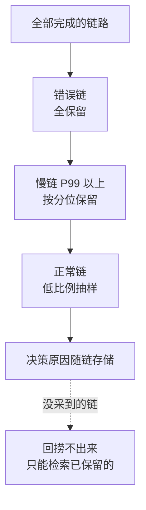

# 分布式追踪的采样与补齐：低频异常要靠尾部采样与标签回捞

**分布式追踪默认按概率均匀丢掉一部分链路，最先丢掉的恰恰是难得一见的异常**。读完这一页你能**按异常的稀有程度和价值设计采样**，**用尾部采样与标签回捞留住证据，并在链路残缺时按时间和上下游边界补齐**。

> **要点**：**头部采样均匀丢掉低频异常的关键证据**，**尾部采样按结果保留慢与错、对账读放大与错误恢复补全残链**——机制在于**采样策略按"异常的稀有程度 × 证据价值"设计**，**追不上链时按时间与上下游边界补齐**。

## 默认采样为什么会漏掉低频异常？

分布式追踪的默认策略是头部采样：**请求进入时按固定概率决定是否记录**。**这个策略对平均负载公平，对异常请求失明**——**千分之一概率的缺陷请求，头部采样保留它的概率同样只有千分之一**，**恰好采到时证据残缺（链路后半段在其他服务里被独立丢弃）**，**追查时只剩"用户说有这个问题，系统里没有记录"**。本库《指标、日志、Trace与剖析各答一问》讲清了四类证据的分工；**本篇接着解决追踪证据的完整性问题**：**采样策略决定哪些证据留得下来，补齐手段决定残链能拼回多少**——**没被采样保留的低频异常，追查能力在采样配置时就已注定缺失**。

## 尾部采样如何在留住异常的同时补偿读放大？

**尾部采样的原理**：**请求完成后再决定是否保留——决策点从入口移到出口**，规则按结果制定：**慢请求（P99 以上延迟）保留、错误请求全保留、正常请求按低比例抽样**。**尾部采样的实现代价是缓冲与延迟**：**每个请求的完成要等链路收齐（或超时）**，**采集端要持有全量 span（一次调用在单个服务内的执行片段，链路由多个 span 串成）等待决策**——**缓冲窗口按"链路最大耗时 + 余量"定，超窗口的链路按已有 span 决策**。


*图源：OpenTelemetry 官方文档「Concepts / Sampling」页面的 Tail Sampling Processor 示意图，地址 /static/figures/tail-sampling-process.svg 。*

**读放大（一次逻辑读触发多倍实际读取）的补偿规则**：**一次用户读可能在存储层放大成上百次内部读（缓存未命中、副本读、rebalance 读——rebalance 读即数据再均衡时触发的搬迁读）**，**头部采样按入口概率均匀抽，抽中的链要么全是正常读（无信息量），要么把放大路径抽得支离破碎**。**采样规则要给放大路径显式配额**：上游 BookKeeper（Apache 的分布式日志存储系统）的一个复现改进是 reorderReadSequence（重排读序列的改动）的读放大路径对追踪可见——**读放大的决策（为什么这次读去了这些节点）是容量与副本问题的核心证据**，**这类链路按"决策事件"采样，保留优先级高于普通读**。

**错误恢复的链路补全**：**重试、故障转移、副本切换产生的链路，一次用户操作对应多段内部尝试**——尾部采样按"最终结果"保留时，**要把失败的尝试段一并保留（它们是异常的证据主体），只留成功段的"错误恢复链"是残次品**。**保留规则按"链路含错误段"判定，成功收尾不豁免**。


## 读完这一段你能判断什么：采样配置与补齐手段

**配置的三层结构**：**一层错误全保留（错误链是最高价值证据，成本可控）**；**二层慢链按分位保留（P99 以上的延迟证据）**；**三层正常链低比例抽（维持基线画像）**。**每层的比例按证据价值与存储预算定**，**全量保留正常链是预算黑洞，全不保留则容量规划失去依据**——**正常链的基线（正常状态下的指标水平、用来对比异常）画像正是容量规划的依据**，没有它就无法估算各服务的真实负载。



证据预算的分配顺序：**错误链价值最高全保，慢链按分位保，正常链抽样维持基线**，每层按证据价值与存储预算定比例。**虚线是回捞的边界——采样时没留下的证据，回捞扩大的只是检索面，找不回证据本身**。

**回捞（标签检索）的边界**：**尾部采样外的回捞手段是"按标签重新过滤已保留的链"**——**它扩大的只是检索面**，**采样时没留下的证据，回捞不出来**。**把回捞当采样替代品的期望无法兑现**：**低频异常的证据必须在采样决策时保留**，**回捞只是把已保留的证据按维度（用户、租户、错误码）找出来**。

**头部采样是"下网前就定好这网只捞前十条"，尾部采样是"收网时按结果挑"**——错误链全留、慢链按分位、正常链抽样；**回捞则是收网后的翻检，采样时没留下的，翻检一百遍也没有**。**这个比喻只对应采样决策的时间点，实际系统的采样规则比渔网精细得多**，能按错误码、延迟分位、租户分别配置。**决策放在收网一刻的价值，在真实界面里看得最直接**：


*图源：Dash0《What is Jaeger Tracing?》中的 Jaeger Trace View 截图，https://www.dash0.com/knowledge/what-is-Jaeger-tracing。*

被采样的链路汇聚成服务依赖图，尾部采样保留的错误链正是这张图的边——哪条边调用量大、哪条边带错误，运维在一张图上就能看清全局：


*图源：Dash0《What is Jaeger Tracing?》中的 Jaeger System Architecture 截图，https://www.dash0.com/knowledge/what-is-jaeger-tracing。*

**残链的补齐顺序**：**链路追不上（上下文丢失、跨队列断链）时按三个方向补**：**按时间窗并排**（**用时间戳窗口找同时段的相关服务记录**）、**边界锚点**（**队列与网关的入出记录补上断点两侧**）、**关联标识**（**业务单号、消息 ID 作为跨系统的次级关联键**）。**补齐后的链要标注证据等级**（完整链 / 按时间窗推断 / 单侧记录），**推断链没有经过验证，据此定位根因会把排查引到错误的服务**——**把推断当实证是误诊的来源**。

## 这套说法在哪儿会失效

**尾部采样的缓冲是内存热点（访问集中在少数键或节点上的现象）**：**高流量系统的决策缓冲要限量与降级（缓冲满时按头部采样兜底）**，**否则采样系统自己成为过载源**——**观测系统的自保设计**与本库性能域"指标采集的基数控制"同源。

**采样决策要留审计**：**为什么这条链被保留（错误？慢？抽样命中？）——决策原因随链存储**，**追查时"这是全量错误链还是抽样命中"直接影响证据权重**。

**跨系统采样率（只按比例保留部分样本、其余丢弃的比例）不一致**：**各服务独立配置采样时，同一条链的保留概率是各段概率之积**——**入口服务决定保留，下游跟随入口的采样标记**（trace flags——追踪上下文里标记采样决策的标记位——传递），**下游再自作主张采样就把入口的决定打碎**。

## 怎么自己动手验证

本篇要解决的问题——低频异常证据丢失——可以用这四步复现验证，每步都写明了预期结果：

1. 低频异常保留验证：**构造 0.1% 的错误注入，预期错误链 100% 被尾部采样保留（头部采样对照组大部分丢失）**；
2. 放大路径验证：**构造缓存未命中风暴，预期放大决策链按配额保留、可检索**；
3. 残链补齐验证：**故意截断某服务的追踪上报，按时间窗并排与队列边界补链**，**预期补齐结果标注了证据等级**；
4. 断言锚点：**三层采样配置在管、错误链保留率 100%、采样决策原因随链存储**——三者齐备，**低频异常从"没记录"变成"按标签可回捞"**。

```text
保留断言 = 错误注入链 100% 在库
决策断言 = 决策原因字段随链可查
补齐断言 = 残链可按时间与边界补齐并标注等级
```

**采样策略分配的是证据预算**——**每条保留的链路都占用存储与计算额度，就像花钱，要花在价值最高的证据上**：**异常按价值全保、基线按比例抽、回捞负责检索面**——**预算分对了，追踪才配得上"分布式系统最细粒度证据"的名分**。

## 还能读哪几篇补全证据视角？

- [[工程知识/性能工程：从用户等待到资源瓶颈/观测与诊断/指标、日志、Trace与剖析各答一问，合起来才构成证据]] —— 证据体系的分工，本篇解决 Trace 证据的完整性
- [[工程知识/性能工程：从用户等待到资源瓶颈/观测与诊断/拨测与合成监控：在用户之前从外面敲一遍门]] —— 主动证据与被动证据的互补
- [[工程知识/后端系统：在并发、失败与变化中维持服务/分布式可靠性/超时的层次设计：连接、读写与整链路的预算分配]] —— 慢链判定与超时预算的联动
- [[工程知识/缺陷分析：从个案到体系/并发/并发缺陷的复现策略：压力放大与确定性调度]] —— 低频异常的复现与追踪证据的配合
