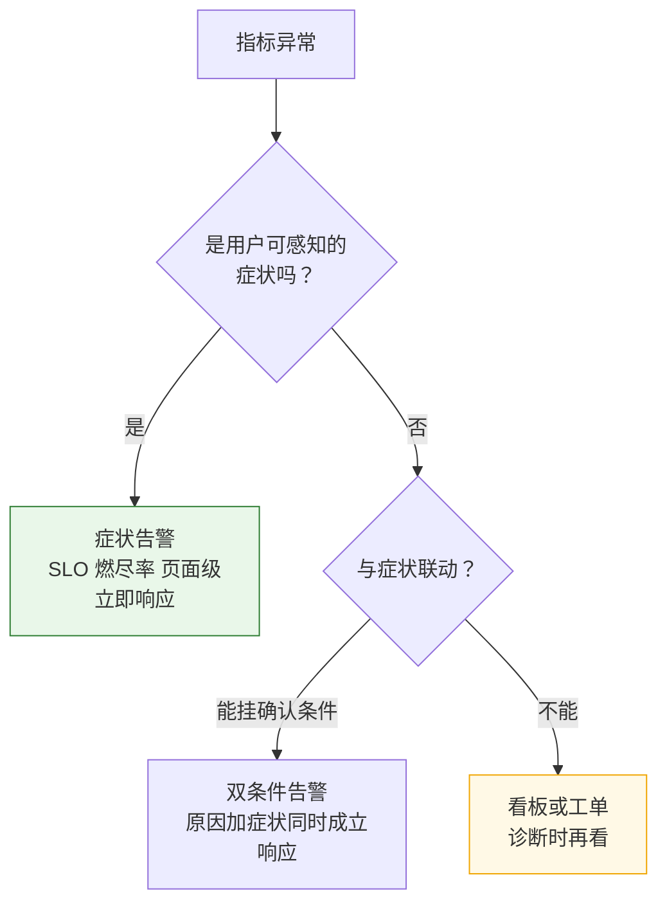

# 告警规则与症状噪声：一个阈值为什么治不了延迟波动

**阈值告警的失效模式是结构性的：延迟是重尾分布，阈值定在哪一刀都切不对——定高了漏掉慢性劣化，定低了被日常抖动淹没；治本的办法是让告警看症状（用户可感知的失败），而不是看原因（资源与中间指标）**。 读完你能回答：**为什么「延迟超 200ms 就告警」必然两头不讨好、症状告警与原因告警怎么分工、多窗口与倍率怎么配、告警噪声的成本怎么核算**。

## 要解决的问题

**延迟类指标的分布形态决定了阈值告警的困境：P99 在日常就有自然波动（GC、缓存过期、突发流量），阈值 200ms 时每天误报十几次——响应的人很快学会忽略它；调到 500ms，真正的事故前兆（P99 从 180 缓慢爬到 400 的内存泄漏）全程沉默直到爆发**。**同一个阈值既要滤掉噪声又要抓住信号，在重尾分布上是数学上做不到的**。 **误报与漏报之间没有平衡点，只有换度量方式一条路**。

## 机制：症状与原因的分工

### 症状告警：用户可感知的失败，高优先级

症状（symptom，用户视角的失败）直接对应 SLO：**错误预算消耗率、可用性比例、延迟达标比例**。这类告警的特征是**必然真实**——**用户真的受影响了，值得叫醒人**。多窗口燃尽结构（短窗口抓突发、长窗口抓慢性）在 SLO 篇已展开，此处不重复。

### 原因告警：中间指标异常，低优先级或仅作诊断

原因（cause，导致症状的中间状态）包括 CPU、内存、队列深度、连接数、缓存命中率。**这类指标的阈值告警天然多发误报——资源波动多数被系统自愈吸收，真正演成事故的是少数**。定位：**原因告警用于看板与诊断（事故发生时快速归因），不用于叫醒人**；**必须升级为页面告警的原因指标，要挂上与症状的确认条件（如「队列深度高 且 错误预算消耗率超 3 倍」），双条件把噪声压下去**。

### 噪声的成本核算

**告警噪声不是烦人而已，是可核算的损耗：每次误报消耗响应者 15-30 分钟（查看、判断、记录），每月 50 次误报就是一个工程师的三分之一工时**；**更贵的是狼来了效应——响应对噪声的阈值不断提高，真告警混在噪声里的有效响应时间显著变长**。**降噪的优先级排序：删（从未有响应价值的规则直接删）、并（同源告警合并）、降级（页面降工单）、双条件（原因告警挂症状确认）**。

## 案例：信号语义失真的共通结构

[[工程知识/缺陷分析：从个案到体系/正确性/日志级别的语义：把提示当告警，告警就成了背景噪音]] 是本篇在日志域的同构案例：BookKeeper 把常规事件打成 WARN，告警系统按级别转发后噪声淹没信号——**信号通道的语义纪律（什么该进告警通道）与阈值设计同样重要**。**通道进来的每一张告警都要么值得响应、要么删除；「留着总归安全」的告警在狼来了效应下是负资产**。[[工程知识/后端系统：在并发、失败与变化中维持服务/服务设计/SLO把可靠性目标变成可核算的错误预算：从SLI选择到燃尽告警]] 给出症状侧的完整账本：**错误预算是症状告警的数学基础，双窗口倍率是它的标准配置**。

## 怎么测

- **告警审计：逐条统计每条规则近 90 天的触发次数与响应率（被查看/被处置的比例），响应率低的规则进删除或降级清单**。**验证方式是审计对账：规则清单与触发日志逐条核对，对不上的幽灵规则直接下线**。
- **误报回归：用历史 30 天数据回放告警规则，统计「触发但事后确认无需处理」的比例，作为降噪前基线**；**降噪后的回放结果要与基线对比，预期误报率显著下降，对不上就说明改的是敏感度而不是噪声源**。
- **漏报演练：注入已知故障形态（内存泄漏的慢性劣化、依赖超时的突发），预期症状告警在预期时间内触发；实测没触发说明症状覆盖有缺口**。
- **值班反馈闭环：每次页面告警后记录「是否值得叫醒」，月度复盘把不值得的规则逐条处置**。

## 哪些认识一看就错

- **「告警多一点更安全」——噪声稀释响应能力，狼来了效应让真告警的响应变慢；告警通道的稀缺性就是它的价值**。
- **「阈值微调总能找到平衡」——重尾分布上误报与漏报由分布形态决定，参数微调只在这两者间移动；结构性问题要换度量（比例、燃尽率、多窗口）**。
- **「原因指标告警更早发现」——资源指标先动不假，但多数波动自愈，为「更早」付出的全是误报；早发现的价值要在低误报前提下重新核算**。
- **「告警规则定完就不用管」——流量与架构漂移让规则的信噪比持续变化，月度审计与响应率统计是维护成本的固定项**。
- **本篇的边界：它治理的是「告警响应质量」，不覆盖监控覆盖度本身——该有的指标没采集，再好的告警纪律也测不出盲区，覆盖度治理在监控分层篇**。

## 效果从哪来、要付什么代价

**症状告警保证每条页面告警都对应真实用户影响，双条件把原因告警的噪声压进看板层，审计闭环让规则集随系统演化持续瘦身**。**代价是建设成本：SLO 体系要先行**（症状告警的度量基础）、**审计流程要常态化**（月度复盘的纪律）。**收益按响应质量结算：值班工程师看到的每条告警都值得响应，真故障的有效响应时间显著缩短——告警系统的质量用它引发的响应质量度量，不用它的数量**。

关系：[[工程知识/后端系统：在并发、失败与变化中维持服务/服务设计/SLO把可靠性目标变成可核算的错误预算：从SLI选择到燃尽告警]] —— 症状告警的数学基础与双窗口配置。[[工程知识/缺陷分析：从个案到体系/正确性/日志级别的语义：把提示当告警，告警就成了背景噪音]] —— 日志域的信号语义失真同构案例。[[工程知识/性能工程：从用户等待到资源瓶颈/观测与诊断/监控体系按四个问题分层：坏了没、坏了哪、为什么坏、会再坏吗]] —— 症状与原因在观测分层里的完整位置。
