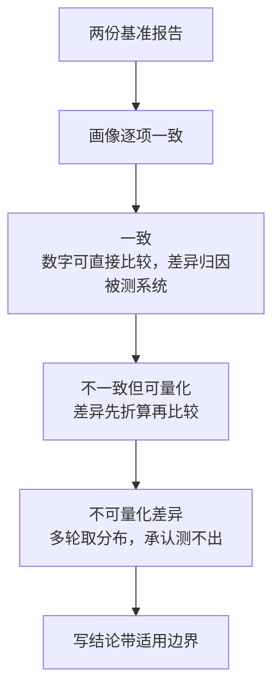
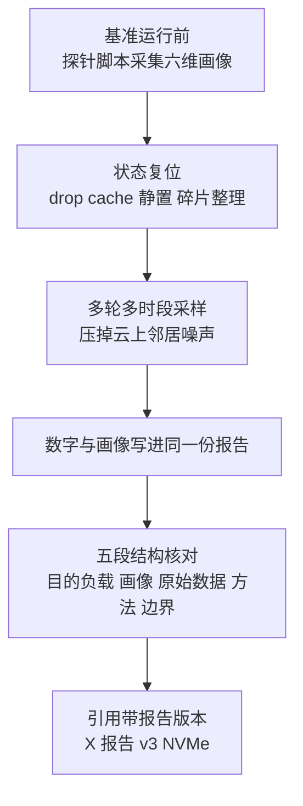

# 基准报告要绑定机器画像：没有环境描述的数字不可比较

> **要点**：基准数字离开环境画像就没有意义——报告必须绑定机器画像（硬件规格、内核参数、并发配置、观测方法），画像齐备的两组数字才能比较，缺画像的数字只能当单点记录；本机画像用现成探针脚本采集，成本是一次命令行。

## 为什么没有机器画像的性能数字不能比较？

本篇要解决的问题从这里开始：**团队里的性能数字经常以"上次测试是 X"的形式流传**，**第二次测试得出 Y 时无人在意 X 的环境**——**两台不同内核参数的机器、不同并发度、不同数据量的测试结果被当成"同一个东西的两次测量"来比较**，**结论从源头就是错的**。本库性能域"数据库基准必须描述负载与资源边界"给过基准的负载描述纪律；本篇把环境描述展开成可操作的画像清单：**画像的采集方法（现成工具一次取齐）、画像与数字的绑定方式、跨机器比较的条件**——**画像的成本极低（几个探针命令），缺画像的成本是所有基于错误比较的决策**。读完这一页你能**给报告补一份六维画像，并判断两组基准数字到底能不能比**。

## 机器画像由哪六个维度构成、怎么采集？

画像的机制在于**不写在报告里靠人填，而是放在应用之外统一存着，跑基准的时候取出来一起归档**。**画像的实物形态是机器的硬件拓扑**：**hwloc（Portable Hardware Locality）项目把一台机器画成一棵层级树**——**机器之下是插槽、NUMA（非统一内存访问，多路服务器内存分槽、跨槽访问更慢）节点、缓存与核心**，**每个基准数字背后的「机器」就是这棵树**：


*图源：Wikimedia Commons《Hwloc.png》，hwloc 项目（Open MPI 项目）文档示例图，https://commons.wikimedia.org/wiki/File:Hwloc.png，BSD 许可。*


**硬件层**：**CPU 型号与核数、内存容量与通道数、磁盘型号与接口（NVMe 是走高速总线的固态盘接口，SATA 是传统的串行硬盘接口）、网卡带宽**——`lscpu`、`free`、`lsblk`、`ethtool` 一组命令取齐。**同型号是画像的前提，不是可省的说明**：**云主机的"同规格"可能对应不同的宿主机抢占状态**，**同型号不同宿主机的噪声差异要靠多轮取中位数压掉**——**多轮采样（只采集一部分数据以控制记录开销）里邻居噪声随机上下波动，取中位数能抵消这些随机抖动（性能指标不稳定的起伏）**。CPU-Z（查看 CPU 与主板信息的工具） 这类探针（向系统注入的检测点或检测请求）工具展示的正是画像要记录的内容——**实时时钟频率、倍频、各级缓存容量与相联度、物理核与线程数**，**一份基准报告的机器画像就是这些字段的归档**：


*图源：[Wikimedia Commons，Franck Delattre (CPUID)，公有领域](https://commons.wikimedia.org/wiki/File:CROP_2025-07-08_16_12_58-4797.25_MHz_(Core_-0)_2.png)。*

**系统层**：**内核版本、关键参数（调度器参数，即控制进程何时上处理器、分多少时间片的内核设置）、透明大页（内核把多个内存页合并成大页以减少地址转换开销的特性）、IO 调度器、网络缓冲区（内核收发数据包用的内存队列大小）**——`uname -a` 与 `sysctl -a` 的关键子集。**透明大页与 IO 调度器是性能数字的高频变量**（**二者改动内存分配与 IO 队列的组织方式，直接挪动延迟与吞吐**，**数据库负载上差异可达两位数百分比，画像缺失时先核这两项**）。

**配置层**：**被测系统的版本、关键配置（连接数、缓冲区、线程数）、数据规模与分布**——**基准的可比性要求这些配置逐项一致**，**任何一项不同都要在报告里显式声明**。

**观测层**：**测量方法（用什么工具、统计口径是平均值还是 P99）、采样间隔（每隔多久记录一次数值）与观测开销**（**探针自己占用的处理器与 IO 会抬高被测数字，需要测出并扣除**）。**测量方法不同的两组数字比较是方法论错误**，先统一方法再比数字。

**绑定方式**：画像与数字写进同一份报告（画像清单作为报告的固定章节），数字的每次引用都带上报告版本——**"X（报告 v3，NVMe/tps=4200）"的引用方式让比较条件随行**。

**跨机器比较的条件**像考试比分数：**同一张卷子才能直接比分数（画像逐项一致，差异归因被测系统）**；**卷子不同但难度可折算就先折算再比（差异可量化，先折算再比较）**；**卷子完全不可比就比各自的分数分布（宿主机抢占、固件版本这类不可量化差异，用多轮取分布比较）**——**单轮数字的差异小于分布的散度时，差异可能只是噪声，结论是"测不出差异"**，**承认测不出比硬给结论诚实**。

**两份报告摆到一起，比较资格按三条路径判定，判定完才知道数字能不能比**：



**比较资格的分级：一致才可直比、可量化先折算、不可量化靠分布**，**三条路径之外拿单轮数字硬比，结论从源头就错**。

## 一份可比较的基准报告长什么样？

**一份可比较的基准报告五段**：**目的与负载定义（测什么问题、什么负载形态）**、机器画像（六维度清单）、**原始数据（多轮分布，不只中位数）**、**方法说明（工具、口径、轮数）**、**结论与适用边界（数字在什么条件下成立）**。**五段缺任何一段，报告的数字只能当单点记录**——**不能用于比较决策**。


**画像采集在基准之前就位**：探针脚本跑在基准之前，**状态复位紧跟其后，之后的多轮多时段采样才有可比较的基数**，**数字与画像自始至终写进同一份报告**：



**采集、复位、采样、绑定这条链自动化之后，手动画像漏项的问题消失，画像的成本降到一次脚本运行**。

**画像采集的自动化**：**探针命令打包成脚本，基准运行前自动采集并嵌入报告**——**手动画像必然漏项**，自动化让画像成本接近零。本库硬件域"基准结果的可复现性"给过可复现的纪律；**画像是可复现的第一步：环境不可描述，复现无从谈起**。

**比较的记录习惯**：**团队内流传的性能数字统一挂报告链接**——**"口头数字"进入决策链路时要求先补报告**，**数字的流通纪律与画像的采集纪律是同一件事的两面**；**纪律的收益是任何一次比较都有环境可查，代价是"随手测个数"不再被接受为决策依据**。

## 这套说法在哪儿会失效

**画像不是越细越好**：**与负载无关的维度（如 GPU 对纯磁盘基准）进画像只是噪声**——**画像维度按负载类型裁剪**，磁盘基准画 IO 与 CPU 路径，网络基准画 NIC（Network Interface Card，网卡） 与内核网络栈。

**画像一致不保证可比**：**同画像下的运行时状态（页缓存温度、后台任务、碎片程度）仍会引入差异**——**基准前做状态复位**，把机器调回干净的起跑线：**清页缓存（drop cache）、静置到空闲、按被测对象整理碎片（存储空间里零散不连续的小块）**，**做到后台噪声不再主导测量为止，复位动作写进方法说明**。

**云端环境的画像要加租户维度**：**虚机的邻居干扰（noisy neighbor）不进常规探针**——**云上基准用多轮多时段采样**，单时段的数字在云端环境散度大，**跨云比较更要声明实例类型与时段**。

## 怎么自己动手验证

下面四步都不需要专用环境，每步写明了预期结果，跑完对照即可。

1. 画像脚本验证：探针脚本在两台同规格机器上运行，**预期输出结构一致、字段完整——脚本本身是画像的采集工具验证**；
2. 敏感性验证：**对画像中一项（如透明大页开关）做开关对比测试，预期数字差异被捕捉**——**证明画像维度选对了（无关维度的开关对比应测不出差异）**；
3. 比较纪律验证：**抽查团队内两份流传的基准报告，预期五段结构齐全、画像版本可追溯**；
4. 断言锚点：**画像随基准自动采集、报告五段结构在模板里、数字引用带报告版本**——三件齐备，**性能数字从口头传说变成可比较的证据**。

```text
画像断言 = 探针脚本一次取齐六维度
敏感断言 = 维度开关差异可被捕捉
纪律断言 = 数字引用挂报告版本
```

**基准的可比性建立在画像上**：**六维度探针一次取齐、报告五段固定结构、引用挂版本**——画像的成本是一次脚本运行，**它换来的是团队内每个性能数字都有名字、有环境、有边界**。

## 接着读哪几篇：画像维度按负载裁剪的依据

- [[工程知识/性能工程：从用户等待到资源瓶颈/观测与诊断/基准结果的可复现性：不能稳定重跑的数字不能进决策.md]] —— 可复现纪律，本篇补环境画像面
- [[工程知识/数据系统：在并发与故障中保存事实/可靠性与运维/数据库基准必须描述负载与资源边界]] —— 负载描述纪律
- [[工程知识/性能工程：从用户等待到资源瓶颈/存储与网络/存储IO性能取决于访问模式、队列与持久化语义]] —— 画像维度按负载裁剪的依据
- [[工程知识/性能工程：从用户等待到资源瓶颈/观测与诊断/基准测试必须先定义负载和测量误差]] —— 测量方法与观测开销的方法层
