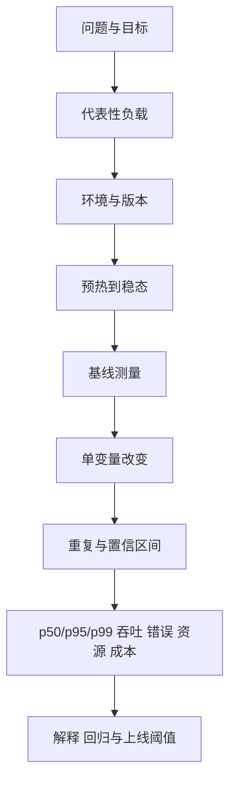
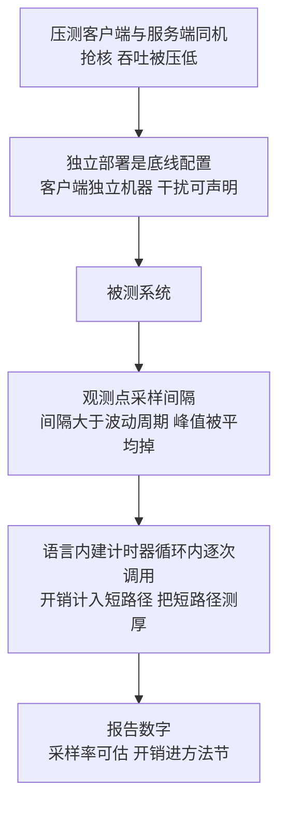

# 基准测试必须先定义负载和测量误差

**这篇要讲明白一件事：基准测试必须先定义负载和测量误差，否则数字不可信——基准是一个实验，不是一个数字**。**请求/数据分布、并发、到达模式、缓存、预热、硬件、版本、采样（只采集一部分数据以控制记录开销）、运行时抖动（性能指标不稳定的起伏）和结果统计都会改变结论；没有这些上下文的“快 30%”不可复用**。**读完这篇你能说清一个"快 30%"要带上哪些上下文才可信，也能把负载和误差定义清楚，让别人复现你的结论**。

**基准的产物应是“在何种负载和误差范围内，哪个变量造成了什么变化”，而不是一个脱离环境的排行榜——这个比方只到"脱离上下文的数字没有意义"为止，排行榜的名次会诱导人为了刷分挑负载，正是基准要避免的**。对 AI 服务还要把质量、token（模型处理文本的最小单位，约相当于一个词或半个词） 分布、上下文命中（请求的数据已在缓存中，不用重算）和单位成本纳入同一实验。

## 要解决的问题：负载由哪些维度描述

**两个环境之间比较吞吐或延迟数字，得出快百分之几十的结论，换到真实负载上差异消失或者方向相反**。本篇回答：负载由哪些维度描述、测量误差从哪里来、预热（上线前提前加载数据或建立连接，避免初期变慢）与轮次为什么是纪律要求、中位数与分位数（把耗时排序后取某个百分比位置的值、如 P99）各自表达什么，以及结果要带哪些上下文才算可复用。


## 实验该按什么模板走才不会漏段？

模板的第一段是问题与目标（测什么问题、结论给谁用），第二段是代表性负载（负载定义先于一切数字）：

```text
问题与目标 -> 代表性负载 -> 环境与版本 -> 预热/稳态
          -> 基线 -> 单变量改变 -> 重复与置信区间
          -> p50/p95/p99（第 50/95/99 百分位的延迟，即 100 次请求里排在 50%、95%、99% 位置的耗时）、吞吐、错误、资源、成本
          -> 解释、回归与上线阈值
```

**吞吐测试要说明是否排队、批处理（把多个请求合并成一批同时计算、提高硬件利用率）或丢弃超时请求；延迟测试要说明客户端/服务端边界、冷启动（缓存或服务刚启动、还没有数据与连接的状态）和长尾（少数请求耗时远高于其余大部分）**。**平均值不能替代分位数——平均值把长尾抹平，而 P99（99% 的请求耗时不超过这个值） 这类尾延迟（P99 一类的慢请求耗时指标）才决定真实体验**；**单次运行不能证明稳定收益——单次可能被冷启动或抖动污染，只有重复取中位数才能排除偶发**。

**实验模板九段环环相扣，前段是后段的输入，缺段会让后段返工，最后一段"解释、回归与上线阈值"把结论钉回使用场景**：



图：段与段的依赖顺序——负载定义先于环境声明（负载形态决定哪些环境变量是关键）、预热先于基线（冷态基线会把初始化成本带进所有对比）、置信区间（按样本估计真实值时的误差范围）先于结论（无区间的数字过不了复测对账），模板九段的排列本身就是防返工的顺序。

负载定义缺一项，测量曲线就多一处解释不了的起伏。下图是生产环境的实测记录：同步客户端在收到错误后立即重试，重试流量与正常流量叠加，请求数、延迟、后端延迟三条曲线一起振荡——负载定义里不写清重试行为，任何时刻的读数都无法归因：


*图源：Google SRE（Site Reliability Engineering，网站可靠性工程：用软件方法做运维） Workbook《Managing Load》Figure 11-6，https://sre.google/workbook/managing-load/，引用于基准负载定义与重试放大效应。*

**首段列出的负载维度（请求构成、键分布、数据量、并发等）之外，还有负载在时间轴上的形态——同样是 200 并发，均匀持续（恒定压力）、阶梯爬升（逐级加压）、脉冲冲击（瞬时高峰）对系统压出来的状态完全不同；这三种是简化归类，与下文 k6（Grafana Labs 旗下的开源压测工具）的六类形态（Smoke、Stress、Spike 等）可以对应着看**。k6 官方文档把常用负载形态画在同一张图里：Smoke（冒烟验证）、Average Load（平均负载）、Stress（压力递增）、Soak（浸泡耐久）、Breakpoint（断点探测）、Spike（尖峰冲击）六类在持续时间与 VU（virtual user，虚拟用户）数两轴上的分布一目了然：


*图源：Grafana k6 官方文档《Test types》，https://grafana.com/docs/k6/latest/testing-guides/test-types/。负载定义写清形态类目，测量结论才能限定适用范围——冒烟负载测出的吞吐不能外推到尖峰场景。*

"数字要能对上数"的实物原型是天平与砝码：老当铺与药房的戥子每次称量前先放标准砝码校零校量程——砝码是公认的基准点，称出的数字才有分量；砝码本身磨损了或放错面值，称得再仔细也全错：


*图源：Wikimedia Commons，CC BY 4.0，https://commons.wikimedia.org/wiki/File:Balance_scales_cum_weights.jpg。*

**基准测试的"负载定义"就是先摆砝码：请求构成、键分布、并发、预热状态这些就是砝码的面值——基准报告先声明这批砝码，读数（QPS、P99）才有对照系；负载没声明的"快 30%"，等于拿一块锈蚀砝码称出来的斤两，换一架天平就对不上**。这个比方到「没有声明的读数不能比」为止——砝码是实物、面值固定，负载会随用户行为漂移，所以负载定义还要写清测量窗口与预热。**误差披露（±320 ops/s、轮间差 2.7%）则相当于报出砝码的允差等级，让听的人知道这个数在几位有效数字上可信**。

## 测出的数字为什么会骗人：常见偏差有哪些？

- **合成数据过于均匀，隐藏热点（访问集中在少数键或节点上的现象）、长尾和真实大小**。
- **预热不一致或缓存状态不同，测到初始化而非稳态（系统运行指标进入平稳区间后的状态）**。
- **优化一个微基准，却改变了端到端排队、网络、质量或成本**。
- **只看 CPU/GPU 利用率，不看用户 SLO（服务等级目标，对外承诺的可用性与延迟水平）和错误**。

**三个偏差源的干扰方向各不相同：客户端同机把吞吐压低、采样间隔把峰值平均掉、内建计时器把短路径测厚——方向不同意味着它们不会互相抵消**：



干扰量摆上台面才能判断换不换工具：声明不了采集位置与开销估算的工具，它给出的数字不进报告的方法节。

**测量工具自身也是偏差源，选型时先把干扰量摆上台面：压测客户端跑在被测机上时，客户端 CPU 与服务端抢核，吞吐数字先被压低（客户端独立部署是底线配置）；采样式监控的采集间隔大于负载波动周期时，峰值被平均掉（秒级采样的监控面板看不到毫秒级突发）；语言运行时的内建计时器有开销：Python 的 time.perf_counter 单次调用百纳秒级，循环里逐次计时会把执行时间本就很短的函数测厚**。**工具链的干扰要在报告的方法节声明采集位置与开销估算，声明不了就换低侵入工具：perf（Linux 性能剖析工具，统计 CPU 采样与硬件事件）的采样开销按采样率（只按比例保留部分样本、其余丢弃的比例）可估，eBPF 即内核内可编程观测机制，探针（向系统注入的检测点或检测请求）开销按事件量可估**。

## 动手跑一遍会看到什么：一份误差可见的基准报告模板

同一个"QPS（Queries Per Second，每秒查询数） 12000"的结论，误差披露前后是两份不同的报告：

```text
负载定义（先于一切数字）：
  请求构成：80% 读（点查 95% + 范围查 5%）、20% 写（单行 upsert）
  键分布：Zipf 0.9（少数 key 极热的倾斜分布，参数越大热点越集中；这里的取值对齐生产抓包）
  数据量：1 亿行 × 200B，热数据占比 40%
  并发：200 连接，预热 10 分钟（缓存形态达到稳态）

测量结果（带误差与分位）：
  吞吐：11,950 ± 320 ops/s（三轮中位数，轮间差 2.7%，判据 <5%）
  延迟：P50 2.1ms / P95 8.4ms / P99 22ms
        （P99 的置信区间 ±3ms——只有 1% 样本支撑，波动天然大）
  资源：CPU 78%、磁盘读 210MB/s、网络 84MB/s

结论（只在边界内成立）：
  "该配置下 80/20 Zipf 负载、1 亿行规模，吞吐约 1.2 万 ops/s，
   瓶颈在 CPU；键分布改均匀分布或热数据占比过半，数字要重测。"
```

**跑一遍的收获：误差披露把"测出来 12000"升级成"测出来 12000±320 且三轮稳定"——没有误差的数字在下一轮复测就对不上，对不上就没人再信任何数字**。**P99 的置信区间天然比 P50 宽得多（同样本量下尾部样本占比只有百分之一，两边统计基础的差距按样本占比的倒数放大），这是"只报 P99 不报样本量"的报告不可信的数学原因**。

## 这些结论的量级靠什么数字支撑

**稳定性的判据账：轮间差 <5% 是基准可用的最低门槛，超过说明预热不足或有后台噪声，checkpoint（检查点落盘）与日志压缩都是常见源，测三轮取中位数是纪律底线**。**预热的账：缓存冷热两态的吞吐差按存储层次的速度差推——DRAM（动态随机存取内存，常见的主内存） 与 SSD 固态硬盘的访问延迟差三个数量级，读全部命中缓存时吞吐上限由内存带宽决定，内存库冷启动的差距更大，跳过预热等于把"冷态性能"当"稳态性能"报告**。

案例回流：数据库域的同款纪律见 [[工程知识/数据系统：在并发与故障中保存事实/可靠性与运维/数据库基准必须描述负载与资源边界.md]]（负载与资源边界三问，两篇是同一方法在两层存储的各自展开），负载定义缺失的实录后果见 [[工程知识/缺陷分析：从个案到体系/资源与容量/案例六：容量与泄漏——连接泄漏和 SST 堆积]]——容量假设建立在无边界基准上，量产后假设失效。

## 怎么自己动手验证

**基准结论要与离散程度对账——预写多轮重复的离散度应在可接受范围内，单轮结果与预期对不上时先扩大样本——单轮只是一次抽样，扩大样本才能看出真实离散度；采信最快的一次没有意义——最快一次往往是冷态或抖动的幸运值，把它当结论等于把噪声当性能**。

**至少重复多轮并报告中位数、分位数和离散程度；用真实回放与合成负载交叉验证；固定随机种子/版本/拓扑；在目标硬件和压力区间测量饱和点。AI 推理还要固定输入/输出 token 分布、模型质量和 KV（Key/Value，键值）缓存（cache）状态**。

关系：[[工程知识/性能工程：从用户等待到资源瓶颈/性能工程：从用户等待到资源瓶颈]] · [[工程知识/性能工程：从用户等待到资源瓶颈/观测与诊断/排队论给容量一个可推导的模型]] · [[工程知识/数据系统：在并发与故障中保存事实/可靠性与运维/数据库基准必须描述负载与资源边界]]
- [[工程知识/性能工程：从用户等待到资源瓶颈/观测与诊断/市面Benchmark的设计读法：宏微与中间层基准.md]] —— 自做基准讲纪律，读别人的基准讲读法，同方法论两方向
- [[工程知识/性能工程：从用户等待到资源瓶颈/观测与诊断/性能回归门禁：把性能预算写进CI.md]] —— 门禁的基准复用负载与误差纪律
- [[工程知识/性能工程：从用户等待到资源瓶颈/观测与诊断/分位数是估算出来的：直方图分桶、插值误差与跨实例聚合的边界]] —— 报告里那些 P50/P95/P99 是直方图（把数值按区间分桶统计、看分布形态）桶内插值的结果，误差上界是桶宽

## 基准的本质是什么？

**基准是一次受控实验，结论由负载定义、测量方法与误差范围三部分共同成立**。**请求与数据分布决定系统走到哪个状态，并发与到达模式决定队列与竞争程度，预热与轮次决定测量是否位于稳定区间；任何一个上下文缺失，得到的数字都无法迁移到别的环境**。