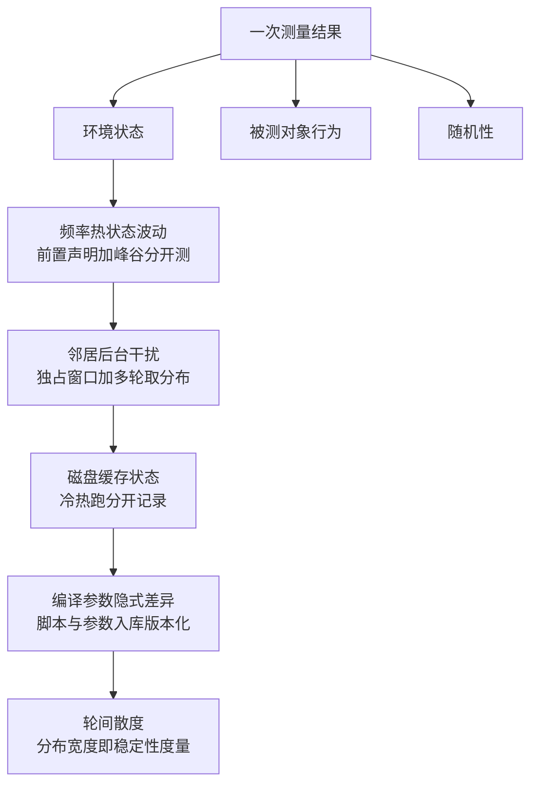
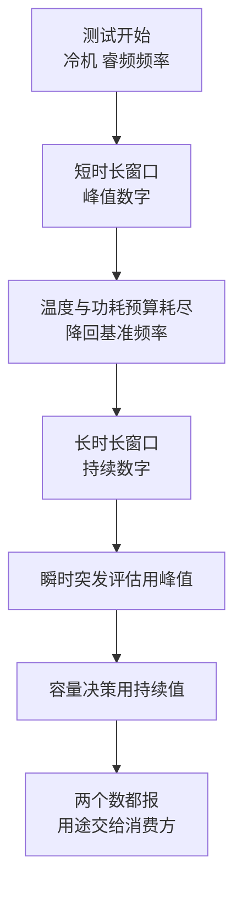

# 基准结果的可复现性：不能稳定重跑的数字不能进决策

> **要点**：**硬件层的一切性能数字都带着环境指纹（频率、负载、状态、随机性）**，**跑一次拿到的数字没有证据资格**——**能以可声明的方式重跑并给出差异范围的数字才能进决策**。

## 为什么不能稳定重跑的数字不能进决策？

硬件层的性能数字有一个与软件层不同的特点：**它把环境状态和随机性一起包进了结果**。**软件层的性能问题（一个函数的耗时）尚且受环境干扰**，**硬件层的数字直接由频率、温度、磁盘磨损、页缓存状态共同决定**。市面 Benchmark（基准测试：按固定负载跑分，给系统性能一个可比的数字）的设计读法一文解决了"基准测什么才可靠"的问题；**本篇解决另一半："这个数字本身可信吗，重跑还会是这个数吗"**。

**不稳定数字的真实成本，全部发生在决策链上**：采购选型按厂商发布的一组跑分做决定，**跑分是理想环境下的最好成绩——理想环境剥离了邻居、后台与热衰减，生产里这些因素都回来了**，**实测通常明显低于发布值（常见的说法是打了七折）**——**数字在生产环境不可复现，选型就从证据变成了赌博——就像拿一次运气好的结果当稳定事实去下注，环境一变就亏，选型的输赢取决于这个数字能不能复现**；**超分超卖（卖给客户的资源超过实际拥有量，赌多数客户不会同时用满）按实验室峰值定容量**，**峰值是一次性事件，线上持续负载下性能回落**，SLA（Service Level Agreement，服务等级协议：承诺水平达不到通常要按合同退费或补偿）指标就会失守。这些事故的共同结构：**单次测量 + 未声明环境 + 无重跑记录，被当成了稳定事实**。

## 数字为什么不能稳定重跑？

**重跑不稳的一大来源是缓存：第一次跑要回源加载，第二次跑命中缓存，两个数字不是同一件事**。**跑基准前先失效页缓存（内核用来加速文件读写的临时内存，读过的文件再读直接走内存）并声明冷热跑状态**，**这条路径的失效动作必须写进重跑协议**。
**一次测量结果 = 被测对象的行为 × 环境状态 × 随机性**——**机制在于三个乘数硬件层都不稳定，每一个都把波动直接乘进结果**：

**频率与热状态的波动**：**CPU 从基准频率到睿频（CPU 在散热与供电允许时自动把频率拉到高于标称值的状态）差可达一倍**，**睿频持续多久由功耗与温度预算（CPU 允许的耗电与散热上限，超过就自动降频保护）决定**。**基准测试刚开机时跑在睿频上，十分钟后降回基准**——**同一个测试，时间窗不同，结果不同**——**所以要做前置声明、峰值与持续分开测**。**"峰值性能"与"持续性能"是两个数，测到哪一个取决于测试时长**。

**邻居与后台的干扰**：**共享环境下（云主机、同宿主机其他租户），邻居的负载直接影响你的缓存与带宽占用**；**本机后台任务（日志回写、监控采集、定时任务）在测量窗口里插入干扰**。**裸机独占能消除邻居，消除不了系统自身的后台活动**。

**磁盘与文件系统的状态**：**写性能测试跑在全新空盘上，与跑在用了三个月、SSD（固态硬盘）缓存已磨损、文件系统碎片累积的盘上，数字可以差数倍**。页缓存状态同理——**缓存（把用过的数据暂存在更快的存储里，下次直接取，不用再走慢的那条路）的第一次读冷数据走磁盘，第二次读同一数据走缓存**，**"冷跑"与"热跑"是两个不同的测量**。

**编译与参数的隐式差异**：**重跑时的编译选项、库版本、内核参数与上一次不同，数字自然不同**——**这类差异可声明、可控制，与前几类"不可控但可声明"的环境因素共同构成重跑协议的内容**。

分析天平把"重跑协议"做成了一间屋子：**同一枚砝码，今天称和明天称、不同操作员称，读数必须一致**——**这个一致性不靠天平本身，靠称量协议**：恒温恒湿的屋子（环境状态声明）、砝码的校准证书（CA 签发的公钥凭证、证明持有者身份）——**对应基准溯源：记录这次跑用的是哪个版本脚本与哪台机器**，就像校准证书写明砝码何时、由谁标定、开关门静置后再读数（操作规程固定）。**缺了协议的天平也会给出读数，但每次读数都混着当天温湿度的指纹**，**两次读数的差异你说不清是物体变了还是屋子变了**。

当然，天平的读数不像基准数字那样受频率与缓存影响，这里**只借它「同一条件多次称量结果一致」这一点**——基准数字同理，**没有重跑协议的数字分不清是代码变了还是环境变了**：


*图：Phoronix Test Suite 的图形界面（v2.0.0，Wikimedia Commons，GPL 许可）。**界面上的三个元素对应重跑协议的三件事**——统一封装的测试用例（Installed/Available Tests）让每次跑的是同一件事、Test Results 标签页归档历次结果、Batch Mode 支持无人值守多轮批量跑——**「多轮跑取分布」在真实基准工具里就是这三个功能的组合**。*

*图源：Wikimedia Commons，[Phoronix test Suite-2.0.0.png](https://commons.wikimedia.org/wiki/File:Phoronix_test_Suite-2.0.0.png)，GPL 许可；工具官网 https://www.phoronix-test-suite.com/ （Phoronix Test Suite：开源跨平台的系统基准测试套件，Linux 评测常用）。*


*图源：同上（Wikimedia Commons），Sergei Golyshev。*

这些波动的处理方式由数字的用途决定：决策需要的是**可复现声明下的结果区间**，**单点数字只在"恰好处于稳定状态"时偶然成立**。

一次测量被三个乘数拖着走，每个乘数有对应的防线，见下图：



**防线与波动来源的对应：声明管环境可见性、分布管随机性、分开测管状态迁移**，**三条防线齐了数字才是区间证据，缺一条就退回单点记录**。

## 靠什么让数字可复现？

**可复现性的防线要能被外部定期验证：应用暴露一个健康端点，监控服务按固定间隔探测**。**这条外部验证与下面的测量纪律是并列的两道防线，层次不同**：外部验证针对服务整体是否可复现，给一个随时可查的信号；下面的测量纪律针对单次测量如何控住环境。**验证动作自动、可重复，「稳定重跑」这个说法才立得住**。


**测量前置状态声明**：**每次基准记录环境快照（某一时刻的完整只读副本）**——**CPU 型号与 governor（CPU 调频策略开关，决定频率随负载如何变化）、内存配置、磁盘型号与已用量、内核版本、后台负载、测量时长与次数**。**声明的意义在纵向对比：两份数字的可比性由环境差异决定，环境未声明的对比没有意义**。

**多轮跑取分布**：**单次测量升级为 N 轮（预热轮丢弃、正式轮取分布）**，**报告中位数与分位数（把耗时排序后取某个百分比位置的值、如 P99），不报告最好成绩**——**分布的宽度本身就是结果稳定性的度量，这个宽度就是轮间散度，宽分布说明结果不稳**。**此时应先判断波动来自测量噪声还是样本太少——样本不足同样会造成宽分布，直接归因环境会误判**；**确认是环境干扰后再去控环境，不要急着引用数字**。


**同一个测试在时间轴上的不同位置给出两个数**：睿频窗口内的短时长测到峰值，温度与功耗预算耗尽、降回基准频率之后的长时长测到持续值：



**两个数用途不同、不可互换，只报其中一个，容量决策与突发评估必然有一个用错数**。

**峰值与持续分开测**：**短时长测峰值（测试开始时冷机、睿频频率窗口内）、长时长测持续（热稳定后），两个数都报告且用途分开**——**容量决策用持续值，瞬时突发评估用峰值**。**用哪个数的决定权留给消费方，但两个数都要给**。

SPEC（Standard Performance Evaluation Corporation，标准性能评估组织）的结果发布把「峰值与持续分开报」这条纪律做成了表格制度：**每行一个测量记录，Base（基础口径即持续值）与 Peak（峰值口径）两列并排，系统配置、编译器与测试发起方随行披露**——**峰值数字与持续数字在发布环节就分开占列，谁也不能只报好看的那一个**：


*图：SPEC CPU 2026 官方结果页表（虚拟地址到物理地址的映射表）格。每行是一份基准报告：Test Sponsor（测试发起方）、System Name、Base Copies、处理器配置、Results 的 Base 与 Peak 两列、Compiler 列，每条记录附 HTML/CSV（用逗号分隔字段、可直接用表格软件打开的纯文本格式）/Config 链接（Config 即完整配置披露）。Base 与 Peak 并排占列意味着两种测量口径都必须公开，环境声明是 SPEC 发布的准入条件——制度要求每份结果必须随附配置披露，不接受未声明环境的报告。*

*图源：SPEC 官网，[All Published SPEC CPU 2026 Results](https://www.spec.org/cpu2026/results/cpu2026.html)。*

**关键决策双环境验证**：**采购、架构选型这类高成本决策，实验室数字之外在类生产环境复测**——**同一套脚本、同样的负载模型，数字偏差超过预期就要查环境差异，查不出来就按保守值决策**。

**数字与脚本一起入库**：**基准脚本版本化，结果记录附带脚本版本与参数**——**三个月后的复测能对上"当时怎么测的"，数字才具备纵向可比性**。

## 这套说法在什么情况下会失效？

**三条边界各防一种走形**：可复现不等于数字固定，防的是把复现误解为每次同值；双轨取舍防的是把基准环境当生产；随机性控制适度即可，防的是试图消除一切随机。

**可复现不等于数字固定**：**目标是"差异可解释、范围可声明"，重跑结果在声明的范围内波动即算复现**——**追求每次完全相同的数字会把测量引向过度简化的环境，失去代表性**。

**基准环境与生产环境的取舍**：完全模拟生产的基准环境成本高且仍非生产；**规范做法是双轨——可控环境跑可比数字（版本间对比），生产环境跑真实流量画像（容量校准），两份数字回答不同问题**。

**随机性控制适度即可**：**固定随机种子、固定数据规模消除可消除的随机性**；**硬件层的物理随机性（热噪声级别的干扰）消除不了，靠分布统计吸收**——**区分"可控制的随机"与"只能统计的随机"**。

## 怎么自己动手验证

给手头的基准跑一轮资格检查：

1. 建立基线（正常状态下的指标水平、用来对比异常）：**同一环境跑基准 N 轮，记录环境快照与结果分布**；
2. 稳定性验证：**隔日重跑，结果分布与基线重叠、差异在声明范围内——数字获得"可复现"资格**；
3. 敏感性验证：**改变一个声明过的环境变量（governor 从 performance 切到 powersave），观察数字偏移幅度，确认环境敏感度与预期一致**；
4. 断言锚点：**任何进决策的基准数字都有环境快照、N 轮分布与重跑记录**三者齐备；缺任何一项的数字不进评审材料。

```text
基线 = 环境快照 + N 轮分布（中位数 + P90——第 90 百分位，一百次测量中九十次不高于此值）
复现断言 = 隔日重跑分布 ⊆ 基线声明范围
决策断言 = 进评审的数字三件套齐备
```

**"数字 + 环境 + 分布"三个要素合起来是基准证据的最低完整形态**——**市面 Benchmark 的设计读法保证测得对，本篇保证测得稳，两者合起来数字才有资格进决策**。读完这一页，**你能给每个基准数字附上环境声明、跑多轮取分布，让进决策的数字可复现验证**。

## 想往下钻，该接着读哪几篇？

- [[工程知识/性能工程：从用户等待到资源瓶颈/观测与诊断/市面Benchmark的设计读法：宏微与中间层基准]] —— 前置篇：基准测什么才可靠，本篇解决结果可复现性
- [[工程知识/性能工程：从用户等待到资源瓶颈/处理器与内存/大页与TLB：地址翻译的隐藏成本]] —— 微架构层面的测量对象，其效果同样依赖环境状态
- [[工程知识/数据系统：在并发与故障中保存事实/可靠性与运维/数据库基准必须描述负载与资源边界]] —— 数据库基准对环境描述的姊妹纪律
- [[工程知识/性能工程：从用户等待到资源瓶颈/观测与诊断/性能回归门禁：把性能预算写进CI]] —— 把可复现测量工程化进持续集成
- [[工程知识/性能工程：从用户等待到资源瓶颈/观测与诊断/基准报告要绑定机器画像：没有环境描述的数字不可比较.md]] —— 可复现的第一步是环境可描述：画像采集与比较条件
