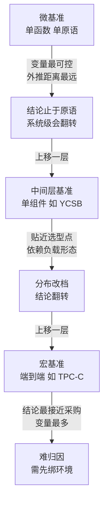
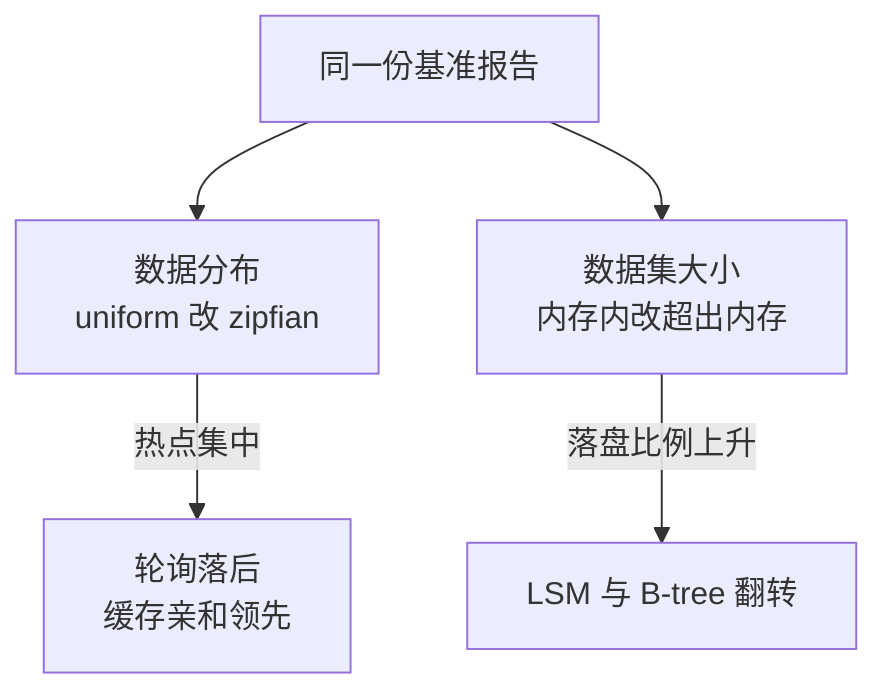
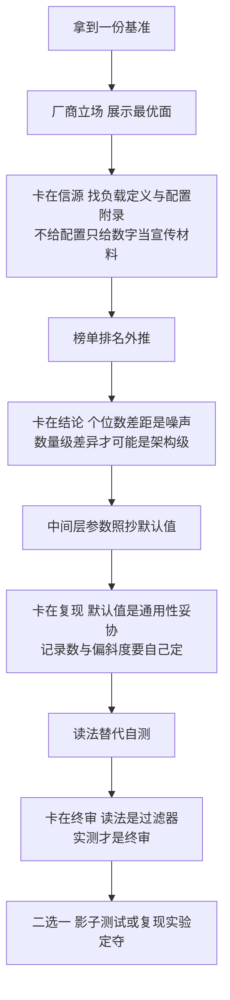
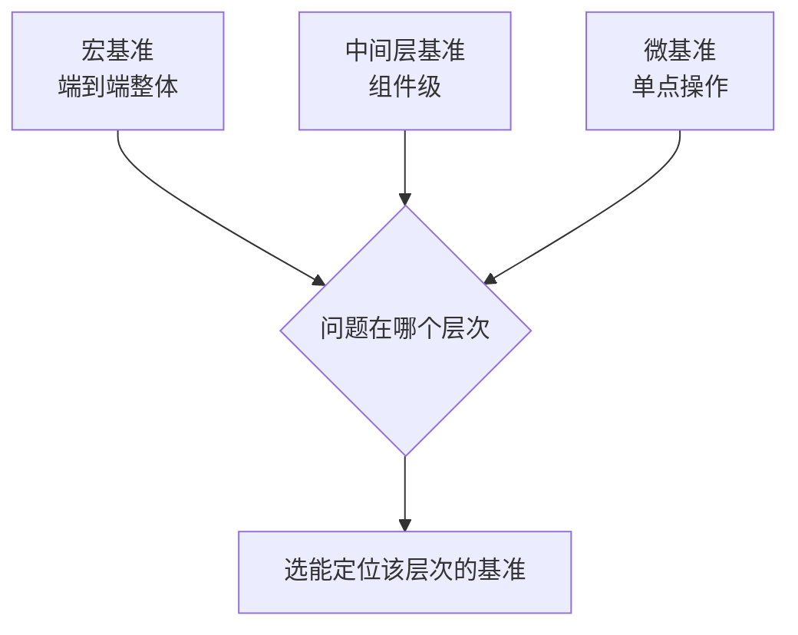

## 要解决的问题

这篇讲怎么读别人做的基准：**读完你能判断一份榜单能不能信、结论能不能搬到你自己的负载上**。选型与评估时你面对的多数基准是别人做的：数据库官网的 TPS（每秒事务数）榜、云厂商的性价比表、论文里的 SOTA（当前最佳水平）曲线、开源 README 里的压测截图。照着榜单买回来，**自己的负载上跑不出数字**，甚至方向相反。

对方未必造假，根子在**基准的负载假设与你的负载不是同一分布**：**同一指标在你的负载分布里权重不同，基准上的优劣搬到你这就会反转**——比如基准按均匀访问测出存储 A 优于 B，而你的业务集中在少数热点（访问集中在少数键或节点上的现象）数据上，谁对热点更友好的因素变成主导，**排名就可能反过来**；人家的基准为「可复现、可比较、可刷榜」设计，你的系统为你的业务分布服务。

**读基准的功夫在读它的设计（负载从哪来、测什么层、比什么变量），不在读它的结论栏**——**不会读基准的人拿着别人的实验结果做自己的决策**。

## 它是怎么做到的

**基准分哪三层，各能回答什么？**
- **微基准（microbenchmark）**：单函数/单原语的延迟吞吐（一次 malloc、一次哈希、一次 syscall）。**变量可控、复现性最好，但结果不能外推到系统级**——**单次快的原语在真实调用流里被锁、缓存、分支拖垮是常态**。
- **中间层基准（component/intermediate）**：一个子系统的吞吐，贴近选型决策点——存储引擎的 YCSB（Yahoo! Cloud Serving Benchmark，云服务数据库基准）、消息队列（生产者写入、消费者读取的缓冲中间层）的 latency-throughput 曲线、GC 的 pause 分布图。曲线画的是吞吐一路升高时延迟怎么跟着变，用它找系统接近饱和、延迟开始翘头的拐点，但**结论依赖驱动负载的形态**（YCSB 的 zipfian 热点偏斜与 uniform 均匀分布，两种负载下结论可以反转）。
- **宏基准（macro/end-to-end）**：整系统跑真实或合成业务流（SPEC、TPC-C/E、MLPerf——分别是系统级基准体系、事务处理基准及其扩展、AI 训练推理基准），**结论最接近采购决策，但变量最多（硬件、配置、调优水平、版本），最难归因**。

**读基准先问它在哪一层：层越低越干净，外推距离越远**。

**三层基准的控制力与外推距离沿同一根轴反向排列**：**层越低变量越可控，但离系统真实负载越远**。下图画出这根轴上的三层位置与各自的失效方向。



微基准的形态在专用测量仪器上有实物对应。下图是 DEC MINC-23 小型机的机箱内部：一排测量模块（a/d、d/a、clock、digital I/O）各管一路信号，每一路的量程与精度单独标定——**这就是微基准的物理形态：把一个变量隔离在一路通道里测准**，**代价是它只回答这一路的问题**。


> 图：DEC MINC-23 实验室测量系统机箱内部，来自 [Wikimedia Commons](https://commons.wikimedia.org/wiki/File:DEC-MINC-23.jpg)，CC BY-SA 3.0，摄影 Retro-Computing Society of Rhode Island。

**负载设计要读哪三要素？**数据分布：均匀还是偏斜（zipfian 是偏斜分布的代表：**少数热点数据被反复访问，多数冷数据几乎没人碰**，真实业务大多长这样）、数据集大小——**是否超出缓存与内存工作集**。YCSB 把数据量调大到超出内存工作集后，**读写就要落到 SSD（固态硬盘）这类磁盘上**，磁盘访问比内存慢得多，**磁盘上随机写的代价比顺序写高得多**，LSM（Log-Structured Merge，先把写入攒在内存里、再按批顺序落盘的存储结构）靠顺序追加避开随机写，**B-tree 的随机页更新在磁盘上被放大**，**LSM 与 B-tree 的胜负就在这一步翻转**。

到达模式分两种。闭回环（closed loop，得名于「闭环」：请求与响应成对串接）是客户端发一个、等它回来、再发下一个，**吞吐被延迟拖住**，这是压测工具的默认形态。开回环（open loop）相反：**发送与响应解耦**，**不管上一个有没有回来都按固定速率继续发**，**能测出队列堆积与过载行为**，P99（把所有请求响应时间从小到大排，第 99 百分位的值，99% 的请求比它快）在这种模式下更真实。并发与竞争：单线程顺序写还是多线程交错（**多线程互相等锁的比例越高，等待加锁的开销占去的时间越多**）。**同一段「吞吐 X、延迟 Y」在数据分布、到达模式、并发与竞争这三要素的任何一档不同下都可翻转**。

同一份基准，三要素各改一档，结论走向就不同。下表把三处改动与各自的结论走向对照起来看。



这些改动各对应一个不同的观测面：数据分布改变谁的缓存命中率（请求直接从缓存拿到结果的比例）高，数据集大小改变读写落盘的比例，**到达模式改变测量的到底是延迟还是排队**，**并发与竞争改变锁等待在总耗时里的占比**。**同一份报告在这些地方各改一档，排名可以整体重排**（布局或尺寸变化触发重新计算排版），这也是「读基准要读负载定义」的具体理由。

**对比设计的公平性怎么看？**变量控制：**只改一个变量（版本、配置）其他全冻结**，还是混着改（新版本+新配置+新硬件一起上，**收益无法归因**）；调优对称性：**两边都调到各自最优还是一边默认一边调优**（**厂商基准的经典不对称**）；预热（上线前提前加载数据或建立连接，避免初期变慢）与稳态：JIT（即时编译，把代码跑热后变快）/缓存/compaction（后台合并数据文件）都进入稳定前，测出的是冷启动（缓存或服务刚启动、还没有数据与连接的状态）数字，长测才知道 LSM 的 compaction 抖动（性能指标不稳定的起伏）、GC 的周期性尖刺。统计形态：**单次运行的数字没有置信度**，**重复多次给区间**；**平均值掩盖长尾**（少数请求耗时远高于其余大部分），P99 与 tail-to-tail（两次测试各自取 P99 相互对比）才暴露延迟尾部。

宏基准的"环境"不是一个可以省略的脚注，它是一整套要写进报告附录的实体——TPC-C 的测试配置长这样：


*图源：Wikimedia Commons，作者 Francoisraab，CC BY-SA 4.0，https://commons.wikimedia.org/wiki/File:TPC-C_Configuration_2008.jpg。宏基准的结论只在这套具体配置下成立，换一代 CPU、换一种布线拓扑、换一个存储配置，数字就要重新测——环境描述不可比，数字就不可比。*

**面向模型负载的基准要怎么读？**MLPerf 训练/推理：先看它参赛的项目——**closed division 锁死软件硬件配置，数字可比性强**；**open division 允许自己魔改优化，看的是能力上限**；固定 batch（批，一次同时送进 GPU 的多个请求）与固定序列长度下的 tokens/s **外推到你的变长请求流要打折**，**固定长度下测出的吞吐推不出你的平均表现**。折扣来自三处：

- 变长请求让每批实际 token（模型处理文本的最小单位）数不定，**GPU 吃不满**
- 短请求多，**单次启动开销摊到少量 token 上成本高**
- 长请求让批内序列长度参差，**要等最长的对齐才结束，延迟被拖高**

榜单上的 SOTA 曲线（精度 vs 成本）常拿调参预算不对等的对手比——一方投入大量人力试超参数、另一方用默认配置，**榜上位置反映的是投入差异而非算法优劣**。

云厂商性价比表：实例代际、超售比（同一台物理机分给多家用户共享的比例，共享的人越多分到的算力越少）、突发积分（burst credit，平时攒下的短时超额算力配额）**耗尽后的真实带宽，表里看不到**。

## 它从哪儿来，要付什么代价

基准的工业化从 TPC（Transaction Processing Council，1988 年成立的工业基准组织，出 OLTP 与 OLAP（联机分析处理：面向统计聚合的查询负载）系列标准负载）与 SPEC开始，方法论上 Brendan Gregg 的 USE 方法（Utilization/Saturation/Errors，对每类资源查使用率、饱和度、错误数）与「基准是实验不是数字」的论述把读法系统化。YCSB代表中间层基准的形态。

MLPerf（2018 年起把 AI 训练推理基准化）。sysbench（数据库压测工具）、fio（Flexible IO Tester，磁盘基准工具）、wrk（高性能 HTTP 压测工具）这类工具级基准贯穿三层。

值得单独放在一起讲的是**把基准从「结论表」读成「实验设计」**：**结论（数据库 A 更快）只在它的实验框（负载分布、数据规模、硬件、调优）内成立**，**读出实验框，才知道结论往自己系统上搬要过几道翻译**。**这一笔把评估决策从「信权威」改成「审实验」**，**跟读论文先看 methods 是同一素养**。代价：审读有成本（读 workload 定义、跑对照的时间可能超过自己直接做小规模实验）。

**自制基准的诱惑**：读到别人基准处处不公，容易滑向「自己写个 benchmark」——自制基准的坑（负载代表性、测量误差、统计陷阱）比读别人的坑更深，正确的姿势是拿标准负载（YCSB/TPC 类）改参数贴近自己分布，**从零发明负载是最后的选项**。

## 这套说法在哪儿会失效

- **厂商基准的默认立场是展示最优面**。这属于商业行为：**调优到最优、挑优势负载、选有利硬件是常态**。**读法：找负载定义与配置附录**，**复现门槛高的（不给配置只给数字）当宣传材料处理**。官方榜单的形态，TPC-C 的 Top Performance 页是原型——Rank、Company、System、Performance (tpmC)、Price/tpmC、数据库与操作系统一应俱全，但每一列数字都绑定在 System Availability 日期那一栏的硬件与配置上：


*图源：[TPC 官网 TPC-C Top Performance Results](https://www.tpc.org/tpcc/results/tpcc_perf_results5.asp?resulttype=all)（页面截图，2026-09-27，Version 5 Results as of 27-Sept-2026）。榜单把环境列全（系统、数据库、OS、TP（Transaction Processing，事务处理） Monitor、日期）正是宏基准「环境绑定」的官方形态：第 1 名与第 2 名差 7 倍 tpmC，但两者跑在完全不同的硬件与许可上——这张表给出的是「这套配置下这些数字成立」，不是「买第 1 名你的业务就快 7 倍」。*
- **榜单排名外推的边界**。**排名差距在个位数百分比以内基本是噪声与调优差异，不构成选型依据**；**差距达到数量级才可能是架构级差距**；即便是数量级差距，**也要用自己的负载形态复测关键场景**（读多写少、大 value、长尾延迟敏感，各自的敏感点不同）。
- **中间层基准的参数不能照抄默认值**。YCSB 默认 workload 的记录数与分布是老设计的（记内存内工作集），**今天的存储评测要显式改大记录数与偏斜度**。**默认值是通用性妥协，你的场景要自己定**。
- **基准读法不能替代小规模自测**。审读筛掉明显不对的候选（省时间），**最终二选一仍要拿自己 10% 流量的影子测试或复现实验定夺**。**读法是过滤器，实测是终审**。

四条边界按读一份基准的先后顺序排，各自卡在一个环节上，见下图：



第一条决定这份材料能不能进后续流程——**不给配置只给数字的，在信源这一关就该被挡下**，后面的排名与参数都无从谈起。第二、三条管的是"怎么读"：前者把个位数百分比的差距判为噪声，后者提醒默认值是通用性妥协。最后一条最容易被跳过：读法筛掉明显不对的候选只是省时间，最终二选一必须靠自己的流量实测定夺。

## 怎么自己动手验证读法是否可靠？



三类基准回答的问题不同，**选错的代价是结论无法指导改动**，对照见下表：


- **负载敏感性复现实验**：拿一个中间层基准（YCSB 跑两种存储引擎），**把 zipfian 改 uniform、记录数从内存工作集改到明显超出内存**。预期：**两处改动各自让排行榜结论翻转或大幅缩窄**。**负载假设决定结论的一手证据**。
- **调优对称性审计**：找两份同类系统的对比基准报告，逐项检查两边的调优对称性（配置、版本、硬件、预热）。预期：**多数公开对比存在至少一处不对称**，**不对称点清单即结论的折扣依据**。公平性读法的实操。
- **闭开回环对照**：同一服务分别用闭回环（wrk 默认）与开回环（恒定速率注入）压，对比 P99 与过载行为。预期：**闭回环下 P99 被低估、过载退化被掩盖，开回环下队列堆积显形**。到达模式读法的可复现验证。

## 动手跑一遍会看到什么：把基准当一笔账逐项推演

```text
读一份基准报告的四问推演账（通用形态）：

  一问 负载：测的是宏（端到端）、微（单函数）还是中间层（单组件）？
    宏基准答"用户体感"，微基准答"代码快慢"，混着读会得出错误结论
  二问 环境：机器画像、版本、参数有没有绑定？没有环境描述的数字不可比
  三问 误差：跑几次？方差多少？只报均值不报分位与方差 → 不可信
  四问 利益：谁出的钱？厂商自测的曲线要打折读（选择有利于自己的配置是常态）

  换算陷阱账：微基准优化 30% × 该代码占运行时间 5% → 端到端只快 1.5%
    （Amdahl 在读报告时的用法）
```

三个实录：

- 微宏错读——团队看到某序列化库微基准大幅胜出就全量替换，压测端到端几乎没有变化（**序列化只占请求路径的极小比例时间**）；**换算账先算占比再动手术**。
- 环境漂移——对比报告里新版明显更快，复现时发现对比机器差了一代 CPU（同一篇报告里新旧数据用了不同硬件）；**读报告先核对环境绑定**。
- 厂商基准——某数据库官方基准显示领先竞品，第三方便携基准里排名靠后（**基准配置按自家强项调**）；**宏基准 + 自家负载回放才作数**。可复现性与环境绑定见 [[工程知识/性能工程：从用户等待到资源瓶颈/观测与诊断/基准结果的可复现性：不能稳定重跑的数字不能进决策.md]]、机器画像绑定见 [[工程知识/性能工程：从用户等待到资源瓶颈/观测与诊断/基准报告要绑定机器画像：没有环境描述的数字不可比较.md]]、负载与误差的声明规范见 [[工程知识/性能工程：从用户等待到资源瓶颈/观测与诊断/基准测试必须先定义负载和测量误差.md]]。

## 接着读哪几篇：存量篇讲自做基准的纪律

- [[工程知识/性能工程：从用户等待到资源瓶颈/观测与诊断/基准测试必须先定义负载和测量误差.md]] —— 存量篇讲自做基准的纪律，本篇讲读别人基准的读法，同一方法论的两个方向
- [[工程知识/性能工程：从用户等待到资源瓶颈/观测与诊断/基准结果的可复现性：不能稳定重跑的数字不能进决策]] —— 本篇管"测得对"，续篇管"测得稳"：环境指纹、N 轮分布与重跑协议
- [[工程知识/性能工程：从用户等待到资源瓶颈/观测与诊断/性能问题定位.md]] —— 基准读法与问题定位共用证据链素养：结论只在实验框内成立
- [[工程知识/AI 系统工程：从模型能力到生产能力/模型基础与训练/预训练数据决定模型能力上限.md]] —— AI 榜单的读法同一原理：评测集分布决定结论适用面
