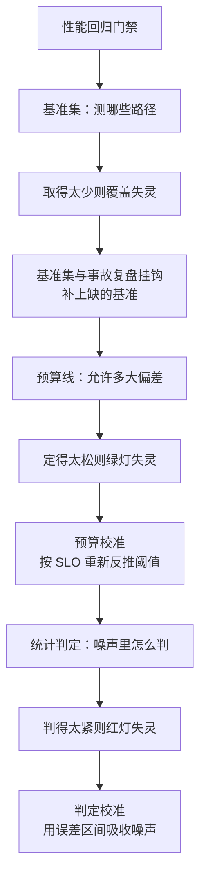
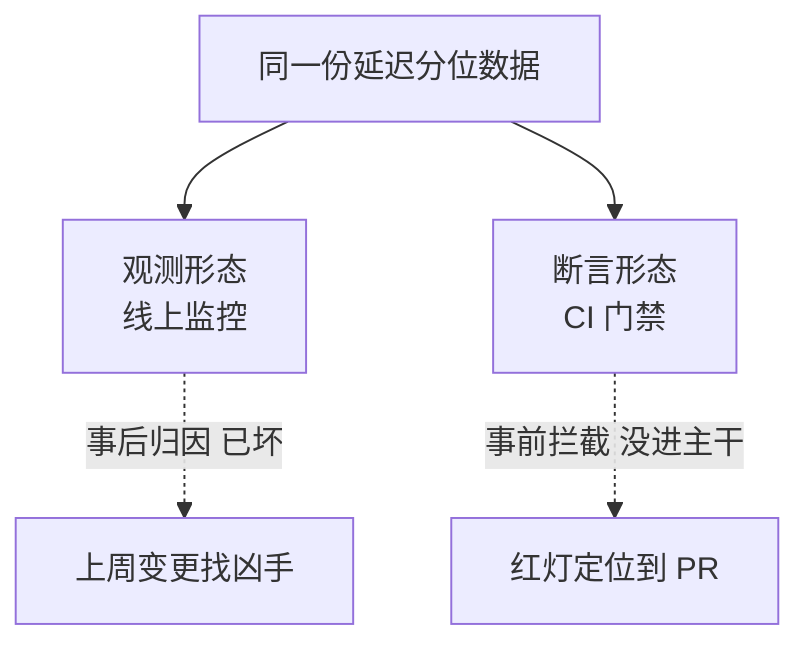
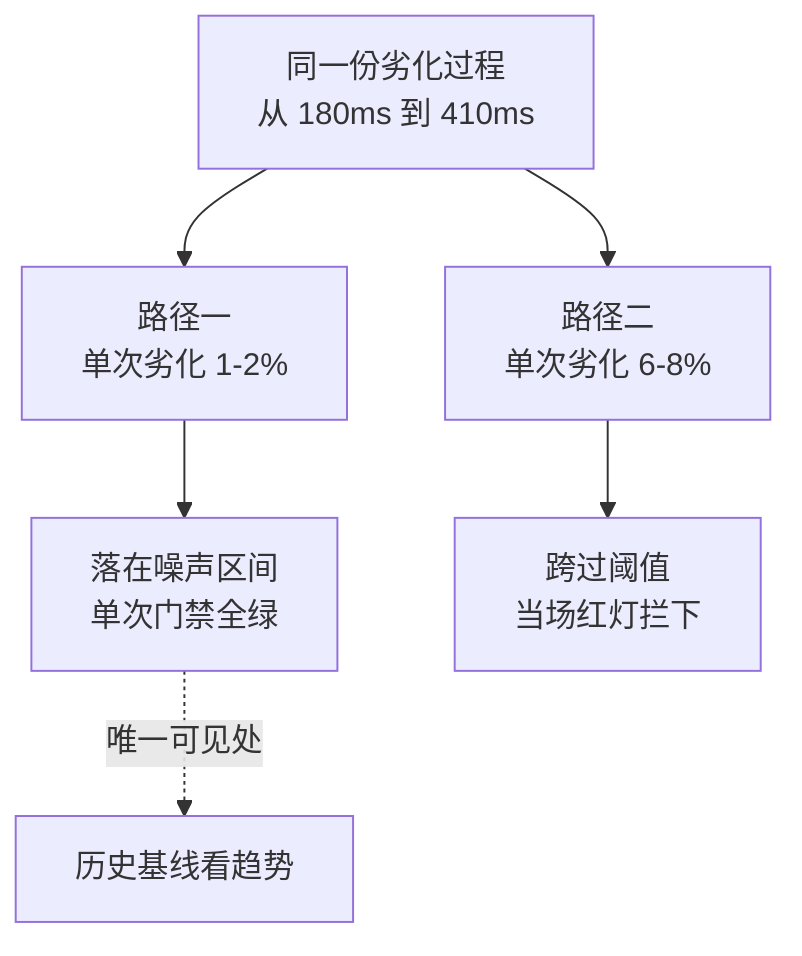

# 性能回归门禁：把性能预算写进CI

## 为什么性能回归总在线上才被发现？

功能回归有测试拦截，性能回归没有防线——没有 CI（持续集成：代码改动自动编译、测试的流水线实践）级的自动检测与拦截，**劣化只能等线上出事才被发现**。本篇要解决的问题是：怎么在合入之前拦下性能劣化。

具体来说：一次"无害的小重构"把热路径加了一层锁，延迟涨 30%，上线后才发现。上线后发现意味着回退已发布版本、影响线上用户、重新协调发布窗口，**回滚（把系统状态退回到改动之前的版本）的代价因此是事故级的**。

**性能问题发现得越晚，定位成本越高**（发布窗口里的变更一堆，哪个都不像凶手）。问题的本质：**性能是可回归的质量属性（开发阶段就能测量和保证的特性），但多数团队把它当"出了事再查"的运维属性（上线后出了问题再去追查的特性）**。

**性能回归门禁把性能预算变成 CI 里的可执行断言**：**关键路径的基准跑在流水线上，超预算即红灯，回归在合入前被拦下**。**发现时点从"线上告警"前移到"提交时刻"**，**定位范围从"上周所有变更"缩小到"这次 PR（Pull Request，拉取请求：请求把我的分支改动合入主干）"**。读完这一页你能搭一套在合入前拦下性能劣化的门禁。

## 它是怎么做到的


*图源：Wikimedia Commons《Continuous Integration》，CC BY-SA 3.0，https://commons.wikimedia.org/wiki/File:Continuous_Integration.jpg。性能门禁就是往这个闭环里再加一道判定：图上跑的是"能不能用"，这里要判定的是"有没有变慢"。*

**门禁由哪三要素组成**。第一要素是基准集，决定测哪些路径——覆盖核心接口的 p50 与 p99 延迟。p50 指一半请求快于此值，p99 指 99% 的请求快于此值，延迟类指标都越小越好。基准集还包括关键算法的吞吐、启动时间、内存足迹。基准取得太少则覆盖失灵，对策是与事故复盘挂钩、补上缺的基准。选取原则：从真实流量形态提炼代表性负载，**覆盖稳定热路径而非全接口（全接口基准跑不起，挑 5-10 个"坏了就是事故"的路径）**。第二要素是预算线，定允许多大偏差——**每条基准的允许区间（绝对值或相对基线的百分比偏差**——基线即历史跑出的基准结果，作为对比参照值，下文详述其管理），预算从 SLO（服务等级目标，团队对外承诺的服务质量目标）反推——**SLO 是对外承诺的上限，预算线是内部留了安全边际的更严值**（SLO 说 p99 ≤ 200ms，基准预算留出安全边际定 180ms）。第三要素是统计判定，管噪声里怎么下结论——判得太紧则红灯失灵。单次运行的噪声（CI 机器的邻居干扰、频率漂移）会让 ±10% 的抖动（性能指标不稳定的起伏）常态化，判定必须带统计——**重复 N 次取分位数（把耗时排序后取某个百分比位置的值、如 P99）**、**与历史基线（正常状态下的指标水平、用来对比异常）比而非单点比**、**噪声超出区间时重跑或标 inconclusive 而非硬判**。

这三要素中任何一个定得不合适，都会让门禁失掉作用，具体三种失效方式见下图：



三要素讲完，再看同一份延迟数据在两种形态里的分工，见下图：



门禁的本质交换：**同一份数据（延迟分位数），观测形态留在事后归因（线上告警后从一堆变更里找凶手）**，**断言形态把时点前移到提交时刻（红灯即拦、定位范围缩小到这次 PR）**——**门禁是断言形态的实现，它不替代线上监控，两者是同一份数据的两种时态**。

**为什么基线要一直管、不能定一次就不管**。**前面说过基线是历史基准结果、对比的参照值**。它不是一次定终身：**性能优化合入后基线要更新（否则新代码永远跟旧基线比，误报淹没真回归）**；**基线更新与预算变更要显式走 PR**；**历史基线序列（每合并一批的基准值曲线）让趋势可见**——**门禁挡突变，趋势图治渐变**（**每次涨 2% 的慢性回归过得了单次门禁，曲线上一年的累积塌方一目了然**）。

## 观测形态长什么样：慢查询日志的现成样本

同一份延迟数据在两种形态里长什么样，慢查询日志给了一个现成的样本：**日志条目里 Query_time 与 Rows_examined 是事后观测的原始记录**，explain 段随之把执行计划也一并写进日志，**事后翻查时既能看到「慢了多久」也能看到「慢在哪一步」**：


*图源：MariaDB 官方文档《EXPLAIN in the Slow Query Log》中的日志条目示例，https://mariadb.com/kb/en/explain-in-the-slow-query-log/。*

这条条目是观测形态的典型：它写下来了、能定位到具体语句与具体执行步骤，**但它是事后产生的——查询已经跑完 5.5 秒才留下这一行**。**门禁要的是把这份数据在合并之前就变成断言**，**判定依据与这张图里的字段同源（耗时、扫描行数、访问类型）**，**区别只在判定发生在提交时刻还是线上告警之后**。

**门禁在 CI 里实际怎么跑**。触发策略：每 PR 全跑（贵但拦得早）vs 夜间全量 + 发布前必跑（省但晚）vs 只跑改动路径关联的基准（需要先分析出本次改动影响了哪些代码路径，再只跑与这些路径关联的基准，即变更影响映射）。环境隔离：**性能基准对 CI 共享机器的噪声极敏感**，专用 runner、用 cgroup（Linux 的控制组机制，给一组进程划定 CPU、内存等资源上限）**限制同一台机器上其他进程对 CPU 和内存的占用以减少邻居干扰**、锁频（cpupower frequency-set）、**先空跑几轮让 CPU 缓存和分支预测稳定下来（预热）**、**正式测量时丢弃预热（上线前提前加载数据或建立连接，避免初期变慢）轮次的数据**以免冷启动（缓存或服务刚启动、还没有数据与连接的状态）偏差污染结果，**这些都是标配**。耗时控制：全套基准 10 分钟内（超了就会被跳过或砍掉），**分层：快速集（每 PR，秒级微基准）+ 慢速集（夜间，端到端宏基准）**。

红灯拦下回归时，开发者看到的就是一张门禁报告。Bencher（开源持续基准平台）在 PR 评论里的报告**把判定依据逐列摆出**：哪条基准（Adapter::Json）、哪个度量（Latency µs）、本次结果与相对基线的偏差（21.83 µs，+336.60%）、预算上限与超限幅度（Upper Boundary 15.00，145.53%），**ALERT（Prometheus 的告警规则段）标记就是拦下合并的红灯**：


*图源：Bencher 官网首页 PR 报告示例（bencher.dev），开源持续基准平台的产品界面。*

**门禁会怎么失灵、各有啥对策**。上图已画出每种失灵的对策链路，这里补各自的机理：绿灯失灵（基准太松，回归过了门禁线上才炸）；红灯失灵（基准太敏感，噪声天天误报，团队学会的第一个动作是跳过门禁）；覆盖失灵（测的是微基准，回归发生在没测的路径或路径间的组合上）。三种失灵各有对策，不能混成一句话：覆盖失灵靠**基准集与线上事故复盘挂钩**——**每次线上性能事故，问"哪条基准本该拦住它"，答案缺席就补基准**；**绿灯失灵是阈值定得比 SLO 松**，要靠**预算校准**按 SLO 重新反推；**红灯失灵是判定比噪声还紧**，要靠**判定校准**用误差区间吸收噪声，**否则门禁会被绕过**。

慢性回归和突变在门禁里为什么可见性不同？看下图：



两条路径的差别只在单次幅度：**落在噪声区间里的劣化每次都能过门禁，唯一的可见处是历史基线序列的趋势**；**单次幅度跨过阈值的劣化当场被拦，定位范围缩小到那一个 PR**。**「门禁挡突变、趋势图治渐变」两件设施都必须有**，原因就在这里。

## 性能门禁的思想来源与代价是什么？

性能回归检测的工业化是 CI/CD（持续集成/持续交付：代码改动自动通过编译、测试，并自动发布到生产环境的流水线实践）成熟期的产物（2015 年之后），Google 的 perf sheriffs——perf 是 Linux 性能剖析工具，sheriffs 指派专人像治安官一样轮班盯住性能回归，是大仓库的持续性能监控机制——与 Meta 的大规模基准跟踪是工业界标杆；开源生态成型为 Bencher、CodSpeed、Google Benchmark 的 CI 集成（benchmark 结果持久化 + 统计比较）；Linux kernel 内置 perftest（内核源码树里的性能回归测试脚本集合，每次提交自动跑一轮并对比历史结果）目录，Rust 与 Chromium 各自内置性能基准套件并接入 CI，三者并列构成"性能即测试"的公共样本。

按「门禁的本质交换」一节讲过的观测与断言之分，门禁的全部机制都系于一次改写：**把性能从"观测指标"改写成"断言"**。这次改写要付的代价如下：**CI 机器的测量噪声是门禁的头号敌人**——最大干扰源，**它把统计判定逼成多次重复、耗时翻几倍**，**还逼出专用性能 runner 这笔真金白银的基建投入**，**共享 runner 的邻居负载正是噪声的主要来历**；**基准集的维护是持续成本——热路径漂移、负载形态演进，基准不跟就过时，过时的基准拦不住新形态的回归**；**门禁的假阳性代价不对称**——**误报拦住一个好 PR 的团队摩擦，比漏报一次回归（还有线上监控兜底）更伤门禁的公信力**，所以**预算线宁可先松后紧（先拦 30% 突变，跑稳了再收 10%）**。什么时候值得上门禁——按延迟敏感度与发布频率衡量：**延迟敏感型服务（交易、广告、搜索）与基础库（语言运行时、存储引擎）收益最大**；**迭代期原型与小范围工具类项目发布频率低、线上监控够了，门禁是提前的奢侈**。

## 这套说法在哪儿会失效

- **门禁挡的是可复现的回归，不是线上事故的全部**。容量型事故（流量突增）、配置型事故（线上配置与基准环境不同）、数据型事故（生产数据分布触发慢查询）不在门禁射程内。**门禁与容量规划、影子流量、慢查询审查是互补件，不是替代件**。
- **微基准与宏基准的判定分离**。微基准的噪声小、判定严（±5% 可判）；宏基准噪声大、判定宽（±15% 起步），且只在夜间全量跑。**同一套预算线套两种基准是配置错误**。
- **跳过门禁要有显式通道**。安全漏洞这类紧急修复允许 override 人工放行、强制跳过门禁，但 **override 记录进审计：谁、为什么、事后补基准**；改配置文件绕过的静默跳过要把门禁配置本身纳入保护，**改门禁配置的 PR 需要额外评审**。
- **跨语言/跨服务的性能预算**。本篇门禁在单系统内；跨服务的延迟预算（端到端 SLO 分解到各服务）是另一层工程（SLO 分解与错误预算），**别把门禁写成分布式预算系统，单点做好单点的事**。

## 怎么自己动手验证

- **拦截实验**：故意提交一个热路径加锁的 PR。预期：**CI 门禁红灯，报告指出哪条基准超预算、超出幅度、历史基线对比**。门禁拦截能力的直接证据。
- **噪声画像实验**：同一份代码在 CI runner 上重复跑基准 20 次，画延迟分布。预期：共享 runner 的分布宽（±10% 以上），专用 runner 窄（±3% 内）；**分布宽度决定统计判定需要的重复次数**。门禁噪声地基的实测。
- **趋势复盘**：导出一条基准的历史序列（6 个月），标出线上性能事故时间点。预期：事故前的曲线有可见漂移（或事故对应基准覆盖缺口），**漂移点即"门禁该拦没拦"或"基准该补没补"的证据**。门禁集与事故挂钩的方法验证。

## 动手跑一遍能验证门禁的哪些结论？

门禁判定与业务判定要分开。健康检查端点模式（应用暴露专门端点让外部监控探活，由应用自己汇报能否服务）给出了这个分离的形态：探活的归探活，业务的归业务，两者互不替代。性能门禁同理——**门禁判定性能是否达标，不替代业务逻辑自身的正确性判断**。

性能预算的分配遵循同样的分离逻辑：不同优先级各自占一条队列、消费者池按配额分别取用，配额就是预算——各占各的份，互不挤占：


*图源：[Microsoft Learn《优先级队列模式》](https://learn.microsoft.com/zh-cn/azure/architecture/patterns/priority-queue)，CC BY 4.0。原图为 SVG（Scalable Vector Graphics，可缩放矢量图形：用数学描述画出来的图，放大不失真）矢量图，放大不失真。*

**配额是给每类任务划定独立份额、各自用完为止**；阈值是所有任务共用的单一上限。**把预算写成配额，超支时行为可预期：高优先级的那份不会被低优先级挤掉**；**共用一个统一上限，所有优先级的任务会一起变慢**。


```text
一条性能门禁的推演账（通用形态）：

预算声明：P99 ≤ 200ms、QPS（每秒查询数）≥ 5000、内存峰值 ≤ 2GB（写进配置随代码走）
  基线：性能基准环境固定（同机型、同负载模型），每次合并跑基准取基线
  判定：新版与基线同环境对比，劣化 > 5% 且排除环境噪声 → 拦截合并
  噪声控制：同一 commit 跑 3 次取中位数；环境漂移单独监控
    （噪声 8% 的环境里拦 5% 的劣化只会误报）
  失效模式：环境不固定 → 数字不可比；只测均值不看分位 → 长尾劣化漏网
```

慢劣化漏网的实录——**六个月里每次合并劣化 1-2% 都在噪声里放行**，累计 P99（99% 的请求耗时不超过这个值） 从 180ms 涨到 410ms（**无门禁时每次都"看起来没变化"**）；**上门禁后同类累计劣化在第一次跨过 5% 阈值时被拦**。环境漂移误报的实录——基准机被其他任务占用，门禁连拦 12 个无辜合并，团队把门禁改成"可跳过"（门禁失去信用等于不存在）；**机器画像绑定与独占基准机是门禁可信的前提**。

均值陷阱的实录——**均值 P50 全绿但 P99 翻倍（长尾被新加的慢路径拖垮）**，**门禁按分位逐项设预算后才拦得住**。负载模型与误差的声明规范见 [[工程知识/性能工程：从用户等待到资源瓶颈/观测与诊断/基准测试必须先定义负载和测量误差.md]]、环境可比性见 [[工程知识/性能工程：从用户等待到资源瓶颈/观测与诊断/基准报告要绑定机器画像：没有环境描述的数字不可比较.md]]。

## 想往下钻，该接着读哪几篇？

- [[工程知识/性能工程：从用户等待到资源瓶颈/观测与诊断/基准测试必须先定义负载和测量误差.md]] —— 门禁的基准复用这套纪律：负载定义与误差区间先行
- [[工程知识/软件构建：让变化可以理解、验证与交付/测试与交付/可观测性断言：把运行时行为写进测试.md]] —— 同一套断言思路的另一侧：它在运行时约束行为，本篇在 CI 侧约束性能预算
- [[工程知识/性能工程：从用户等待到资源瓶颈/观测与诊断/优化收益递减决定何时该停手.md]] —— 门禁的预算线从 SLO 反推，优化停手点决定预算松紧
- [[工程知识/缺陷分析：从个案到体系/复现与回归/回归风险评估的通用骨架：从变更面到测试选择.md]] —— 性能风险档的专门门禁，骨架里性能风险一档的具体实现

## 相关

[[工程知识/性能工程：从用户等待到资源瓶颈/观测与诊断/告警规则与症状噪声：一个阈值为什么治不了延迟波动.md]]