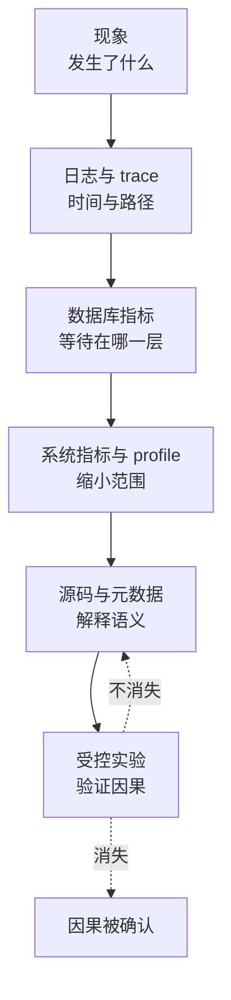
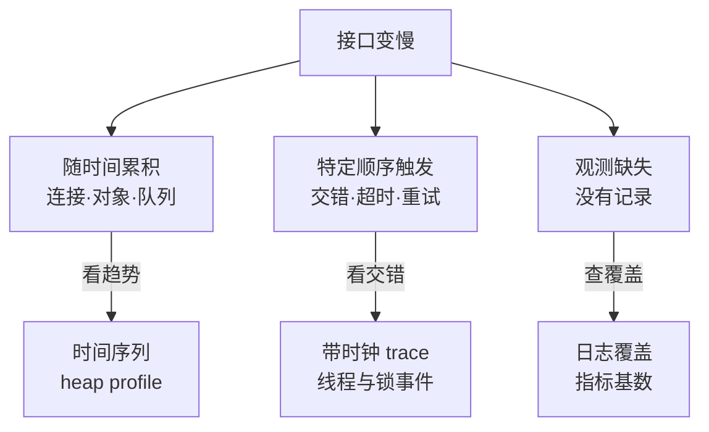

# 性能问题定位方法

一次「慢」到底慢在哪里？性能定位要回答的正是这个问题。**做法是把用户影响、资源等待、调用路径和可复现实验这四样串成证据链**。**每一步结论都有上一步的输出作为输入，链条断开处就是结论的边界**，找"最慢函数"只是链上一步。**任何修复都要证明目标 SLO（服务等级目标，对外承诺的可用性或延迟水平）真的改善**。**改善还不能只是搬家：成本、错误或尾延迟（最慢那批请求的高延迟）不许被转移到另一层**。读完你能定位等待段、建出证据链，并在修复后证明改善是真的。

慢点究竟出在哪一段？同一条请求的慢点可能出现在排队、锁、I/O、网络或业务计算。**先按时间线定位等待段，再用 profile（对运行中的程序采样处理器与调用栈、定位耗时热点）或最小实验确认因果，才能避免对错误层次优化**。例如**误把锁等待当 SQL 慢去改索引，实际瓶颈在并发串行化，改完依然慢**。

## 性能问题定位难在哪

一个变慢的接口摆在面前，日志里只有超时字样，翻遍代码也找不到明显瓶颈，于是改一个参数、加一段缓存，症状短暂缓解后再次出现。性能定位要解决的问题是：**用户感知的延迟怎样映射到排队、锁、I/O、网络或计算的某一段等待、四类现象（延迟、吞吐、正确性、稳定性）怎样分开、证据链按什么顺序接续、以及最小实验如何把因果关系从巧合里分离出来**。

## 先要区分哪四类现象

1. **延迟问题**：平均延迟、尾延迟、锁等待、IO 等待或下游等待上升。
2. **吞吐问题**：并发上升后 QPS（每秒查询数，系统每秒处理的请求量）不再增加，或队列持续积压。
3. **正确性问题**：结果错误、数据丢失、重复执行、主备不一致。
4. **稳定性问题**：崩溃、内存泄漏、死锁、连接耗尽、资源耗尽。

**同一个症状可能由不同层次造成**。例如「SQL 慢」可能是执行计划改变（数据库选用的查询步骤发生变化）、锁等待、IO 抖动（性能指标不稳定的起伏）、连接池（预先建好连接反复取用、省去反复握手建连的开销）排队或网络传输，**而不一定是 SQL 文本本身**——**锁等待在 SHOW PROCESSLIST 里表现为 State 处于 Waiting for lock，IO 抖动在 iostat（查看磁盘 IO 统计的命令）里表现为设备利用率打满，先看征兆再定层次**。

## 根因证据链怎么建

**每一步的输入来自上一步的输出，链条从日志与 trace、数据库指标走到系统指标与 profile，最后由源码与元数据解释语义——链条断在哪一段，结论就停在哪一段**，像顺着水管查漏水，哪一段测不到水压下降，**结论就只能停在那一段，不能推断更下游还有漏点**。资源检查按什么顺序走、走到哪一步算定位完成？

Brendan Gregg 的 USE 方法（Utilization/Saturation/Errors：对每类资源查使用率、饱和度、错误数）官方流程图给的是行业通用答案。**这个方法把检查顺序与停手条件都规定好了：逐个资源检查错误、使用率、饱和度三个判据，任一命中就去深入排查（Investigate Discovery），全部资源检查完毕且未命中才允许下"系统没有资源瓶颈"的结论**。**检查顺序与停手条件都是方法的一部分——想到哪查到哪会漏掉整段等待，比如没查饱和度就看不出队列积压**：


*图源：[Brendan Gregg《USE Method》](https://www.brendangregg.com/usemethod.html)，CC BY-NC-SA 4.0，文档引用。*



## 最小实验原则是什么

- **固定版本、配置、数据规模和负载，只改变一个关键变量**。
- **先做只读观测，再做低风险实验；生产写入、重启和参数变更需要审批**。
- **记录基线（正常状态下的指标水平、用来对比异常）、样本数、置信区间（按样本估计真实值时的误差范围）和失败样本，不用一次成功替代统计结论**。
- **任何修复都要有反例：高并发、空值、大数据、异常中断、重复请求和降级（主动牺牲部分功能或精度，保住核心链路）路径**。

## 数据库问题该按什么表检查

- [ ] 执行计划和实际行数是否一致？
- [ ] 是否存在长事务、锁等待、死锁（多个执行流互相等待对方释放资源）或复制延迟（从库同步速度落后于主库、读到旧数据的时间差）？
- [ ] Buffer Pool（数据库缓存数据与索引的内存区）、磁盘、网络和连接池是否达到边界？
- [ ] 重试和超时是否可能造成重复执行？
- [ ] 日志是否足够恢复完整时间线？
- [ ] 修复是否在原始用例和相邻用例上都验证？

## 哪三个维度排障时最容易被忽略？

| 维度 | 要追问什么 | 需要的证据 |
| --- | --- | --- |
| 积累 | 问题是否随连接、对象、缓存、队列或运行时长累积？ | 时间序列、heap/profile、对象/队列计数和稳定负载 |
| 时序 | 是否只在特定并发交错、切换、超时或重试顺序下发生？ | 带时钟的 trace、线程/锁事件、请求 ID 和故障注入 |
| 可观测缺口 | 「没有错误」是否只是没有记录？ | 日志覆盖、指标基数（同一指标有多少种不同的取值组合）、采样策略和 unknown 状态 |

**排障不是只看 SQL 文本或最终错误**。维度与方法之间有固定的对应：**累积型靠时间序列与 heap/profile 看增长趋势，顺序触发型靠带时钟的 trace 看交错，观测缺失型先补日志覆盖再谈归因**。**先判断是随时间累积、由特定事件顺序触发，还是关键观测缺失，再按这个对应关系选择手段**。

采集手段要按前面那组对应关系逐项核对，对不上号就白测——空有征兆不下定性，排障就会停在只看到征兆这一步。

"征兆与定性分开"的实物原型是挂在墙上的木框气压计：指针位置告诉你"气压在掉、天要变"——这是缩小范围的征兆；要定性"下不下雨、下多大"，得出门看天、用雨量计量——征兆不等于结论，仪器读数要配现场证据：


*图源：Wikimedia Commons，作者 Reconrabbit，CC0，https://commons.wikimedia.org/wiki/File:German_barometer_on_wood.jpg。*

性能定位的证据链与这只气压计同构，其机制在于把征兆与定性分属两层证据：**指标读数是气压计（延迟在涨、吞吐在掉——征兆），trace 与 profile 是出门看天（乌云在哪片天上——哪一层在等待），受控实验是雨量计（证实确实是这股湿气流带来的雨——因果确认）**。只盯指标调参数，等于对着气压计烧香——这是形容错误做法的比方，不是操作步骤。



### 这个案例方法为什么值得保留：怎样提炼可复用的方法？

这类案例的长期价值在证据链，而不是「给表添加字段/索引」这个具体结论：

profile 缩小范围这一步的输出，常见形态就是火焰图（把 CPU 采样堆栈画成一帧帧横条，宽度代表占用时间比例）。Brendan Gregg 公开的一张 Linux tar 打包负载的真实火焰图里，热点（访问集中在少数键或节点上的现象）集中在 `sys_newfstatat`、`vfs_fstatat` 等文件属性查询系统调用（程序请求内核提供服务的入口）上——**不用读代码就能看出时间花在哪个函数族，定界证据一眼可取**：**这些函数占用比例最高且集中在同一族调用，说明瓶颈不在业务计算而在系统调用，范围直接定到这一层**：


*图源：[Brendan Gregg《FlameGraphs》](https://www.brendangregg.com/FlameGraphs/cpu-linux-tar.png)，CC BY-NC-SA 4.0，文档引用。*

```text
CPU profile 发现调度/锁热点
  -> 源码把热点收敛到 buffer page 获取
  -> uprobe 记录真实 page 标识
  -> 数据库元数据识别 page 类型
  -> 失败实验解释为什么原方案无效
  -> 新方案用相同负载重新压测
```

**四类手段回答的不是同一个问题：profile 看总量分布、trace/probe 看单个对象、元数据看语义归属、受控实验看改动前后差别，各自只覆盖其中一个侧面，混用就会拿分布去回答因果**。这说明 profile 用于缩小范围，trace/probe 用于观察具体对象，元数据用于解释语义，受控实验用于验证因果。案例中的数据、函数和优化结果只适用于当时版本与负载，不能直接推广到其他数据库或业务表。

**为什么不同现象要用不同手段？性能问题定位是一条从缩小范围到验证因果的证据链，现象分属随时间累积、由事件顺序触发与观测缺失三类，各自的采集手段互相不能替代——这就是分层取证的原因**。

## 怎么自己动手验证

下面五步把前面的方法落到一次具体排障的完整流程，按顺序走一遍即可复现证据链。

1. 现象分类：**对同一个变慢的接口，先判断它是随时间累积、由特定事件顺序触发，还是关键观测缺失，三类各自选取对应的采集手段**。
2. 证据链接续：**按 profile 缩小范围、trace 或 uprobe 观察具体对象、元数据解释语义、受控实验验证因果的顺序走一遍，每一步的输入来自上一步的输出**。
3. 单变量实验：**提出两个可被区分开的假设，一次只改变一个变量，预期只有其中一个假设的结果出现；未能区分时重新构造实验**。
4. 改善确认：**优化后同时核对业务 SLO、资源代价与错误率，确认三者共同改善并在阈值内保留回滚（把系统状态退回到改动之前的版本）路径**。
5. 断言锚点：**现象分类有依据，证据链完整衔接，实验能区分假设，改善结果覆盖业务与资源两侧**。

## 接着读哪几篇：结论只在实验框内成立

- [[工程知识/性能工程：从用户等待到资源瓶颈/性能工程：从用户等待到资源瓶颈]]
- [[工程知识/数据系统：在并发与故障中保存事实/数据系统：在并发与故障中保存事实]]
- [[工程知识/性能工程：从用户等待到资源瓶颈/观测与诊断/市面Benchmark的设计读法：宏微与中间层基准.md]] —— 结论只在实验框内成立，基准读法与问题定位共用证据素养
- [[工程知识/缺陷分析：从个案到体系/资源与容量/资源泄漏的三段式排查法：预筛确认与归因.md]] —— 资源上涨是 USE 的 Utilization 维度，证据素养共用
