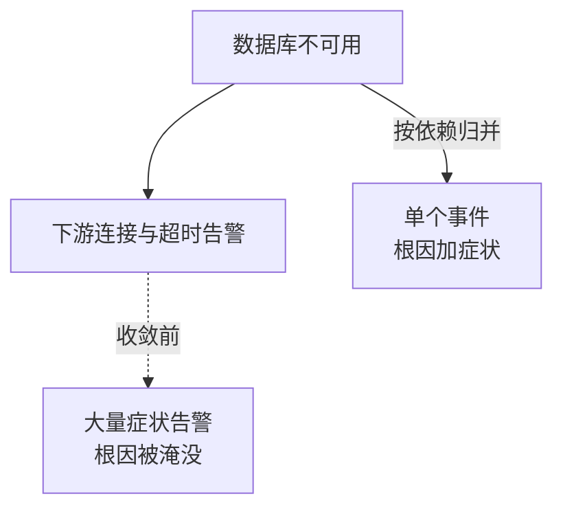
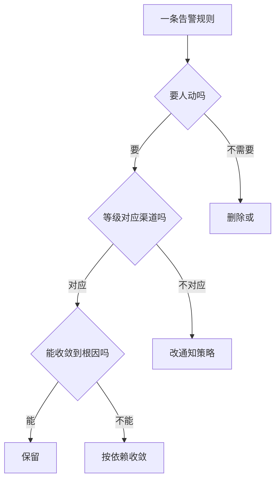

# 报警治理的降噪三件事：分级收敛与值班可持续

> **要点**：报警系统的失效形态是"狼来了"——噪音让真告警淹没在忽略里；降噪按三件事治理：每条告警有需要人动手的理由（分级）、同类告警合并成单事件（收敛）、值班负载有数字上限（可持续），三条把告警从流量变成信号。读完你能给现有告警体系做分级、做收敛、给值班设负载上限，把噪音告警压下去。

## 报警体系为什么会越跑越吵？

告警体系会自然恶化：每加一个监控点就多几条告警，阈值设保守一点就是周期性误报，值班表格里的"已忽略"越积越多——**恶化的终点是告警疲劳：所有告警都被条件反射地忽略，真事故混在里面一起被忽略**。本库正确性域"日志级别的语义"讲过"把提示当告警，告警就成了背景噪音"的机制；本篇把同一原理放到报警体系的组织层，要解决的问题是告警疲劳：**噪音的定义是"没有响应动作的告警"，与数量多少无关**——降噪的目标按这个定义走，三件事各管一段：**分级管"哪些值得响"，收敛管"响多少声"，可持续管"响的节奏撑得住吗"**。

## 三件事各自压住的是哪一类噪音？

先把形状说成一件事：报警治理像管理小区门口的喇叭广播——分级是"什么才配得上广播"（快递到了不播、火警才播，而且火警要标明几分钟内必须有人跑）；收敛是"同一件事别播八遍"（十家都停水，播一遍"本楼停水"而不是挨家播）；可持续是"一天播多少条要封顶"（每天八十条广播，居民连火警都不抬头了）。噪音的定义跟着就出来了：没有响应动作的广播就是噪音，跟条数无关。这个比喻到"封顶"为止——现实里分级有分钟级到天级的响应预算、收敛要靠依赖拓扑与时间窗算法，下面逐件展开。

**分级（每条告警回答"要人干什么"）**：**告警的存在理由是"需要人做某个动作"**——立即动手（服务不可用，级别 P1）、计划处理（容量趋势，级别 P3）、记录观察（无需动作，不进告警进面板）。**"不需要动作的信号"的正确去处是仪表盘与报表，进告警队列就是噪音**。分级判据按"响应动作 + 时间预算"双维：**P1 分钟级人工介入、P2 小时级、P3 天级工单**——判据写在每条告警的元数据里，值班看到级别就知道响应形态。**分级的收益是值班的注意力按级别分配（P1 抢时间、P3 排计划）**，**代价是每条告警要维护级别元数据且级别错配需要定期复审**——但**每多一条无动作的告警，值班都要花一次判断再忽略的注意力**，**告警量上百后这些零散成本累计起来远超维护元数据的花费**。

"时间预算"一侧的数字从哪来，Google SRE Workbook（SRE 即 Site Reliability Engineering，Google 的运维方法论）的告警章节给过官方实测：检测时间随错误率对数下降——**错误率 1% 时检测需分钟级，10% 以上压到秒级**。**低错误率的故障天然要靠更长的窗口才能与噪音区分——检测得慢，人就更要在检测到之后立刻跟上**。**P1 告警代表最重的故障，绑定"分钟级响应"预算正是给这条慢检测路径兜底**：**检测花掉的时间无法压缩，响应速度就不能再拖**，级别错配的告警要么响应跟不上检测曲线，要么把秒级可判的故障拖成工单：


*图源：[Google SRE Workbook《Alerting on SLOs》](https://sre.google/workbook/alerting-on-slos/)，Google 版权，CC BY-NC-ND 3.0，文档引用。*

**收敛（同类信号合并成单事件）**：一个故障沿传播链触发几十条告警（数据库挂了 → 20 个服务的连接错误 → 200 个接口超时全响），**值班屏幕上出现的大量症状告警把人刷屏，根因被淹没在症状里**。收敛的三种机制：**按依赖拓扑归并**（CMDB 即配置管理数据库，记录服务及其依赖关系，可用服务依赖图把下游告警挂到根因事件下）、**按时间窗聚合**（同源同症状的重复触发合并为计数增长的单事件）、**按变更关联**（发布窗口内的告警优先关联到变更事件）。收敛后的形态：值班收到一个事件 + 一条根因候选 + 关联症状列表——**事件是处置单位，告警只是事件的原材料**。

收敛机制在 Grafana（监控面板工具）官方告警体系里的实物：**通知策略以树形组织，告警实例按标签匹配路由到分支，同一分支的实例可合并为单条通知**——「按标签归并 + 树形路由」就是收敛的两种机制（按归属归并、按聚合减少条数）在产品里的形态：


*图：Grafana 官方文档的通知策略树图。左侧是三个告警实例（Pod stuck in CrashLoop、Disk Usage 80%、Unauthorized log entry），各自携带 team 与 severity 标签；右侧是通知策略树——**Default Notification Policy 为根节点保证所有实例都被处理**，子节点按 team=operations、severity=high/low、team=security 的标签匹配路由。**同标签的多个实例在发出前先分组，多条告警合并成一条通知**。*

*图源：Grafana 官方文档《Alerting fundamentals》Notification policies 一节，[Grafana.org.cn 中文文档站](https://grafana.org.cn/docs/grafana/latest/alerting/fundamentals/)。*

**同一个根因在收敛前后，值班侧看到的东西完全不同**。下图把收敛前的一屏告警与收敛后的一个事件对照起来。



**可持续（值班负载的数字上限）**：**值班的告警处理能力是有限资源，超载后每条告警的处理质量都下降**——按每班"可处置事件数"设上限（经验量级：夜间值守每班个位数 P1/P2），**超限即触发告警风暴事件（风暴本身按 P1 处理），风暴响应优先级高于任何单条告警的处置**。**可持续的度量挂在值守记录上**：**每班的 P1/P2 事件数、误报率、处理时长，三个数周报，趋势恶化即触发告警规则的批量复审**。

## 一条告警规则合格吗：质量审查



质量审查的三问按「是否需要行动 → 通知是否匹配 → 能否收敛」推进，上面的流程图画出这根骨架。骨架落到日常操作上，是新告警上线前的四问审查——**四问把三问细化成可执行的质量门槛**：

**一问动作**：这条告警触发后，接收人做什么？**答不出具体动作的告警不上线（进面板）**。**二问判据**：触发条件是否过滤了已知噪音源（抖动、维护窗口、已知误报模式）——**判据里要有"连续 N 次 + 排除窗口"**。**三问级别**：响应动作与时间预算是否匹配分级表——**"需要分钟级响应"却标 P3 的告警是级别错配**。**四问历史**：同规则的误报记录——**从别的系统迁移来的规则先看误报率再决定阈值**。

存量告警的清理路径：**按"近 90 天触发记录"排序**——**从未触发过的告警（阈值失真，等于没监控）与天天触发的告警（噪音源）两头都是治理对象**，**中间触发频度合理且每次有动作的告警才是健康的存量**。

## 降噪管不到什么：边界

三条边界防止防线走形。

**降噪不等于提高阈值**：**把阈值调高让告警不响，是噪音治理里最危险的动作（监控盲区化）**——**正确的降噪是删掉无动作的告警、收敛同源的告警**，**阈值的调整要有触发记录的证据支撑（误报实例）**。

**收敛依赖的拓扑要维护**：**依赖归并的质量取决于服务依赖图的准确性**——**图谱过期后收敛会把症状当根因（或反之）**，**依赖图的更新进服务上线流程**，与"服务发现"（服务上线时自动登记自己地址与端口的机制）同源维护。

**值班负载的度量要防造假**：**把 P1 降级成 P3 能让数字变好看——负载度量与告警级别变更的审计绑定，级别调整要过复审**，**治理体系自身的指标也要防指标被刻意美化（gaming）**。

## 降噪做成了怎么验证：验证

可复现的验证路径按下面三步走。

1. 动作审查验证：抽查在管告警 20 条，**每条能说出"触发后做什么"——答不出的进清理队列**；
2. 收敛验证：演练环境构造单根因多症状故障（停一个共享依赖），**预期值班收到 1 个事件（含根因候选与关联列表）**，**原始告警数与事件数的收敛比可度量**；
3. 负载验证：**值守记录里每班 P1/P2 事件数与误报率周报可读，超限触发风暴响应的历史记录存在**；
4. 断言锚点：**新告警过四问审查、存量按触发记录清理、收敛比与负载三数常驻周报**。

```text
动作断言 = 每条在管告警有具体响应动作
收敛断言 = 单根因故障 → 单事件，收敛比可读
负载断言 = 每班事件数与误报率周报在管
```

报警治理的终点是"值班收到的每条消息都值得看"——**分级保证值得、收敛保证不多、可持续保证长期撑得住**，**三件事的共同度量是值守记录，治理效果最终写在值班员的工作质量上**。

三件事协同的样子，老式电话总机是实物：**接线员面前的交换台每孔一线，重要线路插头优先接续（分级）**，**同一故障导致的占线合并为一次通报给值班主管（收敛）**，**接线员的接续能力有上限、超载就挂"线路繁忙"请示升级（可持续）**——**没人会往一个接线员头上同时插二百条线**。这个比喻只到「孔位、并线、上限」三步为止：**现实里的分级要写响应预算，收敛靠依赖拓扑与时间窗算法，比插头复杂得多**，前文各节展开的就是这三步的现实做法。


*图源：Wikimedia Commons，FortepanIowa 收藏（ID#: Gary Langebartels），CC BY-SA 4.0，https://commons.wikimedia.org/wiki/File:Wisconsin_Bell_Telephone_Company_Switchboard.jpg。*

**告警分级元数据就是交换台的孔位等级，收敛是"同一故障一次通报"**，**负载上限是接线员双手**——**值班收到的一个事件 + 一条根因候选，正对应总机上的一次接续 + 一句情况说明**。

## 接着读哪几篇：信噪比（有用信号与干扰噪音之比）机制的日志层版本

- [[工程知识/缺陷分析：从个案到体系/正确性/日志级别的语义：把提示当告警，告警就成了背景噪音]] —— 信噪比机制的日志层版本，本篇是报警组织层
- [[工程知识/性能工程：从用户等待到资源瓶颈/观测与诊断/指标、日志、Trace与剖析各答一问，合起来才构成证据]] —— 无动作信号的去处（面板与报表）的证据体系背景
- [[工程知识/性能工程：从用户等待到资源瓶颈/观测与诊断/拨测与合成监控：在用户之前从外面敲一遍门]] —— 外部视角告警的判据纪律（探针一致性）- [[工程知识/后端系统：在并发、失败与变化中维持服务/服务设计/健康检查的三层语义：存活就绪与深度]] —— 告警源头信号的质量分层
