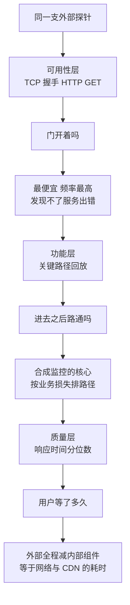
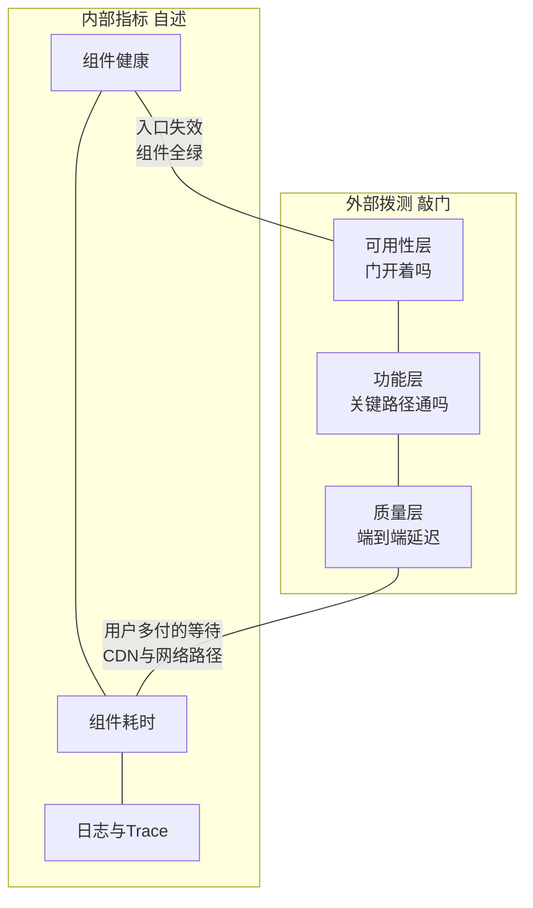
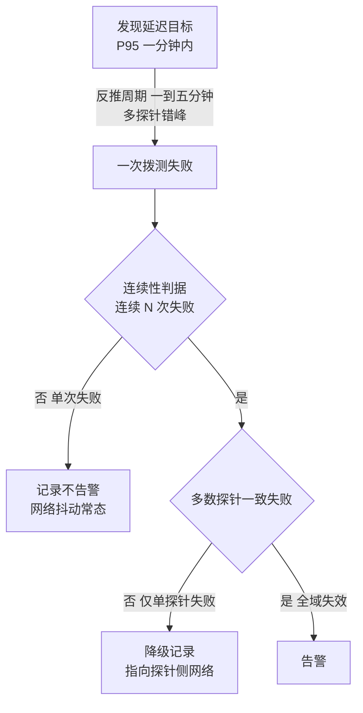

# 拨测与合成监控：在用户之前从外面敲一遍门

> **要点**：指标与日志是服务从内部看的自述，拨测是探针从外部敲门——外部视角能发现"组件全绿但用户进不来"的失效，拨测的设计按真实用户行为取样、按告警有据定频率、与内部指标分层互相补盲。

## 要解决的问题

监控体系有一个结构性盲区：**所有内部指标都从服务自己的位置采集，服务的入口失效（DNS 解析、负载均衡、证书过期、网关路由、防火墙规则）不经过服务本身**，**组件指标全绿而用户侧 100% 失败的形态真实存在**——证书过期、LB（Load Balancer，负载均衡器） 健康检查误摘、DNS（Domain Name System，域名系统：把域名解析成 IP 地址） 记录错误，**这些失效点上服务进程毫发无损**。本库可观测性域「指标、日志、Trace 与采样（只采集一部分数据以控制记录开销）各答一问，合起来才构成证据」[[工程知识/性能工程：从用户等待到资源瓶颈/观测与诊断/指标、日志、Trace与剖析各答一问，合起来才构成证据]]确立了证据体系的内部分工；本篇补外部的那个问号：**"用户能不能进来"由拨测回答**——**探针按真实用户的路径周期性访问，外部视角的失效在这里变成可见的失败记录**。读完这一页你能按真实路径设计拨测的三层深度、用发现延迟反推频率、配置多探针与告警判据。

## 探针从外面看什么、怎么敲门？

**拨测的三层深度**，机制在于同一支探针在不同深度上各答不同的问题。先把形状说成一件事：**内部指标像店员写的营业日志（收银机正常、货架有货、系统在线）**——这个比喻到"店员自述"为止，**店员看不见门外有没有人排队、门锁坏没坏，那是拨测的视角**；**拨测像神秘顾客——从店门外开始走完顾客的真实路径**：推门推得开吗（可用性层，TCP/HTTP 握手）、货架上找得到商品吗（功能层，关键路径回放）、从进门到结账花了多久（质量层，响应时间分位）。**神秘顾客发现的是"日志全正常但顾客进不了门"的失效**——比如门锁坏了而店内每个环节都自认无恙。这个比喻到"走完顾客路径"为止——现实里一位神秘顾客只能代表一个门，分布式系统要按用户分布派多位神秘顾客（多地域探针），多数人说进不去才算数，这是探针位置一节的内容。

**可用性层（端口与握手）**：探针按周期做 TCP（传输控制协议，负责把数据完整、有序地送达）连接或 HTTP GET（超文本传输协议的只读请求方法），**回答"门开着吗"——最便宜、频率最高，覆盖入口链路的存活**。**它发现不了"门开了但服务错了"**。

**功能层（关键路径回放）**：探针执行一段固定的用户旅程（打开首页、登录、提交订单的只读影子操作：用真实数据走一遍流程但不真正生成订单，避免污染业务数据），再断言响应内容与状态码（HTTP 的三位数字应答，200 表示成功、404 表示找不到），回答"进去之后路通吗"——这是合成监控的核心：**用最小的合成流量覆盖最关键的用户路径**，**路径选取按"失效后业务损失最大"排序，不追求覆盖全部功能**。

**质量层（性能水位）**：拨测同时记录响应时间分位数（把耗时排序后取某个百分比位置的值、如 P99），从外部看端到端延迟——**内部指标测组件耗时，外部拨测测用户全程**，网络传输、CDN（内容分发网络，把内容复制到离用户近的边缘节点，即部署在靠近用户的接入机房里的服务器）、边缘接入都算在内，**两者的差值就是"用户多付的等待"**，等于网络与 CDN 的耗时，**它是 CDN 与网络路径问题的敏感信号**（本库性能工程域"端到端网络延迟来自排队、协议、传输与处理"的分段视角在外部视角的对应物）。

三层深度在国产观测平台里的实物现场：观测云的可用性监测把 API 拨测、多步拨测建成独立任务类型，协议——HTTP/TCP/ICMP（Internet Control Message Protocol，网络层控制消息协议，ping 用它）/WEBSOCKET 各层连通探测，ping（探测目标主机是否可达的基础命令） 使用的就是 ICMP与拨测频率——1 分钟到 24 小时在任务上显式配置，「同一支探针在不同深度上回答三个问题」落到产品形态就是这些任务参数。


*图：观测云「可用性监测」功能的新建监测任务界面（中文）。右侧新建面板提供 API 拨测（测试网站、API 的连接情况，以评估可用性和运行时间）与多步拨测（使用多个 API 连接的响应数据创建测试）；左侧快捷筛选按拨测类型（HTTP/TCP/ICMP/WEBSOCKET/多步）、状态、标签、拨测频率（1min 至 24h）四个维度过滤任务。*

*图源：观测云可观测学堂，[网站/接口可用性拨测最佳实践](https://guance.com/learn/articles/synthetic-tests-api)。*

**探针位置决定发现能力**：**单点拨测只能证明"探针那里能进来"**——**多地域探针（至少覆盖用户的主要网络运营商/地域）才能区分"全域失效"与"局部运营商失效"**；探针位置的选取按用户分布，**从探针那里看不见的失效，对那部分用户就是真实失效**。**多探针的收益是失效的地域定位与去噪能力（多数派判据的根基）**，代价是探针基础设施的维护与合成流量的成本——跨地域业务的用户分布在多地，单探针看不见局部运营商失效，**漏报造成的损失常常大于探针的成本**，**这笔投入对用户分布跨地域的业务收益远大于代价**，**对只部署在单一机房、不面向公网用户提供服务的系统，单探针加证书（CA 签发的公钥凭证、证明持有者身份）检查已经够用，按用户分布定投入规模**。

多探针通常从就近的接入点发请求，服务地址按任播（anycast，同一个地址在多个位置同时宣告，请求被送到最近的一个宣告点）发布时，同一个 IP 在多个位置宣告，探针的请求被路由到离它最近的一个宣告点：


**探针与用户若不在同一个运营商或地域，「就近」的路径就不同**——**这正是拨测要求数量与位置贴合用户分布的原因**。

三层深度是同一支探针在不同深度上回答的三个问题，不是三种拨测



**三层从外往里一层层加深度，成本和频率也随之变化**：最外层可以每十秒一次，**功能层因为有业务副作用（操作对外部状态产生的额外影响）要控制频率，质量层的分位数需要足够样本才有意义**。**只做最外层的团队会遇到"监控全绿、用户投诉"——门开着和路通着是两件事**。

探针从外面敲门的具体方式就是黑盒（不接触代码内部、只看输入输出的测试或分析方式）监控的手段集合——ping 测连通、API 调用测功能、响应时间测质量，Grafana（开源监控与可视化平台，其合成监控功能提供拨测能力）官方博客的这张图把从外部打到服务上的探测方式画成一圈：**探针不进入服务内部，只从外面观察每次敲门的应答**：


*图源：[Grafana Labs 官方博客《Intro to synthetic monitoring》](https://grafana.org/blog/intro-to-synthetic-monitoring-and-grafana-labs-new-iteration-on-worldping/)。*



上图中内外两个视角的分工与互补：**两条视线相接处正是对方的盲区**——**入口链路失效（证书过期、LB 误摘、DNS 错误）不经过服务本身，组件全绿而用户进不来，只有外部视线看得见**；**反过来拨测延迟减去内部组件耗时，差值只有外部视线敏感**。**两套探针互为对方的盲区探测器，只上其中一套就是残缺**。

## 拨测该怎么设计，才不会又贵又钝？

**频率与成本的平衡**：功能层拨测每次都是真实请求，**频率过高给生产加压、过低则失效发现延迟长**——按"告警确认窗口"定频率：想让 P95（95% 的请求都比它快的那个耗时，代表绝大多数用户的体验）的发现延迟在 1 分钟内——**发现延迟约等于拨测周期乘以连续失败判定的次数**，**周期取目标除以判定次数再留出错峰余量，落在 1-5 分钟**；**可用性层可以更密，功能层保持稀疏**。**频率的依据是发现延迟要求，拍脑袋的频率要么贵要么钝**。

**两个判据是串联的：先过「连续 N 次」，再过「多数探针一致」**；**只有单探针失败的那条支路降级为记录，指向的是探针自己的网络而不是服务**。**频率也不是拍脑袋定的，它由发现延迟目标反推而来**：



**频率由发现延迟目标反推、告警由两个判据串联，两者配齐之后拨测才不会自己变成告警噪音源**。

**告警的判据**：**单次失败不告警（网络抖动正常存在），连续 N 次跨多数探针失败才告警**——**"多数探针 + 连续性"两个条件滤掉探针自身的抖动**；**单探针失败且他探正常，指向探针侧网络问题，降级为记录**。**告警判据里必须有"探针一致性"这个维度**，否则拨测自己变成告警噪音源。

**与内部监控的分工边界**：**拨测回答"入口与关键路径通不通"，内部指标回答"组件内部健康吗"**——**拨测全绿而内部告警，怀疑拨测覆盖不全；内部全绿而拨测告警，怀疑入口链路失效**。**两条视角互为对方的盲区探测器，任何一条单独上线都是残缺的**。

## 拨测管不到什么？

**拨测流量与真实流量隔离**：**合成请求要带可识别标识（专用 UA——User-Agent，请求头里标明客户端身份的一段文字——与测试账号）**，计入独立的统计桶——**混入真实流量会污染业务统计与限流（控制单位时间放进来的请求数量，超过配额就拒绝决策，测试账号要与真实账号的权限隔离防越权）**。

**拨测不替代端到端业务对账**：**功能层拨测验证"路径走得通"，验证不了"数据算得对"**——正确性靠对账体系（本库缺陷分析域"静默失真的检测靠对账与不变量"），**拨测的断言深度止步于路径正确**。

**证书与域名的失效要显式拨测**：**证书剩余有效期、域名解析结果是入口链路的高发失效点**，单独建低频检查（每日）——**功能层拨测撞上证书失效才发现，发现延迟等于拨测周期，专门的证书拨测把发现提前到"还剩 N 天"**。

## 怎么验证拨测真的有用？

下面三步都能在测试环境复现，每步写明了预期结果，跑完对照即可：

1. 失效注入验证：测试环境依次注入入口层失效（停 LB、错误 DNS 记录、过期证书），**预期拨测在对应层失败而组件指标全绿——外部视角盲区覆盖能力的实证**；
2. 噪音验证：**制造单探针网络抖动，预期不触发告警（多数探针条件生效）；制造全域失效，预期告警及时触发**；
3. 断言锚点：**多地域探针覆盖主要用户分布、告警判据含探针一致性维度、证书与域名有独立检查**；三者齐备后"组件全绿用户失败"形态的失效必然被拨测捕获。

```text
注入断言 = 入口失效仅拨测可见
去噪断言 = 单探针抖动不告警，全域失败必告警
覆盖断言 = 探针地域 × 用户分布核对表齐备
```

**拨测是监控体系里唯一站在用户位置的眼睛**——**三层深度、多探针、一致性判据配齐，外部失效从"用户投诉才知道"变成"用户之前已告警"**。

## 还能读哪几篇补全视角？

- [[工程知识/性能工程：从用户等待到资源瓶颈/观测与诊断/指标、日志、Trace与剖析各答一问，合起来才构成证据]] —— 内部证据体系的分工，拨测是外部视角的第五种证据
- [[工程知识/性能工程：从用户等待到资源瓶颈/存储与网络/端到端网络延迟来自排队、协议、传输与处理]] —— 拨测延迟与组件延迟的差值解读依据
- [[工程知识/后端系统：在并发、失败与变化中维持服务/服务设计/健康检查的三层语义：存活就绪与深度]] —— 内部健康检查与外部拨测的分层对照
- [[工程知识/性能工程：从用户等待到资源瓶颈/观测与诊断/连通性诊断的分层顺序：从链路到应用逐层收窄，不跳层]] —— 拨测失败后的收窄诊断路径
- [[工程知识/软件构建：让变化可以理解、验证与交付/测试与交付/故障演练把预案、工具与人串成可执行的响应链.md]] —— 拨测告警拉响之后，人与流程的响应彩排
