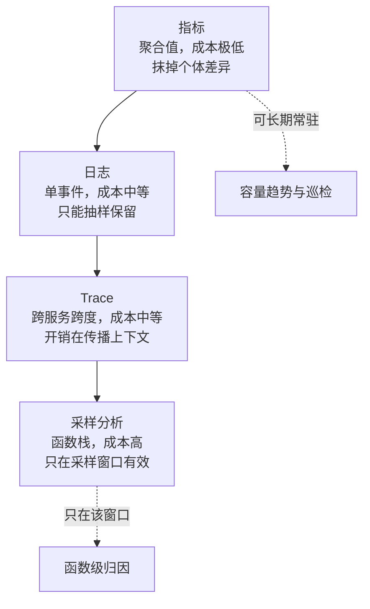
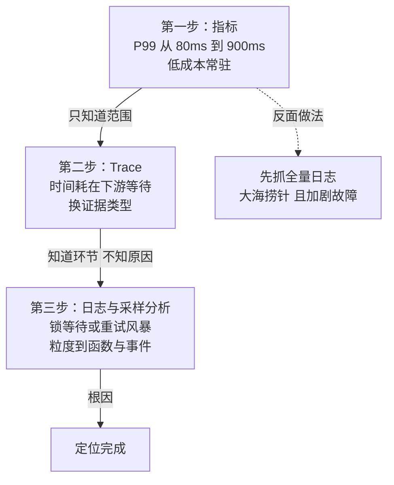

# 指标、日志、Trace与剖析各答一问，合起来才构成证据

**本文讲四类观测证据各答一问、合起来才构成证据：指标是聚合数值，Trace 是单个请求跨服务的完整路径记录，日志是离散事件，剖析是按时间采样得到的函数调用栈**。**读完你能按问题类型选证据：「有没有」看指标、「哪一个」看 Trace、「为什么」看剖析**。

线上出问题时，单一证据类型答不了完整的问题——像只量体温判断一个人是否健康，量到发烧却说不清是哪个器官出问题。**指标告诉你"慢了"，但不知道慢在哪个环节；日志告诉你"这条请求报错了"，但不知道占比多少；Trace 告诉你"请求经过了谁"，但不知道进程内部时间花在哪**。**四类观测证据对应四个互相不可替代的问题维度，把它们当成四种择一使用的工具就会反复走偏**。

核心机制是**粒度与开销的交换**：**指标是聚合值，成本极低、可长期保留，但抹掉了个体差异；日志是单事件，保留细节但采集成本中等、只能抽样保留；Trace 串起一次请求的全部跨度，开销在传播上下文，成本也属中等；剖析（profiling）深入函数级，成本最高，只在采样窗口内有效**。**定位一个问题的标准路径是沿粒度递进：指标定范围 → Trace 定环节 → 日志/剖析定根因**。

## 要解决的问题

线上问题出现时，**手边的指标显示延迟抬升却指不出环节，日志里翻到的一条报错说不清占比，Trace 显示请求经过了某个下游却看不出进程内部的时间去向**。**四类观测证据各自只能回答一个问题维度，指望其中一类单独完成定位就会陷入反复猜测**。本篇回答：**指标、日志、Trace 与剖析各回答哪个问题、粒度与开销之间怎样交换、定位路径为什么按粒度递进、高基数标签为什么会先于业务把存储打爆、以及外部黑盒（不接触代码内部、只看输入输出的测试或分析方式）依赖与采样偏差使归因止步于何处**。

## 线上问题来了，四类证据各该回答什么？

*图示：Jaeger 的架构——客户端埋点（在代码里插入统计上报语句、收集用户行为数据）产生 span，经收集、存储，最后在界面上拼回一条完整调用链。图源：Jaeger 官方文档《Architecture》，Apache-2.0，https://www.jaegertracing.io/docs/latest/architecture/。这张图是"Trace 这一类证据"的完整通路：它回答"这一个请求经过了谁"，但回答不了"整体有多少请求慢"——后者是下面这张分工表里指标那一行的事。*

| 证据 | 回答的问题 | 粒度 | 开销 | 典型误用 |
| --- | --- | --- | --- | --- |
| 指标 | 有没有问题、多大范围、趋势如何 | 聚合 | 极低 | 用高基数标签把存储打爆 |
| 日志 | 这个具体事件发生了什么 | 单事件 | 中（全量很高） | 把日志当指标用（grep 统计） |
| Trace | 一次请求经过了谁、每步多久 | 跨服务跨度 | 中（传播上下文） | 采样率低漏掉尾延迟请求 |
| 剖析 | 进程内 CPU/内存时间花在哪个函数 | 函数栈 | 高（仅开启时） | 拿离线剖析代表在线负载 |

剖析的产物最常见的是火焰图（按调用层级堆叠的耗时分析图、越宽的块越耗时）——宽度直接对应占用时间，热点（访问集中在少数键或节点上的现象）落在哪条调用路径上一眼可见：

*图示：CPU 火焰图的形态：宽度是占比、纵向是调用栈深度。图源：[Brendan Gregg · CPU Flame Graphs](https://www.brendangregg.com/FlameGraphs/cpuflamegraphs.html)。*

这张图区分了剖析与指标的分工：**指标能告诉你 CPU 到了 80%，只有剖析能回答这 80% 是哪条调用路径吃掉的**。**也正因为它只在采样窗口内有效，拿离线剖析的结果代表在线负载才会成为表格里那一条典型误用**。

**判断观测体系是否完整，不看装了多少工具，看四个问题是否都答得出来：占比多少（指标）、这一条怎么了（日志）、路径在哪断的（Trace）、时间花在哪（剖析）**。

**四类证据按粒度从粗到细排成一条递增链——粒度越细保留的信息越多，采集与存储的成本越高，所以越贵的证据越不能常驻，可长期保留的只有最左一类**：

## 四类证据在定位里怎么接续？

一次典型定位走三步接续，每一步换一种证据类型。第一步只看常驻的指标：

1. 指标发现 P99（把所有请求响应时间从小到大排，第 99 百分位的值，99% 的请求比它快）延迟从 80ms 抬到 900ms，且只影响某一类接口——这一步只需要指标，代价是**低成本常驻**。
2. 从慢请求里抓一条 Trace，发现时间耗在下游调用的等待上，但下游自身指标正常——单点证据到此不够，需要换证据类型。
3. 打开下游的采样剖析或拉慢请求日志，发现锁等待或重试风暴（下游失败后反复重试，请求量被放大数倍）——粒度到了函数或事件级。

**这个顺序的意义在于每一步缩小范围，下一步才用更贵的证据**。**反过来做（出问题先抓全量日志）会把定位变成大海捞针，且故障时系统资源本就吃紧，全量写日志再抢 IO 与磁盘，等于在火上加压**。

「抓一条 Trace 看时间花在哪」落到界面上就是瀑布图：OpenTelemetry（CNCF（Cloud Native Computing Foundation，托管 Kubernetes 等项目的基金会）旗下的可观测性数据采集开放标准）官方文档的示例图里，一条请求的每个跨度横向排开、按时间对齐，父跨度把子跨度包在里面，延迟花在哪个下游一眼可见——这正是表格里 Trace 那一行「每步多久」的实物形态：

*图：单条 Trace 的瀑布视图（图源：OpenTelemetry 官方文档《Traces》，https://opentelemetry.io/docs/concepts/observability-primer/#traces，CC BY 4.0）。瀑布图（waterfall，按时间对齐排列各跨度的可视化形态）把「请求经过了谁」和「每步等多久」放进同一张图——第 2 步定位到「时间耗在下游等待」时，看的就是这样一张图。*

三步接续里，每一步用到的证据更贵、范围更窄，贵证据的启动条件由前一步给出：

指标这边有一个常见的反面教材：**把 user_id、request_id 这类值塞进指标标签**。**高基数（同一标签的取值种类极多，如按用户 ID 区分）标签让时间序列数量随用户数爆炸，存储和查询成本先于业务到达瓶颈**。**值属于日志和 Trace，指标只放低维度的维度（接口名、状态码、机房）**。

## 面对一个问题该先取哪类证据？

并发处理下，一条 Trace 的归属会变复杂。**多个消费者竞争同一队列的消息，每条消息只被其中一个处理，这意味着按处理方聚合的指标无法直接回答某条消息经历了什么**。

**为什么指标与 Trace 必须并存？指标回答「消费速率够不够」，这是聚合视角；Trace 回答「这一条消息走了哪条路径」，这是个体视角**。**竞争消费者模型下两者不可互相替代——用速率推断单条消息的经历，正是误判的常见来源**。

| 场景 | 首选证据 | 原因 |
| --- | --- | --- |
| 常态巡检、容量趋势 | 指标 | 聚合便宜，适合长期保留 |
| 单请求异常（某用户报错） | 日志 + Trace | 个体事件需要单事件粒度 |
| 延迟整体抬升、不知在哪 | Trace | 跨环节归因只有跨度数据能做 |
| CPU 打满、吞吐不涨 | 剖析 | 函数级归因 |
| 间歇性故障（每天几次） | 指标触发 + 自动抓 Trace/剖析 | 人工等复现成本太高 |

间歇性故障值得单独说：**它是对"常态只开指标"策略的挑战**。**做法是指标设阈值触发器，触发时自动开启短窗口的 Trace 采样或剖析，把"出事时证据不在场"变成"出事时证据自动到场"**。**这属于预先设计，故障发生后再补是来不及的**。

## 四类证据在哪儿重叠、边界怎么划？

分类有重叠，别为分类而分类。**结构化日志可以聚合成指标（错误计数），Trace 的跨度本身就是一组带维度的数据**。**工程上按"谁消费"决定形态：仪表盘消费的做指标，按请求排查的做 Trace/日志**。

这套分工的边界：**外部黑盒依赖（第三方 API）拿不到 Trace 与剖析，只剩日志与调用侧指标，归因只能到"它在变慢"而不是"它为什么慢"**；**剖析代表的是采样窗口内的负载——剖析只在窗口内抓瞬间，低峰时函数调用构成与高峰不同，低峰期抓的剖析不能代表高峰行为**；**Trace 采样是均匀随机的，会系统性漏掉最慢的少量请求，尾延迟（最慢的那少量请求的延迟）排查要用尾部偏置采样（刻意多采最慢请求而非均匀随机）**。

观测的最终目的是**能重建一次决策**：**事后能回答"当时系统为什么做了这个决定"，收集数据只是达成它的手段**。**这一点上四类证据缺一不可，人工智能（AI）系统里同样成立——模型每次调用的输入、检索到的证据、工具返回值都要在日志与 Trace 里留痕，否则出错后无法归因**。参考 [[工程知识/AI 系统工程：从模型能力到生产能力/质量与运营/可观测性必须能重建一次决策]]。

## 怎么自己动手验证

**证据链完整性要与注入实验对账——预写注入延迟后指标、链路、日志与剖析四环都应给出线索，任一环答不出，与预期对不上，就是证据链的缺口**。

**检验观测体系是否真的可用，做一次注入实验：人为给某个依赖注入 200ms 延迟，然后走一遍定位流程——指标是否在分钟级反映？Trace 是否能指出慢在哪个跨度？日志是否记录了该请求的异常？剖析是否显示了新增的等待？任何一环答不出，就是证据链的缺口**。

**指标基数检查用来防止标签被高基数字段打爆：列出基数最高的 10 个指标标签，凡基数超过千级（取值种类超过一千种）的标签，确认它真的该是标签而不是日志字段**。复现命令参考 [[工程知识/性能工程：从用户等待到资源瓶颈/观测与诊断/性能问题定位]] 的定位路径与 [[工程知识/性能工程：从用户等待到资源瓶颈/观测与诊断/性能剖析与火焰图]] 的剖析方法，指标体系的设计输入见 [[工程知识/性能工程：从用户等待到资源瓶颈/观测与诊断/系统指标与观测]]。

## 接着读哪几篇：三层下钻的完整路径

- 关系：[[工程知识/性能工程：从用户等待到资源瓶颈/观测与诊断/系统指标与观测]] · [[工程知识/性能工程：从用户等待到资源瓶颈/观测与诊断/性能剖析与火焰图]] · [[工程知识/AI 系统工程：从模型能力到生产能力/质量与运营/可观测性必须能重建一次决策]]
- [[工程知识/性能工程：从用户等待到资源瓶颈/观测与诊断/性能问题定位]] —— 三层下钻的完整路径
- [[工程知识/AI 系统工程：从模型能力到生产能力/质量与运营/Agent评估系统的设计约定]] —— Agent 场景下的证据绑定
- [[工程知识/软件构建：让变化可以理解、验证与交付/测试与交付/混沌工程验证系统是否真的能处理故障]] —— 用注入故障反向检验观测
- [[工程知识/软件构建：让变化可以理解、验证与交付/测试与交付/静态分析的证据边界：它证明什么不证明什么.md]] —— 运行时证据的互补面
- [[工程知识/软件构建：让变化可以理解、验证与交付/测试与交付/可观测性断言：把运行时行为写进测试.md]] —— 信号体系与测试体系的桥
- [[工程知识/性能工程：从用户等待到资源瓶颈/观测与诊断/拨测与合成监控：在用户之前从外面敲一遍门.md]] —— 外部视角的第五种证据：探针（向系统注入的检测点或检测请求）从用户位置回答"进不进得来"
- [[工程知识/性能工程：从用户等待到资源瓶颈/观测与诊断/分布式追踪的采样与补齐：低频异常要靠尾部采样与标签回捞.md]] —— Trace 证据的完整性：采样策略决定哪些证据留得下来
- 相关（观测本身也有代价）：[[工程知识/缺陷分析：从个案到体系/并发/只读旁观者不能改变被观察对象的状态]] —— 采集动作写入共享状态或占用独占资源时，观测会改变被观察对象
