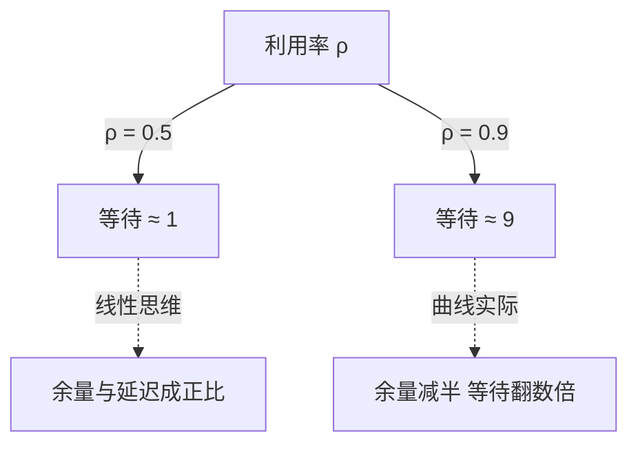
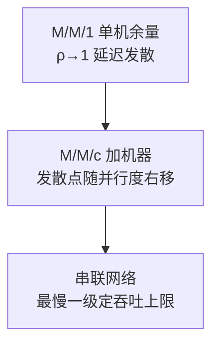

# 排队论给容量一个可推导的模型

**容量问题（"能扛多少""加机器能改善多少""延迟为什么会突然涨"）没有排队模型时只能靠压测试错——试一次贵一次，且试出来的数字不可迁移（换负载形态就失效）。**排队论把这类问题变成可推导的：**到达率（单位时间进来的请求数）、服务率（单位时间处理完的请求数）、并行度三个参数进模型，延迟与队列长度的期望值出来。**读完这一页你能**用三个参数推导容量上限，判断该加机器还是该优化代码，并算出「留 10% 余量」为什么站不住**。M/M/1 是单队列单服务台的理想模型，真实系统并不**严格符合**，但**简化模型的价值在于方向性结论不需要精确**。

排队模型的机制先从两个最常用的结论看起。

**Little 定律**：`L = λ × W`（系统内平均请求数 = 到达率 × 平均停留时间）。**它恒成立（不依赖分布假设），用途极广：反推容量（实测 L 与 W，算出 λ 上限）、估算队列长度（λ 乘 W 的积就是系统里同时存在的平均请求数）、验证观测一致性（三个量测出来不满足公式，说明有一个测错了——这本身就是观测一致性的自检）。**

**利用率-延迟曲线**：M/M/1 模型里 `W = 1/(μ-λ)`（平均停留时间 = 1/(服务率-到达率)），**利用率 ρ = λ/μ 趋近 1 时延迟发散。**把两个利用率代进这个式子：ρ=0.5 时 W = 2/μ，ρ=0.9 时 W = 10/μ，**后者是前者的五倍**；换成排队段等待时间 `ρ/(1-ρ)`，两个比值分别落在 1 与 9。**容量规划留余量的数学根据就是这条曲线的形状：线性扩容的思维（90% 用满 = 还有 10% 余量）在这条曲线面前是错的——利用率余量小，工作点就落在曲线右侧，少量余量对应延迟恶化数倍，所以按平均负载留少量余量不够。**

同一条式子画成曲线就是下面的形状——横轴靠右的每一小步，对应纵轴的一大步：

**曲线上的取值来自 `ρ/(1-ρ)`：利用率从一半抬到九成，排队等待从 1 个单位涨到 9 个单位，而按线性思维预留的余量只从 50% 缩到 10%——余量减半再减半，等待却翻数倍。这就是「留 10% 余量」的容量结论在这条曲线面前站不住的原因。**

模型的最小形态就是一条排队链，全部参数只有到达率与服务率两个速率加一个并行度：

*M/M/1 排队系统的状态转移速度图与指标表：ρ 为系统负荷水平，Ls、Lq、Ws、Wq 分别对应队长、队列长、逗留时间与等待时间，全部可由 λ 与 μ 推出（图源：CSDN 博客）*

*M/M/1 排队链（图源：Wikimedia Commons，Tsaitgaist 绘，CC BY-SA 3.0）*

**λ 与 μ 两个速率之比就是利用率 ρ，图上队列那一段攒起来的长度就是 W 与 L 的落点——上面两个结论都建立在这条链上。**

## 要解决的问题

"能扛多少请求""加多少台机器""延迟为什么会突然上涨"这类问题没有模型支撑时只能靠压测试错，而压测结果与真实负载形态不符。**本篇回答：到达率、服务率与并行度怎样进入容量推导、利用率上升时延迟为什么非线性增长、拐点位置怎样实测，以及简化模型在什么范围内值得信任。**

## 为什么容量规划要给利用率留余量？

利用率接近 1 时等待时间为什么会陡峭上升？排队论对这个问题的回答是本篇的第一个结论。**到达率不由容量侧决定，唯一能主动压住利用率的手段是拦住一部分请求，所以容量规划要给利用率留余量，而限流（控制单位时间放进来的请求数量，超过配额就拒绝）就是那个把利用率压住的闸门。**

**到达率、服务率与并行度三个参数进入模型，输出的是一组期望值。**系统在利用率接近上限时延迟上升的速度远快于线性，原因是**等待时间随利用率上升而非随负载上升**，**利用率余量小就落在曲线右侧，延迟恶化数倍**；**这解释了为什么容量决策不能按平均值留有少量余量，也解释了压测试出来的数字为什么换个负载形态就失效。**

来源：[美团技术团队《Java线程池实现原理及其在美团业务中的实践》](https://tech.meituan.com/2020/04/02/java-pooling-pratice-in-meituan.html)（CC 4.0 BY-SA）

## 三个容量模型各自覆盖什么场景

三个模型的差别在并行度怎么进入公式，各自的结论回答的容量问题也不同：

选哪一个模型，取决于**要回答的容量问题落在哪一层：问单机余量用 M/M/1**，**问加机器的收益用 M/M/c，问优化哪一级用串联网络——模型不同，能推出的结论也不同，用错模型得到的数字没有意义。**

| 模型 | 场景 | 关键结论 |
| --- | --- | --- |
| M/M/1 单队单服务台 | 单实例、串行瓶颈 | 延迟在 ρ→1 发散 |
| M/M/c 多服务台 | 实例池、连接池 | 并行度提高延迟发散点右移 |
| 排队网络（串联） | 多级流水线 | 最慢一级决定吞吐上限 |

M/M/c 的实践含义：连接池（预先建好连接反复取用、省去反复握手建连的开销）从 10 扩到 20 不是简单的吞吐翻倍——池小于到达所需并发时排队在池门口（连接等待），池大于服务端处理能力时排队挪到服务端内部（线程切换开销上升）。**最优池大小存在一个点，两侧性能都变差，这个点用排队模型能逼近，用压测能校准**（压测方法见 [[工程知识/后端系统：在并发、失败与变化中维持服务/基础设施/容量规划与压测要用同一个负载模型说话]]）。

M/M/1 还可以画成状态机：把系统内的请求数当作状态（0, 1, 2, …, n），到达一个请求状态右移一格（速率 λ），服务完一个状态左移一格（速率 μ）。利用率就是向右的箭头压过向左的箭头的程度——ρ→1 时状态往高处漂，队列长度与等待时间随之发散。上一节"利用率-延迟曲线"的发散形状，在状态空间里就是这串状态的重心不断上移——重心指系统内请求数的期望值（概率加权均值），不按物理重量理解：

*M/M/1 的状态空间转移（图源：Wikimedia Commons，Michael K. 绘，公共领域）*

**串联排队网络的含义：流水线吞吐上限 = 最慢一级的服务率，加快其他级无效。**这与"端到端延迟来自多层排队"的分解一致[[工程知识/性能工程：从用户等待到资源瓶颈/存储与网络/端到端网络延迟来自排队、协议、传输与处理]]，瓶颈判定用 USE 方法（Utilization/Saturation/Errors，对每类资源查使用率、饱和度、错误数），它看三类资源信号：Utilization 利用率、Saturation 饱和度、Errors 错误，见 [[工程知识/性能工程：从用户等待到资源瓶颈/观测与诊断/系统指标与观测]]。

## 怎么用模型回答三个容量问题

**问题一：加机器还是优化代码？** 用 Little 定律算出当前单机有效并发 L = λ×W，对比服务端真实并行度。**差距大说明排队在等资源（加机器有效）；差距小且延迟仍高说明单请求本身慢（优化服务时间才有效）。**这个判断把"加机器"从领导直觉变成有推导的选择。

**问题二：突发流量会怎样？** **突发是到达率瞬时抬升，模型上队列长度按指数积累（ρ 短暂超过 1 时队列线性增长，增速 = λ-μ）。持续时间 T 的突发需要缓冲容量 (λ-μ)×T——这就是"削峰（用队列把瞬时高峰摊平到更长的时间段）填谷要多少队列容量"的算法。**真实系统的突发形态（整点脉冲、缓存失效风暴）偏离指数假设，**量级估算仍适用，精确值靠回放压测。**

**问题三：为什么延迟突然涨了三倍？** 排队模型的第一嫌疑是**利用率爬过拐点——流量只涨一成多，利用率却从 80% 到 92%——利用率是到达率与服务率之比，临近饱和时分母接近 1，流量涨一成会被放大成利用率涨一大截**；代进 `ρ/(1-ρ)` **排队等待从 4 个单位涨到 11.5 个单位，接近三倍（曲线形状决定）**。第二嫌疑是**服务时间分布变长尾（某类请求变慢拖住服务台），表现是平均利用率不高但第 99 百分位延迟（响应时间从短到长排，99% 的请求比它快）恶化——这是 M/M/1 模型外的情况**，用采样（只采集一部分数据以控制记录开销）分析找长尾来源[[工程知识/性能工程：从用户等待到资源瓶颈/观测与诊断/性能剖析与火焰图]]。

## 这套说法在哪儿会失效

模型假设的三个偏离要心里有数：**到达不是泊松（泊松过程指到达间隔相互独立、随机均匀到来；真实流量有自相关与脉冲）、服务时间不是指数（多峰分布）、系统有反馈（过载时降级——主动牺牲部分功能或精度，保住核心链路——与限流改变到达形态）**。偏离的方向性影响：**脉冲式到达的队列比模型预测更长（预测值是下界），反馈控制让实际系统比模型更韧（预测值过于悲观）。模型给的是数量级与方向，决策要压测校准**——这一主从（一台主节点负责写入、其他从节点同步数据的部署形态）关系在容量规划篇已定，这里给的是它的数学面。

模型也不能替代对负载语义的理解：**同一个每秒查询数（QPS）数字，读多写少与写多读少的容量结论完全不同（写路径的锁与刷盘改变 μ）**，负载构成的分析见 [[工程知识/后端系统：在并发、失败与变化中维持服务/基础设施/容量规划与压测要用同一个负载模型说话]] 的负载模型四要素。

## 怎么自己动手验证

**容量模型要与实测三值对账——预写在线的并发数、吞吐与平均延迟应满足其乘积关系，偏差过大，与预期对不上，先查观测点是否一致。**

**Little 定律自检：从线上取同时在线请求数（连接数或 inflight 计数）、吞吐、平均延迟三个实测值，验证 L ≈ λ×W。偏差大说明观测有错（inflight 没数对、延迟测量点不一致）——这个自检本身是观测体系健康度的检查项**（观测证据的分工见 [[工程知识/性能工程：从用户等待到资源瓶颈/观测与诊断/指标、日志、Trace与剖析各答一问，合起来才构成证据]]）。

**拐点实测：阶梯压测画利用率-延迟曲线，与 M/M/1 形状对比。实测拐点位置早于模型（60% 就陡升）通常意味着锁竞争（多个请求抢同一把锁、互相等待）或 IO 等待把有效并行度压低了——模型与实测的差值就是"锁与 IO 吃掉的并行度"的量化。**

## 接着读哪几篇：长尾来源的下钻工具

- 关系：[[工程知识/后端系统：在并发、失败与变化中维持服务/基础设施/容量规划与压测要用同一个负载模型说话]] · [[工程知识/性能工程：从用户等待到资源瓶颈/存储与网络/端到端网络延迟来自排队、协议、传输与处理]] · [[工程知识/性能工程：从用户等待到资源瓶颈/观测与诊断/系统指标与观测]]
- [[工程知识/性能工程：从用户等待到资源瓶颈/观测与诊断/性能剖析与火焰图]] —— 长尾来源的下钻工具
- [[工程知识/性能工程：从用户等待到资源瓶颈/观测与诊断/优化收益递减决定何时该停手]] —— 容量投入的停止判据
- [[工程知识/后端系统：在并发、失败与变化中维持服务/任务与并发/调度必须同时处理优先级、公平与背压]] —— 队列管理在调度层的展开
- [[工程知识/缺陷分析：从个案到体系/资源与容量/案例六：容量与泄漏——连接泄漏和 SST 堆积]] —— 容量失效的实例形态
- [[工程知识/后端系统：在并发、失败与变化中维持服务/服务设计/容量估算的通用骨架：从峰值QPS到机器数的推导演练.md]] —— 把排队参数变成机器数的完整推导演练
- [[工程知识/AI 系统工程：从模型能力到生产能力/推理服务与平台/推理批处理的两难：吞吐与延迟的调度天平.md]] —— 调度天平的通用理论
- [[工程知识/后端系统：在并发、失败与变化中维持服务/服务设计/连接池的容量数学：池大小与排队等待的权衡.md]] —— 池数学的理论基础
