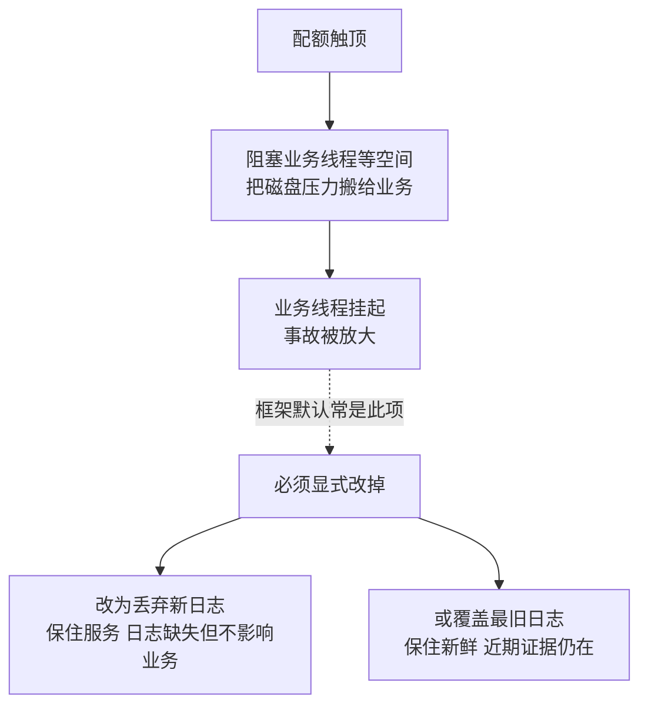
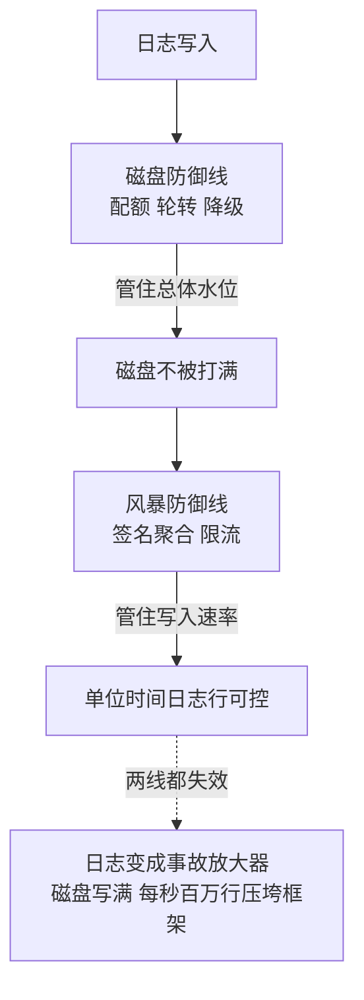

# 日志是诊断的证物也是故障源：磁盘打满与错误风暴两条防御线

日志用来查问题，但它自己也会把磁盘写满、把真信息淹没。读完这一页你能给日志加配额与轮转、给重复错误做聚合限流（控制单位时间内写入的日志数量，超过配额就拒绝写入），两条线都失效时知道先切哪条——**先切风暴防御线（聚合限流见效快、改配置即可生效），再处理磁盘防御线的降级配置（涉及框架行为，改动更重）**。

> **要点**：日志系统的要求是逻辑自洽——诊断工具自己不闯祸——**磁盘防御线给日志配额与轮转（打满前先降级），风暴防御线给重复错误做聚合限流（同样的错误一秒打一次）**，**两条线都失效时日志从证物变成放大故障影响的一环**——被放大的是日志把服务自己压垮的这部分影响，事故本身没有变大。

## 日志为什么会从诊断证物变成故障源？


来源：[JavaGuide](https://javaguide.cn/high-availability/timeout-and-retry.html)（CC 4.0 BY-SA）

本篇要解决的问题从这两次身份反转开始：**平时是诊断证物，出事时日志自己变成事故源**——**磁盘被日志打满**（**错误风暴时每秒百万行的重复错误把磁盘写满，服务从"有 bug"变成「完全不可用」**），**日志系统本身崩溃**（**日志框架在磁盘满时的行为未定义，有的抛异常把业务线程带崩**）。上游 BookKeeper 的一个复现改进是垃圾回收线程记录所有错误（把静默失败变成可见信号）——**可见性是对的，但没有配额的可见性会反噬**：**错误风暴时全量记录恰好把服务压垮**。本篇讲两条防御线：**配额与轮转的磁盘防御、聚合限流的风暴防御**，**让日志"该在的时候在、不该多的时候不多"**。

## 磁盘防御线怎么配额、轮转与降级？

**配额先于写入**：日志目录的磁盘配额单独划，logrotate 的 maxsize、systemd（Linux 的服务管理器，开机自启与守护进程）-journald 的 SystemMaxUse 磁盘上限、应用框架的 maxSize是三个现成的控制手段——**配额按磁盘的一定比例（一般 10-20%）与保留时长双重约束**，两个条件任一触发即轮转——轮转指把当前日志文件改名归档、新建空文件继续写。**配额缺失时轮转形同虚设：单文件轮了，总量无人管，打满只是时间问题**。

**轮转的三要素**——把当前文件改名归档、新建空文件继续写，按大小或时间切分、保留 N 份、过期删除——**三要素缺一，要么单文件无限膨胀，要么旧日志堆积**。**轮转与写入的原子性**：**轮转瞬间正在写的文件被改名，进程的文件句柄（程序持有的资源引用标识）还指向旧 inode（磁盘空间不释放）**——**copytruncate（轮转时先拷贝内容再截断原文件，进程句柄保持不变、空间随即释放）或信号重开（USR1/SIGUSR2，留给应用自定义用途的信号）是标准解**，**用错方式是"轮转后磁盘依然满"的经典原因**。

**配额触顶时的降级行为要预设**（降级指主动牺牲部分日志、保住业务线程不被阻塞）：**磁盘到配额上限时日志框架怎么办——丢弃新日志（保服务，日志缺失但不影响业务）、覆盖最旧（保住新鲜，近期证据仍在）、阻塞业务线程等空间（事故放大器）**——**三选一必须显式配置**，**默认行为常常是第三种（最坏选择）**。**日志丢了可以接受，业务线程被日志阻塞不可接受，这个优先级要写进配置**。

三种降级行为走到头，各自的后果不同——改掉默认行为前先看清每条路的尽头：



两条防御线在日志管道里的位置：日志从应用出发，经收集与存储进入分析与诊断，最后到可视化与告警——**每一段都有缓冲与限速的位置，防御线设在哪一段、丢谁保谁，是这条管道的设计决策**：


*图源：[Microsoft Learn 中文文档《监视和诊断最佳做法》](https://learn.microsoft.com/zh-cn/azure/architecture/best-practices/monitoring)，CC BY 4.0，文档引用。防御线设在哪一段、丢谁保谁，是这条管道的设计决策。*

磁盘打满的第二条来路是「写入方不知道下游多快」：多个收集服务把日志投进队列，**队列像水池缓冲——收集侧是进水管，落盘侧是出水管，队列是水池本身，两边快慢互不影响**（解耦就是这个意思）：**收集侧尖峰在水池里排队，落盘侧按自己的节奏消化，水池满了才轮到丢弃策略登场**：


*取自 Microsoft Learn 中文文档《监视和诊断最佳做法》（CC BY 4.0，learn.microsoft.com/zh-cn/azure/architecture/best-practices/monitoring）。*


## 风暴防御线怎么聚合与限流？

错误风暴（同一根因短时间内被重复上报，日志量暴涨）的典型形态，**是同一个根因被无数个下游实例各自捕获、各自上报一遍——每个实例都在诚实地报告自己那一份，聚合起来就是同一件事的 N 份副本**。**降噪要做的是把 N 收回到 1**，而不是让每个实例少报一点。


**重复错误的聚合**：**同一错误一秒打千次时，第 2 到第 1000 次是噪声**——**聚合按错误签名（异常类型 + 位置 + 关键参数）分组，组内限流**（**如"同一签名每秒最多 1 条 + 计数器"，窗口结束输出"过去 N 秒发生 M 次"**）。主流日志框架都有此机制（logback 的 DuplicateMessageFilter，检测并过滤连续重复消息）、各语言的 rate-limited logger（限制单位时间输出行数的日志记录器），**没配就等于没有**。

**聚合限流的自反性检查**：被限流的错误在聚合计数里可见——**"限流器生效"本身要留痕**，**否则限流把真问题藏住（每秒 1 条的采样让人误以为问题轻微）**；**限流的收益是日志体量可控、磁盘防御线不承压，代价是日志细节被采样（只采集一部分数据以控制记录开销）稀释**——两者靠计数器补偿：**计数与告警联动，签名出现频率异常（从未见过的新错误签名）立即告警，不限流告警**。

**错误与堆栈的成本核算**：**堆栈打印是日志行膨胀的主源（一个异常几十行）**——**风暴场景下堆栈按签名只打首次，后续计数**；**根因堆栈与业务堆栈分离**（根因全打、业务包装层一行带过），**日志的信噪比（有用信息与重复噪声之间的比例）与体量同时改善**。

两条防御线各管一段，任缺一条都会让日志从证物变成放大故障的东西——磁盘写满导致服务不可用、百万行日志压垮框架：



## 两级配置该检查哪些项？

**磁盘防御线四查**：**日志目录有独立配额吗？轮转三要素（切分、保留、过期）齐全吗？轮转方式与进程的重开机制匹配吗（copytruncate 或信号）？配额触顶的降级行为显式配置了吗（丢弃/覆盖，绝不阻塞）？**

**风暴防御线四查**：**重复错误有签名聚合吗？聚合窗口的采样留痕吗（计数可见）？新错误签名有即时告警吗？堆栈有根因/业务的分层策略吗**？

**两线联动的终验**：错误风暴演练——注入高频错误，**预期日志配额不触顶（限流先起作用）、配额触顶时服务不受阻（降级生效）、聚合计数准确反映真实频次**——**演练通过，日志才算从"潜在事故源"转正为"可靠证物"**。

## 这套说法在哪儿会失效

**日志配额不替代磁盘监控**：**配额管日志自己的体量，磁盘的其他消费者（数据、临时文件）监控照旧**——**磁盘水位（队列或资源的当前占用程度）监控与日志配额是两道独立的门**，任何一道单独存在都拦不住所有场景。

**聚合限流不做在错误的层**：按日志行限流（框架层）与按错误签名限流（应用层）效果不同——框架层指日志库自身的限流功能，应用层指业务代码里自己写的限流逻辑。**行级限流可能把不同错误一起掐掉，签名级限流保住多样性**——**签名级是首选**，行级只作兜底。

**静默失败与风暴限流的分界**：**GC 线程"错误全记录"的原则针对的是平时被吞的失败（可见性优先）；风暴限流针对的是已知重复的噪声（体量优先）**——**两者的适用场景不同**，**平时全记、风暴限流，一个配置两种策略**。

## 怎么自己动手验证

下面四步都能在测试环境复现，每步写明了预期结果，跑完对照即可：

1. 配额验证：注入高频错误直到配额触顶，**预期降级行为按配置执行（丢弃新日志）、业务线程无阻塞、服务指标无抖动（性能指标不稳定的起伏）**；
2. 轮转验证：触发轮转，**预期磁盘空间释放（句柄重开生效）、无"删除后空间不释放"**；
3. 聚合验证：同一错误每秒 500 次，**预期日志行速率被限到配置值、窗口计数准确（日志显示"过去 60 秒 30000 次"）**；
4. 断言锚点：**日志配额与轮转配置在代码库可查、降级行为有显式配置、签名聚合与计数告警在管、风暴演练做过**——**四件齐备，日志从双向风险变成单向证物**。

```text
配额断言 = 触顶降级不阻塞业务
轮转断言 = 句柄重开空间即释放
聚合断言 = 限流生效且计数可见
```

日志系统的治理目标是逻辑上自我一致——诊断工具自己不闯祸：**它用来诊断别人，自己先要经得起错误风暴与磁盘压力的考验**。**两条防御线配齐，"出事时日志最先坏"的悖论才会消失**。

## 还能读哪几篇补全日志的上下文？

- [[工程知识/性能工程：从用户等待到资源瓶颈/观测与诊断/指标、日志、Trace与剖析各答一问，合起来才构成证据]] —— 日志在证据体系中的位置
- [[工程知识/性能工程：从用户等待到资源瓶颈/操作系统与运行时/脏页回写在性能与崩溃丢失窗口间权衡.md]] —— 日志写入的内核路径
- [[工程知识/缺陷分析：从个案到体系/硬件故障/静默数据损坏靠校验与副本投票检出：硬件说成功不等于数据还对.md]] —— 可见性原则的缺陷分析视角
- [[工程知识/后端系统：在并发、失败与变化中维持服务/基础设施/socket读写缓冲区：拥塞窗口与应用层背压的连接点.md]] —— 写入路径背压（下游处理不过来时把压力传回上游减速）的同类机制
- [[工程知识/性能工程：从用户等待到资源瓶颈/观测与诊断/后台线程的日志降噪：错误重复不是勤奋，是告警疲劳的起点.md]]
