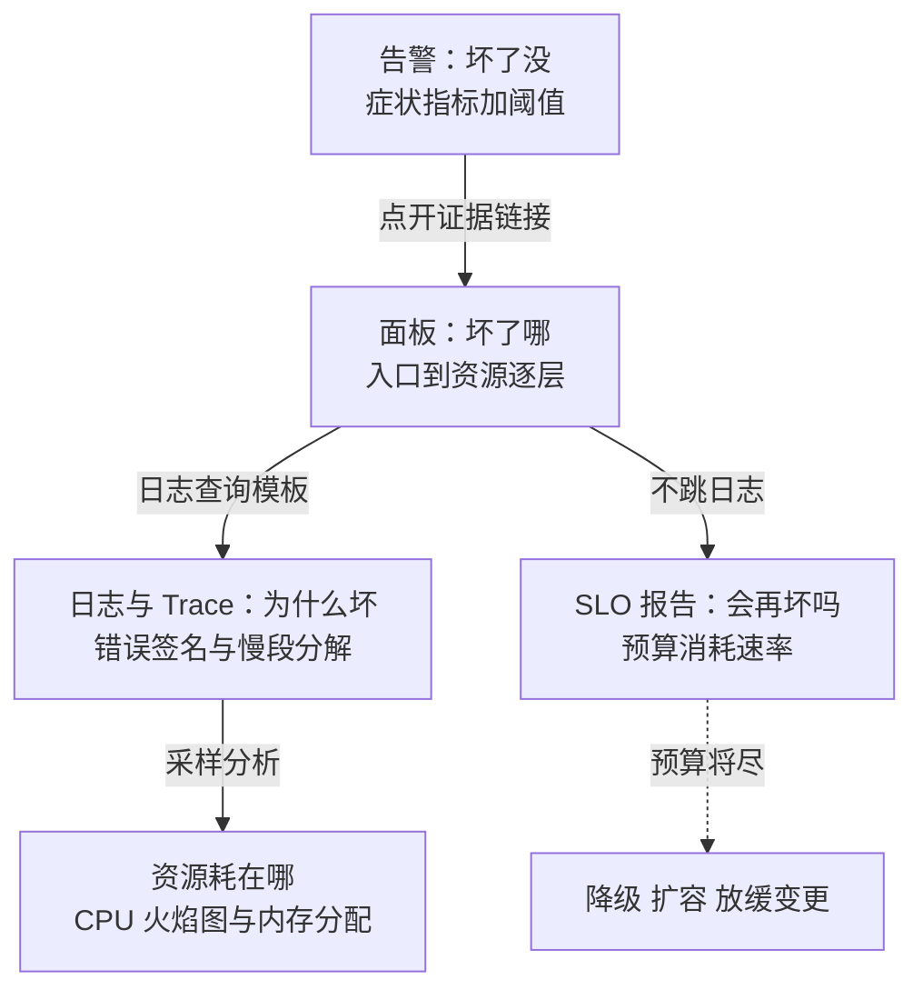
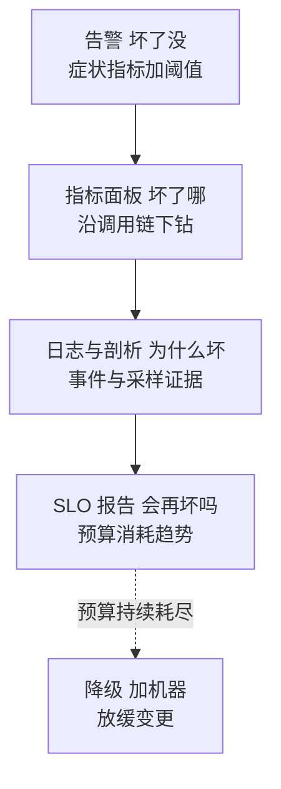

# 监控体系按四个问题分层：坏了没、坏了哪、为什么坏、会再坏吗

把所有监控面板堆在一张图上，告警和定位混在同一层，结果是告警噪声和定位盲区一起来。读完这一页你能按四个问题把监控分成四层，让每层只答一件事。

> **要点**：监控的四个层次各答一个问题——告警答"坏了没"（symptom——症状，用户能直接感知到的异常信号——指标加阈值）、指标面板答"坏了哪"（组件逐层下钻）、日志与剖析答"为什么坏"（剖析指性能剖析，如 CPU 火焰图、内存分配，看资源耗在哪——证据是事件与采样记录）、SLO（服务等级目标，服务对可用性或延迟作出的量化承诺）报告答"会再坏吗"（预算消耗趋势；四层混在一张面板里，告警噪声与定位盲区会同时出现）。

## 背景与本质：监控为什么不是一堆面板的堆叠

监控体系要解决的问题是：**故障发生时按顺序回答四个问题**；**四层共用同一条采集链，但存储与判定各自独立、互不依赖——任一层出问题时，其它层仍能独立工作**：先确认"坏了"（用户可感知的症状），再定位"坏在哪"（组件边界），再回答"为什么坏"（根因证据），最后回答"会不会再坏"（趋势与预算）。四个问题对应四类工具：告警、指标面板、日志与剖析、SLO 报告——**混层的代价是双输**：**把根因证据做成告警（告警量爆炸、值班疲劳），把症状告警做成面板（故障发生时没人盯着面板、发现靠用户投诉）**。

本库"指标、日志、Trace 与剖析各答一问"讲过证据类型分工（同一套观测数据可以按用途分成四类，各答一个问题）；本篇讲监控体系的分层建设：**每层的建设要点、层间的下钻路径、告警设计的判据**。

## 它是怎么做到的：四层的建设要点

**采集链是四层共用的数据通道**：无论告警、面板还是日志查询，第一条证据都从这里流过。**这条链只搬运数据，不存储数据**——存储由下游各层自己的数据库（Prometheus 的时序库、日志库等）负责，采集链不参与。OpenTelemetry 是 CNCF（云原生计算基金会）旗下的可观测性数据采集开放标准，官方的 Collector 架构图把这条管道画全了——接收器收各协议的数据，处理器做批处理（把多个请求合并成一批同时计算、提高硬件利用率）与过滤，导出器把数据交给下游存储，四层的证据全部流经这里：


*图源：[OpenTelemetry 官方文档《Collector》](https://opentelemetry.io/zh/docs/collector/)，Apache-2.0。*


**四层里「坏了没」这一层的判据来自时序库，而时序库的职责边界在官方架构图上标得比文字更清楚**：Prometheus（时序监控与告警系统）服务从被监控目标与推送网关（ Prometheus 组件，接收短任务的推送指标并转交给服务端）拉取或接收数据，写进由本地存储打底的时序数据库，再交给告警规则与查询接口两条出口分别使用——**采集、存储、判定三段各自有独立的运行状态，哪一段出问题能单独查到**——**若采集断了，数据缺失可能被判定规则当成"数值为零"或"正常"，从而掩盖真实故障，所以三段要能分得开**：


*图源：Prometheus 官方文档《Architecture》，Apache-2.0，https://prometheus.io/docs/introduction/architecture/。四条问题各自落在图上不同的一段——「坏了没」用左侧的采集与存储，「会再坏吗」用右上角的告警出口，每层缺数据时该去查哪个组件由此决定。*

*图示：抓取端定时拉取指标写进时序库，库里长出"告警"与"查询"两条出口——**下面四层的第一层和第二层，就对应这两条出口**。来源：Prometheus 官网 Overview 页（Apache-2.0，prometheus.io/docs/introduction/overview）。*

**第一层：告警（坏了没）**。告警只挂用户可感知的症状指标：可用性（错误率/成功率）、延迟（P99 尾延迟超预算）、正确性（数据新鲜度落后、对账不平）——**容量与资源指标（CPU 80%、磁盘 70%）默认不直接告警**，**它们是症状出现前的早期信号——资源先涨、服务后出问题，挂告警会带来大量"资源高但服务正常"的噪声**；**资源告警收敛为趋势告警（看指标上涨速度是否异常，增长斜率异常才告警）或预算告警（按当前消耗速率算还剩多少时间，预计 N 小时内打满才告警）**。**两类告警的分界像急诊分诊：用户已经觉得疼的（症状告警）立即处理，指标高但人没感觉的（资源告警）进观察记录，按紧急程度分流，不按重要程度**。**告警的三要素**：**一个动作（响了要做什么，没有动作的告警是日志）、一个证据链接（点开能看到症状曲线与影响范围）、一个恢复判据（怎么算好了）**。

**第二层：指标面板（坏了哪）**。按调用链逐层组织：入口 → 服务 → 依赖（数据库、缓存、下游 RPC（Remote Procedure Call，远程过程调用：像调本地函数一样调远端服务））→ 资源（CPU/内存/IO）——**每层用同样的四个指标维度**：流量、错误、延迟、饱和度。**资源类指标用 USE 方法（Utilization/Saturation/Errors，对每类资源查使用率、饱和度、错误数），服务类指标用 RED 方法（Rate/Errors/Duration，按请求数、错误数、耗时观测服务）**，两个方法的展开见 [[工程知识/性能工程：从用户等待到资源瓶颈/观测与诊断/系统指标与观测]]。**面板的组织逻辑与调用链一致，定位的路径就是从入口层往下点**：入口错误率上升 → 哪个服务 → 该服务的哪个依赖 → 依赖的资源水位（队列或资源的当前占用程度）。**面板与告警同源**（告警点开的证据链接就是对应面板），**两处指标口径不一致是排障时的经典内耗**。Grafana（监控仪表盘工具，查询 prometheus 等数据源画图） 官方演示库里的真实面板就是这一层的成品形态——**同屏并排多个服务的流量、延迟、错误率曲线，坏了哪从面板标题一路点下去**：


*图源：Grafana 官方 play.demo 产品演示环境（play.grafana.org）的「Website performance」演示面板，AGPL-3.0，https://play.grafana.org/d/000000029/。第二层的成品形态：内存/处理器、登录数、服务请求、页面加载同屏并排，横轴时间对齐，**哪条曲线在哪个时间段异常一眼可辨**——「按调用链组织」落到界面上就是这样的并排下钻布局。*

**第三层：日志与剖析（为什么坏）**。**指标说"这个服务延迟涨了"，根因在这一层找**：日志看异常事件与错误签名（本库日志双防御线篇的签名聚合），Trace（调用链追踪，一次请求在各服务间的完整路径与耗时）看慢在哪一段（跨服务的时间分解），剖析看资源耗在哪（CPU 火焰图、内存分配）——**这一层的特点是按需加载**（平时不扫全量日志，出事时按面板定位的范围查询），**成本控制靠采样（只采集一部分数据以控制记录开销）与保留期**。

**第四层：SLO 报告（会再坏吗）**。**错误预算的消耗速率与趋势：本季度预算已用 60%、按当前速率季度末耗尽**——**这一层回答容量与可靠性的规划问题**：降级（主动牺牲部分功能或精度，保住核心链路）哪些非核心功能、预算将尽时扩容加多少机器、变更节奏放缓到什么程度。本库"数据新鲜度是一组配额"的时限预算、容量域的"留白"原则在这一层汇总成数字。

四层的分工可以画成一条证据链，**每层只答一个问题、层层有出口，出口就是通向下一层的下钻链接**：


*图示：四个问题各占一层，箭头是层间下钻路径（告警点开进面板、面板定位后查日志与剖析、SLO 用预算趋势回答规划问题）。图源：本库依据 Google SRE（Site Reliability Engineering，网站可靠性工程：用软件方法做运维）《Monitoring Distributed Systems》与 OpenTelemetry 文档的分层概念绘制。*

## 读完这一段你能判断什么：层间下钻与告警判据

**下钻路径的设计**：告警 → 面板 → 日志/Trace → SLO 归因，**每一跳要有链接（告警里的面板链接、面板里的日志查询模板）**——**下钻是手动跳转，不做自动关联**（**自动根因分析的成本高、误报率高，手动跳转 + 组织良好的面板是性价比解**），**下钻每断一跳，值班就要另开工具手动找入口，断点越多定位越慢，跳转路径的顺畅度由此决定排障速度**。

四层之间靠链接逐跳下钻，每一跳都收窄范围，下钻路径从告警一直走到 SLO 归因：



**告警的四个判据**：症状优先（用户可感知的才告警）、有动作（响了要做什么）、带证据（点开能看到）、可恢复（怎么算好）——**四条判据过滤后的告警量通常降一个数量级**——**症状优先砍掉资源类噪声，有动作砍掉无人认领的告警，带证据与可恢复再各筛一轮，逐层收敛下来，剩下的每条都值得人看**。

**两个反模式**：面板堆叠症（几十张面板没有组织逻辑，故障时全靠猜）；告警疲劳（大量资源类告警把值班训练成"无视告警"，真症状被淹没）——**两个反模式是同一个根源**：**没按四层分工，把该做面板的做成了告警、该做告警的做成了面板**。



四层的分工与顺序：**告警只答「坏了没」，点开进面板答「坏了哪」，面板定位到组件后查日志与剖析答「为什么坏」，SLO 报告的预算趋势答「会再坏吗」并接规划动作**。**每层只答一个问题、往下一层跳转有链接**，**混层（把根因证据做成告警、把症状告警做成面板）正是两个反模式的共同根源**。

## 这套说法在哪儿会失效

**故障时必须按四层顺序走吗？四层是建设分工，故障时顺序可变**。**有经验的值班从日志/Trace 反推（看到错误签名直接定位），不必机械走四层**——**分层的价值在建设期**（每类工具的建设目标清晰），使用期按熟练度自由组合。

**资源指标该不该直接挂告警？资源告警不直接挂，但资源面板常备**。**容量问题（磁盘将满、连接数逼近上限）的发现路径是趋势面板 + 预算告警，与症状告警分开管理**——**两套告警的分界是"用户可感知"**，不是重要性。

**监控自己坏了怎么办？监控自身的可用性要单独保障**。**监控组件与业务组件同机部署时，业务故障可能带走监控（最需要的时刻没有证据）**——**监控自身的资源配额、存储保留期、拨测兜底（本库"拨测与合成监控"的外部视角）要单独配置**。

## 怎么自己动手验证

下面四步在现有监控体系上就能做，每步写明了预期结果，跑完对照即可：

1. 分层审计：对当前监控体系逐条核对四层分工，**预期每条告警能答"坏了什么 + 该做什么"、每张面板能答"坏了哪"、日志/Trace 覆盖"为什么坏"、SLO 报告回答"会再坏吗"——不达标的条目就是改造清单**；
2. 下钻演练：注入一次延迟故障，**预期值班沿告警 → 面板 → Trace 的路径在分钟级定位到组件，跳转链接全程无断点**；
3. 噪声验证：统计一周告警分布，**预期症状告警占比高于资源告警、每条告警的处置动作可回溯**；
4. 断言锚点：**告警四判据（症状/动作/证据/恢复）在告警规范里、面板与调用链同构、监控自身有独立保障与拨测**——**告警判据消除噪声，面板与调用链同构消除盲区，监控自身保障消除"关键时刻没证据"，三件齐备，监控从"面板堆"变成四问分层的证据体系**。

```text
分层断言 = 四问各有对应的工具层
告警断言 = 每条告警有动作与证据
下钻断言 = 告警到日志的跳转无断点
```

监控体系的建设顺序按四层展开：**先定告警的判据（症状优先）、再按调用链组织面板、再按需加载日志与剖析、最后用 SLO 把可靠性变成可规划的预算**——**四层各答一问，故障响应才从"翻面板碰运气"变成"沿证据链走路"**。

## 接着读哪几篇：证据类型的分工原理

- [[工程知识/性能工程：从用户等待到资源瓶颈/观测与诊断/指标、日志、Trace与剖析各答一问，合起来才构成证据]] —— 证据类型的分工原理，本篇是监控体系的分层展开
- [[工程知识/性能工程：从用户等待到资源瓶颈/观测与诊断/日志是诊断的证物也是故障源：磁盘打满与错误风暴两条防御线.md]] —— 第三层日志的防线设计
- [[工程知识/性能工程：从用户等待到资源瓶颈/观测与诊断/拨测与合成监控：在用户之前从外面敲一遍门.md]] —— 外部视角的兜底观测
- [[工程知识/数据系统：在并发与故障中保存事实/可靠性与运维/数据新鲜度是一组配额：每个消费链路声明自己的时限]] —— 第四层预算化思路的同类机制
- [[工程知识/性能工程：从用户等待到资源瓶颈/观测与诊断/报警治理的降噪三件事：分级收敛与值班可持续.md]] —— 告警体系会自然恶化：告警噪声与告警疲劳的治理展开
