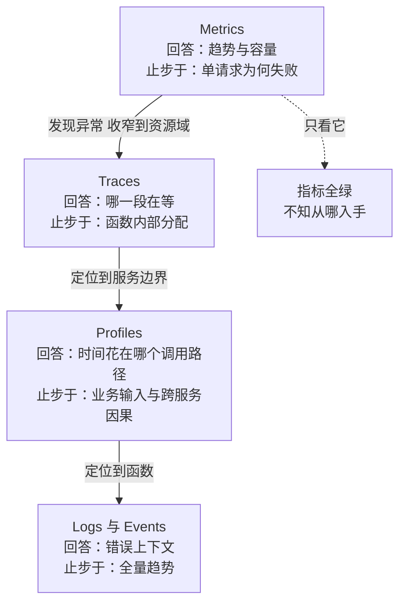
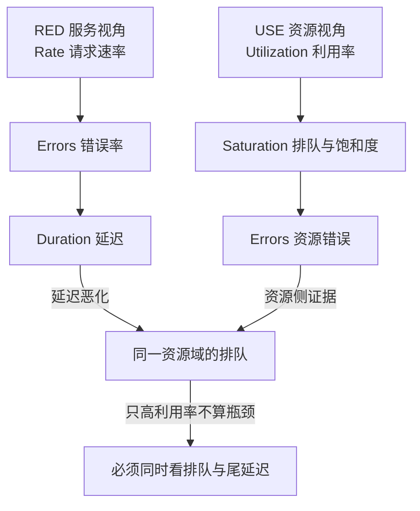

# 系统指标、结构化事件与观测方法

本文讲**指标、trace、profile、日志这四类证据如何配合定位性能问题**。trace 指一次请求跨服务经过的路径记录，profile 指记录时间或内存花在哪个函数调用上的采样（只采集一部分数据以控制记录开销）；指标用于发现「什么时候、哪个资源域发生异常」，日志用于保留离散事件和上下文。**任何一种都不能单独完成根因证明**。读完你能判断先查哪类证据、分位数（把耗时排序后取某个百分比位置的值、如 P99）与标签基数怎么设计、采集缺失如何与零值区分。

例如 p99（99% 的请求耗时都低于这个值，剩下 1% 的慢请求由它代表）上升但 CPU 不变，可能是锁、网络、磁盘、GC（垃圾回收，运行时自动回收不再使用的内存）或队列等待。定位要从两个视角分别取证：**服务视角看用户影响，资源视角看资源占用**——前者对应 RED（Rate 请求速率、Errors 错误率、Duration 耗时）三个指标，后者对应 USE（Utilization 使用率、Saturation 饱和度、Errors 错误）三个指标；把两组指标、trace 的等待段和 profile 的调用路径放在一起核对——**单类证据只能指向或排除一个资源域，多类交叉能互相印证、排除误判**。

例如 trace 显示等待集中在某段锁，profile 就会在对应调用路径上出现 off-CPU（线程离开处理器后的等待时间）集中，两条证据指向同一处；又如 trace 无异常而磁盘 IO 升高，iostat（查看块设备 IO 统计的命令）的队列深度会同步上升，说明瓶颈在磁盘排队。根因范围由此收窄。**观测系统本身也要暴露采样缺失和 unknown，不把空值当成零**。

## 要解决的问题：每一类指标分别回答哪些问题

服务出现延迟恶化时，看板上各层指标都处在正常区间，团队成员无从判断从哪里入手。本篇回答：每一类指标各自回答什么问题、分位数与分桶要按什么依据设计、标签基数为什么需要控制、采集数据缺失怎样与数值为零区分，以及指标之外的证据从哪里取。

## 有哪四类证据

| 证据 | 最擅长回答 | 不能单独回答 |
| --- | --- | --- |
| Metrics | 趋势、容量、SLO、告警 | 单个请求为何失败 |
| Traces | 一次请求在哪一段等待 | 函数内部 CPU/分配细节 |
| Profiles | CPU/off-CPU/内存在哪个调用路径 | 业务输入和跨服务因果 |
| Logs/Events | 特定状态变化和错误上下文 | 全量趋势与统计分布 |

四类证据从粗到细排开，各自能回答与不能回答的问题正相反。只守着指标一类看板，就会出现看板指标全绿却不知从哪入手的局面：



## 为什么要记录结构化事件

文本日志适合人顺着读，却不适合回答「哪些 VIP（Virtual IP，虚拟 IP：可漂移到存活节点的服务地址）用户在缓存未命中时出现数据库慢查询」。**把一次请求的关键上下文放进同一条结构化事件，才能按字段聚合、切片和关联**：

```json
{
  "trace_id（链路编号，串联一次请求跨服务的调用链）": "8f14e45f",
  "service": "order-api",
  "endpoint": "POST /orders",
  "user_tier": "vip",
  "duration_ms": 1832,
  "db_duration_ms": 1780,
  "db_query_count": 12,
  "cache_hit": false,
  "status": 200
}
```

这类「宽事件」指一条事件里带齐入口、出口、关键业务分支、错误、租户、版本和 trace 等稳定字段，而不是**把细节全塞进日志**。它的作用是**让一次请求拥有稳定字段，这样就能按字段做聚合、切片和关联分析**。**高基数字段放事件或 trace，不能直接当 metric label——每个标签组合都会生成一条独立时间序列**，组合数量随各字段取值数相乘增长，**标签取值达到百万级时时间序列数量会超出存储与查询预算，看板变慢甚至写不进**。基数（一个标签不同取值的数量）越高，存储与查询成本越高。

一次请求跨多个服务时，需要一种上下文随行，这里的上下文指调用链上下文，即随请求在各服务间传递的 trace 信息。它的传递方式分两条路：服务间走 HTTP 或 RPC（远程过程调用，像调本地函数一样调另一台机器上的函数）时，请求头里携带 W3C Trace Context（万维网联盟定义的调用链传递格式）装着 trace_id 与 span_id，下游据此知道自己在同一次请求的第几跳；走消息和异步任务时，把 trace_id 写进消息体。

任一跳丢失 `trace_id`，调用链就会**在最需要解释的位置断开**——于是**无法判断耗时到底卡在哪一跳，跨服务问题失去定位依据**。采样**优先保留错误和慢请求，再按比例保留正常请求**——打个比方，像安检先拦下可疑行李再随机抽检。

采集缺失必须显示为 unknown（采集缺失或未上报的状态标记，与数值为零不同），**不能伪装成零**——这像监控摄像头暂时没录到，应当标"未记录"，**当成零等于把没拍到当成一切正常**。上下文传播做对了，一条请求经过多个服务才会连成完整的链路：


*图源：OpenTelemetry 官方文档《可观测性（通过系统对外输出判断内部状态的能力）入门》（中文），Apache-2.0，https://opentelemetry.io/zh/docs/concepts/observability-primer/。*

这张瀑布图就是 trace 的答案形态：一次前端请求展开成跨四个服务的多段 span，每段横条的长度就是该段的耗时，横向错位显示串行等待，纵向嵌套显示调用层级——正文说的"trace 回答一次请求在哪一段等待"，落到图上就是找出最宽的那几段横条。

## USE 与 RED 各自怎么用

- **USE**：Utilization、Saturation、Errors；依次检查 CPU、内存、磁盘、网络、连接池（预先建好连接反复取用、省去反复握手建连的开销）、线程池（预先建好一组线程反复取用、避免频繁创建销毁）和队列。
- **RED**：Rate、Errors、Duration；从用户请求出发，再下钻到资源。

**资源利用率不是瓶颈的充分条件——利用率高只说明资源在忙，若并行度足够或请求很短，吞吐仍可达标；CPU 100% 可能仍达到 SLO（服务等级目标，对外承诺的可用性或延迟水平），现代并行 SSD（固态硬盘） 的 `%util`（设备处于忙状态的时间百分比）也不代表性能极限**。瓶颈要看**排队长度、吞吐和尾延迟（P99 一类的慢请求耗时指标）**，单看利用率会误判。

两个视角从两端出发，在同一个资源域汇合。USE 这一支的执行顺序有官方流程图可循：对每类资源先查有没有错误，再看利用率是否偏高，最后看有没有排队，任一条成立就进入深入排查（Investigate Discovery），没有就换下一类资源：


*图源：Brendan Gregg《The Utilization, Saturation, and Errors (USE) Method》，https://www.brendangregg.com/usemethod.html。RED 从请求端先看症状，USE 按这张图逐资源排查成因——两条线在「同一资源域的排队」处汇合，汇合点就是下钻入口。*



## 常用 Linux 入口有哪几个

这张工具全景图把观测工具按资源域与系统层挂好位置，逐层来看。应用与系统库顶层走 strace（跟踪进程系统调用的命令行工具）与 lsof（列出进程打开的文件与套接字的命令）。VFS（Virtual File System，内核的统一文件系统抽象层）与文件系统走 iostat。网络协议栈走 ss（查看套接字统计的命令）、nstat 与 tcpdump（抓包工具，按条件截获网卡上经过的报文）。调度器与 CPU 走 mpstat（按 CPU 核看统计的命令）、pidstat（按进程看 CPU/内存/IO 的工具）与 perf（Linux 性能剖析工具，统计 CPU 采样与硬件事件）。内存与 NUMA（非统一内存访问架构：多颗 CPU 各带本地内存，访问别人的内存更慢）走 vmstat（查看虚拟内存统计的命令）、free 与 numastat。右上的 sar（系统活动统计报告工具）与 /proc 是历史与现场两类入口。正文清单里的每个命令都能在图上找到它观测的那一层：


*图源：[Brendan Gregg《Linux Performance》](https://www.brendangregg.com/linuxperf.html)，CC BY-NC-SA 4.0，文档引用。*

```text
总体: uptime, vmstat, pidstat
CPU: mpstat, perf, /proc/stat
内存: free, vmstat, /proc/meminfo, PSI（Pressure Stall Information，处理器/内存/IO 的阻塞压力指标）
存储: iostat -x, pidstat -d, fio（验证）
网络: ss, ip -s link, ethtool, nstat, tcpdump
历史: sar
```

`sar` 适合查看 sysstat 已采集的历史切片，但它**无法补回未采集的 trace/profile，也会因采样间隔遗漏短尖峰**。命令示例必须和 **sysstat 版本、单位、采样间隔、时区、设备映射**一起记录。

## 调查按什么顺序

1. 固定问题窗口、时区、版本、请求类型和基线（正常状态下的指标水平、用来对比异常）。
2. 用 RED 判断用户影响，用 USE 找资源域；检查队列而非只看利用率。
3. 用 trace 核对上下游和重试；用 profile/eBPF（内核里的可编程钩子：不改动内核源码就能在内核里跑自己的小程序）深入查看 CPU、锁、I/O 或分配。
4. 提出可被最小实验区分的假设，一次只改变一个变量。
5. 验证业务 SLO、资源代价和错误是否共同改善，并保留回滚（把系统状态退回到改动之前的版本）阈值。

## 数据质量怎么看

- **counter（只增不减的累计计数器）先求 rate（单位时间内的增量），并处理进程重启/回绕；gauge（可升可降的瞬时值）不应被随意累计**。
- **histogram（直方图，按区间统计延迟分布）的 bucket（分桶边界，即各延迟区间的切分点）设计应覆盖 SLO，平均延迟无法反映尾部请求的实际体验**。
- **标签维度控制基数；用户 ID、URL 全路径和异常文本不能直接作为 metric label**。
- **主机/容器/进程/请求使用稳定 resource attributes 关联**。
- **采集缺失与数值为零是不同状态；报告显式显示 unknown**。

## 和哪些主题有关联

- 总体方法：[[工程知识/性能工程：从用户等待到资源瓶颈/观测与诊断/性能问题定位]]
- CPU/函数：[[工程知识/性能工程：从用户等待到资源瓶颈/观测与诊断/性能剖析与火焰图]]
- 存储：[[工程知识/性能工程：从用户等待到资源瓶颈/存储与网络/存储IO性能取决于访问模式、队列与持久化语义]]
- 网络：[[工程知识/性能工程：从用户等待到资源瓶颈/存储与网络/端到端网络延迟来自排队、协议、传输与处理]]
- AI/Agent 轨迹：[[工程知识/AI 系统工程：从模型能力到生产能力/质量与运营/可靠生成需要结构、证据、拒答与回归]]
- 内存：[[工程知识/性能工程：从用户等待到资源瓶颈/观测与诊断/进程内存异常：堆转储与句柄清单的现场诊断]]

## 怎么自己动手验证

1. 数据类型核对：对 counter 求 rate 并处理进程重启与回绕，对 gauge 不做累计；核对后的曲线与业务事件时间点能否对上。
2. 分桶覆盖：检查 histogram 的分桶边界是**否覆盖 SLO 阈值**，确认尾部延迟位于可观测的分桶内；均值正常时单独核对尾部。

3. 标签基数：统计每个指标的标签组合数量，预期不包含用户标识、完整路径与异常文本；基数变化引起采集成本上升时从标签维度收敛。
4. 缺失与零值：主动停止一类采集，确认看板显示为未知而不是零，恢复后状态回到正常。
5. 断言锚点：指标类型与聚合方式对应，分桶覆盖 SLO，标签基数受控，缺失状态与零值可区分。

指标体系的可用性取决于**数据类型的语义与标签基数的控制**，本质问题在于**采集缺失与数值为零是两种状态，混为一谈时会把采集故障读成业务空闲**。

## 这套说法在哪儿会失效

- **平均值掩盖分布**：延迟与排队时长必须看分位数与直方图（把数值按区间分桶统计、看分布形态）分桶，**均值正常时尾部仍可能已越过门槛**；分位数读数本身的来源与误差见 [[工程知识/性能工程：从用户等待到资源瓶颈/观测与诊断/分位数是估算出来的：直方图分桶、插值误差与跨实例聚合的边界]]。
- **标签基数决定采集成本**：**把用户标识、完整路径或异常文本直接作为标签，会把存储与查询成本推高到不可用**。
- **采集缺失与数值为零是两种状态**：**区分不开时会把采集故障当成业务空闲**。
- **指标只能回答是否异常**：**定位到具体函数、具体连接或具体请求需要函数级采样、日志与链路数据配合**。
- **采样与聚合有粒度损失**：**采样率（只按比例保留部分样本、其余丢弃的比例）、聚合窗口与分桶边界决定哪些异常能被看见，越过粒度的事件不会出现在结果里**。

