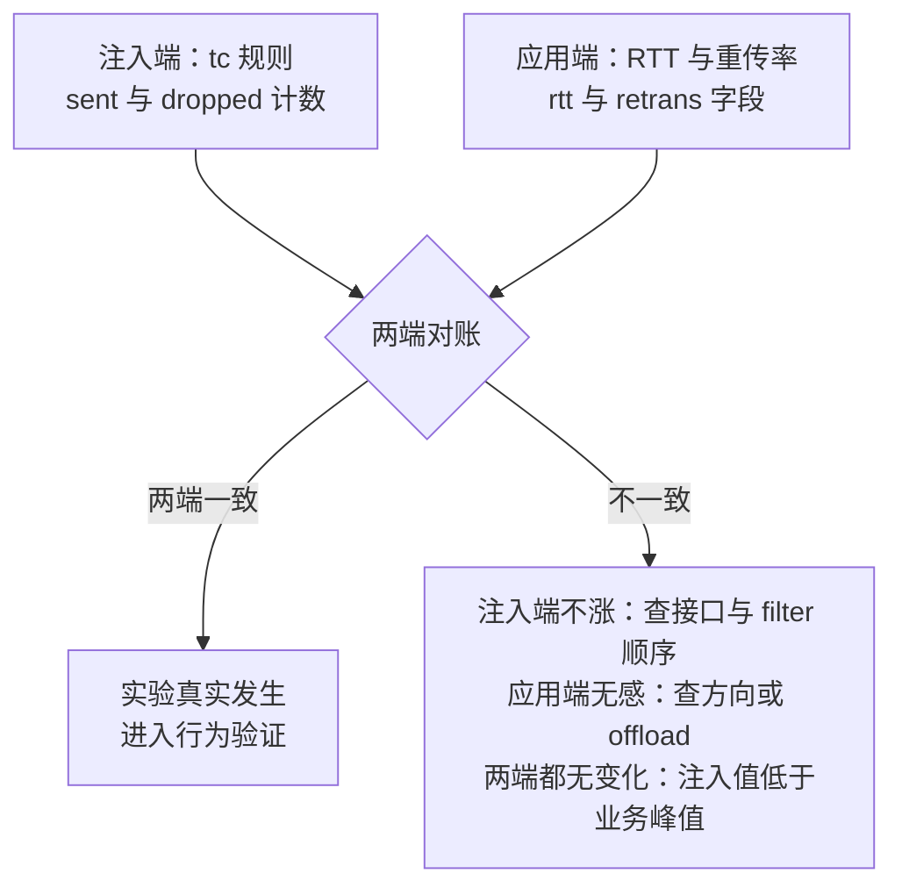
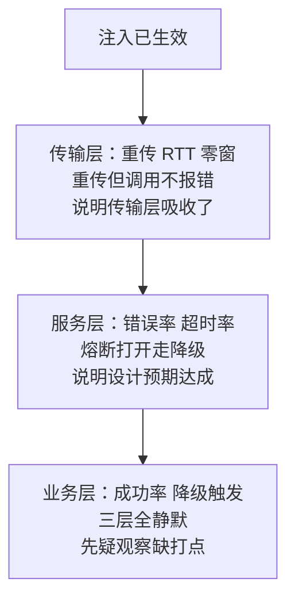
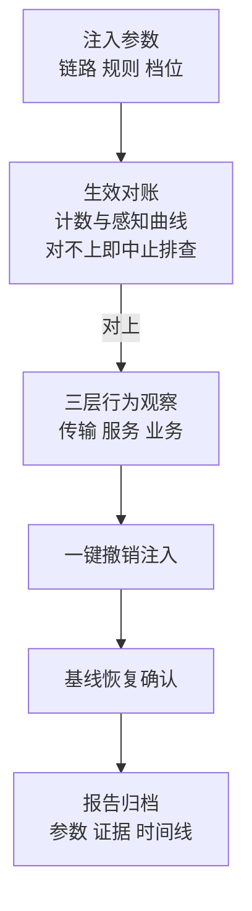

# 网络故障注入先打点对账：注入值与应用感知值对不上，注入就是无效实验

> **要点**：网络故障注入（丢包、延迟、重排、限速）的有效性取决于两端对账——注入端确认规则真的命中目标流量（tc filter 的统计计数在涨，tc 是 Linux 流量控制工具），应用端确认感知到的劣化与注入值一致（RTT（Round-Trip Time，往返时间）抬升幅度、重传率）；两端对不上（规则没命中、方向反了、被 offload 绕过时，实验的"通过"是假通过）。打点对账是注入实验的第一步，行为验证是第二步。读完这一页你能独立给一次网络注入实验打点对账，并一眼识破缺少生效证据的实验报告。

## 注入没生效的实验为什么白跑：要解决的问题

故障注入实验的隐性失败模式：规则加了、流量没走到——tc 规则加在 eth0 时服务流量走的是 veth 或 bond 的另一条路径；方向加反了（想注入下行丢包，规则只命中上行）；网卡 offload（GRO 接收聚合、TSO 发送分片这类硬件优化）把包合并后 netem——Linux 网络延迟与丢包（数据包在网络传输途中丢失）仿真模块的逐包逻辑失真，或限速值远高于应用流量实际速率，注入等于没注。

**这四类失效的共同点**：**实验流程走完了、报告写了"系统表现良好"，表现良好的真实原因是系统根本没经历故障**。本库"混沌工程验证系统是否真的能处理故障"篇讲过注入验证的通用纪律；网络注入另有它自己的一道关口，即**生效性对账**——本篇要解决的问题就是**先证明注入真的发生，再谈系统表现**。

注入端与应用端各持一份证据，两份对上实验才成立，对不上就中止实验排查：



集群环境里的注入要经过更多跳才能落到目标容器上，Chaos Mesh 的官方架构把这条链路画得很清楚。第一跳，Dashboard 与 kubectl 提交演练意图，经 Kubernetes API Server（容器编排平台 Kubernetes 的统一 API 入口） 转成自定义资源，CRD（Custom Resource Definition）是扩展 Kubernetes 资源类型的机制，这里存放"要做一次演练"的意图。第二跳，Controller Manager（把演练意图变成具体注入动作的管理组件）里的各类 Controller 监听到资源后，下发到各节点上的 Chaos Daemon（驻留在每个节点上、真正执行注入动作的守护进程）。最后一跳，Daemon 在容器的网络命名空间里执行 tc/netem 一类的具体动作；另一侧的 External targets（集群外部目标机）处理集群外目标。**对账要在这条链路的每一跳上确认：规则确实下到了目标容器的命名空间，而不是停在 CRD 里等待 reconcile**。


*图源：Chaos Mesh 官方文档（Architecture），Apache License 2.0，https://chaos-mesh.org/docs/*

## 两端怎么对账、错在哪四类：机制

对账的机制在于**两端各持一份独立证据：注入端证明规则命中，应用端证明系统经历**。比喻成消防演习——你拉了警报（tc 规则加上），演习结束宣布"全员疏散合格"。但要先确认两件事才算数：警报真的响了（规则计数在涨，有人听到），疏散的人真的挤在了楼道里（应用感知到劣化）。**警报没响就宣布合格，等于演习根本没办——报告写得再好看也是空转**。**两端对账就是这两问：注入端问警报，应用端问楼道**。这个比喻到"楼道"为止——现实里四类失效（规则没命中、方向反了、offload 稀释、量级虚设）各有具体排查命令，下面逐类展开。

**注入端对账：规则命中率的直接证据**。tc/netem 的规则配统计计数：`tc -s qdisc show dev eth0`（qdisc 是 Linux 的排队规则，管理网卡的收发队列）看 sent/ dropped 计数，`tc -s filter show` 看每条 filter 的命中包数——**注入期间计数在涨**是规则生效的第一证据；**丢包注入时 dropped 计数的增量与注入速率一致（注入 5% 丢包，dropped/total ≈ 5%）**。**iptables（Linux 防火墙规则工具） 注入**（REJECT、DROP 类，即 iptables 的拒绝与丢弃动作）同理用 `iptables -L -v -n` 的 pkts 计数。**计数不涨的三种原因**：**规则绑错接口（服务流量在 veth/bond 上）、优先级被更前面的规则截胡（filter 顺序）、流量走了其他路径（本机回环、IPVS（Linux 内核的 L4 负载均衡模块） 的另一侧）**——**计数是排查这些的第一现场**。

"计量设备走没走数"的对账，实物原型是老式黄铜水表：**水表装在总管上，玻璃罩里的指针随水流转动——抄表员抄的数要和用户账单对上，账才成立**；**表坏了不转，抄出的"零用水"只是仪表失效，不等于这户人家没用水**：


*图源：Wikimedia Commons，作者 Hopfen，CC BY-SA 4.0，https://commons.wikimedia.org/wiki/File:19th_century_Glenfield_water_meter_closeup_of_meter_face.jpg。*

**注入端计数就是故障注入实验的水表：计数在涨证明"水流真的经过了表"（规则命中目标流量），应用端感知曲线是用户的账单**——**两端对上，实验报告才有效力**；**注入端不走数，报告里"系统表现良好"只是仪表失效下的零读数**。**这个比喻只到"查看水表是否走数"为止，实际排查用的是 tc 计数与 RTT 曲线，不用抄表记账**。

**应用端对账：感知值与注入值的一致性**。**注入 100ms 延迟后，应用的下游调用 RTT 应从基线（正常状态下的指标水平、用来对比异常）抬升约 100ms（打点系统的 P99 曲线直接可见）**；**注入 5% 丢包后，TCP（传输控制协议，负责把数据完整、有序地送达）连接的重传率应出现对应抬升**（`ss -ti` 看 retrans 字段，或用 eBPF 即内核可观测技术导出的 TCP 指标）。**两端一致**说明实验真实发生且被系统经历；**应用端无变化**回注入端查（规则没命中）；**注入端在丢包但应用无感知**查 offload（GRO 合包后逐包丢包率被稀释，关 offload 或按流注入重试）。

四类失效各自留下不同的痕迹，**看哪一端不涨就能定位到是哪一类——两端都不涨是规则没命中，一端涨一端不涨要靠方向、offload 与档位三条逐一排除**：

**四类失效的判定表**如下，每类失效对应一段独有的排查入口。
- 规则没命中 → 注入端计数不涨，查接口与 filter 顺序；
- 方向反了 → 单向注入时应用端无感，查 netem 挂在 ingress（入方向）还是 egress（出方向）——入方向要用 ifb（Linux 专门用于入向流量控制的虚拟网卡）转发；
- offload 稀释 → 注入端丢包计数正常但应用重传率低，查 `ethtool -k`（网卡参数查看工具，-k 显示卸载开关）的 GRO/GSO（通用接收/分片卸载）状态；
- 限速虚设 → 注入 100Mbps 但应用峰值只有 10Mbps，流量永远到不了限速上限，观察不到任何劣化，注入等于没注——**限速档位要从应用实际流量倒推**，注入值低于业务峰值才有观察意义。

**行为验证的三层观察**：**注入生效确认后，观察三层——传输层看重传率、RTT、零窗事件**；**服务层看调用错误率、超时率与熔断（错误率过高时暂时断开调用快速失败）器状态**，熔断器在请求失败达到阈值后切断调用、避免故障扩散；**业务层看用户请求成功率与降级（主动关闭次要功能、保住核心链路的自保手段）触发记录**。**注入实验的结论只从三层一致的行为里得出**：**"TCP 重传了但调用没报错"是传输层扛住了，要看吞吐代价**；**"熔断器打开且业务走了降级"是设计预期达成**；**"三层全部静默"要怀疑观察面缺打点，不能就此判定系统无恙**。

三层从上到下逐级吸收劣化，结论要按哪一层先动来读，读出哪层吸收了劣化、哪层触发降级：



## 实验报告要守住什么底线：判断

**一份可信的注入报告至少含四项**：注入参数（哪条链路、什么规则、什么档位）、生效证据（注入端计数与应用端感知曲线）、观察窗口内三层行为的时间线、撤销后基线恢复确认。**缺生效证据的报告**是本篇的第一否决项——**"我注入了 5% 丢包，系统没问题"这句话在计数核对之前不成立**。**实验的粒度**：单服务验证（netem 挂本机出口）、链路验证（两端之间注入，ifb 处理 ingress）、全链路验证（网关层整形）——**粒度越靠后环境越真，定位越难**，**从单服务开始逐级放大**，每级都有对账再进下一级。

一次可信的网络注入实验的完整闭环，**生效对账是第二环，最后一环是报告归档，跳过对账直接跳到结论，报告里只剩"没测到"**：



**打点的前置性**：**注入实验前先确认 RTT、重传率、错误率的打点已存在且粒度够（秒级采样）**——**注入是瞬态实验，分钟级采样（只采集一部分数据以控制记录开销）会把 2 分钟的注入窗口糊掉**，**没有秒级打点就先补打点再做注入**。

## 这套对账在哪儿会失效：边界

**注入的爆炸半径要圈住**：filter 按 IP/端口圈定目标流量（只注测试服务的段），**全接口全端口的注入会波及同机其他服务与监控本身**——**监控通道被注入打断时，实验既危险又不可观察**，**监控流量加 filter 豁免**是注入环境的第一条规则。

**netem 的排队延迟有上限**：深队列大延迟会先撑爆 qdisc 的 buffer（`limit` 参数）——**buffer 要容纳 delay × rate 的在途包量，延迟越大或速率越高，需要的 buffer 越多，超出 limit 就溢出丢包，丢包形态变成缓冲溢出丢而非注入丢**——**延迟与限速组合注入时核对 limit 与速率的匹配**。

**生产注入需要独立的审批与回滚（把系统恢复到上一个可用版本）通道**：**产线环境的注入（混沌演练的生产阶段）按爆炸半径分层审批，回滚命令与注入命令同置（一键撤销），演练窗口避开业务高峰**——本库"退役演练进例行"的同款纪律：演练的价值在于反复做，前提是每次都可控可撤。

## 想自己验一遍怎么动手：验证

下面四步全部能在本机用 netem 复现，每步写明了预期结果，跑完对照即可：

1. 生效对账复现：**本机 netem 注入 50ms 延迟 + 5% 丢包，`tc -s` 计数与应用 RTT/重传率两端对账，预期两端一致**；
2. 失效模式复现：**把规则加到无流量的接口上重跑实验，预期注入端计数不涨、应用无感**——**亲手见过失效模式，报告里的生效证据才知道怎么读**；
3. offload 稀释复现：**开 GRO 注入 per-packet 丢包，对比关 GRO 后的应用重传率，预期差异明显**；
4. 断言锚点：**注入实验报告必含生效证据、监控流量有豁免、撤销与注入同置**——三件齐备，网络注入从"仪式性故障演练"变成有对账的可信实验。

```text
生效断言 = 注入端计数与应用感知对上
半径断言 = 目标圈定监控豁免
可撤断言 = 一键撤销与基线恢复
```

**网络故障注入的可信度建立在打点对账上：注入端计数证明规则命中，应用端感知证明系统经历，三层行为观察给出结论**——**跳过对账的注入实验，报告里所有的"表现良好"都只是"没测到"的礼貌说法**。

## 接着读哪几篇：注入验证的通用纪律

- [[工程知识/软件构建：让变化可以理解、验证与交付/测试与交付/混沌工程验证系统是否真的能处理故障.md]] —— 注入验证的通用纪律
- [[工程知识/性能工程：从用户等待到资源瓶颈/存储与网络/弱网测试要把网络当变量：延迟、抖动、丢包三轴注入到超时边界.md]] —— 三轴注入的参数层
- [[工程知识/性能工程：从用户等待到资源瓶颈/存储与网络/网卡丢包先看环形缓冲区溢出：队列、中断与软中断的接力.md]] —— 丢包的产线侧判定
