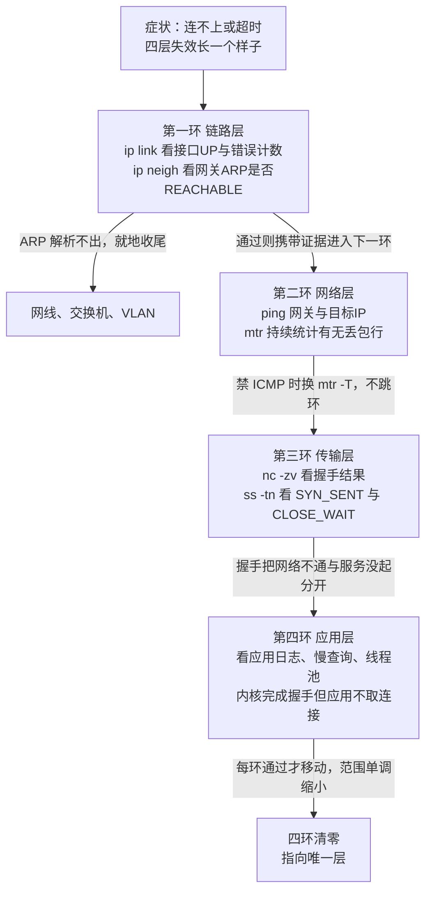
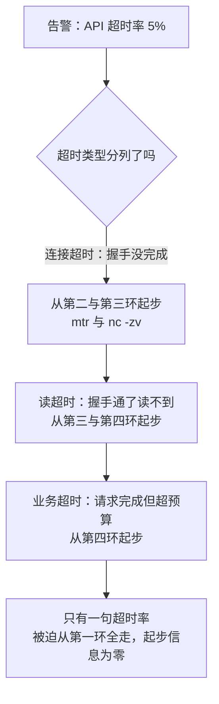

# 连通性诊断的分层顺序：从链路到应用逐层收窄，不跳层

> **要点**："连不上"是一族症状，分布在链路、网络、传输、应用四层，每层的判据不同——跳层诊断会用错误层的证据回答另一层的问题；固定从链路到应用的收窄顺序，每一步都排除一整层。

## 要解决的问题

**"服务连不上"是运维频次最高的问题，也最容易在错误的高度打转**：应用层报超时，运维直接去看应用日志；DNS（域名解析系统：把网址里的域名换成机器用的 IP 地址）解析慢，运维盯着连接池（预先建好连接反复取用、省去反复握手建连的开销）调参。

**每一层的失效都会以"连不上"的统一症状到达用户**，而**在错误层收集的证据再多也排除不了正确层的嫌疑**。本库网络与故障域"网络故障的分层排查"与"分层网络诊断的完整指南"已给出分层框架；本篇把"层与层之间用什么证据切换"这一步展开——**分层顺序的价值不在"知道有四层"，在"知道每一层用什么判据判定无嫌疑、什么证据允许跳到下一层"**，写成可执行的收窄链。

## 四层各用什么判据：收窄链怎么走

先把形状说成一件事：**连通性诊断像查一栋楼里"传呼没人应"——先查对讲机的线通不通（链路层），再查物业的总机转没转对楼栋（网络层），再查你家分机的铃响没响（传输层），最后查你本人是不是戴着耳机没听见（应用层）**。**跳过任何一层直接冲进屋里找人的结论都可能错：问题也许只是楼下对讲机的线被剪了**。这个比喻到"逐层排查"为止——**现实里四层的取证工具与通过条件各不相同（命令、状态机、指标），逐环的判据与去向要在下面具体展开**。

把链路层到应用层每一环的判据与通过条件画出来：

**四层收窄对应的是 TCP/IP 分层里各层的观察通道：应用到应用走会话（Cookie）、进程到进程走端口、主机到主机走 IP、链路层管本地一段**——**每一环的判据正是读对应层的状态**：


*图源：Wikimedia Commons《IP stack connections.drawio.png》，CC BY-SA 3.0，https://commons.wikimedia.org/wiki/File:IP_stack_connections.drawio.png。*

**第一环：链路层（网卡与本地网络）**。判据：接口状态与本地 ARP（地址解析协议，把 IP 地址解析成网卡 MAC 地址）——`ip link` 看接口 UP（接口链路处于启用状态） 状态与错误计数，`ip neigh` 看网关（本机通往外部网络要经过的下一跳地址） MAC 是否解析成功。通过条件：接口 UP、无持续增长的错误计数、网关 ARP 条目 REACHABLE。失败形态：网线/光模块/交换机（在局域网内按地址转发数据帧的设备）端口问题、VLAN 配置错误——**ARP 解析不出来，后面的一切都免谈**。

**第二环：网络层（路由与中间路径）**。判据：路径可达性——`ping` 网关与目标 IP，`traceroute`/`mtr` 看路径在哪一跳断开或劣化。通过条件：目标 IP 可 ping（或路径最后跳到达）、mtr 无持续丢包（数据包在网络传输途中丢失）行。失败形态：路由缺失、防火墙 ICMP（网络层的控制报文协议，ping 用的就是它）限制（ping 不通不等于断，要用 TCP——传输控制协议——层交叉验证，中间链路劣化时 ICMP 是弱证据）。**ping 是 ICMP 判据，对禁 ICMP 的目标是弱证据**，切换判据要用 `mtr -T` 或直接进入传输层。

**链路层判据的物理起点是那块插在主板上的卡**：`ip link` 读的接口状态就是它的寄存器，错误计数器是它累积的——排查从这块卡起步：


*图源：Wikimedia Commons，afrank99，CC BY-SA 2.0，https://commons.wikimedia.org/wiki/File:Ethernet_NIC_100Mbit_PCI.jpg。*

**第三环：传输层（端口与连接状态）**。判据：TCP（负责把数据完整、有序地送达）握手与连接表——`nc -zv` 或 `curl -v` 看握手结果，`ss -tn` 看连接状态机（SYN_SENT = 握手发不出去或被丢，**TIME_WAIT 堆积 = 本端端口耗尽，CLOSE_WAIT 堆积 = 对端关闭后本端没读**）。通过条件：三次握手（TCP 建立连接前、双方交换三个报文确认彼此收发能力的流程）完成（连接 ESTABLISHED）。失败形态：安全组/防火墙拦截、监听端口错、SNAT 端口耗尽、连接队列满。**握手结果把"网络不通"与"服务没起"分开**——这是本环最大的信息增量。

**第四环：应用层（协议与业务）**。判据：协议响应与业务指标——握手通了但请求超时/报错，看应用日志、慢查询、线程池（预先建好一组线程反复取用、避免频繁创建销毁）。失败形态：应用无响应（握手由内核完成，应用不取连接）、协议不匹配（TLS，Transport Layer Security，传输层加密协议，HTTPS 里的 S，连了端口但收明文）、限流（控制单位时间放进来的请求数量，超过配额就拒绝）。**内核替应用完成握手是"端口通但服务不响应"的机制根源**，**传输层通过后仍要给应用层独立判据**。

收窄链的关键纪律：**每环用自己的判据拿到通过/失败结论再移动**，**上一环失败时在上一环收尾（修链路不用看应用日志），上一环通过才携带证据进入下一环**——**顺序保证了每一步的排查范围单调缩小**。

四环各自的判据数字摆成一张图，症状的统一呈现被拆成四组可对账的证据：



图：判据与去向的配对——每环先拿到自己的判据数字（错误计数、丢包行、连接状态、应用指标），失败就地收尾、通过才前进，跳环等于拿错误层的证据回答另一层的问题。


来源：[腾讯云开发者社区《30 张图揭开「内存管理」的迷雾，瞬间豁然开朗》](https://cloud.tencent.cn/developer/article/2671629)（CC 4.0 BY-SA）


## 为什么跳层如此常见

因为入口这一层往往不止一个后端。**单一入口按请求把流量分发到多个服务时，「连不上」这句话本身就没有定位价值——要回答的是连不上哪一个**。


**跳层的典型形态就是在这张图前止步：ping 通了入口就判定链路没问题，而入口背后的某一条后端链路才是故障点**。**分层收窄的意义正在于把「入口通」与「某条后端通」拆成两个可分别判定的问题**。


跳层的根源是**症状的统一呈现**：用户看到的只有"超时"，每一层的失效都长这个样子。三个具体诱因：

**告警不带层级信息**：监控告警"API 超时率 5%"，不说明是握手超时、读超时还是业务超时——**类型本身就是层级信息（连接超时指向二/三环，读超时指向三/四环），告警按超时类型分列能把收窄起点直接推进一环**。

**最高层证据最容易拿到**：应用日志随手可见，链路层要登机器查接口——**取证成本的不对称把诊断拉向最容易取证的一层**，而不是正确的一层。**诊断工具的固定清单（ip/ss（查看套接字统计的命令）/mtr/nc 按序）就是对抗这种惯性的手段**。

**偶发问题的单次快照误导**：跳层诊断常基于单次快照（"ping 通了所以网络没问题"）——**偶发丢包在单次 ping 里不可见，mtr 的持续统计才是网络层的正确取证方式**。**每环判据都有"持续观察"的正确形态**。

三类超时在告警里各自指向一个不同的起步环：



图：告警分列的价值——**超时类型本身就是层级信息，一行类型说明把收窄起点推进一环**；**只有一句"超时率 5%"的告警迫使诊断从第一环全走——三个诱因里这一条改造成本最低（监控指标按超时类型分列），收益直接省掉一到两环**。

## 修完之后靠什么防住复发

**诊断清单化**：四环判据写成固定清单（命令 + 通过条件 + 失败去向），贴在 runbook 里——**清单化的意义在压力场景下强制走完每一环，跳环需要显式理由**。**清单的收益是诊断全程可预期（每环有判据、有去向、有时限），代价是清单本身要与工具版本、环境形态保持同步（云环境的环内工具换代），过期的清单比没有清单更危险——同步责任写进 runbook 的维护项**。

**告警带超时类型**：**超时类指标按连接超时/读超时/业务超时分列——告警里的一行类型信息，为诊断省掉第一环的试探**。

**双端取证**：**网络问题的证据要在两端同时取（客户端握手状态 + 服务端连接表）**——**单端证据解释不了"包在哪一段消失"**，`ss` 两端对账（SYN_SENT 对 SYN_RECV 缺失 = 中间被丢）是传输层的标准动作。

**变更关联**：**诊断起步先查变更（防火墙规则、安全组、路由表、发布）**——**四环排查是"未知原因"路径，已知变更的排查从变更回滚（把系统状态退回到改动之前的版本）起步更快**；**两条路径按"有无近期变更"切换**。

## 这套说法在哪儿会失效

三条边界防止防线走形。

**判据失效时降级（主动牺牲部分功能或精度，保住核心链路）不跳层**：目标禁 ping 就用 TCP 层 mtr 替代，**用同层替代工具保持环的覆盖**，**直接跳环会把中间层嫌疑带进下一环**。

**通过不等于无嫌疑**：**单次通过的环仍可能携带偶发问题（mtr 跑 10 分钟无丢包才算真通过）**——**收窄链的"通过"以持续观察为标准，尤其在"偶发连不上"类问题上**。

**云环境的环变形**：**VPC（Virtual Private Cloud，云上私有网络）/安全组/NAT（网络地址转换，在内外网之间改写地址与端口）网关把链路环与网络环的边界藏进虚拟化**——**诊断清单要按环境定制（云平台流日志替代 traceroute 的一部分职能），环的顺序不变，环内的工具换代**。

## 怎么自己动手验证

可复现的验证路径：

1. 分层注入：在测试环境依次注入四类故障（拔网线级接口 DOWN（接口链路处于断开状态）、路由删除、安全组封端口、应用无响应），**各环判据应准确指认所在环**；
2. 收窄验证：同一故障下按清单走，记录每环耗时与结论——**完整走完不超过十分钟，且不在错误环停留**；
3. 断言锚点：**每类注入故障都被对应环的判据检出，四环清单在 runbook 常驻且与实际工具版本同步**。

```text
注入 = 链路断 / 路由断 / 端口封 / 应用无响应
指认断言 = 各故障被对应环判据检出
效率断言 = 收窄链全程 < 10 分钟，无跳环
```

**四环清单 + 分层告警 + 双端取证，把"连不上"从盲猜变成收窄——顺序不跳、判据不混，每一环排除一整层的可能性**。验证时预期与实际的对照规则提前写明：每类注入故障预期被对应环的判据指认，**对不上（链路断被判成应用问题）即判据用错环或工具版本行为不符，清单要按验证结果修订**；**单次快照的"通过"预期用持续观察复核，对不上（mtr 长跑暴露丢包）说明偶发问题被快照掩盖，该环不能放行**。

## 接着读哪几篇：传输层现场取证的姊妹方法

- [[工程知识/性能工程：从用户等待到资源瓶颈/观测与诊断/tcpdump与抓包定位网络问题的现场方法]] —— 传输层现场取证的姊妹方法
- [[工程知识/性能工程：从用户等待到资源瓶颈/存储与网络/端到端网络延迟来自排队、协议、传输与处理]] —— 分层视角的延迟解剖，与故障分层同构
- [[工程知识/后端系统：在并发、失败与变化中维持服务/基础设施/socket读写缓冲区：拥塞窗口与应用层背压的连接点]] —— 传输层证据（连接状态、缓冲区）的机制背景
- [[工程知识/软件构建：让变化可以理解、验证与交付/开发工具/词汇即接口：Linux与容器命令的词源与设计]] —— ip/ss/nc 等命令的设计语义
