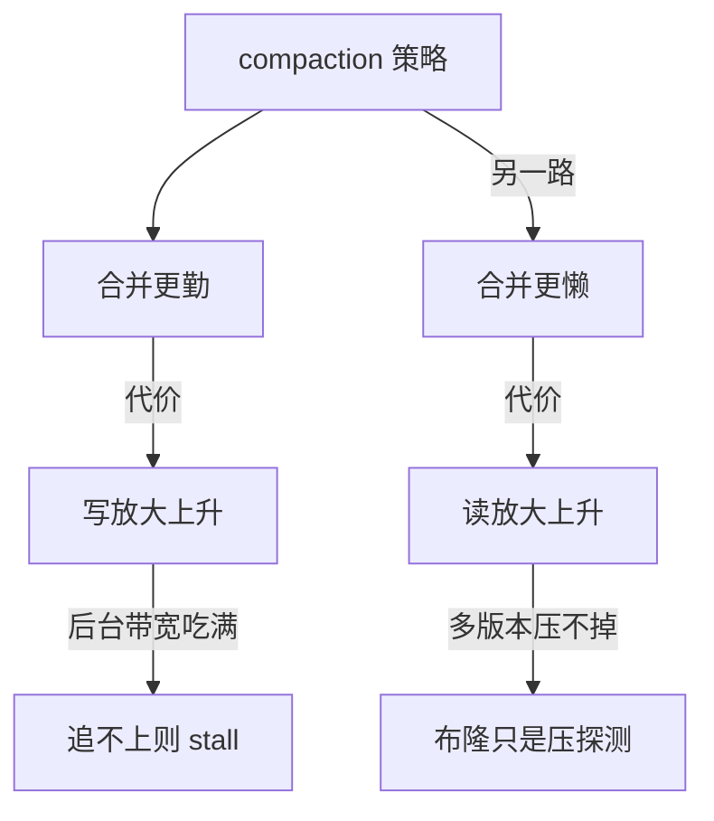

# LSM树用写放大换取顺序写和可扩展性

要解决的问题是**随机更新难以维持高写入吞吐**：磁盘的随机写代价远高于顺序写，分析查询又需要数据有序。核心机制是**先顺序写日志和内存表，再通过 compaction 合并有序文件**；收益是**写路径更适合高吞吐介质**，代价是写放大（实际写入量远大于逻辑数据量的现象）、空间放大（磁盘占用显著高于逻辑数据量的现象）、读放大（一次逻辑读触发多倍实际读取）和后台合并竞争。验证要覆盖不同读写比例、键分布、compaction backlog 和故障恢复，**只看顺序写速度会得出错误结论**。

LSM（Log-Structured Merge，先把写入攒在内存里、再按批顺序落盘的存储结构） 系统先把写入追加到内存结构和日志，再批量刷成不可变有序文件，通过 compaction 合并重叠范围。它**把随机写变成顺序写**，却引入读放大、空间放大、后台 I/O 和 compaction 尾延迟（P99 一类的慢请求耗时指标）。

## 读写各走哪条路径

```text
write -> WAL（Write-Ahead Log，预写日志：先把要做的改动记下来，再真正改数据） -> memtable -> immutable table
read  -> memtable + block cache + 多层 SSTable
merge -> compaction -> 新版本文件
```

**Bloom filter 是用位数组与多个哈希（把任意长度数据压成固定长度指纹、不可逆）函数实现的空间高效集合，能回答"元素可能存在或肯定不存在"**；它、索引块和缓存减少无效读取；分层/大小分级 compaction 在写放大、空间和读放大之间取舍。删除通常**先写 tombstone，直到 compaction 确认旧版本不可见**。

分层的样子放到一张图里看，L0 的小文件怎么一层层合并成更大的文件：


*图示：LSM 树的分层结构与后台合并。图源：Wikimedia Commons《LSM Tree.png》，作者 Ben Stopford，CC BY-SA 4.0，https://commons.wikimedia.org/wiki/File:LSM_Tree.png。*
来源：Wikipedia「Log-structured merge-tree」条目。**层越深文件越少越大、层内有序**——这幅形态就是「同 key 多版本散布各层」的来源：读要逐层找，compaction 把上层小文件重写进下层大文件，**写放大发生在每一次向下的箭头处**；布隆过滤器（用极小空间快速判断「一定不存在或可能存在」的概率结构）挡掉的是「这一层根本不含此 key」的探测。

fjall 存储引擎的官方博客把 leveling compaction 的运行状态画得更细：写缓冲刷出的重叠段如何并入下层、每层怎样按容量阈值**继续向下合并：**


*图源：fjall 官方博客「LSM-tree: leveled compaction」配图，https://fjall-rs.github.io/media/posts/lsm-leveling/leveled_tree.svg，fjall-rs 项目博客图，许可随项目文档（Apache-2.0 生态）。*

工业级实现 RocksDB 的官方架构图把整条链路补全：写入先进 WAL（Write-Ahead Log，预写日志：先把要做的改动记下来，再真正改数据）与 Memtable，写满转 immutable 后 Flush 成 L0 的 SST（Sorted String Table，按 key 排好序后落盘的只读文件）；L0 允许键范围重叠，L1 往下每层键不重叠且有序，Compaction 把重叠文件归并、清掉陈旧条目；Manifest Log 记录每次文件系统变更，非正常重启靠它回滚（把系统恢复到上一个可用版本）到上一个一致点：


*图源：[RocksDB Wiki · Overview](https://github.com/facebook/rocksdb/wiki/RocksDB-Overview) 官方架构图（Apache-2.0 项目文档）。上文「写路径全程顺序」对应图上 WAL→Memtable→Flush 的三步，读放大的来源对应 L0「overlapping key ranges」的标注——每一层的设计约束都直接印在图里。*

## 这套说法的适用边界在哪儿

LSM 的取舍要先看清它跟谁比。UDP（用户数据报协议，只管发、不保证到达与顺序）与 TCP（传输控制协议，负责把数据完整、有序地送达）的对照是同一类：一个轻量快速但不保证，一个可靠有序但要先握手后挥手（断开连接的四次确认过程）。


三放大是一枚旋钮的两面——合并节奏往哪边拧，空间与读、写各自往哪边走：



**三放大只能按负载定价：写密集与读密集的最优策略相反，布隆过滤器与缓存压掉的是症状，不是这个权衡本身**。布隆过滤器压探测的那一下，机制长这样——key 经三个哈希函数落到位数组的三位上，查一次只看这三位：任一位是 0 直接判「不在」，省掉全层翻找；三位全 1 才值得去 SST 里找（还可能是别的 key 撞出来的误判）：


*图源：[JavaGuide《布隆过滤器》](https://javaguide.cn/cs-basics/data-structure/bloom-filter.html)，CC BY-SA 4.0，文档引用。*

写密集、顺序追加和横向扩展的工作负载常受益；高比例随机读、严格尾延迟或频繁更新热点（访问集中在少数键或节点上的现象）可能受 compaction 影响。WAL 刷盘（把内存中暂存的数据写入磁盘持久化）、压缩、文件数量、磁盘带宽和后台线程必须纳入容量计划。

## 动手跑一遍会看到什么：一条写入的完整旅程

同一个 key 连续写三次（`put(k=order:42, v=v1)`、`v2`、`v3`）的旅程：

1. 写 WAL，一次顺序写
2. 写 memtable（内存跳表，k→v3），零盘 IO
3. memtable 满，flush 成 L0 的 SST 文件，一次顺序写；此时盘上有两个 SST 都含 `order:42`（v1 在旧文件，v3 在新文件）
4. 读路径：memtable → L0 → L1 → ... 逐层找，新层的 key 覆盖旧层，读到 v3，但要探测每一层（布隆过滤器挡掉不含此 key 的层）
5. 后台 compaction：L0 与 L1 合并排序，同一 key 只留最新版，v1、v2 的空间在 compaction 时才真正释放

**写路径全程顺序：这是 LSM 对 HDD/追加友好介质的价值来源；代价记在两处——读要逐层探测（读放大），compaction 要重写数据（写放大）**。

跑一遍的收获：**LSM 的"写快"有精确的来源（全程顺序追加），它的"读慢"同样有精确的来源（同 key 多版本散布各层）**——布隆过滤器、缓存、compaction 策略都是在给后者打补丁，补丁的预算就是中央权衡的定价。

## 这些结论的量级靠什么数字支撑

收益的量级：**顺序写与随机写在 HDD（机械硬盘）上差两个数量级**（百 MB/s 对百 KB/s），SSD（固态硬盘）上差距按两种访问形态的带宽比推（SLC（单层存储单元的闪存：速度最快寿命最长容量最小） 缓存内顺序写与满盘随机写仍差数倍，缓存耗尽后差距收窄）——LSM 在机械盘时代是首选方案，**在 SSD 时代优势收窄到"写吞吐与空间可扩展性"两项**。补丁的账：**布隆过滤器把点查的层探测从"每层一次 IO"压到"内存位图判定"**（误判率 1% 时每层探测次数降到 1.01 次），**compaction 的写放大典型 8-15 倍**（与层数和每层倍率直接相关）。

案例回流：compaction 追不上写入的实录见 [[工程知识/数据系统：在并发与故障中保存事实/事务与存储/读写三放大是存储引擎的中央权衡.md]] 的预算账——**后台写带宽被写入速率吃满时 stall 出现，"写得好好的突然卡住"的标准病因**；SST 回收的登记对账见 [[工程知识/性能工程：从用户等待到资源瓶颈/存储与网络/SST文件回收的对账：回收器要与登记表核对，不能只扫目录.md]]——compaction 删旧文件的对账纪律在文件系统层的形态。

## 怎么自己动手验证

存储引擎结论要与真实负载对账——**预写按实际读写比例与键分布压测出的三放大倍数，用空库基准推断的值与预期对不上，不能作为依据**。

按读写比例、key 分布、value 大小、更新/删除比例和磁盘类型压测；观察 p50/p99、写/读/空间放大、compaction backlog、WAL 恢复和重启时间。不要用空数据库 benchmark 推断生产表现。

关系：[[工程知识/数据系统：在并发与故障中保存事实/可靠性与运维/数据库基准必须描述负载与资源边界]] · [[工程知识/性能工程：从用户等待到资源瓶颈/存储与网络/存储IO性能取决于访问模式、队列与持久化语义]] · [[工程知识/数据系统：在并发与故障中保存事实/事务与存储/读写三放大是存储引擎的中央权衡]]

## 接着读哪几篇：讲闪存介质层的写放大机制

- [[工程知识/性能工程：从用户等待到资源瓶颈/存储与网络/SSD的写放大来自介质要先擦后写|SSD的写放大来自介质要先擦后写]]——讲闪存介质层的写放大机制，与本篇软件层顺序写策略互补成完整写路径
- [[工程知识/数据系统：在并发与故障中保存事实/事务与存储/SSD与HDD的IO特性差异：随机写与写放大.md]] —— 软件层写放大与硬件层相乘
- [[工程知识/数据系统：在并发与故障中保存事实/事务与存储/存储引擎的两大路线：B树与LSM的写读取舍.md]] —— LSM 写放大的深水区与本篇的对照谱系
