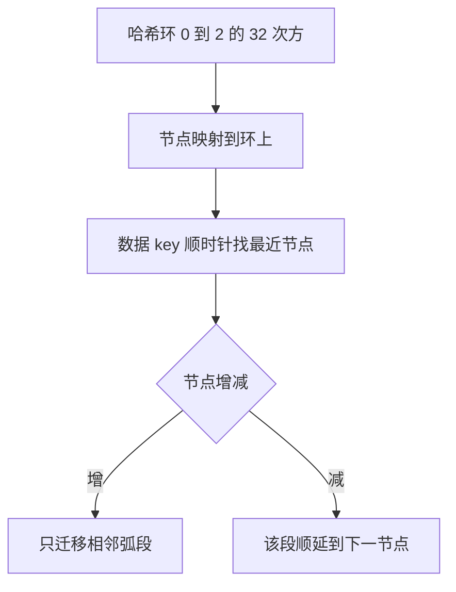

# 一致性哈希把再平衡的数据移动量压到平均槽位

分布式缓存与分片（把数据按规则切开存到不同节点）集群每加一台机器，**最朴素的做法是把所有键按节点数重新取模——数据全体洗牌一次**。这个要解决的问题叫再平衡风暴（集群节点数变化引发的大规模数据迁移）：`hash(key) % N` 在 N 变化时**几乎每个键都要搬家，集群越大扩容一次的 I/O 与缓存失效（缓存里的数据过期或不一致、需要回源加载）代价越大**。**一致性哈希（consistent hashing：把哈希空间组织成一个环，节点与键同放环上，键归属顺时针遇到的第一个节点）让扩缩容只移动平均 1/N 的数据，是分片系统再平衡的机制基石**。

## 朴素取模在什么情况下失效

`hash(key) % N` 的问题出在取模基数：N 从 4 变 5，理想情况下应有 1/5 的键移动，**实际约 80% 的键被重新映射**。缓存场景表现为**扩容瞬间命中率崩塌、后端被打穿**；存储场景表现为**全量数据重灌**。演进到一致性哈希的动机就在这里：**再平衡的移动量由算法结构决定，与集群规模解耦**。

## 它是怎么做到的：环与虚拟节点

**一致性哈希把哈希空间弯成一个环（通常 2^32），节点与键都哈希到环上，每个键归属顺时针遇到的第一个节点**。**节点加入或离开只影响它邻近的那段弧——加一个节点只接管一段弧上的键，移动量约 总键数/N**。

| 节点变化 | 受影响的键 |
| --- | --- |
| 加入节点 B | 只有 A 到 B 这段弧上的键移动 |
| 删除节点 A | 只有 A 到 B 这段弧上的键改归 B |
| 其余情况 | 所有键的归属不变 |

环上的归属关系长这样：节点（圆柱）与数据键（方块）都哈希到同一圆环，每个键归顺时针遇到的第一个节点：

来源：[Devtrovert, What Is Consistent Hashing?](https://blog.devtrovert.com/p/what-is-consistent-hashing-the-backbone)。方块离哪个圆柱的顺时针弧段最近就归谁——"加一个节点只接管一段弧"在图上是把新圆柱插进环、只分走它逆时针方向到前一个节点之间的那几个方块。

**虚拟节点（vnode）解决两个问题：一是数据倾斜（数据分布不均、部分节点过忙而其余闲置）——物理节点按能力权重分成几十上百个虚拟节点撒到环上，键的分布由大数定律抹平；二是异构集群——老机器 128 个 vnode、新机器 256 个 vnode，容量差异直接反映在环占比里**。Redis Cluster（Redis 官方的分布式集群方案）的 16384 槽位、Dynamo 系存储（源自 Amazon Dynamo 论文的一类分布式存储）的 token 环都是这个机制的工程化。

槽位在节点这一侧怎么存，Redis 源码给了直接答案：clusterNode 结构体里一个 unsigned char slots[REDIS_CLUSTER_SLOTS/8] 位图字段，16384 个槽压缩成 2048 字节，某槽属于本节点就是位图里对应的那一位置 1：

![clusterNode 结构体的 slots 位图字段：unsigned char slots[REDIS_CLUSTER_SLOTS/8]，16384 个槽压缩成 2048 字节的位图，置 1 表示槽属于本节点](/static/figures/cluster-node-slots-bitmap-struct.png)

来源：小林coding《Redis 集群模式是怎么保证高可用的？》，https://www.xiaolincoding.com/redis/cluster/cluster_problem.html。位图既是节点自己判断「这个键归不归我」的依据，也是心跳（通信双方定期互发小报文、确认连接还活着）包里随集群视图扩散的槽位信息——vnode 抽象落到工程实现，就是这 2048 字节。

来源：[腾讯云开发者社区《Redis系列：Redis主从、哨兵、集群介绍》](https://cloud.tencent.com/developer/article/2183910)（CC 4.0 BY-SA）

## 一致性哈希的裂缝靠什么补

裸一致性哈希有不均匀性风险：**节点数少时弧段长短悬殊（节点崩溃时键可能集中涌向某一个邻居）**。工程实现用守护带（rendezvous hashing 作为替代方案，或 jump consistent hash 用于只扩不减的场景）与复制因子配合：**每个 vnode 的数据复制到环上顺时针的后 R-1 个不同节点，任一节点故障时副本弧段同样只影响邻近段**。复制在环上的形态——同一份数据的副本沿顺时针散到两个节点，双色方块就是同一个键的两份：

来源：同上，Devtrovert。副本沿环顺时针放 R 份的含义：**任一节点掉线，它的键在顺时针方向的下家手里还有一份，接管动作仍然是"邻近弧段"而不是全集群对账**。

## 怎么自己动手验证

**移动量被压到局部，靠的是环形结构与顺时针归属**：

再平衡移动量要与实测对账——预写槽位从四增到五时移动的键数应约为总量的五分之一，实测接近全部重排（布局或尺寸变化触发重新计算排版），与预期对不上，说明槽位没有真正生效。

最小实验（Python 十行即可复现）：构造 100 万随机键，分别用 % N 与一致性哈希（含 vnode）做 N=4→5 的再平衡，统计移动键数与各节点键数分布的基尼系数。期望结果：**取模法移动约 80 万键，一致性哈希移动约 20 万键、各 vnode 键数方差随 vnode 数上升显著下降**。生产验证看**再平衡期间的净移动字节数、缓存命中率曲线与各节点磁盘均衡度**。

## 这套说法在哪儿会失效

- **一致性哈希只管数据归属，不管复制与共识**——副本怎么同步、谁是主，见 [[工程知识/后端系统：在并发、失败与变化中维持服务/分布式可靠性/复制分片与再平衡改变数据归属]]。
- **热点（访问集中在少数键或节点上的现象）键问题它不解决**：一个明星键的访问不会因为环结构而分散，需要应用层加盐（在密码哈希前混入随机串、防预计算表反查）或局部缓存配合。
- 槽位迁移期间的读写路由（源槽与目标槽双写窗口）是独立的工程问题，机制在 [[工程知识/数据系统：在并发与故障中保存事实/可靠性与运维/在线schema变更走expand与contract，不锁表是底线]] 的"变更窗口"段。

## 接着读哪几篇：哈希环机制与再平衡深水区

- [[工程知识/后端系统：在并发、失败与变化中维持服务/分布式可靠性/复制分片与再平衡改变数据归属]]：再平衡的上层流程（规划-迁移-切换），本文讲它依赖的哈希机制
- [[工程知识/数据系统：在并发与故障中保存事实/查询与索引/B+Tree索引为访问路径服务]]：分片后每个节点内部仍是索引结构，两层机制互补
- [[工程知识/后端系统：在并发、失败与变化中维持服务/服务设计/缓存改变读写路径、一致性与故障模式]]：缓存集群是哈希环最常见的消费方
- [[工程知识/数据系统：在并发与故障中保存事实/事务与存储/分片键设计以查询与均衡为双重约束]]：键怎么设计决定哈希环上的均衡与查询局部性
- [[工程知识/数据系统：在并发与故障中保存事实/可靠性与运维/分区再平衡的三种策略：固定取模与一致性哈希.md]] —— 哈希环机制与再平衡深水区
