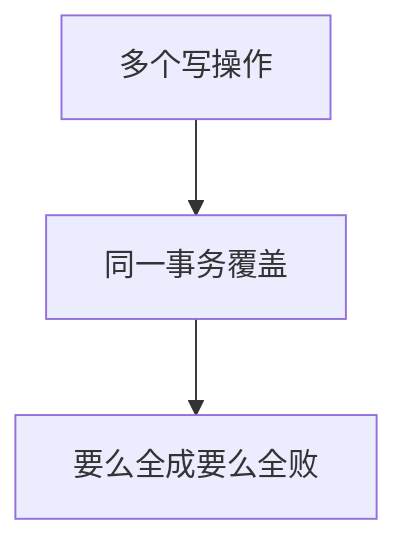
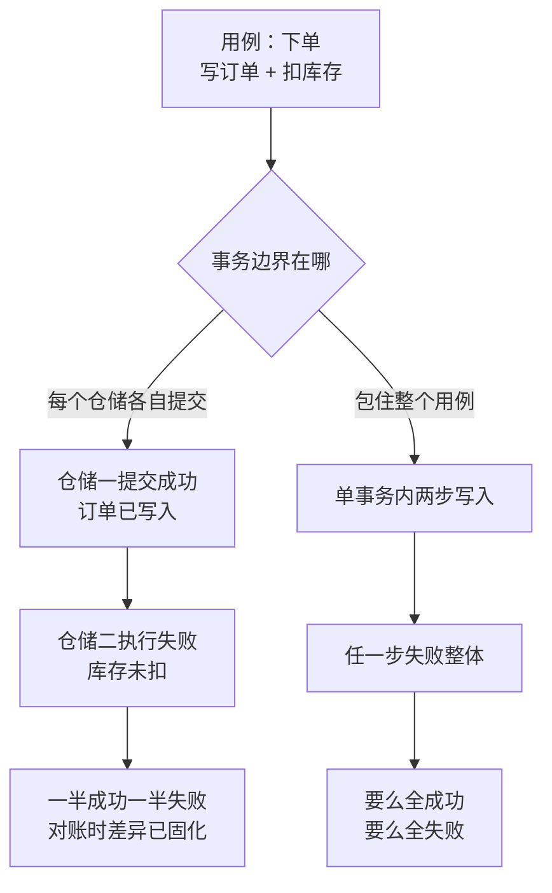
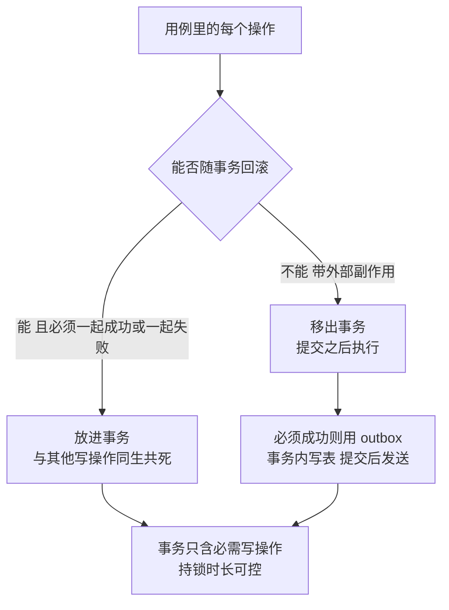

# 事务边界应覆盖完整业务用例

## 要解决的问题是什么：一半成功、一半失败的下单是怎么发生的



事务边界要画在用例上：


一个下单流程要写三张表：订单、订单项、库存扣减。

```go
func (r *OrderRepo) Save(o Order) {
    tx := db.Begin()
    tx.Insert("orders", o)
    tx.Insert("order_items", o.Items...)
    tx.Commit()          // ← 事务在这里结束了
}

func (s *OrderService) Place(o Order) error {
    s.repo.Save(o)       // 订单写入成功
return s.stock.Deduct(o) // 库存扣减失败 → 订单已写入数据库，库存没扣
}
```

结果：**订单存在但库存没扣**。**这是把事务边界放在仓储层的典型后果——每个仓储自成一个事务，跨仓储的业务操作就没有原子性了**。

同一笔下单，两种边界各走出一种结局：



边界位置与原子性的关系：**边界放在仓储层，两次提交各自独立，中间失败留下不一致状态**；**边界包住用例，两步写入同一事务，回滚覆盖全部改动**——**业务不变量（订单与库存同时变化）只被第二种边界保护**。

## 方案怎么实现，机制是什么：让事务覆盖整个用例

事务边界应该贴住**业务不变量**。**一个用例要么全成功，要么全失败，所以事务应该包住整个用例**：

```go
func (s *OrderService) Place(o Order) error {
    return s.tx.Run(func(ctx Context) error {
        if err := s.repo.Save(ctx, o); err != nil { return err }
        return s.stock.Deduct(ctx, o)
    })
}
```

关键点：**事务对象通过参数传递，而不是仓储自己持有**。

```go
type Tx interface {
    Run(fn func(Context) error) error
}
```

**仓储方法接收 `Context`（携带事务句柄），自己不开事务**。

### 谁该负责开事务

| 放在哪 | 结果 |
| --- | --- |
| 仓储方法内 | **跨仓储操作失去原子性（上面的 bug）** |
| Service 用例方法内 | **正确**——边界贴住业务不变量 |
| HTTP handler | **边界太粗，包含参数校验、鉴权等不该回滚的操作** |
| 框架的 `@Transactional` 注解 | **可以用，但要确认它的传播行为符合预期** |


边界划到用例之后还要筛一遍边界内的每个操作——**能不能随事务回滚，是「放进事务」与「移到提交之后」的分水岭**：



**筛完之后事务里只剩必须同生共死的写操作，持锁时长因此可预期**——**HTTP 调用与消息发送一旦留在里面，秒级超时就会变成全表的锁等待**。

**判断标准**：**事务里应该只有"必须一起成功或一起失败"的写操作**。**把日志、发通知、调外部 API 放进事务是错的——外部调用无法回滚，而且会拉长事务持锁时间**。


来源：[CSDN @bjmayor《图解分布式事务模式》](https://bjmayor.blog.csdn.net/article/details/154004146)（CC 4.0 BY-SA）


来源：[CSDN @bjmayor《图解分布式事务模式》](https://bjmayor.blog.csdn.net/article/details/154004146)（CC 4.0 BY-SA）


## 效果从哪来、要付什么代价

**收益**

- **跨表操作的原子性得到保证，不会出现"一半成功"**
- **事务持有时间可控（只包住必需的操作）**
- **用例失败时状态干净，重试安全**

**代价**

- **需要传递事务上下文**：**所有仓储方法签名多一个 `ctx` 参数，代码变"重"**
- **长事务风险**：**如果用例里调了慢的外部 API，事务会一直持锁，阻塞其他请求**
- **不方便跨服务**：**分布式场景下，本地事务不够用，需要 saga 或补偿**

代价里最要防的是长事务，它有可对账的数字形态：**事务持锁期间，同行其他事务进等待队列**，`information_schema.innodb_trx` 的 `trx_started` 与当前时刻**的差值就是持锁时长**，`performance_schema.data_lock_waits` **的等待链就是被它堵住的请求清单**。**包住用例的边界变大的那一刻，"外部 API 调用也在事务内"这类结构就会把持锁时长拖到秒级**——**判定标准写在监控里：持锁超过 100ms 的事务计数应当接近零，持续出现说明边界里混进了慢操作，对策是把不可回滚的操作移出事务**（下文第四步）。

## 从什么地方做

**第一步：找出所有"多次写操作"的用例**

**搜代码里一个 service 方法调用了 ≥2 个写仓储的地方。这些都是需要事务边界的候选**。

**第二步：把仓储改成接收事务上下文**

**给所有写方法加 `ctx` 参数。这一步机械但必须做，否则后面的边界划不了**。

**第三步：在用例方法上开启事务**

只有一个入口 `tx.Run(func(ctx) {...})`，里面顺序调用各仓储。

**第四步：把不可回滚的操作移出事务**

发消息、调外部 API、写日志——移到事务提交**之后**。如果必须保证它们也成功，用 **outbox 模式**：在事务内写一张 outbox 表，事务提交后由后台任务发送。

**本地事务覆盖不到跨服务场景时，两阶段提交是教科书式的参照**——**协调者先问所有参与者能否提交（prepare），全部确认再统一下达提交（commit）**：


*两阶段提交协议流程：第一阶段投票（Prepare），第二阶段按投票结果执行提交或回滚（图源：CSDN 博客）*

*两阶段提交的完整时序（图源：Wikimedia Commons，Jayaprabhakar 绘，CC0）*

**它的两个已知弱点——协调者单点、参与者锁定资源等待投票——正是微服务场景改用 outbox 加补偿的原因**：**把「要么全成」的判断从协议层搬回业务层**。

**第五步：检查隔离级别（并发事务互相可见程度的分级）**

**默认的 `READ COMMITTED` 挡得住脏读（读到了别的事务还没提交的修改），挡不住两个事务交错写引出的三类偏差**——丢失更新（两个事务各写一份，其中一个的修改被另一个覆盖）、写偏斜（两个事务各写各的行，合起来却破坏了业务约束）、幻读（同一查询两次执行读到的行数不一样），**各自要靠显式加锁或抬高隔离级别才挡得住**：

| 问题 | 何时发生 | 对策 |
| --- | --- | --- |
| 丢失更新 | 两个事务读-改-写同一行 | `SELECT ... FOR UPDATE` 或乐观锁（不加锁，提交时检查冲突再决定成败）版本号 |
| 写偏斜 | 两个事务各自检查条件后写入 | `SERIALIZABLE` 或显式锁 |
| 幻读 | 范围查询后另一事务插入 | `REPEATABLE READ` 以上或加间隙锁 |

## 常见错误

**错误 1：把事务当成"锁"来用**

**为了让并发操作串行化，故意开一个长事务。这会严重损害吞吐**。**要串行化应该用显式的锁或队列，不是靠事务隔离。**

**错误 2：事务里做 HTTP 调用**

**第三方接口超时 30 秒，事务就持锁 30 秒。其他请求全部排队**。**外部调用一律移出事务。**

**错误 3：嵌套事务语义不清**

MySQL（最常用的开源关系型数据库之一） 的 `SAVEPOINT` 和 PostgreSQL（开源关系型数据库，以事务与扩展能力见长） 的行为不同，ORM（object-relational mapping，对象关系映射框架，把数据库表映射成编程语言里的对象来操作）**的"嵌套事务"多数只是 savepoint（保存点，事务内的回滚标记，回滚到它只是撤销事务的一段，外层事务仍然存在），不是真正的新事务**。**不要依赖嵌套事务表达业务语义。**

**错误 4：以为"事务失败 = 什么都没发生"**

**事务回滚不会撤销外部副作用（已发的消息、已调用的 API）**。**有外部副作用时，必须有补偿逻辑。**

## 接着读哪几篇：同在数据系统里的相邻问题

- [[工程知识/后端系统：在并发、失败与变化中维持服务/分布式可靠性/超时、重试与幂等共同定义调用语义]] · [[工程知识/软件构建：让变化可以理解、验证与交付/架构与代码/分层与依赖方向决定可测试性和演进成本]]
