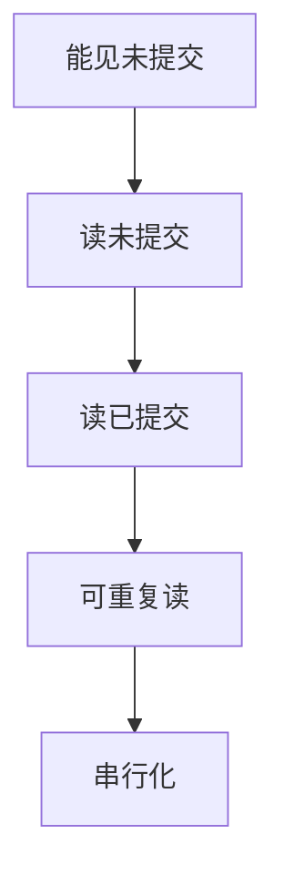
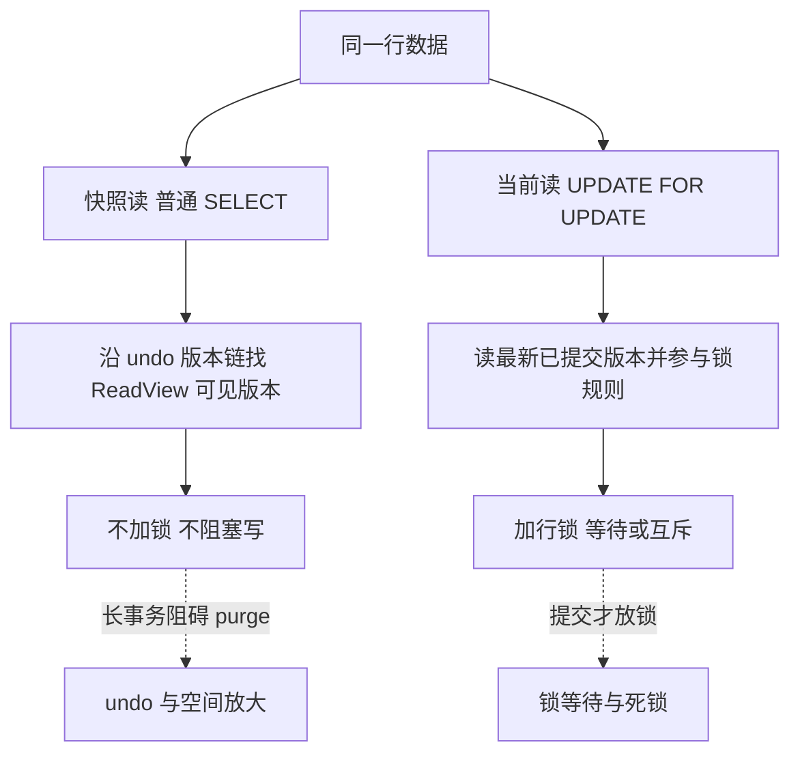

# 事务隔离决定并发读写能观察到什么

**两个事务同时跑，谁先读到新值、谁必须等、提交后多久别人看得见，这些是业务能不能算对的规则，数据库的内部细节反而是表层**。**读完这篇你能按业务不变量选隔离级别（数据库定义并发事务相互可见程度的等级），分清快照（某一时刻的完整只读副本）读和当前读（读最新已提交版本并对记录加锁），也能判断死锁（多个执行流互相等待对方释放资源）和长事务该从哪里下手**。

## 这篇先记住哪几句：入门导读

**隔离级别的本质是定义可见性——不同级别允许观察到不同程度的中间状态**，异常现象随之变化：



四级隔离逐级收紧可见范围：


| 维度 | 回答 |
| --- | --- |
| 要解决的问题 | 多个事务同时读写时，系统必须定义每次读取能看到哪些版本、哪些冲突需要等待，以及提交后数据何时可见。 |
| 本质 | ReadView（事务启动时生成的一致性视图，决定能看到哪些版本）、undo 版本链和锁共同定义「可见性」和「互斥」；隔离级别是在一致性、并发和阻塞之间选择观察规则。 |
| 做法 | 按业务不变量选择 RC/RR 等隔离级别，区分快照读与当前读，缩短事务，统一锁顺序，并为不确定提交设计幂等（同一次操作重复执行与执行一次效果相同）重试。 |
| 效果与代价 | 快照读减少读写阻塞，锁保护冲突更新；代价是长事务、undo、死锁、锁等待和更高隔离级别的并发损失。 |
| 边界 | 事务只覆盖数据库内的原子边界，不能把网络、模型或消息自动纳入同一事务；复制延迟也不由隔离级别解决。 |
| 验证 | 用并发读写、范围锁、死锁、长事务、提交超时和副本延迟场景，核对可见版本、业务不变量、等待时间和恢复行为。 |

## 四个级别各自能看见哪些现象：隔离级别与可见性

**先把形状说成一件事：隔离级别像办公室工位的透明度规则——读未提交是"同事草稿纸你也随便看"（会看到人家画了一半的方案，脏读）；读已提交是"只看打印定稿，但两次看之间可能换了版本"（不可重复读）；可重复读是"进办公室那一刻全体定稿拍照，之后都看这张照片"（幻读是照片没拍到的新同事）；串行化是"改文档必须先宣布独占，谁都不能同时动"（最安全也最挤）**。**级别越严，看到的东西越一致，排队越久**。**这个比喻到"排队"为止——现实里 MySQL（开源关系型数据库）用 ReadView 与版本链实现这套规则，快照读（读事务开始时的一致性版本）与当前读的分工下面展开**。

**隔离级别之间的差别，最终落在并发事务是否可能读到对方未提交的写入，以及同一事务两次读取是否一致**。**四个级别是按允许的异常从宽松到严格排列的，理解这张表就能判断该选哪一级**：

| 隔离级别 | 脏读 | 不可重复读 | 幻读 |
| --- | --- | --- | --- |
| 读未提交 | 可能 | 可能 | 可能 |
| 读已提交 | 不会 | 可能 | 可能 |
| 可重复读 | 不会 | 不会 | 可能 |
| 可串行化 | 不会 | 不会 | 不会 |

**级别越靠下，并发事务互相干扰的可能越小，代价是锁范围与冲突回滚（把系统状态退回到改动之前的版本）变多**。

**InnoDB 常用 `READ COMMITTED`（RC）和 `REPEATABLE READ`（RR）**。

| 读法 | 含义 | 是否加行锁 |
| --- | --- | --- |
| 一致性读/快照读 | 从 ReadView 和 undo 版本链得到可见版本 | 普通 `SELECT` 不加行锁 |

**这些机制防住的事故长什么样，转账的两步流程画得最直白——从「我的余额」扣款、向「你的账户」入账，两段各自读写数据库；中间任何一步断开（崩溃、网络中断、对端更新失败），钱扣了但没到账**。**把六步包进一个事务才成其为转账——事务边界存在的理由，先于任何隔离级别讨论**：


*图源：[小林 coding《事务隔离级别》](https://www.xiaolincoding.com/mysql/transaction/mvcc.html)，原创图注明出处转载。*
| 当前读 | 读取最新已提交/自己的版本并参与锁规则 | `UPDATE`、`DELETE`、`FOR UPDATE`、`FOR SHARE` |

**RR 通常在事务第一次快照读时建立并复用 ReadView；显式 `START TRANSACTION WITH CONSISTENT SNAPSHOT` 可立即建立快照**。**RC 通常在每条语句前建立新视图**。**`BEGIN` 本身不一定触发 InnoDB 快照，真正的时间点取决于第一次相关读操作（InnoDB 是 MySQL 的事务型存储引擎）**。

**每行带有事务版本信息，旧版本通过 undo 链接**。**ReadView 根据活跃事务 ID、低水位（活跃事务中最小的事务 ID）和高水位（下一个将分配的事务 ID）判断版本是否可见；因此快照读可以不阻塞写，但长事务会阻碍 purge 并放大 undo 和空间占用**。


来源：[CSDN @bjmayor《图解分布式事务模式》支付取消并发一图](https://bjmayor.blog.csdn.net/article/details/154004146)（CC 4.0 BY-SA）


再一处图源：[腾讯云开发者社区《一篇文章讲透MySQL为什么要用B+树实现索引》平衡树一图](https://cloud.tencent.com/developer/article/1543335)（CC 4.0 BY-SA）


## 锁的层次怎么分：从全库到行

- **全局锁**：**如 `FLUSH TABLES WITH READ LOCK`，主要用于全库一致性备份；优先评估 `single-transaction` 等不阻塞业务的方案**。
- **表锁**：**显式 `LOCK TABLES`，MyISAM 等非事务引擎更常见**。
- **MDL（Meta Data Lock，元数据锁：改表结构时挡住并发读写）**：**访问表自动获得 MDL 读锁，DDL（数据定义语言：建表、改表结构一类的语句）需要 MDL 写锁**。**长事务或频繁访问会让加字段、加索引排队；DDL 要设置等待上限并提前清理长事务**。
- **行锁/间隙锁（锁住索引记录之间的空隙、阻止插入的锁）/Next-Key Lock**：**InnoDB 在索引记录和间隙上控制当前读**。**RR 下范围当前读可能锁住间隙以避免幻读（同一查询两次执行读到的行数不一样）；实际锁范围取决于索引、谓词和执行计划**。

**这三种锁的形态，小林 coding 的行级表示法画得最直观**。**记录锁锁单条索引记录——给 id=1 的行加 X 型记录锁，其余行照常读写**：


*图源：[小林 coding《MySQL 有哪些锁》](https://www.xiaolincoding.com/mysql/lock/mysql_lock.html)，原创图注明出处转载。*

**临键锁是记录锁与间隙锁的组合——锁定半开区间 3 到 5，箭头同时指向 id=5 这一行和它前面的间隙：行本身不能改，间隙里不能插新行，幻读被挡在锁范围外**：

![小林 coding 中文图：临键锁（Next-Key Lock）——一张四行小表（id 列 1/3/5/6，name 列路飞/索隆/乌索普/山治），标注「临键锁： (3, 5]」，两条线分别指向 id=3 与 id=5 之间的间隙和 id=5 这一行，id=5 行红色高亮](/static/figures/xiaolin-next-key-lock-range-3-5.png)

*图源：同上，小林 coding。*

## 死锁是怎么形成的：两阶段锁怎么会画出一个圈

**死锁的本质是线程之间形成了环形的等待关系：每个线程持有对方需要的锁，又都在等对方释放**。**线程转储里的传递等待关系图能直接把这个环画出来**。


*图示：线程间的传递等待关系。图中的闭环即死锁；本文讨论的锁等待检测正是要尽早发现这类结构。*

**行锁按需获取，但通常到事务提交/回滚才释放，称为两阶段锁协议**。**一个事务需要锁多行时，尽量把最可能冲突的锁放后面，并让所有代码按相同顺序访问资源**。

**「按相同顺序访问资源」没做到会长什么样，两个订单事务的对照表就是实例：事务 A 与事务 B 都做「先检查订单是否存在（FOR UPDATE 拿间隙锁）再插入」，A 先锁 1007 后插 1008，B 先锁 1008 后插 1007——两次插入各自撞进对方持有的间隙锁，双双阻塞等待，环就画出来了**：


*图源：[小林 coding《MySQL 记录锁、间隙锁与死锁》](https://www.xiaolincoding.com/mysql/lock/deadlock.html)，原创图注明出处转载。*

**死锁检测只在等待加锁时触发；热点（访问集中在少数键或节点上的现象）行高并发可能让死锁检测本身消耗大量 CPU**。**处理顺序**：

1. **缩短事务、减少锁范围和锁持有时间**。
2. **统一访问顺序，分开热点行或按业务键分片（把数据按规则切开、分散到多个节点存储），必要时在服务端排队控制并发**。
3. **应用捕获死锁错误并以幂等（重复执行与执行一次效果相同）方式重试**。
4. **关闭 `innodb_deadlock_detect` 的前提有两条：业务路径确定不会形成死锁、外部有并发控制兜底**。**两条都成立才评估关闭；锁设计问题用锁设计修，调参掩盖不了**。

## 按什么选级别、怎么避坑：设计边界

- **事务要短且有明确边界；网络调用、模型调用、人工等待不能放在数据库事务内**。
- **所有重试都要有幂等键（请求自带唯一标识，重复提交只生效一次），尤其是提交超时后无法判断「服务端是否已提交」的情况**。
- **需要强一致读取时使用主库或当前读**；**读写分离（写入走主库、查询走从库的架构）必须把复制延迟（从库同步速度落后于主库、读到旧数据的时间差）纳入业务语义，而不是只做流量分配**。
- **插入、自增和唯一性检查也会参与锁竞争（多个执行流争抢同一把锁造成的等待开销）；批量写入要控制批次大小和索引数量**。

## 版本与锁怎么画出来：图解看什么

事务隔离可见性的两条读路径，图示如下。



**可见性与互斥的分工：普通 SELECT 走版本链拿快照，写走当前读加锁，两条路径互不阻塞；两条虚线是各自的代价——快照读的长事务把 undo 攒大，当前读的两阶段锁把等待与死锁带回来**。**隔离级别的选择就是在这两组代价之间选观察规则**。

**快照读沿版本链找「可见版本」时用的判定器就是 ReadView，四个字段各管一段判断：creator_trx_id（创建该版本的事务编号）是创建者自己的事务 id，m_ids（生成 Read View 时仍在活跃的事务编号列表）是创建时刻活跃未提交事务列表（在列表里的不可见），min_trx_id（活跃事务里最小的事务编号字段） 是活跃列表最小值（比它小的都已提交、可见），max_trx_id（下一个将分配的事务编号字段） 是下一个待分配事务 id**。**四字段结构图配在本库《快照隔离与MVCC（多版本并发控制，读写互不阻塞）：多版本如何在不阻塞读写的前提下挡住脏读（读到别的事务尚未提交的数据）》篇，此处不重复贴图**。

## 出了问题先看哪里：现场检查

```sql
SHOW PROCESSLIST;
SELECT * FROM information_schema.innodb_trx;
SELECT * FROM performance_schema.data_lock_waits;
```

**再结合 `SHOW ENGINE INNODB STATUS`、慢日志和应用 trace 并排核对阻塞者、被阻塞者、事务开始时间、SQL 指纹和业务请求**。

## 想自己验一遍怎么动手：验证

1. **现象复现：构造两个并发事务，一个读取、一个写入同一批行，分别在四种隔离级别下重复，记录是否出现脏读、不可重复读（同一事务内两次读同一行，结果不一样）与幻读，预期结果与当前数据库版本的文档描述一致**。
2. **锁等待观察：用 `SELECT * FROM performance_schema.data_lock_waits` 与 `information_schema.innodb_trx` 并排核对阻塞者与被阻塞者，确认等待发生在哪一类锁上**。
3. **长事务影响：让一个事务长时间不提交，观察历史版本保留、清理延迟与存储占用随事务时长的变化**。
4. **外部一致：在数据库事务提交后写入消息或调用外部接口，制造中间失败，确认需要 outbox、幂等或补偿才能保证两侧一致**。
5. **断言锚点：各隔离级别的现象逐项有记录，锁等待可定位到具体事务，长事务影响有观测数据**。

## 接着读哪几篇：并发同键请求的隔离语义

- [[工程知识/数据系统：在并发与故障中保存事实/查询与索引/一条SQL如何穿过优化器与存储引擎]]
- [[工程知识/数据系统：在并发与故障中保存事实/可靠性与运维/InnoDB用日志连接事务、恢复与复制]]
- [[工程知识/数据系统：在并发与故障中保存事实/可靠性与运维/MySQL空间、容量与在线运维]]
- [[工程知识/性能工程：从用户等待到资源瓶颈/观测与诊断/性能问题定位]]
- [[工程知识/后端系统：在并发、失败与变化中维持服务/任务与并发/幂等性的完整谱系：从操作语义到删除接口的天然陷阱.md]] —— 并发同键请求的隔离语义
- [[工程知识/数据系统：在并发与故障中保存事实/事务与存储/复制滞后的一致性补救：读己之写与会话保证.md]] —— 单机隔离级别与会话保证的分界
- [[工程知识/数据系统：在并发与故障中保存事实/事务与存储/快照隔离与MVCC：多版本如何在不阻塞读写的前提下挡住脏读.md]] —— 本篇讲隔离级别的现象谱系，机制篇讲 MVCC 如何实现快照语义
