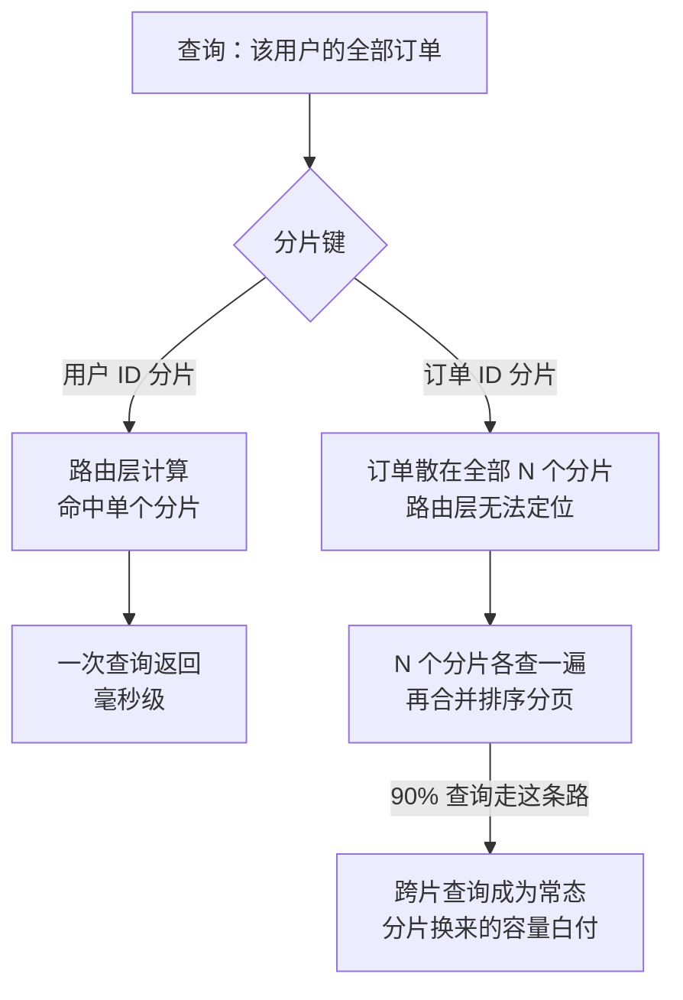
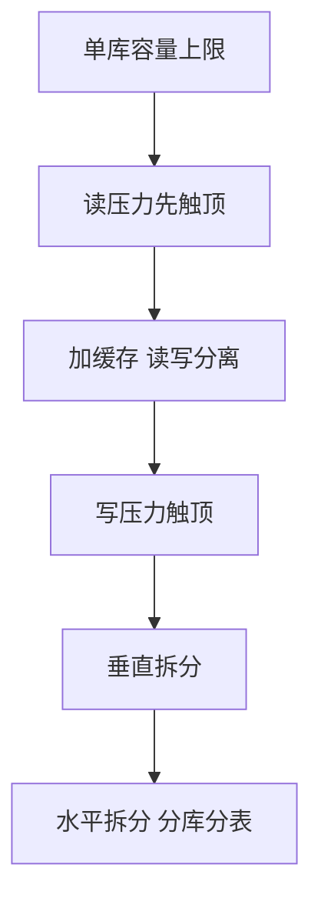
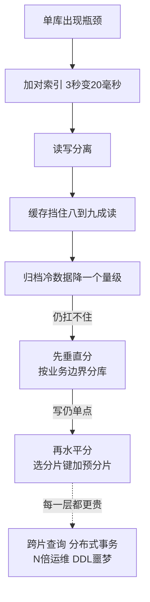

# 分库分表只在单库成为瓶颈后使用

## 为什么要等单库真的顶不住了：要解决的问题

按用户规模预期提前分库分表之后，**跨分片查询、分布式事务与扩容迁移的复杂度立即出现，而单库并未成为限制**。本篇回答：分片解决的是哪一项瓶颈、单库在什么条件下才构成这个瓶颈、分片键与路由方式怎样确定、跨片操作需要付出什么代价，以及扩容时数据怎样重分布。**小饭馆急着开三家分店是同一个错误：预计「将来客人会多」，菜谱、账本、厨师班底先复制成三套（提前分片），客人还没多，三套班子的沟通成本先来了**——**调个菜要三店统一、月底对账要对三本账（跨分片复杂度立即出现）**。比喻到「成本先于规模」为止：**饭馆开砸了一家可以关掉重来，数据库分完再合回去，代价远比开分店高**。

## 这件事发生在什么场景：提前分了 16 个库，然后麻烦开始了

一个项目预估"未来会有千万用户"，一开始就分了 16 个库。

**上线半年后实际只有 20 万用户，四类代价却已经全部付出**：

- **跨库查询做不了**："查询所有 VIP（Virtual IP，虚拟 IP：可漂移到存活节点的服务地址） 用户"要查 16 个库再合并，代码里全是 `for shard := range shards`
- **事务基本不可用**：跨库事务要么不支持，要么性能极差 → 所有业务改成最终一致，复杂度暴涨
- **扩容困难**：从 16 扩到 32 要迁移一半数据，得停机
- **运维成本**：16 套主从（一台主节点负责写入、其他从节点同步数据的部署形态）要维护，备份与监控的套数与库数同步增

**结果：为一个没到来的规模，提前付出了全部代价。**买房子预判「将来要住三代人」就一步买到五室两厅，是同一个负担：**房贷（16 套主从的运维成本）先压上，房间常年空着（跨库查询做不了、事务受限都是空房间的日常代价），真到三代同堂那天，户型还不一定合适**。比喻到「为预期付现钱」为止：**房子可以卖掉换小，分片拆完再合并是伤筋动骨的迁移工程**。

## 怎么判断真的需要分：从零开始

先把形状说成一件事：**单库像一家窗口齐全的邮局——加缓存是在大厅摆一排"常见问题自取架"（读压力先进自取架，窗口只接没印到的问题）；分库分表是另开分理处（要重新编邮政编码，跨局汇款、改址、对账都变复杂）**。**自取架加满了、窗口排到门外（读写触顶），才轮到开分理处**。这个比喻到"开分理处"为止——现实里单库上限有具体数字，下面逐项列出。

在分库分表之前，先把缓存这一层用起来。旁路（绕开主流程的备用路径）缓存的做法是：**读时先查缓存，未命中再查库并回填；写时更新库再让缓存失效（缓存里的数据过期或不一致、需要回源加载）**。**它解决的是读压力，通常先于分库分表触顶**。


*图源：Microsoft Azure Architecture Center《Cache-Aside pattern》，CC BY 4.0，https://learn.microsoft.com/en-us/azure/architecture/patterns/cache-aside。**旁路缓存的读写路径就是图上这两条：先于分库分表把读压力挡在缓存层，是成本最低的一档扩容**。*


### 单库的容量上限到底有多大：怎么实测

先要搞清楚单库的真实上限，别凭感觉：

| 瓶颈 | 单库（32 核 128G，NVMe）大致上限 |
| --- | --- |
| 数据量 | **2-5 TB**（**超过后备份、DDL（Data Definition Language，建表改表类 SQL：CREATE/ALTER/DROP）、索引维护都很痛苦**） |
| QPS | **5-10 万** |
| 写入 TPS（Transactions Per Second，每秒事务数） | **1-3 万**（**受限于 redo log fsync**） |
| 连接数 | **500-1000**（**超过后上下文切换严重**） |

**关键认知**：**数据量通常不是最先到的瓶颈，QPS（每秒查询数：一秒钟处理了多少个请求）和连接数才是。**体检报告是同一个解读方式：**体重超标（数据量大）看着扎眼，先出问题的心肺功能（QPS 与连接数）才是医生真正盯的指标**——**体重 200 斤但心肺达标的人能正常生活（行数多但全走索引，查询照样毫秒级），心肺不行的人体重正常也上不了三层楼**。比喻到「先看会倒的指标」为止：**体检能开药调理，数据库连接数顶到上限只能加机器或改架构，所以要用实测而不是体感定上限**。

**很多团队因为"表有 8000 万行"就急着分表——但如果查询都走索引，8000 万行的表查询只要几毫秒，完全不需要分**。

### 分库分表之前要先做完哪几件事

**按这个顺序优化，往往能推迟分库分表 2-3 年：**

| 优化 | 效果 |
| --- | --- |
| **加对索引** | 3 秒 → 20 毫秒（见 [[工程知识/数据系统：在并发与故障中保存事实/查询与索引/B+Tree索引为访问路径服务]]） |
| **读写分离（写入走主库、查询走从库的架构）** | **读压力分散到多个从库** |
| **缓存热点（访问集中在少数键或节点上的现象）** | **挡住 80-95% 的读** |
| **归档冷数据** | **把 3 年前的数据迁到历史表，主表体积降一个量级** |
| **优化大字段** | **把 TEXT/BLOB 移到独立表，主表变紧凑** |
| **连接池调优** | **消除"连接数不够"这个假瓶颈（见容量规划）** |

**做完这些还是扛不住，才考虑分。**

## 两种分法差在哪：方案与难度

### 垂直分法怎么做（先做这个）

垂直分法按业务把表分到不同的库：

| 分出的库 | 包含的表 |
| --- | --- |
| 用户库 | users |
| 订单库 | orders |
| 商品库 | products |
| 日志库 | logs |

这样分的好处有三条：
- **可以独立扩容、独立优化**
- **跨库事务通常可以避免**（因为业务边界清晰）

**按业务科室分楼是同一个分法：门诊楼、住院楼、行政楼各管各的（用户库、订单库、商品库），门诊楼爆满不影响住院部手术（业务隔离），哪栋楼不够用单独加盖（独立扩容）**。比喻到「按职能分楼」为止：**楼与楼之间转院要走流程（跨库 Join 代价高），但清晰的职能边界让大部分业务根本不用跨楼，这也是它代价低的原因**。

**代价**：低。**这是应该优先做的分法。**

### 水平分法难在哪（分库分表，真正的难点）

**水平分法不是应用自己拼出来的：从接入到后端数据库之间通常隔着一层分片中间件，中间件对上给应用一个逻辑库，对下把 SQL 按分片规则改写、路由到多个物理库再汇总结果**。ShardingSphere 的架构把这层的位置画得很清楚——最上面是面向应用的功能层，中间是内核的执行与路由，最下面是各类存储与部署形态：


*图源：SphereEx 社区《ShardingSphere 架构》PDF，Apache-2.0，https://shardingsphere.apache.org/document/current/cn/overview/。**应用看到的仍然是一个逻辑库，改写与归并由中间层的路由引擎承担——这也是后面跨分片查询、扩容这些难点集中出现的地方**。*

中间层收到一条 SQL 之后做什么，官方中文文档把它画成一条六步链路——解析、优化、路由、改写、执行、归并，跨分片查询的代价就藏在最后两步里：


*图源：Apache ShardingSphere 官方文档（中文），Apache-2.0，https://shardingsphere.apache.org/document/current/cn/features/sharding/。*

**带分片键的 SQL 在路由一步就收敛到单个分片，执行与归并退化为透传；不带分片键的 SQL 在路由一步扇出（一个请求分发给多个下游并行处理）到全部分片，执行变成 N 份、归并变成排序与聚合的合并**——同一张图上，**「80% 查询单分片命中」的目标就是为了让大多数 SQL 停在链路的前半段**。

水平分法绕不开分片键的选择。**范围分片按键的区间划分，范围查询友好，但某个区间一旦成为热点，压力全落在一个分片上**。


*图源：Microsoft Learn 中文文档，CC BY 4.0，https://learn.microsoft.com/zh-cn/azure/architecture/patterns/sharding。*

范围分片落到多租户场景的具体形态：分片映射表记录每段连续键的归属，租户 1-3 的数据整段落在分片 A、租户 10-11 整段落分片 B——**「连续键住同一分片」是范围查询友好的来源，也是热点集中（某个大租户占满一个分片）的来源**：


*图源：Microsoft Azure Architecture Center《Data partitioning strategies》range shardlet 图，文档引用，https://learn.microsoft.com/en-us/azure/architecture/best-practices/data-partitioning-strategies。图上的 Range shard map 就是范围分片的路由依据：键区间到分片的映射一目了然，改映射即完成扩容迁移的单位。*


**把一张表的数据按规则分散到多个库/表**，4 亿行的 orders 表按哈希分成四张：


*图源：JavaGuide《一副手绘图看懂分库分表》，CC BY-NC-SA 4.0（注：该许可含 NC 条款，仅作内部学习引用）。**哈希把同键请求均匀打散到各分片，代价是键相邻不等于分片相邻——这正是下面「跨分片查询为什么是最大痛点」的根源**。*

- orders_0：1 亿行
- orders_1：1 亿行
- orders_2：1 亿行
- orders_3：1 亿行

### 分片键怎么选（最关键的决定）

**分片键决定了几乎所有查询的效率。**

| 分片键 | 适用 | 问题 |
| --- | --- | --- |
| **用户 ID** | 大多数 C 端业务 | 查"某商家的订单"要扫全部分片 |
| **订单 ID** | 订单详情查询 | 查"某用户的所有订单"要扫全部分片 |
| **商户 ID** | B 端 SaaS | 大商户数据倾斜（数据分布不均、部分节点过忙而其余闲置） |
| **时间** | 日志、流水 | 热点集中在新分片 |

分片键的选择原则有三条：
2. **数据分布要均匀**（避免热点分片）
3. **尽量让 80% 的查询只命中一个分片**（避免跨片）

同一句“查我的订单”，分片键选用户 ID 还是订单 ID，走的是两条完全不同的路：**前者路由层一次算出落在哪个分片、一次查询毫秒级返回；后者订单散在全部 N 个分片上，路由层根本定位不了**——**两条路的落差**：



坏路上“N 个分片各查一遍再合并排序分页”不是偶发，图上标了 90% 的查询走这一条（**正文的 80% 是选键时要达到的目标，两者不是同一个口径**）。所以**分片键不是分完之后再调优的选项：选查询最频繁的维度做键，路由层一次定位；选错维度，同一查询变成 N 个分片的扇出与合并——它选定的那一刻，哪些查询变快、哪些变慢就已经定死**。

**实际常用做法：基因法 / 复合分片键**

**订单 ID 由"用户 ID 后 4 位 + 时间戳 + 序列号"拼成，取用户 ID 的后 4 位作为基因。这样同一个用户的订单必然命中同一个分片**。

**这样既能按订单 ID 查（能路由），也能按用户 ID 查（同一分片）**。

### 跨分片查询为什么是最大痛点

| 场景 | 难点 | 解法 |
| --- | --- | --- |
| 不带分片键的查询 | 要查所有分片 | **异构索引表**（另建一张按其他维度分片的表） |
| 分页排序 | 每个分片都要排序再归并 | 业务上避免深分页；或用"游标 + 分片并发" |
| 聚合（COUNT/SUM） | 各分片算完再合并 | 可以接受的话用并行查询；否则预聚合 |
| Join | 跨库 Join 性能极差 | **业务层做**（Saga（把长事务拆成一串本地事务、每步配一个补偿动作的模式）：先查 A，再用 ID 批量查 B） |
| 分布式事务 | 2PC 代价高 | **避免**：用 Saga + 对账 |

**这就是为什么要晚分**：这些复杂度是实打实的，而且要持续维护。**连锁超市总部查「全国哪些门店的某商品缺货」是同一个难题：货分布在几百家门店的独立账本里（数据分在各分片），总部没有一本总账，只能一家家问再汇总（扇出查询），问完还要自己排好序（归并）；想快就得另建一本按商品组织的副本（异构索引表），副本本身又要持续同步**。比喻到「账本一分为多、每问一次都变贵」为止：**超市盘点慢一天能忍，线上查询的扇出代价直接乘在每次请求上**。

### 扩容怎么走：从 N 个分片扩到 2N

**方案 1：停机迁移**（简单但不可用）

1. 停写
2. 双倍分片，重新哈希迁移数据
3. 切换路由
4. 恢复

**方案 2：一致性哈希（节点增减时只迁移少量数据的分片路由）**（减少迁移量）

从 N → N+1 时，只迁移 1/N 的数据，而不是全部。


*图源：Wikimedia Commons《Dynamo consistent hashing》，原表 Flash1984、SVG 制作 Marlus_Gancher，CC BY-SA 3.0 de，https://commons.wikimedia.org/wiki/File:Dynamo_consistent_hashing.svg。*

这张图画出迁移量变小的原因：**键与节点落在同一个环上，路由规则是「顺时针找到第一个节点」**。**环的取值空间固定（如 0 到 2^32-1），增删节点只改变该节点与前一节点之间那一段的归属，其余键的映射完全不动——正文「只迁移 1/N 的数据」在图上就是这一段弧**。

**方案 3：预分片（推荐）**

```
一开始就建 1024 个逻辑分片，放在 8 个物理库上（每库 128 个）
  → 扩容到 16 个库时，只需移动逻辑分片，不重新哈希
```

**这是最实用的方案**：**前期用少量物理库承载大量逻辑分片，扩容时只搬逻辑分片**。

**方案 4：用中间件**

MySQL（开源关系数据库）、ShardingSphere、TiDB、PolarDB-X。**它们解决了路由、扩容、分布式查询，但有学习成本和运维依赖。**

## 收益从哪来、付什么价：效果与代价

**收益**

- **容量线性扩展**：分片数 × 单分片容量
- **写压力分散**：多主写入
- **故障隔离**：一个分片挂了不影响其他

开连锁店相对一家大店，拿到的是同样的三条：**店面可复制（容量线性扩展）、各店各自收款（写压力分散）、一家店着火不烧其他店（故障隔离）**。**代价（很重，要清楚）**

- **跨分片操作复杂**：查询、分页、聚合、Join 都要重写
- **事务受限**：分布式事务代价高，通常要改成最终一致
- **运维复杂度翻倍**：N 个库 = N 倍的备份、监控、DDL
- **DDL 噩梦**：加一个字段要在 N 个分片上执行，且要保证一致性
- **全局 ID**：不能用数据库自增，要引入 Snowflake 这类方案

**五条代价不是各自独立的开销，它们从"数据不再在一处"这一个事实里长出来，并且彼此牵连**：



最下面那条值得单说：**跨分片操作、事务、DDL 三项最终都会落到"业务层要不要接受中间态"这个问题上**。**分布式事务的代价高到通常不划算，于是改成最终一致，而接受中间态是业务层的让步，不是技术层能独自消化掉的**。**这也是为什么分库分表的决策不能只由数据库负载触发——它改的是业务语义**。



「晚分」的完整路径：**单库到瓶颈后按代价从低到高逐层做——索引、读写分离、缓存、归档冷数据（这四层往往能推迟分片两三年），然后先垂直分（按业务边界，代价低）最后才水平分（分片键与预分片，真正的复杂度从这里开始）**。**虚线挂的是水平分一次性买下的持续成本：跨片查询、分布式事务、N 倍运维与 DDL——每往下一层都更贵，所以分片的时机由实测瓶颈决定，不由预估规模决定**。

## 动手时从哪儿开始

**第一步：先量化瓶颈**

是数据量、QPS、连接数还是磁盘 IO？**不同的瓶颈对应不同的方案**（可能根本不需要分）。

**第二步：先做垂直分法**

按业务边界划分。**代价低、收益明确，且往往就够了。**

**第三步：归档冷数据**

把历史数据迁走。**这一步常常能让数据量降一个量级，直接推迟水平分法。**

**第四步：选分片键（花最多时间在这）**

列出所有高频查询，看它们按什么维度查。**80% 的查询能单分片命中，才能分。**

**第五步：用预分片 + 中间件**

不要自己写路由逻辑。**用 Vitess/ShardingSphere（两款开源的数据库分片中间件，前者来自 YouTube 的生产实践、后者是 Apache 顶级项目）或云厂商的分布式数据库。**

## 哪些做法一看就错：常见错误

**错误 1：过早分片**

前面那个案例。**分片是不可逆的复杂度，晚分比早分好。**

**错误 2：分片键选错**

按订单 ID 分片，但 90% 的查询是"查我的订单" → 每次查所有分片。**必须先看查询模式。**

**错误 3：以为中间件能解决一切**

Vitess 能路由、能扩容，但**改变不了跨分片聚合和 Join 的本质代价**。

**错误 4：忽略数据倾斜**

按商户 ID 分片，一个大商户占了 30% 的数据 → 那个分片是热点。**大客户要单独处理。**

**错误 5：还在用数据库自增 ID**

多个分片各自自增 → ID 冲突。**必须用全局 ID 生成（Snowflake、号段、UUID）。**

**错误 6：分片后还写跨分片事务**

用 2PC（两阶段提交协议）硬撑 → 性能和可用性都很差。**改成最终一致 + 对账。**


## 想自己验一遍怎么动手：验证

1. 瓶颈确认：**在决定分片之前记录单库的 CPU、IO、连接数与写入延迟水位，确认限制出现在数据库侧；出现跨机网络或应用侧瓶颈时先处理那一层**。
2. 分片键核对：**按候选分片键统计数据分布，确认各分片承载的量接近、单一大客户的占比可控**。

3. 跨片操作：**对跨分片查询与写入分别记录影响的分片数量、延迟与失败处理方式，确认代价已被计算**。
4. 标识唯一：**在多个分片上分别生成业务标识，预期不出现重复；使用自增标识的实现应能观察到冲突**。

5. 扩容重分布：**在演练环境按新分片数重分布数据，记录迁移期间的读写可用性与对账结果**。
6. 断言锚点：**单库瓶颈有实测依据，分片键分布与跨片代价有数据，标识唯一性经过验证，重分布演练过**。

## 接着读哪几篇：同在数据系统里的相邻问题

- [[工程知识/数据系统：在并发与故障中保存事实/查询与索引/B+Tree索引为访问路径服务]] · [[工程知识/性能工程：从用户等待到资源瓶颈/性能工程：从用户等待到资源瓶颈]]
