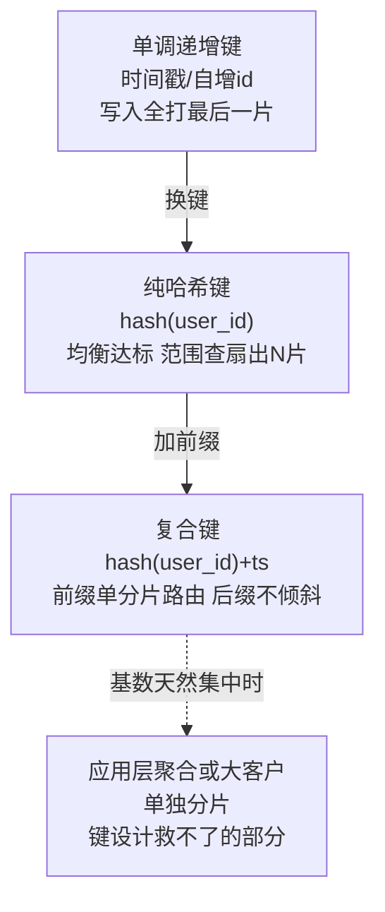
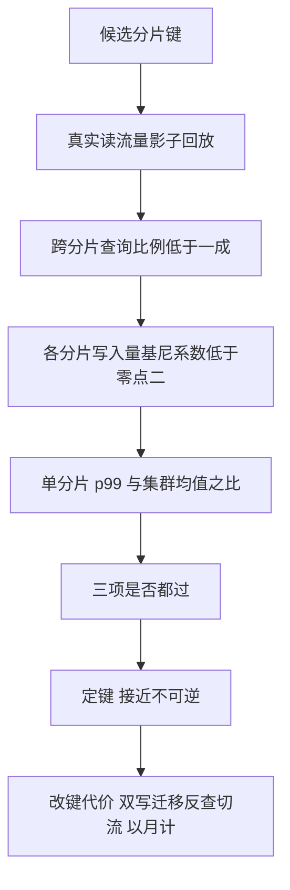

# 分片键设计以查询与均衡为双重约束

分片键的选型落在两个互相打架的约束的交集里：**查询局部性（同样频次的查询尽量少跨分片）与数据均衡（热点不能压垮单个分片）**，哈希（把任意长度数据压成固定长度指纹、不可逆）函数只是实现手段。要解决的问题：**选错的分片键没法事后改——存量数据要按新键重分布，等于一次全库再平衡，停机或双写（迁移期间同一份数据同时写入新旧两个存储）窗口都代价高昂**。分片键一旦选定，数据就按它落位；要换键就得把存量数据按新键重分布，**代价等于一次全库再平衡，停机或双写窗口都躲不掉**，因此分片键是分片系统里**最接近不可逆**的决策。

## 双重约束怎么打架

| 约束 | 满足它的键 | 违反它的代价 |
| --- | --- | --- |
| 查询局部性 | 范围键（user_id 范围、时间范围） | 均衡差：单调递增键全部写入尾部分片 |
| 数据均衡 | 哈希键（hash(user_id)） | 局部性差：任意范围查询扇出（一个请求分发给多个下游并行处理）到全部分片 |
| 兼得 | 复合键（hash(user_id)+ts） | 前缀路由范围查 user，后缀保证不倾斜 |

**单调递增键（自增 id、时间戳）是最常见的错误：写入热点（访问集中在少数键或节点上的现象）永远在最后一个分片，等于没有水平扩展**。纯哈希键解决了均衡，代价是**所有范围查询变成 scatter-gather**，**查询代价乘以分片数**。

Dynamo 系存储的哈希环把键空间切成首尾相接的弧段，每个键按哈希值落到所在弧段，副本再沿环顺时针放 R 份——哈希键「分布均匀」的承诺就建立在这样的环上：


*Dynamo 风格的哈希环与副本分布（图源：Wikimedia Commons，Flash1984 原图，Marlus_Gancher 转 SVG，CC BY-SA 3.0 de；图中表格为德文标注，für N=3 意为副本因子取 3）*

## 设计时该回答哪四问

均衡这一侧最直接的做法是对分片键取哈希：键的取值被打散，理论上各分片拿到差不多的量。**哈希能让分布均匀，但也会让范围查询落到多个分片上——这正是双重约束打架的地方**。


1. **最高频查询的等值/范围条件是什么？分片键前缀必须覆盖它，否则每次查询都是全分片扇出**。

2. **写入分布由谁决定？业务键基数是否足够（≥ 分片数一个数量级）、是否存在明星实体（大客户、热门商品）**。

3. **未来的分区数是多少？基数不够的键在扩容到 N 片后必然倾斜（数据或负载集中到少数节点）**。

4. **单分片内的二级索引还够用吗？分片键之外的查询走全局索引或分片本地索引，两者代价结构完全不同**（[[工程知识/数据系统：在并发与故障中保存事实/查询与索引/一条SQL如何穿过优化器与存储引擎]]）。


来源：[腾讯云开发者社区《一篇文章讲透MySQL为什么要用B+树实现索引》](https://cloud.tencent.com/developer/article/1543335)（CC 4.0 BY-SA）


来源：[腾讯云开发者社区《Redis系列：Redis主从、哨兵、集群介绍》](https://cloud.tencent.com/developer/article/2183910)（CC 4.0 BY-SA）


## 缓解了热点为什么不等于解决问题

另一种常见做法是按区间分片：相邻的键落在同一分片，**范围查询只打一个分片**。代价是**区间边界固定之后**，写入集中在某个区间时**那个分片会先撑不住**。


加盐（键前缀加随机段）能把写入摊平，代价是**读时要枚举盐值**；范围分片 + 定期再平衡能追平倾斜，代价是**迁移窗口**。**两者都是"延迟摊牌"，如果实体基数天然集中（一个客户占 90% 写入），任何键设计都救不了，要么单独建分片（物理隔离大客户），要么回到应用层聚合**。数据归属变化的机制见 [[工程知识/数据系统：在并发与故障中保存事实/事务与存储/一致性哈希把再平衡的数据移动量压到平均槽位]]。

## 动手跑一遍会看到什么：分片键的双重账

可运行示例：同一个订单表三种分片键，两本账各算一遍：

```text
查询约束（点查能否由单分片承担）：
  分片键 = user_id：查"某用户的订单" → 1 次路由（最优）
  分片键 = order_id：查"某用户的订单" → 广播全部分片（N 次查询再合并）
  分片键 = 复合 (user_id, hash(order_id))：带 user_id 的查询仍单分片

均衡约束（数据与负载是否摊得开）：
  user_id 直接哈希：数据均匀，但明星用户的热点仍在单分片
  user_id 加盐（user_id % 16 再哈希）：热点摊开，代价是**跨盐合并查询**
  按 created_at 范围分片：查询友好（时间范围扫描单分片），
    但写入永远打最后一片（时间热点，最大忌讳）

三者的取舍没有全赢解：查询形态决定分片键必须含什么，
写入分布决定它不能是什么——两个约束的交集才是可选项。
```

三类键在两个约束轴上的位置排成一张阶梯：



升级路径与各自卡点：**单调递增键在均衡轴上直接失败，纯哈希键补齐均衡但把范围查询变成全分片扇出，复合键用前缀路由覆盖最高频查询形态；基数天然集中（一个客户占大头写入）超出任何键设计的能力范围，只能物理隔离或聚合，这是阶梯的尽头**。

**定键前那道闸门由三项影子回放指标把守，任一项不过就回到候选键，全过才进入不可逆区**：



**闸门没过就定键，账单就是下一段那种以月计的重写**——定键前跑负载模型、定键后按分片看写入与磁盘增速，**两段合成一次决策的闭环**。

选错分片键的纠偏成本实录——**分片键定错了要重写数据（双写迁移、反查、切流，以月计的工程），所以选型阶段要拿真实查询日志验证（top 查询模板逐条过一遍能否单分片命中），凭直觉选键的错误要到容量翻倍后才暴露**；[[工程知识/数据系统：在并发与故障中保存事实/事务与存储/数据分布不均是分片集群的第一大故障源.md]] 的热点监控是选型错误的探测器，**设计期验证与运行期监控两段衔接，覆盖选键决策的完整周期**。

## 怎么自己动手验证

**分片键要与影子流量对账——预写候选键回放后跨分片查询比例低于一成、各分片写入量接近均衡，任一项与预期对不上就不能定键**。

用真实流量影子评估：把生产读流量按候选键回放，**统计跨分片查询比例（期望 <10%）、各分片写入量基尼系数（期望 <0.2）、单分片 p99 延迟与集群均值之比。三项都过才定键**。定键前跑 [[工程知识/数据系统：在并发与故障中保存事实/可靠性与运维/数据库基准必须描述负载与资源边界]] 的负载模型，**避免用想象的负载定不可逆决策**。

## 这套说法在哪儿会失效

- 分片键选择先于分片实现：逻辑分片（PostgreSQL，广泛使用的开源关系数据库，声明式分区；Vitess vschema）给未来的键调整留了缝隙，物理分片（早期分库分表）几乎不可逆。
- 二级索引跨分片一致性与分片键无关，是独立的事务与复制问题（[[工程知识/数据系统：在并发与故障中保存事实/事务与存储/事务隔离决定并发读写能观察到什么]]）。
- 本文讲键的设计，数据在分片间迁移的机制见 [[工程知识/后端系统：在并发、失败与变化中维持服务/分布式可靠性/复制分片与再平衡改变数据归属]]。

## 接着读哪几篇：分片键选错的第一后果就是分布不均

- [[工程知识/数据系统：在并发与故障中保存事实/事务与存储/数据分布不均是分片集群的第一大故障源|数据分布不均是分片集群的第一大故障源]]——分片键选错的第一后果就是分布不均
- [[工程知识/数据系统：在并发与故障中保存事实/事务与存储/一致性哈希把再平衡的数据移动量压到平均槽位]]：本文的键如何对应到环/槽位上的机制
- [[工程知识/数据系统：在并发与故障中保存事实/数据建模与SQL/聚合边界由业务不变量而不是ER图决定]]：聚合边界决定哪些字段必须同分片（同一聚合不跨片），是分片键的前置决策
- [[工程知识/性能工程：从用户等待到资源瓶颈/观测与诊断/优化收益递减决定何时该停手]]：何时该停的分片扩容收益判断
