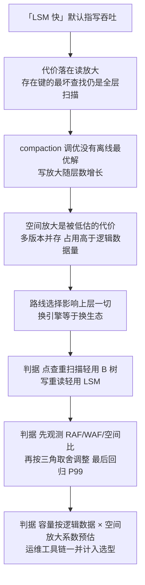

# 存储引擎的两大路线：B树与LSM的写读取舍

## 要解决的问题

打个比方：B 树像图书馆的书架，新书进来要抽开空位插进去（原地更新，读的时候位置固定），LSM（Log-Structured Merge，先把写入攒在内存里、再按批顺序落盘的存储结构） 像一块先随手记账的便签本，攒厚了再誊抄进正式账本（追加再合并，写的时候不用挪旧账）。这个比方到「写快读慢与写慢读快的交换」为止，放大倍数与选型度量看正文。

**磁盘上的数据结构要同时服务写、读、空间三件事**。**B 树（原地更新）与 LSM（追加再合并）是两条根本不同的路线**：**B 树用读性能换写吞吐，LSM 用写吞吐换读性能**，**这个交换比不是常数，随读写比、点查与扫描比、空间预算变化**。选错路线的代价是**数量级的**（**写重负载用 B 树撑不住，读重负载用 LSM 读放大高**）。**本文写两条路线的机制、代价结构与选型判据**，**它们是数据库、缓存、消息队列（生产者写入、消费者读取的缓冲中间层）存储层的共同底座**。

## 它是怎么做到的

**B 树：原地更新的有序树**。**多叉平衡树，页为节点（16KB 上下），根到叶 3-4 层即覆盖亿级行**。**写路径：找到叶子页 → 原地改 → 若页满则分裂，向上传播**。**读路径：树高对数，点查 3-4 次 IO 定位**。**写代价藏在原地更新：随机写（页分散在盘上）+ 页分裂（页写满时把一页拆成两页的操作）的连锁**（写放大 WAF，即 Write Amplification Factor：一次逻辑写可能触发页分裂传播、供未来读的预读失效）。B+树（多路平衡搜索树、叶子节点串成有序链表、适合范围查询与磁盘读取）索引为访问路径服务[[工程知识/数据系统：在并发与故障中保存事实/查询与索引/B+Tree索引为访问路径服务.md]]写的是索引结构，本文写它作为存储路线的代价结构。

来源：Wikipedia「B+ tree」条目（CC BY-SA）。**这棵树的关键在页的位置固定**：键 4 插进来只会改动叶层的一个页与沿途导航键，页在盘上的位置原地不变——**「写随机」的代价来源就是任意页都可能被触碰**。

**LSM：追加+分层合并**。**写路径：写 memtable（内存跳表）→ 满了刷成 SSTable（不可变、有序文件）→ 后台 compaction 把多层 SSTable 合并去重**。**读路径：memtable → L0（可能多个重叠文件）→ 逐层向下找，每层多个文件都可能命中同一键的旧版本**——读放大RAF（Read Amplification Factor，读放大系数：一次读要实际读的次数）**是 LSM 的命门：最坏情况查遍全部层**。存储引擎的两大路线之外，LSM树（Log-Structured Merge Tree，先写内存再批量合并到磁盘的存储结构、写入快）用写放大（实际写入量是逻辑写入量的多倍）换取顺序写和可扩展性[[工程知识/数据系统：在并发与故障中保存事实/事务与存储/LSM树用写放大换取顺序写和可扩展性.md]]已把 LSM 的写放大机制写透，本文补两条路线的对照谱系与选型。

分层合并的形态见下图：Level 0 的一批小 SSTable 经 compaction 两两归并成 Level 1 的有序大文件，再逐层向下合并成更大的文件——**「compaction 不断制造更少、更大、更大的文件」正是写吞吐与读放大（一次逻辑读触发多倍实际读取）的交换现场**：

*LSM 的分层 compaction（图源：Wikimedia Commons，Ben Stopford 绘，CC BY-SA 4.0）*

**写读代价的结构性差异**。**B 树：写随机（原地改，任意页）、读对数（树导航）**。**LSM：写顺序（memtable 吸收全部随机性，写入磁盘全是顺序大块）、读多路（层间+层内查找）**。磁盘的物理特性（顺序快随机慢，见 [[工程知识/数据系统：在并发与故障中保存事实/事务与存储/SSD与HDD的IO特性差异：随机写与写放大.md]]）决定了：**机械硬盘（HDD，Hard Disk Drive）上 LSM 的顺序写红利巨大**；固态硬盘（SSD，Solid State Drive）上随机写不再那么贵，但大块顺序写仍是 SSD（固态硬盘）的 FTL（Flash Translation Layer，闪存转换层：把逻辑地址映射到物理闪存位置） 友好模式（GC 效率高、WA 低），**LSM 红利缩小但不消失**。

**compaction 的调优三角**。**LSM 的空间/写放大/读放大三者不可同时最小**（这组三角关系见存量 LSM 篇——上文链接）。调优即选角：leveled compaction（RocksDB 默认：层间重叠小、读放大小，写放大高）；tiered（层内先攒再合，写放大小、读放大大）；FIFO（只按时间丢，纯日志场景）。现代引擎把三者做成参数谱（RocksDB 的 compaction priority、Cassandra 的 STCS（Size-Tiered Compaction，按文件大小分层合并的 LSM 策略）/LCS（Leveled Compaction，按层级逐级合并的 LSM 策略）/TWCS（Time-Window Compaction，按时间窗口分组合并的 LSM 策略））。

leveled compaction 的布局是理解这组取舍的起点：内存写缓冲刷出的 Level 0 文件之间键范围重叠，Level 1 以上每层内部按顺序切成多个互不重叠的文件，容量逐层放大十倍左右，**一条记录每下沉一层都要跟该层键范围重叠的文件重写一遍**：

*图源：[RocksDB Wiki「Leveled Compaction」](https://github.com/facebook/rocksdb/wiki/Leveled-Compaction)官方架构图 level_structure.png，Meta RocksDB 项目，Apache-2.0 项目文档配图（注明出处转载）。层内不重叠让点查每层最多读一个文件、读放大小；代价是同一条记录要逐层重写，写放大随层数增长。*

**事务与崩溃恢复的路线差异**。**B 树配 WAL（redo log）：写日志页缓存（内核把磁盘数据缓存在内存里、减少重复读盘）→WAL 先写入磁盘→数据页后台刷**。**LSM 本身就是日志结构（WAL→memtable→SSTable），崩溃恢复重放 WAL 到 memtable，不需要独立的 redo**。**两者都靠 WAL 先写原则保证持久性**，但 LSM 的追加写让「页半写」（torn page，一页写一半断电）风险集中在 SSTable 的 CRC（循环冗余校验，用除法余数检查数据有没有损坏）校验上，B 树的原地写则要 doublewrite（InnoDB 的双写缓冲）防页损坏。

*来源：腾讯云开发者社区《一篇文章讲透MySQL为什么要用B+树实现索引》，https://cloud.tencent.com/developer/article/1543335（CC 4.0 BY-SA）*

*来源：同上（腾讯云开发者社区《一篇文章讲透MySQL为什么要用B+树实现索引》，CC 4.0 BY-SA）*

## 它从哪儿来，要付什么代价

**B 树（1970，Bayer 与 McCreight）是为主存小、磁盘慢的时代设计的**：**树高即 IO 次数，多叉把树高压到 3-4**。LSM 来自日志结构文件系统 LSF（Log-structured File System，Rosenblum 与 Ousterhout 1992 年提出）思想：**磁盘的顺序吞吐远超随机，把随机写重写成顺序大块**。**两条路线在 2010s 融合：B 树系吸收 LSM 手法（InnoDB 的 change buffer 吸收随机写），LSM 系吸收 B 树手法（分区 SSTable、布隆过滤器压读放大）**。

**memtable 把随机性全部吸收到内存**。**磁盘上没有一次随机写——全部写以 memtable 为缓冲转成顺序 SSTable**。随机吸收的前提是**内存装得下热数据的工作集**，代价是**热数据溢出时 memtable 刷盘**（把内存中暂存的数据写入磁盘持久化）风暴（写停滞、write stall）。代价：**LSM 的写吞吐红利不是免费的，它是向读、向空间、向后台 CPU 借来的**。**背景 compaction 与前台读写争 IO/CPU**，**大 compaction 期间的 P99 尾延迟（P99 一类的慢请求耗时指标）劣化是 LSM 系的通病**；**删除是墓碑（tombstone，标记不物理删），读要跨墓碑，彻底删要等 compaction**——**法规删除（GDPR（欧盟通用数据保护条例）类）在纯 LSM 上是难题（要停写全量重写）**。

## 这套说法在哪儿会失效

- **「LSM 快」默认指写吞吐，读没这么幸运**。**布隆过滤器（用极小空间快速判断「一定不存在或可能存在」的概率结构）把不存在键的查找挡在多数层外**，但存在键的最坏查找仍是全层扫描。**点查重、扫描轻的负载（用户画像查询、配置读取）B 树的稳定读延迟更合适**；**写重读轻（日志、事件、时序）LSM 红利全开**。范围扫描两者都行，**LSM 的 SSTable 顺序性对大范围扫描甚至更快**。
- **compaction 调优没有离线最优解，只有负载画像**。**同一份参数在写重与读重负载下表现反转**。**上线路径：默认参数 → 观测实际 RAF/WAF/空间比 → 按三角取舍调整 → 回归 P99**。**参数文档（RocksDB tuning guide）给的是起点不是终点**。
- **空间放大是 LSM 被低估的代价**。**多版本并存（旧版本等 compaction 去重）让 LSM 实际磁盘占用显著高于逻辑数据量**，**监控磁盘容量要按「逻辑数据 × 空间放大系数」预估**，**容量规划打不足会撞 write stall**。
- **路线选择影响上层一切**。事务实现（B 树的 MVCC（多版本并发控制：同一行保留多个版本，每个事务按自己的快照挑版本读） 在页内、LSM 的 MVCC 在版本链）、备份（B 树物理备份 vs LSM 的 SSTable 快照）、EC 表达（LSM 的 SSTable 天然不可变、适合对象存储）。**换引擎 = 换生态，选型时把运维工具链一并计入**，见数据质量的三重校验 [[工程知识/数据系统：在并发与故障中保存事实/数据治理/数据质量的三重校验：完整性时效与一致性.md]] 的口径治理。

四条边界讲的其实是三种放大各自落在哪一侧：

三种放大的量级对比，[存储引擎概览：堆文件到 LSM-Tree 的演化路径](https://quant67.com/post/storage/24-storage-engine-overview/storage-engine-overview.html) 给了一张实测对照：**B+Tree（InnoDB）读放大 2-4、写放大 10-40、空间放大约 1.4**；LSM-Tree 用 Size-Tiered（按文件大小分层、同层内多个文件成组合并）时读放大 5-20、写放大 4-10、空间放大最坏到 2.0，用 Leveled 时读放大 2-10、写放大 10-30、空间放大约 1.1。该文还按 RocksDB 的 Leveled Compaction 算了一笔账：**一条 1 KB 记录从写 WAL、MemTable 刷盘到逐层压缩，总写入量 33 KB，写放大 33**。

这解释了第二条边界为什么没有离线最优解——**两种 compaction 策略在写放大与空间放大上的表现正好反转**：**Leveled（每层是一个有序整体，逐层向下合并）写放大高、空间放大低，Size-Tiered 反过来，写放大低、空间放大高**，同一份参数在写重与读重负载下表现也会反转。[MySQL 写入撑不住了？换 LSM-Tree 到底能快多少](https://www.cnblogs.com/dicengwanjialaozhang/articles/22024676) 里的经验值印证了这一点：**Compaction 不限速会把写入延迟直接拖翻倍，限速太狠则 SSTable 层数上涨、读取慢五倍**，**实测的平衡点是 Compaction 写带宽不超过总带宽的 40%**。

## 怎么自己动手验证

- **写读代价对照实验**：同一数据集（1 亿键值对）分别用 B 树引擎（如 SQLite、MySQL，两者都是带 B 树索引的关系型数据库）与 LSM 引擎（RocksDB 配默认 leveled）跑 100% 写、100% 点查、70/30 混合三组负载。预期：**写负载 LSM 吞吐数倍于 B 树；点查负载 B 树延迟更稳（P99）；混合负载差异收窄**。**数字对不上先查 compaction 是否成为瓶颈（CPU/IO 观测）**。
- **写停滞复现**：RocksDB 写入速率超限（p999 write stall 计数）压测，预期：write stall 计数上升、写入延迟出现长尾（少数请求耗时远高于其余大部分）；调大 memtable 与后台 flush 线程后重测，预期 stall 缓解。**stall 与参数的响应曲线是容量规划依据**。
- **空间放大观测**：写入 100GB 逻辑数据，观察实际磁盘占用随时间演化（compaction 前后），预期：占用显著高于 100GB（空间放大 1.5-3x），compaction 后回落但稳定高于逻辑值。**真实占用/逻辑数据的比值是容量系数**。

## 接着读哪几篇：LSM 写放大的深水区

- [[工程知识/数据系统：在并发与故障中保存事实/事务与存储/LSM树用写放大换取顺序写和可扩展性.md]] —— LSM 写放大的深水区
- [[工程知识/数据系统：在并发与故障中保存事实/查询与索引/B+Tree索引为访问路径服务.md]] —— B 树索引的机制细节
- [[工程知识/数据系统：在并发与故障中保存事实/数据治理/数据质量的三重校验：完整性时效与一致性.md]] —— 引擎选择影响的数据口径
- [[工程知识/数据系统：在并发与故障中保存事实/查询与索引/列存与向量化执行：OLAP引擎快的两个来源.md]] —— 行存两大路线与列存的谱系全景
