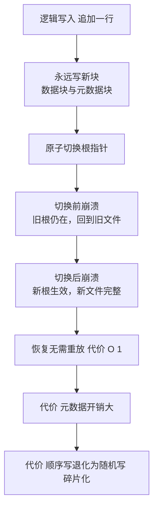
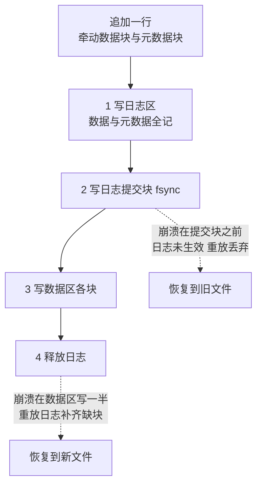

# 崩溃一致性给文件系统补上POSIX未定义部分

POSIX（Portable Operating System Interface，可移植操作系统接口：Unix 类系统的标准行为约定）只定义了正常执行时 write 的语义，**没定义 write 进行到一半断电会发生什么**。要解决的问题：一次逻辑写入牵动多个磁盘块（数据块、元数据块、目录项），崩溃可能停在任何两块之间，留下既不是旧状态也不是新状态的中间态。**崩溃一致性（crash consistency）就是让文件系统在任何崩溃点都能恢复到一个可解释的状态**。

## 崩溃一致性怎么给文件系统补上 POSIX 未定义的部分


来源：[JavaGuide](https://javaguide.cn/high-availability/timeout-and-retry.html)（CC 4.0 BY-SA）

崩溃一致性补的是 POSIX 没定义的那一段——**应用对持久化的预期和文件系统实际给出的保证之间，差着一层语义**。这层差异需要有人翻译：应用说的是「写完要能读到」，文件系统说的是自己的落盘顺序。


问题表（一次"往文件追加一行"牵动的写序）如下：

| 崩溃点 | 已写入磁盘 | 磁盘状态 | 结果 |
| --- | --- | --- | --- |
| 全部之前 | 无 | 旧文件完整 | 丢失追加，可接受 |
| 数据块后、元数据前 | 新数据块 | 新数据指向旧大小 | 空间泄漏（垃圾） |
| 元数据后、数据前 | 新元数据 | 旧大小指向新数据 | 读到垃圾数据，最危险 |
| 全部之后 | 全部 | 新文件完整 | 追加成功 |

两类方案，对照见下图：

| 方案 | 机制 | 代表 | 代价 |
| --- | --- | --- | --- |
| 日志（journaling） | 先把全部写序记录到日志区，再真正写数据 | ext3/ext4（Linux 常用文件系统）、XFS | 日志写一遍数据再写一遍，写入放大两倍（可关闭数据的日志回序） |
| 写时复制（copy-on-write） | 永远写新块，原子切换根指针 | ZFS、Btrfs、APFS | 元数据开销大、随机写变随机读+写、碎片化 |

**权衡：日志方案顺序化写路径、恢复快（重放日志），但 fsync（强制把内核缓冲刷入磁盘的系统调用）成本高；COW（Copy On Write，写时复制：共享到写入那一刻才复制） 方案天然快照（某一时刻的完整只读副本）与校验和（对数据算出的指纹，用来发现传输或存储中的损坏）、崩溃恢复 O(1)，但碎片化与顺序写退化为随机写**。数据库视角看这两类方案：WAL（预写日志，先把改动写进日志再改数据本身）就是应用层的 journaling，见 [[工程知识/数据系统：在并发与故障中保存事实/可靠性与运维/InnoDB用日志连接事务、恢复与复制|InnoDB用日志连接事务、恢复与复制]]。收益：任意崩溃点恢复可解释；代价：写吞吐下降、设计复杂度上升。

日志方案之外的另一条路是写时复制，它的崩溃点只有一个，结局也只有两个：



**两条路的代价落点不同——日志方案落在 fsync，写时复制落在碎片化与随机写**，选型前那道 fsync 千次取均值的测量量的正是前者

**代价的账要落到 fsync 上量**：写 4KB 文件后 fsync，循环一千次取均值，盘的写缓存带电容与否、HDD（机械硬盘）与 SSD（固态硬盘）的量级差异一次测出。**这道测试是选型前的必要动作——写缓存不带电容的盘上，fsync 的语义本身打折，文件系统的日志保证建立在盘会诚实持久化之上**。应用层在文件系统之上重演同一套模式：SQLite（嵌入式单文件数据库）用 rollback journal（journal 文件先写头并同步，再改数据文件——journaling 的微缩版），LevelDB 的 WAL 追加写满后转 SST（Sorted String Table，按 key 排好序后落盘的只读文件）、manifest 记版本切换，提交点等于 manifest 的原子改写，见 [[工程知识/数据系统：在并发与故障中保存事实/事务与存储/LSM树用写放大换取顺序写和可扩展性|LSM树用写放大换取顺序写和可扩展性]]。**文件系统给不了的应用级原子性，应用自己用 fsync 的顺序组出来**，模式与本文的两类方案同构。

**日志方案能在任意崩溃点恢复的关键在提交块这道分界**，写序与两种崩溃结局的对应：



"任意崩溃点可解释"的实现方式：**提交块之前崩溃，日志整体作废，回到旧状态；提交块之后崩溃，重放日志把没写完的块补齐**。问题表里的四个中间态在日志序里都归到这两种结局，没有第三个出口。


来源：[CSDN @bjmayor《图解分布式事务模式》](https://bjmayor.blog.csdn.net/article/details/154004146)（CC 4.0 BY-SA）


来源：[稀土掘金《深度解析 Raft分布式一致性协议》](https://juejin.cn/post/6907151199141625870)（CC 4.0 BY-SA）


## 怎么自己动手验证

```bash
# 观察自己文件系统的行为：查挂载选项
mount | grep -E "ext4|xfs|zfs|btrfs"
# 用 crashmonkey / alice 类的探索性测试框架检测真实文件系统的崩溃一致性
# （crashmonkey: https://github.com/utsaslab/crashmonkey）
# 用 Alice 系论文的方法：模糊文件系统操作序与崩溃点，检查恢复后的不变量
```
预期：**ext4 data=ordered 模式下"数据先于元数据"保证不会读到垃圾数据，但可能出现零填充（null bytes）**——这是 Linux 社区对 "POSIX 未定义" 的实际选择。验证时要对照论文的发现：Alice 论文（FAST'15）系统性检查了 11 个应用在真实文件系统上的崩溃一致性漏洞，包括 SQLite、LevelDB、PostgreSQL（开源关系型数据库），都存在非平凡漏洞。**数字对不上或行为异常时，先查你的盘是否启用回写缓存**（写缓存易失时，盘自身先于文件系统丢失数据，fsync 的语义再次打折）。

## 这套说法在哪儿会失效

本篇讲文件系统层的崩溃一致性，不适用于内存数据结构的崩溃语义——进程被杀时内存状态直接消失，没有"写了一半"的问题，那是另一类持久化设计。伪文件系统与 tmpfs 上的写入不经过磁盘页缓存回写路径，本篇的失效形态在那些场景不会出现。OS 页缓存层的回写决策与 fsync 机制见 [[工程知识/性能工程：从用户等待到资源瓶颈/操作系统与运行时/脏页回写在性能与崩溃丢失窗口间权衡|脏页回写在性能与崩溃丢失窗口间权衡]]，两篇是同一枚硬币的两面：那篇讲"什么时候写"，本篇讲"写了停一半怎么办"。应用层事务怎么用 fsync 组出原子提交，见 [[工程知识/数据系统：在并发与故障中保存事实/可靠性与运维/InnoDB用日志连接事务、恢复与复制|InnoDB用日志连接事务、恢复与复制]]。分布式视角的多数派持久化（Raft 的日志先于提交）见 [[工程知识/后端系统：在并发、失败与变化中维持服务/分布式可靠性/Raft选举与日志复制把共识变成工程实现|Raft选举与日志复制把共识变成工程实现]]。备份与恢复的演练视角见 [[工程知识/数据系统：在并发与故障中保存事实/可靠性与运维/备份的价值由恢复演练来验证|备份的价值由恢复演练来验证]]。

## 接着读哪几篇：应用层的崩溃一致性实现

- [[工程知识/数据系统：在并发与故障中保存事实/可靠性与运维/InnoDB用日志连接事务、恢复与复制]]——应用层的崩溃一致性实现
- [[工程知识/性能工程：从用户等待到资源瓶颈/操作系统与运行时/脏页回写在性能与崩溃丢失窗口间权衡]]——写路径另一半
