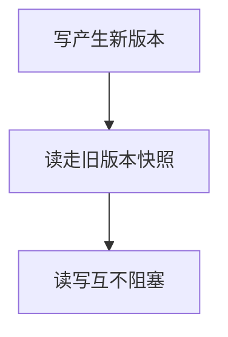
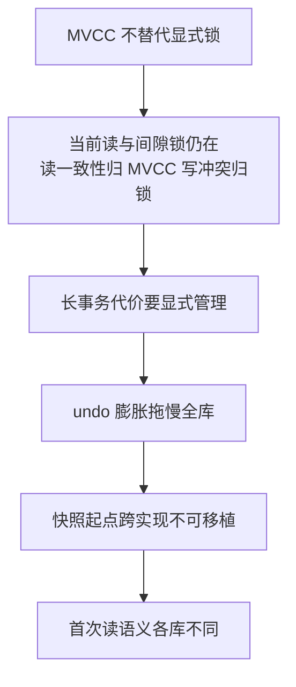

# 快照隔离与MVCC：多版本如何在不阻塞读写的前提下挡住脏读

> **要点**：MVCC 给每行保留多个版本、每个事务按自己的快照选版本，读不阻塞写、写不阻塞读——脏读与不可重复读被快照天然挡住，写倾斜成为快照隔离的残留异常，两层圈定它的适用面。

## 背景与本质：快照隔离怎么从"读写互斥"走到"版本选择"



**多版本让读写各走各的——写创建新的行版本，读按自己的快照挑一个可见版本，两者作用在不同版本上，互斥在多数场景下消失**。


锁方案下，一致性靠**互斥**取得：读锁挡写、写锁挡读，事务串行地观察数据库，正确但并发度低。要解决的问题由此而来：**读多写少的负载被读写互斥拖住，长事务的读会阻塞写，吞吐上不去**——**问题的根源在于一致性被实现成了互斥**。**两阶段锁的读写冲突点在于读操作也要拿锁，长事务的读会拖住写**，本库事务与存储域"事务隔离决定并发读写能观察到什么"从现象层讲过隔离级别（并发事务互相可见程度的分级）的谱系；本篇深入其主流实现机制——**MVCC（多版本并发控制：同一行保留多个版本，每个事务按自己的快照挑版本读） 把一致性从"互斥"改成"版本选择"**：**写操作创建新版本，读操作按事务开始时的快照挑一个可见版本，读与写作用于不同的版本，互斥在多数场景下消失**。

本质可以用一句话收拢：**每个事务看到的是数据库在某一时刻的私有照片**。**照片拍下之后，别人再怎么改数据库，照片不会变——这就是"快照"的语义**。**MVCC 的全部工程问题围绕两个子问题展开：版本怎么存（存储开销与旧版本回收），快照怎么定（可见性判定规则）**。

两大实现的可见性规则不同，行为差异由此而来：InnoDB 的快照在第一条一致性读时建立（REPEATABLE READ），undo log（回滚日志：记录修改前的值、用于回滚与一致性读） 沿版本链回溯；PostgreSQL（开源关系型数据库）的快照在事务第一条查询时建立，旧版本行留在表内，靠 VACUUM（PostgreSQL 回收失效行版本的维护操作）清理。**同一个隔离级别名字下，可见性的精确起点与旧版本的存放位置是两种工程形态**。

## 它是怎么做到的：版本、快照与可见性判定

**版本链**：**每行带创建它的事务 id 与删除标记（或删除版本号）**。**修改一行 = 写一个新版本，旧版本通过回滚（把系统状态退回到改动之前的版本）指针串成链**。**读操作的可见性判定沿链走：从最新版本开始，逐个检查"创建它的事务在我的快照建立时是否已提交"，直到找到第一个可见版本**。**判定规则的三要素——快照建立时机、活跃事务集合、提交状态——决定了读到哪个版本**。

InnoDB 的版本链长这样——最新版本住在聚簇索引（叶子节点直接存放整行数据、表本身就按主键组织）里，历史版本挂在 undo 空间，ROLL_PTR 从新指向旧：


来源：Zhao Song，[MySQL vs PostgreSQL Internals (Part 2) — MVCC](https://kernelmaker.github.io/mysql-vs-pg-mvcc)。**undo record 只存被改列的旧值、不存整行副本，这就是版本存储的"差量"形态**；可见性判定不可见时沿 ROLL_PTR 往旧走，方向与新→旧箭头一致。

PostgreSQL 把新旧版本全放在表内（heap），用 HOT 链与快照配合找可见版本：


来源：同上。与 InnoDB 相反，**PG 的版本链从旧指向新（ctid 方向）、历史版本与最新版本混在同一个 heap 里靠 VACUUM 回收**——同一篇正文说的"同一隔离级别名字下，可见性的精确起点与旧版本的存放位置是两种工程形态"，这两张图就是那两种形态的并排对照。

**快照的建立时机**：**REPEATABLE READ 下快照在整个事务期间不变（InnoDB 首次读时建立，PostgreSQL 首条查询时建立），重复读拿到同一版本，不可重复读（同一事务内两次读同一行，结果不一样）消失**；**READ COMMITTED 下每条语句重新取快照，语句间能看到他人新提交的数据**。**隔离级别的差异在 MVCC 实现里就是快照刷新频率的差异**——**这是"机制层面的统一解释"，比"锁的范围不同"更准确**。

**脏读（读到了别的事务还没提交的修改）为什么天然消失**：**未提交事务写的版本，创建它的事务必然不在任何其他事务的"已提交"集合里，可见性判定直接跳过**——**未提交数据对快照不可见，无需任何额外检查**。**脏读的根因（读到未提交数据）在版本选择这一步就被消除了**。

**幻读（同一查询两次执行读到的行数不一样）的残留形态**：**快照冻结了已有行的可见性，新插入的行对快照而言"不存在"，普通查询不会看到幻影行**；但**当前读**（SELECT ... FOR UPDATE、UPDATE 的 WHERE 扫描）读的是最新版本，新插入的行会进入扫描范围——**InnoDB 用间隙锁（锁住索引记录之间的空隙、阻止插入的锁）把当前读的扫描范围锁住补上这个洞**，**PostgreSQL 的 SERIALIZABLE 用谓词锁的 SSI（Serializable Snapshot Isolation，可串行化快照隔离）实现检测冲突**。**快照隔离默认挡不住写倾斜：两个事务读同一快照、各自更新不相交的行，单独看都合法、合起来破坏不变量**（**值班表例子：两人看到"还有一人值班"各写入自己，结果无人值班**）。

版本链的起点在行结构上：**InnoDB 给每行藏了两个列**——trx_id（事务编号，InnoDB 里每个事务的唯一 ID）记录最后修改它的事务号，roll_pointer（InnoDB 行里的回滚指针，指向上一版本）指向 undo 日志里的上一个版本，**可见性判定沿这两个字段往回走**：


来源：小林coding《事务隔离级别是怎么实现的？》，https://www.xiaolincoding.com/mysql/transaction/mvcc.html。前面正文说的「每行带创建它的事务 id 与删除标记、旧版本通过回滚指针串成链」，这张图就是那两个隐藏列与指针指向 undo 日志的实物形态。

沿版本链往回走时按什么标准停下来，判定器是 ReadView（InnoDB 在查询开始时生成的一份可见性判断记录，含当前活跃事务集合）。小林 coding 的结构图把四个字段与各自的判断依据一一对应——**creator_trx_id（创建该版本的事务编号字段） 管自己的修改（总是可见）**，**m_ids（生成 Read View 时仍在活跃的事务编号列表）管创建时刻还没提交的事务（在列表里就不可见）**，**min_trx_id（活跃事务里最小的事务编号字段） 划出已提交下界（比它小的全部可见）**，**max_trx_id（下一个将分配的事务编号字段） 划出未来上界（不小于它的全部不可见）**：


来源：同上。**版本链图给了「链上有什么」，这张图给「怎么判可见」，两图合起来是快照读可见性判定的完整两半**。


## 读完这一段你能判断什么：什么场景选什么

判断场景选什么，依据有三组：

**读多写少的报表与查询**：**MVCC 收益最大——长查询不阻塞写入，快照一致性免费获得**。**PostgreSQL 的 VACUUM 压力与 InnoDB 的 undo 增长要纳入评估**：**长事务是两种实现的共同天敌**（**旧版本无法回收，存储与回溯成本随长事务时长增长**）。

**写倾斜敏感的业务**：**检查不变量再写入的模式（先查后写）在快照隔离下有竞态（多个执行流争抢资源、结果取决于时序）**——**要么用 SELECT ... FOR UPDATE 显式锁住关键行把读变成当前读，要么上 SERIALIZABLE，要么把不变量改写成单行原子更新**。**判断依据：不变量跨多行时，快照隔离的"先读后写"不安全**。

**隔离级别的选择**：**默认级别（RR 或 RC）之上，需要显式升级的场景是"应用层校验 + 写入"的跨行不变量**；**其余场景按默认走，快照的一致性已经覆盖绝大多数读路径**。**把"显式锁"留给不变量路径，不要全局加锁**。

## 这套说法在哪儿会失效

三条边界各自挡住一种把 MVCC 用过头的理解。



第一条最常被读成"有了 MVCC 就没有锁"：**普通 SELECT 走快照不加锁，但 `SELECT ... FOR UPDATE`、UPDATE、DELETE 仍要加锁**，[数据库MVCC原理是什么](https://www.yisu.com/jc/1087543.html) 把这条归并成一句——**MVCC 解决读一致性，锁解决写冲突**。第二条是代价侧：**长事务会让 undo log 膨胀（InnoDB）或失效元组堆积（PostgreSQL），回收跟不上会拖慢全库**，所以**监控长事务、限制其时长属于治理动作**。

第三条影响的是可移植性——InnoDB 在首次读生成 Read View，PostgreSQL 在首条查询生成，加上 `START TRANSACTION WITH CONSISTENT SNAPSHOT` 的有无，**依赖快照起点的代码跨库迁移时必须按目标库文档核对**。

**MVCC 不替代显式锁**：**当前读、意向锁、间隙锁仍在**——**MVCC 管普通读的一致性，写冲突与范围冲突仍靠锁**，"MVCC 就没有锁了"是误读。

**长事务的代价要显式管理**：**两种堆积都会拖慢全库——监控长事务并在治理上限制其时长，VACUUM/undo 回收策略按写入量调参**。

**快照的"起点"跨实现不可移植**：**InnoDB 首次读与 PostgreSQL 首条查询的语义差异、START TRANSACTION WITH CONSISTENT SNAPSHOT 的存在与否**——**依赖快照起点的代码要按目标库的文档核对**，**跨库迁移按能力清单逐项核对**（本库数据系统域"数据组件的迁移清单"）。

## 怎么自己动手验证

可复现的验证路径：

1. 不可重复读验证：开 RR 事务读一行 → 另一连接更新并提交 → 事务内重读，预期读到旧值（快照生效）；换 READ COMMITTED 重跑，预期读到新值——**两级对照确认快照刷新频率的差异**；
2. 脏读不可见验证：事务 A 写未提交 → 事务 B 读，**预期读不到 A 的数据（版本判定跳过未提交版本）**；
3. 写倾斜验证：构造"先查后写"跨行不变量（值班表），两个并发事务各自读同一快照后写入，**预期在 RR 下不变量被破坏——确认残留异常的真实性，再验证 FOR UPDATE 修复**；
4. 断言锚点：**验证以预期与实际的对照为判据**（重读结果与快照语义对得上、写倾斜确实可复现、修复后不变量保持），**对不上时按可见性判定规则回查快照起点与隔离级别设置**。

```text
RR 断言 = 重读旧值成立
RC 断言 = 重读新值成立
写倾斜断言 = RR 下可复现，FOR UPDATE 后不可复现
```

**MVCC 的价值在"读写互不阻塞下的一致性"，代价在版本存储与残留异常**——**快照语义 + 判定规则 + 写倾斜边界三件事在握，隔离级别的选择从背表格变成推机制**。

## 接着读哪几篇：现象层：隔离级别的谱系与用户可见行为

- [[工程知识/数据系统：在并发与故障中保存事实/事务与存储/事务隔离决定并发读写能观察到什么]] —— 现象层：隔离级别的谱系与用户可见行为，本篇是它的机制实现层
- [[工程知识/数据系统：在并发与故障中保存事实/事务与存储/SQLite与MySQL代表不同的并发与运维边界]] —— 不同实现（SQLite 的库级写锁 vs MySQL 的行级 MVCC）的边界对照
- [[工程知识/数据系统：在并发与故障中保存事实/数据治理/数据组件的迁移清单：能力等价按逐项核对建立，不按名称对应]] —— 快照起点差异进迁移清单的核对项示例
- [[工程知识/后端系统：在并发、失败与变化中维持服务/任务与并发/幂等性的完整谱系：从操作语义到删除接口的天然陷阱]] —— 写倾斜防御中"先读后写"模式的姊妹纪律
