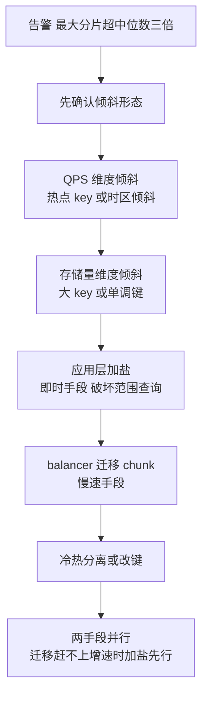
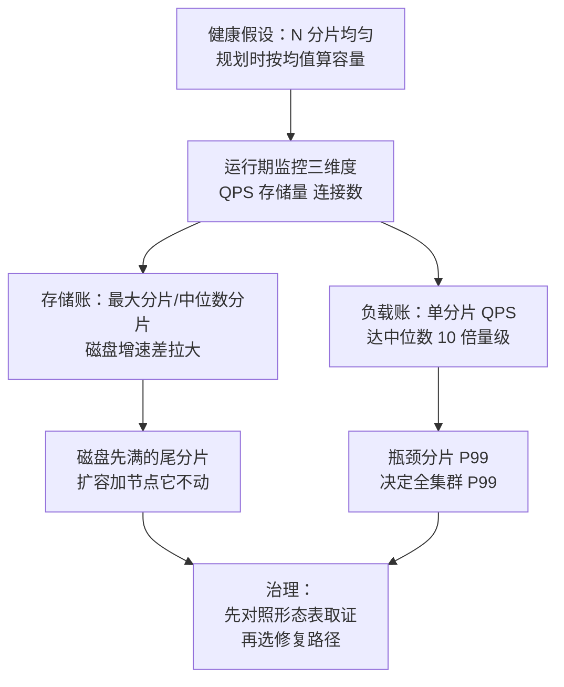

# 数据分布不均是分片集群的第一大故障源

分片集群上线时按容量规划了 N 个分片（把数据或负载按规则切分到多个节点的方法），**三个月后 80% 流量打在一个分片上**：热点（访问集中在少数键或节点上的现象） key、单调递增的分片键、时区性的访问模式，**都会把"均匀分布"的假设打破**。可以把它想成收银台前排队：没人规定顾客必须平均分散，只要有一列队伍短就会有人站过去。这个比方到「人会往短队走」为止，**分片键是写死的，数据并不会自己挪到空闲分片**。要解决的问题：**把数据倾斜（skew）当作分片集群的第一故障源来对待，识别它的形态、检测它的信号、给出修复与预防路径**。

## 数据倾斜有哪些形态，检测信号是什么

倾斜的一种典型形态是按属性分片且属性值本身分布不均：**某个取值的数据量远大于其他取值，对应的分片就成了热点**。按地区分片时这个现象尤其常见。


| 倾斜形态 | 成因 | 检测信号 | 修复路径 |
| --- | --- | --- | --- |
| 热点 key 倾斜 | 少量 key 承载高频访问（明星商品、大 V） | 单分片 QPS/其它分片均值 > 10x | 应用层散列加盐（salt 前缀） |
| 单调键倾斜 | 分片键单调递增（时间戳、自增 ID） | 写入永远集中在尾分片 | 键加散列前缀、范围分片改哈希分片 |
| 大 key 倾斜 | 单 key 数据量超大（百万级 hash field） | 单分片存储量/均值 > 10x | 分开 key、冷热分离（不常访问的数据移到慢存储、热数据留在快存储） |
| 时区倾斜 | 用户地理分布不均 | 分片 QPS 的昼夜周期与地理分布相关 | 按地理域分组再分片 |

检测纪律：**监控每个分片的 QPS（每秒查询数，系统每秒处理的请求量）、存储量、连接数三个维度（任一维度倾斜都算），设告警阈值为"最大分片/中位数分片 > 3x"——比均值更抗大 key 干扰**。收益是**早发现早散列**；代价是**散列加盐破坏了 key 的可读性与范围查询能力**，**加盐前先确认访问模式真的没有范围需求**。Kafka（分布式消息队列，靠日志追加支撑高吞吐订阅）的分区设计文档与 MongoDB balancer 文档（MongoDB：文档型数据库；balancer 是其分片数据均衡组件）分别给出了流式与文档型两种系统的一手设计依据。

哈希（把任意长度数据压成固定长度指纹、不可逆）分片之所以是「范围分片改哈希分片」这条修复路径的目标形态，看路由过程就清楚——分片键经哈希函数直接决定数据落在哪个分片，键值不再有单调聚集的机会：


*图源：Microsoft Learn 云设计模式 Sharding pattern，CC BY 4.0，https://learn.microsoft.com/en-us/azure/architecture/patterns/sharding。图上哈希值把相邻的键打散到相距很远的分片：单调递增的键（自增 ID、时间戳）经哈希后不再挤在尾部分片，这正是单调键倾斜的预防机制；代价是哈希切断了键值的范围关系，范围查询要扫全部分片。*

## 真实案例给的是什么数：分布不均的实录

分布不均的两本账——**存储不均（一个分片占比超过检测阈值的量级时，扩容加节点它不动，写入热点使它的磁盘先满）；负载不均：明星用户所在分片 QPS 达到中位数分片的告警阈值以上时，其他分片空闲，瓶颈分片的 P99（99% 的请求耗时不超过这个值） 决定全集群的 P99**。热点键（被高频访问的少数键、聚集成局部瓶颈）的典型来源：**时间戳当分片键首列（所有写入永远集中在最后一个分片，顺序写热点）、大客户 ID（单一租户占大头流量）**。

告警之后先取证还是先动手，决定了**加盐这类破坏范围查询的手段会不会用错场景：**



顺序颠倒的代价是**把加盐用到本该冷热分离的场景**；而**即时手段与慢速手段是并行关系，热点增速超过迁移速度时先加盐**。

治理的时序有一道先后判断：**检测告警触发后，先确认倾斜形态（对照机制节形态表取证：QPS 维度看热点 key 与时区、存储量维度看大 key 与单调键），再选修复路径——顺序颠倒会把散列加盐这类破坏范围查询的手段用到本来该冷热分离的场景**。修复动作生效前有窗口期：**balancer 迁移 chunk 的速度赶不上倾斜增长速度时（热点直播的写入增速分钟级），应用层加盐是即时手段，迁移是慢速手段，两者在治理路径上并行而非互斥**。案例回流的实录：[[工程知识/数据系统：在并发与故障中保存事实/事务与存储/分片键设计以查询与均衡为双重约束.md]] 是本篇的姊妹篇——**分片键的选型决策决定不均是否发生，本篇讲不均发生后的识别与处置**（监控按分片看写入 QPS 与磁盘增速，尾部离散度超告警阈值即触发）；[[工程知识/缺陷分析：从个案到体系/资源与容量/案例六：容量与泄漏——连接泄漏和 SST 堆积]] 的容量假设失效实录里，**分片不均是"按节点数算容量却算不准"的直接原因——均值没有意义，尾部分片才是容量真相**。

同一集群的两本账各自压垮不同的分片，**告警阈值分别盯住各自的口径**：



图："第一故障源"的构成——**容量规划按均值假设，故障按尾部发生——存储账压垮磁盘、负载账压垮延迟，两本账在监控上分别对账，任一本超阈都触发治理流程**。


来源：[博客园《解密 Raft算法》](https://www.cnblogs.com/traditional/p/12588733.html)（CC 4.0 BY-SA）


来源：[腾讯云开发者社区《Redis系列：Redis主从、哨兵、集群介绍》](https://cloud.tencent.com/developer/article/2183910)（CC 4.0 BY-SA）


## 怎么自己动手验证

```bash
# 对自己的分片集群跑分布体检
redis-cli --cluster info / CLUSTER SLOTS | 检查 slot 分布
# MongoDB: 每分片 chunk 数与数据量
sh.status(); db.collection.getShardDistribution()
# Kafka: 分区消息速率
kafka-consumer-groups.sh --describe --group g
```
预期：**健康集群最大分片/中位数分片比值在 1.5x 以内；超出即触发治理流程**。数字对不上预期（某分片持续超阈）时，**先查分片键的写入模式（单调性、热点集中度），再查是否迁移速度跟不上倾斜速度（balancer 滞后也是一类故障）**。

## 这套说法在哪儿会失效

本篇讲分布不均的故障形态与治理，**不适用于单机部署与副本数等于节点数的全镜像集群——没有分片就没有分布不均的问题，单机的瓶颈在资源容量而不是槽位归属**。分片键选得极差导致数据无法再平衡时（例如按自增主键分片且写入恒定集中在最后一个分片），**本篇的治理手段（再平衡、热点迁移）治标不治本，要回到分片键重选**。分片键的选型方法论（查询局部性与均衡的权衡）见 [[工程知识/数据系统：在并发与故障中保存事实/事务与存储/分片键设计以查询与均衡为双重约束|分片键设计以查询与均衡为双重约束]]。再平衡时怎么把移动量压到平均槽位见 [[工程知识/数据系统：在并发与故障中保存事实/事务与存储/一致性哈希把再平衡的数据移动量压到平均槽位|一致性哈希把再平衡的数据移动量压到平均槽位]]。热点在缓存层的对应形态与防御见 [[工程知识/后端系统：在并发、失败与变化中维持服务/服务设计/缓存穿透击穿与雪崩是三种不同的失效模式|缓存穿透击穿与雪崩]]。缓存的读写路径与一致性代价见 [[工程知识/后端系统：在并发、失败与变化中维持服务/服务设计/缓存改变读写路径、一致性与故障模式|缓存改变读写路径、一致性与故障模式]]。

## 接着读哪几篇：再平衡的移动量控制

- [[工程知识/数据系统：在并发与故障中保存事实/事务与存储/分片键设计以查询与均衡为双重约束]]——倾斜的源头预防
- [[工程知识/数据系统：在并发与故障中保存事实/事务与存储/一致性哈希把再平衡的数据移动量压到平均槽位]]——再平衡的移动量控制
- [[工程知识/数据系统：在并发与故障中保存事实/可靠性与运维/热点副本与流量倾斜：读写热点要按分片维度分开治理]]——倾斜的治理端：两种形态的诊断信号与手段选择树
