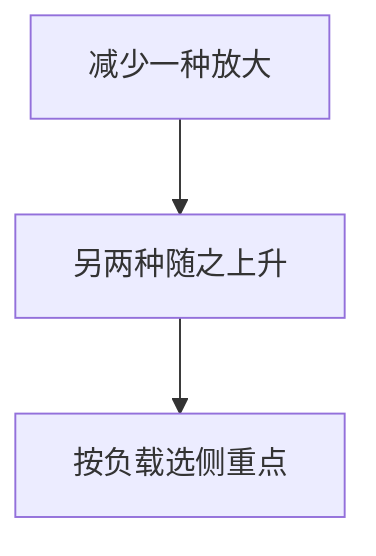

# 读写三放大是存储引擎的中央权衡

**存储引擎的选型争论，剥掉名词后都是三个数字的权衡：写放大（写 1 字节实际写入磁盘多少字节）、读放大（读 1 次逻辑读实际做几次物理读）、空间放大（存 1 字节逻辑数据实际占多少空间）**。要解决的问题：**三者构成不可能三角——压低任何一个必然抬高另外两个；不看三放大的存储选型，等于只看一个基准数字做决策**。

## 三放大各自从哪来



三种放大此消彼长：


| 放大 | B+Tree 的来源 | LSM（Log-Structured Merge，先把写入攒在内存里、再按批顺序落盘的存储结构） 的来源 |
| --- | --- | --- |
| 写放大 | 页内原地更新 + WAL（Write-Ahead Log，预写日志：先把要做的改动记下来，再真正改数据） | memtable 多层 compaction 合并 |
| 读放大 | 树高（3-4 次页读） | 多层 SSTable 探测 + Bloom 滤波 |
| 空间放大 | 页碎片 + 预留空页 | 旧版本 + tombstone 等待 compaction |

表里的 LSM 词汇：memtable 是内存里的写缓冲，写满后整体落盘成一个 SSTable（有序的只读文件）；compaction 是后台把多个 SSTable 合并重写、丢掉旧版本的过程；tombstone 是删除标记，要等 compaction 才真正腾出空间；Bloom 滤波器用一点内存回答"这个键肯定不在这个文件里"，省掉大部分无效探测。

**LSM 用写放大与空间放大换写吞吐（顺序写）：代价是读路径变贵（层层数）、后台 compaction 与前台争 I/O。B+Tree 用读友好换写代价（每次更新整页写回）**。这是 [[工程知识/数据系统：在并发与故障中保存事实/事务与存储/LSM树用写放大换取顺序写和可扩展性]] 的机制层面展开，也是所有"XX 引擎比 YY 快"论战的还原终点。

## 为什么度量先于选型

**三放大不是常数，随工作负载漂移：读多写少时 LSM 的空间放大恶化（compaction 变少）；写多读少时 B+Tree 的页内更新热点（访问集中在少数键或节点上的现象）恶化**。**选型前用真实负载画像回答：读写比、key 分布（单调/均匀/热点）、value 大小分布、删除比例**。画像方法与 [[工程知识/数据系统：在并发与故障中保存事实/可靠性与运维/数据库基准必须描述负载与资源边界]] 一致。


来源：[腾讯云开发者社区《一篇文章讲透MySQL为什么要用B+树实现索引》](https://cloud.tencent.com/developer/article/1543335)（CC 4.0 BY-SA）


来源：[腾讯云开发者社区《消息队列：听我解释，我真的不是只有Kafka！》](https://cloud.tencent.com.cn/developer/article/1866156)（CC 4.0 BY-SA）


## 推演账：同一份数据在两类引擎里各放大多少

一个 KV（Key-Value，注意力机制里缓存的键值对）工作负载（80 读 20 写），B+ 树（一种多叉有序树索引，数据全在叶子层，范围查询沿叶子链表走）与 LSM 各算各的账，数字按结构推导，落到具体引擎要实测：

```text
数据：1 亿条 × 1KB，B+ 树（InnoDB 类）：
  写放大：随机写 → 页分裂 → 一次写变 2-4 次页写（+redo log）
  读放大：树高 3-4 层 → 3-4 次 IO（缓存热时 1 次）
  空间放大：页填充率 70-85% → 约 1.2 倍

LSM：
  写放大：每下推一层约重写 T 倍，再加 L0 与 WAL
          → 十倍量级到几十倍，具体随层数与 T 变
  读放大：memtable + 每层各探一个 SST（Bloom 全命中时）≈ 5 次探测
  空间放大：compaction 期间新旧数据共存，约 1.5-2 倍

同一负载的读延迟对账：B+ 树 P99 稳（路径固定），
LSM P99 有毛刺（compaction 峰值时段读被抢 IO）——毛刺是写放大的时间侧形态
```

写放大在结构上的来源就在这张布局图里：L0 的文件键范围相互重叠，L1 以下每层内部不再重叠，向下合并时同一份数据被重新写一遍，层数越多重写次数越多。图取自 [RocksDB 官方 wiki「Leveled Compaction」](https://github.com/facebook/rocksdb/wiki/Leveled-Compaction)，Apache 2.0。

写入与合并的完整流向（内存中的写缓冲落盘成有序文件，再由后台逐层合并）是这种结构的全貌：


*图示：LSM 树的分层结构与后台合并。图源：Wikimedia Commons《LSM Tree.png》，作者 Ben Stopford，CC BY-SA 4.0，https://commons.wikimedia.org/wiki/File:LSM_Tree.png。*
图取自 [Wikimedia Commons: LSM Tree](https://commons.wikimedia.org/wiki/File:LSM_Tree.png)，作者 Ben Stopford（[原文](http://www.benstopford.com/2015/02/14/log-structured-merge-trees/)），许可 CC BY-SA 4.0。读路径要穿过这些层，读放大因此随层数增长；写路径只追加不改写，写吞吐因此高于 B+ 树。

**三放大属于同一笔账的三种记法——LSM 一侧记的是读放大与毛刺、换来写吞吐，B+ 树一侧记的是写放大、换来读延迟稳定。选型先测负载里哪个放大最贵**。

## 这些量在什么数量级

**点查密集（缓存类）B+ 树胜，顺序写密集（日志、时序）LSM 胜；空间放大乘以 1.5 到 2 的系数意味着同样 1TB 数据 LSM 要备到 2TB 盘——容量规划的乘数不能漏**。**compaction 的预算账：后台写带宽 = 写放大倍数 × 前台写入**。

**写放大 10、前台持续写入 100MB/s，后台就要约 1GB/s 的盘带宽；盘配小了 compaction 追不上写入，写入被限速（stall），这是"写得好好的突然卡住"的标准病因**，[[工程知识/缺陷分析：从个案到体系/资源与容量/案例六：容量与泄漏——连接泄漏和 SST 堆积]] 里 SST（Sorted String Table，按 key 排好序后落盘的只读文件） 堆积的形态就是它。

## 怎么自己动手验证

- **三放大倍数要与工具输出对账：预期实际写入字节 / 逻辑写入字节落在推演账的区间里，比值突增而负载没变，说明负载画像已经漂移**。RocksDB 用 `db_bench --statistics` 或运行时 `rocksdb.stats` 拿到实际写入字节、逻辑写、读次数与磁盘占用。
- **compaction 监控作为写放大的运行时代理：compaction I/O 字节 / 前台写入字节的比值趋势，突增意味着负载漂移**。
- **空间放大用对账验证：逻辑数据量与磁盘用量之差即碎片（存储空间里零散不连续的小块） + 旧版本 + tombstone，趋势恶化触发 compaction 调参或归档**。

## 这套说法在哪儿会失效

- **三放大是引擎层视角，数据库整体视角还要叠加复制放大（每个写要复制 R 份）与 [[工程知识/数据系统：在并发与故障中保存事实/数据管道与流处理/物化视图把重复计算变成增量维护]] 的视图维护放大**。
- **SSD（固态硬盘）的写放大还有介质层（FTL，Flash Translation Layer，闪存转换层：把逻辑地址映射到物理闪存位置的垃圾回收与磨损均衡），与引擎层叠加，全链路写放大 = 引擎 × 介质；介质层无法被引擎消除，只能减少写入总量**。
- **三放大无法同时压低的证明属于理论层，工程实践的自由度是调平衡点（compaction 策略、Bloom 误报率、页填充率），三角本身打不破**。

## 接着读哪几篇：讲介质层的先擦后写约束如何叠加在软件层放大之上

- [[工程知识/数据系统：在并发与故障中保存事实/事务与存储/LSM树用写放大换取顺序写和可扩展性]]：LSM 侧的机制专篇，本文横向比较
- [[工程知识/数据系统：在并发与故障中保存事实/查询与索引/B+Tree索引为访问路径服务]]：B+Tree 侧的机制专篇
- [[工程知识/数据系统：在并发与故障中保存事实/查询与索引/一条SQL如何穿过优化器与存储引擎]]：三放大之上的查询路径全貌
- [[工程知识/性能工程：从用户等待到资源瓶颈/存储与网络/SSD的写放大来自介质要先擦后写|SSD的写放大来自介质要先擦后写]]——讲介质层的先擦后写约束如何叠加在软件层放大之上，是三放大在硬件层的根
