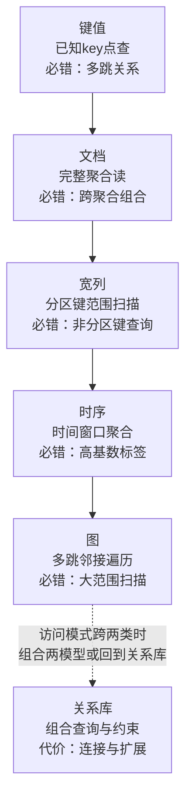

# 非关系数据库按访问模式选择数据模型

**键值、文档、宽列、图和时序系统同样有 schema，只是把 schema、查询、扩展和一致性边界放在了不同位置**。选型从访问模式、数据关系、更新、事务、规模和运维能力出发，**产品标签推导不出设计**。读完你能按自己的访问模式在键值、文档、宽列、图和时序之间做出选择，并说清放弃了什么。

同一份用户资料，如果主要按完整用户读取，文档模型可能减少连接；如果需要按多种关系、多租户条件和事务约束查询，反规范化的同步成本可能超过收益。**模型选择是在访问路径和一致性成本之间做交换，不是把 SQL 换成另一种语法**。

## 要解决的问题：几类模型各自把结构约束与查询能力放在哪些位置

选型之前先弄清数据怎么走：读写发生在什么位置、按什么键访问、跨不跨实体。五类模型的差别在「结构约束放在哪一层」，逐个看下面几节的具体形态。

键值、文档、宽列、图与时序系统常被当作没有结构约束的存储，按产品标签选定之后发现查询模式与数据关系无法支持。本篇回答：几类模型各自把结构约束与查询能力放在什么位置、访问模式与数据关系的哪些特征决定模型选择、一致性与扩展能力各自的边界在哪里，以及选型应当从哪些条件出发。

## 它到底怎么做到的：本质是什么

非关系数据库的机制层：**数据模型把结构约束放在写入侧还是读取侧，决定了哪些查询能在存储层完成、哪些必须由应用自行维护**。**访问模式在选型之前就已经存在**，跨分区查询、多文档事务与关系遍历的成本由模型与分区键共同决定；选定的模型决定了**后续哪些需求无法通过扩容解决**。

文档模型一方的官方选型指南是 MongoDB（文档型数据库）的 Data Modeling 章：开篇即「data that's accessed together should be stored together」——按访问路径组织数据，内嵌还是引用由读写形态决定。它把「模型跟着访问模式走」从口号写成了官方设计流程：

*图源：[MongoDB 官方文档 — Data Modeling](https://www.mongodb.com/docs/manual/data-modeling/)（页面截图，2026-09-27）。文档模型「减少连接」的前提就是这条内嵌判据；同一个访问模式换成多条件组合查询，官方同样文档化的 Schema Design Anti-Patterns 一节就是它的反面清单。*

## 最小选型实验怎么做

用脱敏（遮盖敏感字段的部分内容、保留可辨识形态）的真实查询分布建立 key-value、文档或关系模型的对照：固定数据量、热点（访问集中在少数键或节点上的现象）比例、更新/读取比和故障预算，记录 p95/p99、跨分区请求、重复写、空间、备份恢复和开发复杂度。主要访问路径和失败语义两项都通过，模型才有资格写入架构决策。

## 有哪些常见取舍

| 模型 | 擅长 | 代价 |
| --- | --- | --- |
| key-value | 已知 key 的低延迟读写 | 复杂查询和关系需要应用维护 |
| document | 聚合读取、局部嵌套变化 | 跨文档事务、重复数据和查询组合 |
| wide-column | 大规模分区读写、时间/键范围 | 查询必须围绕分区键建模 |
| graph | 多跳关系和邻接遍历 | 写入、分片、全局分析和运维复杂 |
| time-series | 时间窗口、压缩和保留策略 | 高基数标签、更新和跨域关联 |

反规范化是以写放大、同步和一致性换取读取路径；最终一致性（不承诺实时一致、但保证停止写入后副本终将一致）、冲突解决、TTL（Time To Live，数据的存活时间，到期作废）、（存活时间，到期后数据可被自动删除）分区和重平衡（成员增减时把分区重新分配给消费者的过程）必须写进业务语义。NoSQL 不能自动替代事务、约束、备份和审计。

访问模式落到五类模型上各自有一个"必须命中"的形态与一个"必错"的形态：按完整聚合读（用户资料、商品详情）命中文档模型，跨聚合多条件组合查询用它就要靠应用拼；已知 key 的低延迟读写（会话、缓存、去重表）命中键值模型，**多跳关系遍历用它等于把邻接表搬进应用**；时间窗口聚合（指标、日志、行情）命中时序模型，**高基数标签直接吃掉它的压缩优势**；多跳关系查询（风控、社交、权限继承）命中图模型，**用关系库做要写多层自连接**；大范围分区扫描（feed 流、消息队列）命中宽列模型，**按非分区键查询退化为全分区扇出**（一个请求分发给多个下游并行处理）。**两类形态对上，选型实验只剩验证；对不上，换模型的成本与访问模式错配的缺陷实录（案例六的 SST（Sorted String Table，按 key 排好序后落盘的只读文件）堆积）之间没有第三条路**。

这张谱系图把五类模型在访问模式轴上的位置与必错形态画在一起：

"按访问模式选"的判定顺序：**先写下自己的读写形态，在谱系上找到命中的那一档，再看必错形态是否撞上自己的次要需求——次要需求撞必错形态时，谱系尽头的关系库与双模型组合是两条出路**。

「字盘按取字路径排布」的实物原型是印刷作坊的字架：按韵排的字盘服务"按音取字"（键值点查），按经史分架的书柜服务"整部取书"（聚合读取），活字与整版各供各的路径——用整版书架应付"按音点查"，每一次都要翻遍全架：

*图源：Wikimedia Commons，作者 Popolon，CC BY-SA 4.0，https://commons.wikimedia.org/wiki/File:Beijing_printing_museum.wooden_movable_types.jpg。*

五类模型就是五种字盘排法：键值是按韵的字盘（点查最快，多跳遍历要翻遍全盘）、文档是整架的经史（整部取书快，跨架组合要人跑腿）、宽列是按卷次的排架（范围扫快，跨卷乱查退化全扫）、图是按人物关系编的索引卡（顺藤摸瓜快，全局统计慢）、时序是按日记事的流水格（窗口聚合快，高基数标签挤爆格子）——**访问模式先于字盘存在，字盘照路径摆**。

## 真实案例里发生了什么：访问模式错配的缺陷实录

选型错误在缺陷域有直接对应物：[[工程知识/缺陷分析：从个案到体系/资源与容量/案例六：容量与泄漏——连接泄漏和 SST 堆积]] 里的 SST 堆积，正是"写多读少的 LSM（Log-Structured Merge，先把写入追加成日志再后台合并成有序文件的存储结构） 类存储被当成了高频点查缓存"的访问模式错配——LSM 的读路径要逐层查，点查密集时读放大（一次逻辑读触发多倍实际读取）失控。同类错配还有：把宽列存当强事务账本用（隔离语义对不上）、把文档库的多文档事务当跨实体一致性用。选型实验跑的每个访问模式，都应该对着缺陷案例里的失败形态过一遍。

这些量在什么数量级：读放大的账

**LSM 类存储的点查成本 = memtable + 每层一个 SST，层数 L 的读放大约 L 次 IO**；

这个公式背后的存储布局是可以画出来的：写入先进内存表，写满后整批刷成 L0 的 SST 文件，后台合并逐层向下压——每一层内部的文件按键值范围排列，L0 的文件范围相互重叠，L1 以下每层内部不再重叠。点查要逐层下探，正是由这个结构决定的。

*图源：Wikimedia Commons《LSM tree》，作者 Qwertyus，许可 [CC BY-SA 4.0](https://commons.wikimedia.org/wiki/File:LSM_tree.svg)。 memtable + L0 + L1 + … + Lk 就是公式里"层数 L 次 IO"的实物形态：层数越多、写放大（实际写入量是逻辑写入量的多倍）越低、点查路径越长——同一组权衡在两个方向上各收一次。*

## 怎么自己动手验证

数据模型要与访问模式对账——**预写按真实键分布与热点压测出的延迟与空间占用，用均匀分布假设推出的结论与预期对不上**。

用真实 key/查询分布、热点、跨分区、重复/乱序、节点丢失、迁移和过期数据压测；比较一致性、p99、吞吐、空间、备份恢复和开发/值班成本。对 AI 记忆、检索缓存和向量元数据额外测租户/ACL（访问控制列表：一条条写明"谁对什么能做什么"的权限表）隔离。

关系：[[工程知识/数据系统：在并发与故障中保存事实/数据系统：在并发与故障中保存事实]] · [[工程知识/后端系统：在并发、失败与变化中维持服务/分布式可靠性/复制分片与再平衡改变数据归属]]

