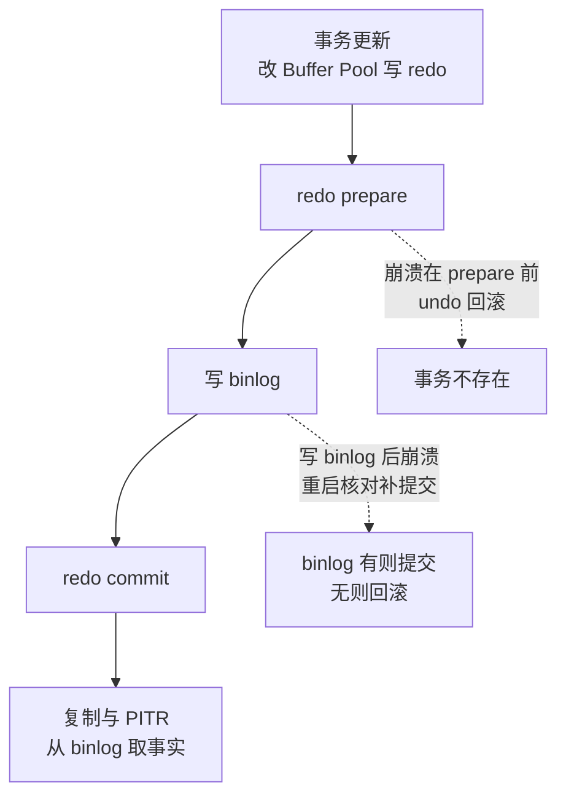
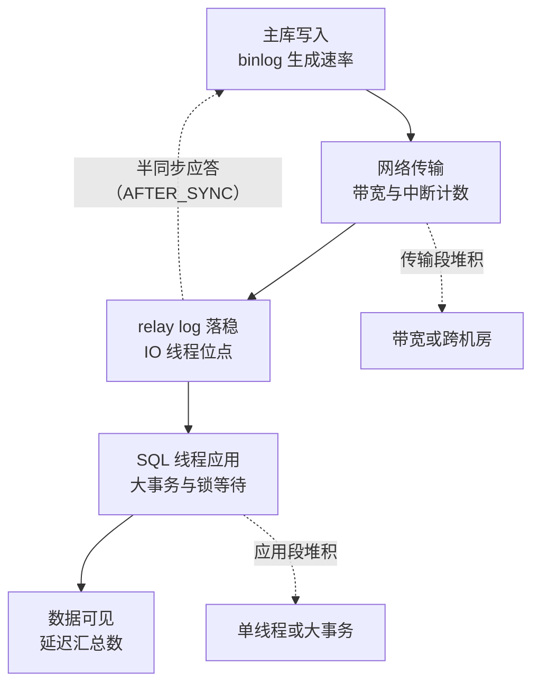

# InnoDB 用日志连接事务、恢复与复制

## 要解决的问题：几种日志各自负责哪一段

**事务的提交、崩溃之后的恢复与副本之间的数据同步看起来是三件独立的事，各自的配置也分散在不同参数里，出问题时无法判断日志之间的衔接在哪一步断开**。本篇回答：几种日志各自负责哪一段、它们之间怎样互相依赖、哪一类日志不能替代另一类的作用，以及恢复与复制分别从哪个位置接续。

## 机制与本质：三类日志各自解决哪些问题

**日志把随机的数据页写回变成顺序的追加，崩溃后重放与撤销各自需要一个明确的起点，这个起点由检查点（checkpoint，记录"此前的修改都已落到数据页"的日志位置）决定**。三类日志分工如下：

| 日志 | 主要职责 | 不能替代 |
| --- | --- | --- |
| `redo log` | 预写日志；崩溃后把已提交修改重做到数据页 | 逻辑审计、跨库复制 |
| `undo log` | 回滚、多版本并发控制（MVCC：同一行保留多个版本，每个事务按自己的快照挑版本读）的旧版本和一致性读 | 崩溃后的完整备份 |
| `binlog` | Server 层逻辑变更记录；复制、时间点恢复、审计 | 代替 redo 的页级恢复 |

**「日志把随机的数据页写回变成顺序的追加」这条主干，小林 coding 的中文图给了完整的路径形态——server 层执行 SQL，数据页加载进 Buffer Pool、原地更新成脏页，修改先记进 redo log（InnoDB 重做日志：记录物理修改、崩溃后重放保证持久性） 文件（追加写），脏页由后台线程定期刷回磁盘文件**。**先记日志再刷数据页的顺序，就是 WAL（Write-Ahead Log，预写日志：先把要做的改动记下来，再真正改数据）的全部：崩溃后 redo 重放把提交过的修改补回来，脏页刷没刷完都不怕**：


*图源：[小林 coding《MySQL 日志：一条 SQL 更新语句是如何执行的》](https://www.xiaolincoding.com/mysql/log/how_update.html)，原创图注明出处转载。*

三份日志在提交时刻由两阶段提交协调，衔接的形状见下图：



**提交时刻必须有协调者，因为 redo 与 binlog（MySQL 服务层日志：记录逻辑变更、用于主从复制与恢复） 分属引擎层与 Server 层，各写各的**。**崩溃恢复要判定「这个事务到底算不算提交」，唯一依据是两阶段提交留下的衔接状态：prepare 前崩（undo 回滚，事务不存在）、prepare 后崩（重启核对 binlog，有则提交、无则回滚）、commit 后崩（已提交），三种时刻的结局各不相同**。图上两条虚线的起点画在 prepare 与写 binlog 两个节点上，表示崩溃时刻在这两个节点之后、下一个节点之前；prepare 之后 binlog 未写完就崩，与写完 binlog 之后崩，走的都是「核对 binlog 有无再决定提交还是回滚」这一条、写完 binlog 后崩、commit 后崩，三种时刻的结局各不相同（回滚、核对后补提交、已提交）。**复制与 PITR（Point-In-Time Recovery，按时间点恢复：恢复到事故发生前的任一时刻） 不读 redo，事实来源统一在 binlog，这是「逻辑复制不绑引擎页格式」的代价与自由**。

**更新通常先改 Buffer Pool（InnoDB 在内存里缓存的数据页）、写 redo；提交时通过两阶段提交协调 redo 和 binlog，避免「binlog 有记录但 InnoDB 未提交」或反过来的不一致**。**`binlog_format=ROW` 通常比 statement 更适合可靠复制和按行恢复，但要结合版本、工具和合规要求验证**。

**两份记录必须在同一时刻给出同一个结论**，穿孔纸带是实物原型：早期计算机的程序与数据打在一条纸带上，要复制一份就得用复孔机重打一条——复孔机逐列读原带、逐列打新带，打完还要经校孔机双重读两盘带逐孔核对，两盘带在任何一个孔位上不一致，复制作废重来。这个比方到「两边必须逐位一致」为止——复孔机复制的是静态纸带，两阶段提交复制的是还在被写入的日志，后者多出来的那一层是崩溃时谁来裁定。**两阶段提交里 redo 与 binlog 的关系与此相同：prepare 阶段相当于原带打完待核，binlog 写完相当于校孔通过，commit 才是两条纸带同时登记入册——入册前任何一步中断，这次复制都不能算数**。


*图源：Wikimedia Commons，Friedrich Haag，CC BY-SA 4.0，https://commons.wikimedia.org/wiki/File:2013_07_16_120_Lochstreifen.jpg。*

两个日志文件在同一时刻必须给出同一个结论，靠的是提交前先问一圈、全部答应了才落最终决定：


来源：[腾讯云开发者社区《一篇文章讲透MySQL为什么要用B+树实现索引》](https://cloud.tencent.com/developer/article/1543335)（CC 4.0 BY-SA）


来源：[腾讯云开发者社区《Redis系列：Redis主从、哨兵、集群介绍》](https://cloud.tencent.com/developer/article/2183910)（CC 4.0 BY-SA）


## 持久性和抖动怎么权衡

**`innodb_flush_log_at_trx_commit=1` 与 `sync_binlog=1` 常被称为「双 1」，可提供更强的提交持久性，代价是更多刷盘**。**具体取值必须根据 RPO（Recovery Point Objective，恢复点目标：最多丢多少数据）——recovery point objective、容灾指标，故障时最多允许丢多少数据——以及磁盘能力和复制架构决定，不能把参数名当作绝对保证**。

平时更新快、偶尔整体变慢，常见原因是**刷脏页：redo 写满、Buffer Pool 淘汰脏页、后台空闲刷盘（把内存中暂存的数据写入磁盘持久化）或正常关闭**。**重点观察 redo 使用率、checkpoint age、脏页比例、I/O 延迟和 `innodb_io_capacity` 是否与真实磁盘能力匹配。redo 太小会造成写入堵塞，参数过大则增加崩溃恢复时间和空间占用**。

## 复制、高可用与读写分离是怎么支持的

**PITR 是 Point-In-Time Recovery 的缩写，指把数据恢复到过去某一个具体时刻的能力，靠全量备份加上备份之后的 binlog 重放实现**。


**复制链路至少要监控五段：主库写入、日志生成、网络传输、从库 relay log（从库把收到的 binlog 先落成的本地中转日志）落稳和 SQL 线程应用**。**延迟可能来自大事务、单线程应用、热点（访问集中在少数键或节点上的现象）锁、磁盘或网络；`Seconds_Behind_Master` 只反映末端汇总，三个不同病因共用一个表象**。

**五段在运行时各有一个能直接问的观测点：主库侧 `SHOW MASTER STATUS` 给出 binlog 文件与位点（消费进度的记账标记，记录处理到哪一条）、`mysqlbinlog` 看事件内容；传输段看从库 IO 线程的 `Master_Log_File`/`Read_Master_Log_Pos` 与主库位点的差，差在涨就是传输段堵；relay 落稳看 `Relay_Log_File`/`Relay_Log_Pos`；应用段看 `Exec_Master_Log_Pos` 与 relay 位点的差，再从 `SHOW PROCESSLIST` 里看 SQL 线程卡在哪条事件上；末端汇总才是 `Seconds_Behind_Master`（它只是时间戳之差，从库被长时间大事务占住时它照旧跳动，不能当唯一依据）**。半同步还要加上 `Rpl_semi_sync_master_status` 与等待从库应答的计数。

把这五段按链路顺序排开，每段的堆积各有一组候选病因——传输段卡在带宽或跨机房，应用段卡在单线程或大事务，而末端那个汇总数只是结果、不是病因：


**所以 `Seconds_Behind_Master` 只是图上最末端那一格：它涨了以后要往回逐段比位点差——传输段的差是 relay 位点对主库位点，应用段的差是已应用位点对 relay 位点。差值停在哪一段，扩容和改参数就该做在哪一段**。图上把主库写入与 binlog 生成合为一格，正文的五段里这两步是分开的。

**半同步（主库提交前至少等一个从库应答）的账要把丢失窗口摆进数字：`rpl_semi_sync_master_wait_point=AFTER_SYNC`（增强半同步，5.7 起的默认值）在从库把 binlog 写进 relay log 后即应答，主库崩溃切换时刚应答的事务在从库有 relay 但可能未应用——窗口是"应答到应用"的距离**。**退化判定看 `Rpl_semi_sync_master_status` 是否变成 OFF（关闭状态）：`rpl_semi_sync_master_timeout` 超时后自动降级为异步，这是半同步最常见的失效形态——平时是半同步，主从（一台主节点负责写入、其他从节点同步数据的部署形态）断连超时后变成异步，丢失窗口静默扩大**。**核对命令 `SHOW GLOBAL STATUS LIKE 'Rpl_semi_sync%'` 要与故障注入切换演练配合，参数表上的半同步不等于故障时刻的半同步**。

做高可用切换前，必须先回答下面四个问题：

- **谁判定主库故障，如何防止脑裂（主从切换期间新旧主库同时对外写入、数据分叉的故障）？**
- **候选从库是否追平，缺失事务如何处理？**
- **客户端如何刷新连接和路由，正在执行的请求如何重试？**
- **切换后的写入点、读后写一致性和数据丢失窗口是多少？**

**读写分离（写走主库、读走从库的分摊方式）要显式定义一致性策略：关键读走主库、等待从库位点追平、或携带会话粘性；不能假设「写完立刻读」一定能在从库看到**。

## 备份与误删恢复怎么做

**推荐把恢复目标写成可测试的 RPO/RTO（最多能丢多少数据 / 最长多久恢复服务），并至少演练：全量备份校验、binlog 连续性、时间点恢复、恢复到隔离实例、业务数据抽样校验和切换回滚**。**误删后先停止进一步写入或保护现场，保存 binlog/备份，再恢复到临时实例核对，最后用幂等（同一操作执行多次与执行一次效果相同）方式回灌（同一份回灌重复执行结果不变，中断重跑不会写重）；不要直接在生产库「凭记忆反向操作」**。

```text
发现 -> 保护现场 -> 确认时间点/影响范围 -> 临时恢复
      -> 校验行数和业务不变量 -> 小批量回灌 -> 对账 -> 复盘
```

## 变更安全怎么保证

- **大表 DDL（Data Definition Language，建表改表类 SQL：CREATE/ALTER/DROP 这类 DDL 命令）要检查 MDL（元数据锁，DDL 与正在跑的查询互相等待的那把锁）、执行时间、复制影响和回滚方案**。
- **`ALTER TABLE ... ENGINE=InnoDB`/`OPTIMIZE TABLE` 可能重建表；`ANALYZE TABLE` 主要更新统计信息，不等同于收缩数据文件**。
- **在线 DDL（不锁表改表结构的操作）或 gh-ost（GitHub 开源的在线改表工具，靠影子表加追增量搬数据）等工具也需要变更窗口、限速、监控和终止条件**。

## 这套说法在哪儿会失效

**日志配置的结论只在这台机器的刷盘方式与复制模式下成立：换成异步刷盘或跨机房半同步，丢失窗口与复制延迟（从库同步速度落后于主库、读到旧数据的时间差）都要重测**。**`innodb_flush_log_at_trx_commit=2` 把 redo 只写进操作系统缓存、每秒刷一次盘，按官方文档，操作系统崩溃或断电最多丢约一秒的事务；性能收益与丢失窗口要摆在一起由业务裁决**。

## 怎么自己动手验证

1. **崩溃恢复：在事务提交、日志刷盘、数据页写回三个时刻分别终止进程，重启后与预期核对——已确认的事务应全部保留、未提交的事务应全部撤销，与预期对不上就说明恢复点判定有误。双 1 配置在断电演练下预期零丢失**。

2. **日志衔接：核对 redo 与 undo 的接续位置，确认重启后恢复从正确的检查点开始，而不是从头重放或跳过未处理的记录**。
3. **副本接续：在复制中断后重新建立连接，核对副本从哪个位点继续拉取，确认中断期间没有丢失事务**。

4. **备份可用：用备份加上归档日志执行一次时间点恢复，与崩溃前的账目对照**。
5. **半同步退化：切断主从连接超过 `rpl_semi_sync_master_timeout`，预期 `Rpl_semi_sync_master_status` 变为 OFF；恢复连接后核对它是否自动回到 ON（半同步复制的开启状态），看参数得不到这个结论**。
6. **断言锚点：各时刻崩溃后的数据状态有记录，恢复起点可核对，副本接续位点明确，时间点恢复演练过**。

## 接着读哪几篇：Server 层与引擎层的分界

- [[工程知识/数据系统：在并发与故障中保存事实/事务与存储/事务隔离决定并发读写能观察到什么]] —— undo log（回滚日志：记录修改前的值、用于回滚与一致性读） 支撑的一致性读在隔离级别层面长什么样
- [[工程知识/数据系统：在并发与故障中保存事实/查询与索引/一条SQL如何穿过优化器与存储引擎]] —— Server 层与引擎层的分界，binlog 与 redo 分属两层的来由
- [[工程知识/数据系统：在并发与故障中保存事实/可靠性与运维/MySQL空间、容量与在线运维]] —— redo 大小、脏页与在线 DDL 的容量面
- [[工程知识/性能工程：从用户等待到资源瓶颈/观测与诊断/性能问题定位]] —— 刷脏抖动（性能指标不稳定的起伏）这类周期性变慢的定位方法
