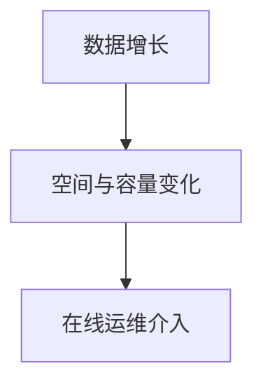
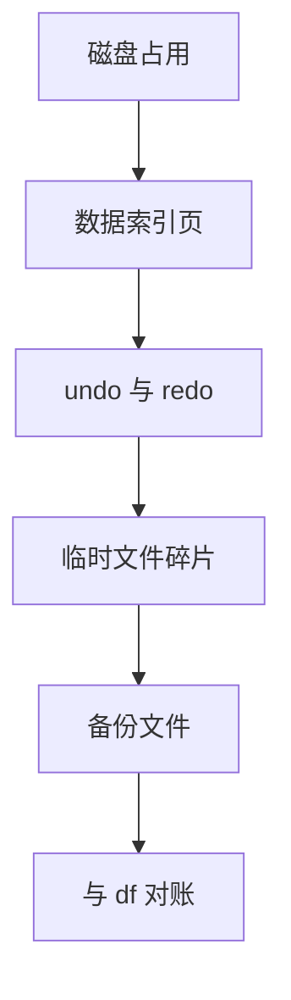
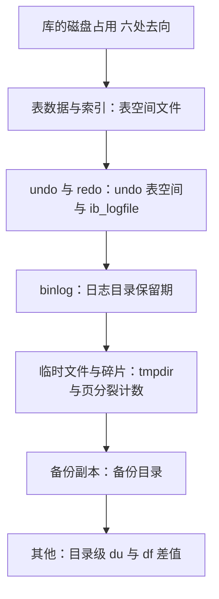

# MySQL 空间、容量与在线运维

本文的版本性判断以 MySQL（开源关系型数据库） 8.4 官方手册为准；云厂商兼容版、MySQL 9.x 或不同存储引擎的命令和默认值必须单独复测。课程材料只作为历史线索，不作为当前行为的依据。读完你能算出一张表实际占多少空间，并判断一次删除该不该立刻回收。

## 要解决的问题：空间被哪些部分组成



容量治理要提前：


磁盘占用持续上升而表里的行数并没有成比例增加，或者在线运维期间的空间回收把读写请求拖慢，容量判断因此缺少依据。本篇回答：空间被哪些部分组成、删除行与释放磁盘空间之间差在哪一步、碎片与临时文件从哪里产生，以及在线操作期间需要核对哪些状态。

## 删除为什么没让表文件变小

**InnoDB 的 `DELETE` 通常只把记录或数据页标记为可复用，不会让 `.ibd` 文件立即变小。随机插入、更新和删除还可能产生页分裂（页写满时把一页拆成两页的操作）和空洞。回收空间需要重建表并评估 MDL（Meta Data Lock，元数据锁：改表结构时挡住并发读写）、I/O、复制和回滚（把系统状态退回到改动之前的版本）风险：**

空间被谁占着，MySQL 8.4 官方手册的 InnoDB 架构图给的是权威答案——内存侧的 Buffer Pool、Change Buffer、Log Buffer，磁盘侧的 System Tablespace、File-Per-Table 表空间（`.ibd` 文件）、Undo 表空间、Redo Log、临时表空间各占一段：容量判断的六类成分与这张图的部件一一对应，删了行空间没回来，先在图上找它停留在哪个部件里：


*图源：[MySQL 8.4 Reference Manual《InnoDB Architecture》](https://dev.mysql.com/doc/refman/8.4/en/innodb-architecture.html)，Oracle 版权，文档引用。*

- `ANALYZE TABLE`：更新统计信息，不重建数据。
- `ALTER TABLE t ENGINE=InnoDB`：重建表，可能回收空洞。
- `OPTIMIZE TABLE`：通常相当于重建并重新统计，具体行为看引擎和版本。

**优先从表设计、删除策略、分区生命周期和归档流程减少空洞；不要把频繁 `OPTIMIZE` 当作常规性能按钮。**


删除行与磁盘空间变小之间隔着几步，把这几步按先后排开，「删了但空间没回来」就不再需要猜：



**重建只是把空间从「页内可复用」变成「文件变小」，最后一步还要回到文件系统对账——目录级 du 与 df 的差值才说明空间真的回来了。**

空洞的账要按三个来源分开算：批量删除（周期性清理历史数据，删除后页内记录稀疏）、随机更新（变长列改大改小造成页分裂）、主键乱序插入（随机主键让插入落在页面中间）。三者各自的观察量不同——删除看行数与文件大小的背离、更新看页分裂计数（`Innodb_pages_created` 的增量）、乱序插入看主键模式。重建表回收空间的实际效果也要按文件层对账：`.ibd` 缩小之后，文件系统的可用空间不一定同步增加（表空间文件可能被其他文件复用），核对落在目录级 `du` 与 `df` 的差值上。

一个库的磁盘占用按六类成分分布，容量判断的依据是分辨增长来自哪一类：



"磁盘涨了但行数没涨"要怎么归因：六类成分各自有查询手段——表空间文件大小、undo 使用量、binlog（MySQL 服务层日志：记录逻辑变更、用于主从复制与恢复） 目录、tmpdir、碎片比例、备份目录——对账顺序是从最大增量那类查起，一类一类排除；"空间被谁占"这个问题在单看表行数时无法回答。六类里「undo 与 redo」那类的空间形态最特别——redo log（InnoDB 重做日志：记录物理修改、崩溃后重放保证持久性） 是固定个数的文件组从头到尾再回头的循环写，write pos 追上 checkpoint 就得停下来先刷脏腾位置，所以日志空间的容量账要看"循环到哪"，不看"涨到多少"


*图源：[小林 coding《MySQL 日志：一条 SQL 更新语句是如何执行的》](https://www.xiaolincoding.com/mysql/log/how_update.html)，原创图注明出处转载。*


来源：[小林coding《索引常见面试题》](https://www.xiaolincoding.com/mysql/index/index_interview.html)


## COUNT 的计数模型是怎么算的

**InnoDB 需要根据 MVCC（多版本并发控制：同一行保留多个版本，每个事务按自己的快照挑版本读） 判断当前事务可见的行，因此无条件 `COUNT(*)` 也可能扫描大量数据。`COUNT(*)` 是最明确且通常最优的全行计数写法；`COUNT(col)` 只统计非 NULL 值，不能互换。`SHOW TABLE STATUS` 的估算值不能替代精确计数。**

**高频展示计数时，选择与一致性要求匹配的方案：异步统计允许近似；强一致计数可在同一事务内维护计数表，但热点（访问集中在少数键或节点上的现象）行会产生锁竞争（多个执行流争抢同一把锁造成的等待开销），需分片（把数据按规则切开存到不同节点）或按桶计数。**

## 临时表、引擎和分区各自影响什么

- 内部临时表可能由 `GROUP BY`、`DISTINCT`、复杂排序和中间结果触发，关注内存上限、磁盘写入和生命周期。
- `Memory` 引擎适合可丢失、结构简单且明确受控的临时数据；不要用它替代 InnoDB 的持久性和事务能力。
- 分区只有在分区键过滤、生命周期管理或单分区维护确实带来收益时才使用；分区不是自动并行和自动索引，先用真实数据验证剪枝效果。

## 自增 ID 与容量有什么关系

自增 ID 不保证连续：回滚、批量预留、冲突和重启都可能造成间隙。业务不要把连续自增当作计数器或无缺口账本。接近类型上限时，提前评估扩容、迁移、无符号范围和下游字段兼容性。

## 现场要按什么步骤诊断

```sql
SHOW PROCESSLIST;
SHOW ENGINE INNODB STATUS;
SELECT * FROM performance_schema.events_statements_summary_by_digest;
SELECT * FROM performance_schema.table_lock_waits_summary_by_table;
```

建议先 `FLUSH STATUS` 再做固定窗口采样（只采集一部分数据以控制记录开销），区分累计值和本窗口增量；结合慢日志、CPU、内存、磁盘、网络、连接数、锁等待和复制延迟（从库同步速度落后于主库、读到旧数据的时间差）形成证据链。

## 权限变更和复制之间有什么牵连

`GRANT` 会更新权限表；现代 MySQL 通常会立即生效，不应把 `FLUSH PRIVILEGES` 当作每次授权后的固定动作。兼容分支与发行版（例如 Percona Server、MariaDB）要用最小复现记录与原版 MySQL 的差异，不能只依据产品宣传或旧笔记。

主从（一台主节点负责写入、其他从节点同步数据的部署形态）复制把写与读分开：主库接收修改，从库应用主库的变更并承担读请求，一主多从是最常见的扩读形态：


大表 DDL（Data Definition Language，建表改表类 SQL：CREATE/ALTER/DROP 这类 DDL 命令）期间从库逐条回放主库的变更，主库几分钟完成的操作从库可能要跑更久——副本延迟是容量规划要计入的读放大（一次逻辑读触发多倍实际读取）数据来源之一（对应的观察动作见验证节的复制影响）。

## 怎么自己动手验证

1. 空间组成核对：分别查询表数据、索引、undo、redo、binlog、临时文件与碎片各自的占用，与操作系统层面的目录大小对照，确认容量增长来自哪一部分。
2. 删除与回收对照：删除一批行后核对表文件大小是否变化，再从某个时间点做固定窗口采样，观察空间何时真正释放。

3. 在线操作观察：在执行大表 DDL 期间，用 `SHOW PROCESSLIST`、锁等待与 `performance_schema` 的语句统计跟踪读写延迟，确认限速与终止条件按预期生效。
4. 复制影响：在 DDL 期间观察副本延迟，确认变更不会让副本长时间落后。
5. 断言锚点：空间占用逐项有对应关系，碎片与临时文件的产生位置明确，在线操作期间的状态有采样记录。

## 接着读哪几篇：同在数据系统里的相邻问题

- [[工程知识/数据系统：在并发与故障中保存事实/查询与索引/B+Tree索引为访问路径服务]]
- [[工程知识/数据系统：在并发与故障中保存事实/事务与存储/事务隔离决定并发读写能观察到什么]]
- [[工程知识/数据系统：在并发与故障中保存事实/可靠性与运维/InnoDB用日志连接事务、恢复与复制]]
- [[工程知识/数据系统：在并发与故障中保存事实/数据系统：在并发与故障中保存事实]]
- 在线运维的边界：在线 DDL 的能力边界随操作类型变化——加列可在线、改列类型多要重建表、大表加索引仍有主从延迟风险，每类操作的锁行为与耗时上限要在容量规划时写明；空间边界的硬线（磁盘 80% 预警）与软手段（归档、分库）要在硬线之前启动。
- 表空间由数据、索引、日志与碎片共同占用，本质问题在于删除行并不**立刻归还磁盘**，空间释放的时机由存储引擎何时复用空闲页决定。
