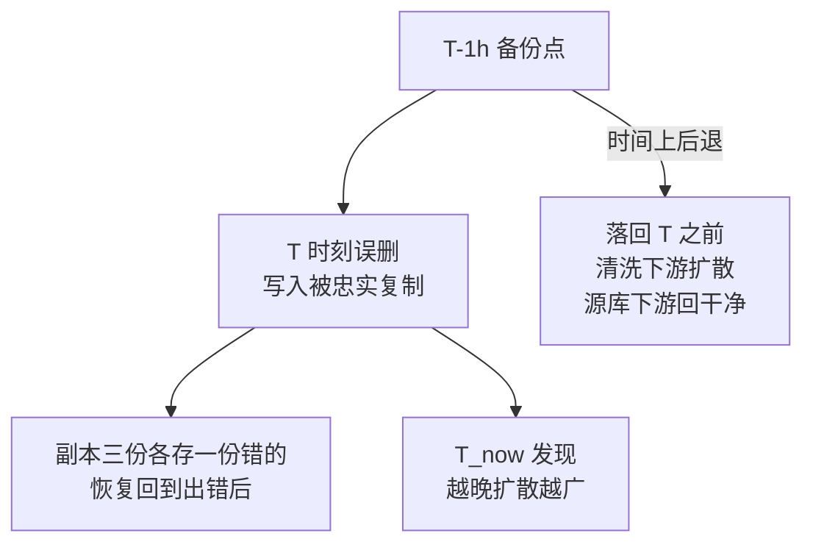

# 单机备份与多机副本要分开看：副本不是备份

> **要点**：副本对抗单机故障，备份对抗逻辑错误（误删、错误数据扩散、恶意操作）——错误会原样复制进每个副本，只有时间上后退的备份能回到错误发生之前；两者的保留周期、验证方式、恢复演练分开设计，混为一谈的系统在逻辑错误面前没有退路。

## 要解决的问题

**"有三副本就不需要备份"是分布式存储最贵的误解**。副本机制（同一份数据保留多份拷贝以防单点失效）复制的对象是**写入动作**：**客户端写了错误数据，三份副本忠实地各存一份错的**；**应用层的误删（DROP TABLE 删整表、批量删除），副本系统把它当作合法写入同步到每一台**。

**副本提供的是"机器坏了数据还在"，它不提供"数据错了能回去"**——**对抗逻辑错误需要时间维度上的副本（备份），空间维度上的副本（复制）对此无能为力**。上游 BookKeeper 的一个复现缺陷（ledger 写入后删除导致数据丢失）从反面印证：**删除操作一旦在元数据层生效，全部副本按同一视图执行删除，没有任何一台存着"被删掉的数据"**。

本库数据系统域"备份的价值由恢复演练来验证"讲过备份的验证纪律；本篇补前置的决策面：**备份与副本的职责分界、备份保留策略与错误发生时间的匹配、逻辑错误的恢复窗口**——**三件事决定一个系统在"数据错了"时有没有退路**。

## 它是怎么做到的：逻辑错误的恢复窗口


*图示：HDFS 的架构——元数据在 NameNode，数据块以多副本散在 DataNode 上并跨机架摆放。图源：Apache Hadoop 官方文档《HDFS Architecture》，Apache-2.0，https://hadoop.apache.org/docs/current/hadoop-project-dist/hadoop-hdfs/HdfsDesign.html。这张图常被误当成"备份方案"，其实它只回答"介质坏了怎么办"：副本在同一个文件系统里同步复制，逻辑错误也会跟着复制过去。*

**恢复窗口由保留策略决定**：**误删发生在 T 时刻，能回到 T 之前的那一刻，取决于最近的、早于 T 的备份**——**保留策略的粒度（每小时一个增量、每天一个全量）决定"最多丢多少数据"**，**这个数字RPO（Recovery Point Objective，恢复点目标：最多丢多少数据）要按业务的数据价值声明，而不是按备份介质的方便程度默认**。

**错误传播的时间线决定备份的紧迫性**：**错误写入在 T 发生，下游系统在 T+Δ 读到并扩散（派生表、消息、缓存）**——**恢复不只回滚（把系统状态退回到改动之前的版本）存储，还要处理 [T, T_now] 窗口内被污染的下游**。**恢复预案要覆盖扩散链**：**列出错误数据的下游清单（按数据血缘，本库数据治理域"血缘图谱的价值"）、每个下游的清理或重建方式**——**只恢复源库不清洗下游，错误数据会从派生路径绕回来**。

副本与备份是时间轴上方向相反的两条防线，一张图看清各自的守备对象与恢复落点：



"副本不是备份"的机制原因：**副本守住的空间维度的当前状态，写入动作被忠实复制使错误在每份副本上一致存在**；**备份守住的时间维度的历史状态，恢复落点在错误发生之前**。**恢复的完整条件包含下游扩散链的清洗，发现时间越晚，需要清洗的窗口越宽**。

**副本与备份的验证方式也不同**：**副本的验证是校验和（对数据算出的指纹，用来发现传输或存储中的损坏）与对账（数据在不在、对不对）**，**备份的验证是恢复演练（能不能回去、回多快）**——**副本健康不蕴含备份可用**：**备份文件损坏、恢复脚本失效、权限过期，都在副本全绿时静默发生**。**备份体系的收益是逻辑错误有退路，代价是持续的存储成本与演练成本**；**演练的频率按 RTO（Recovery Time Objective，恢复时间目标：出事后多久内必须恢复）承诺定**（本库备份篇的纪律），**演练环境与生产的一致性决定演练结果的可信度**。


## 读完这一段你能判断什么：备份体系的设计清单

**保留梯度**：**近密远疏——最近 24 小时每小时一个恢复点（对抗刚发生的误操作）、最近 30 天每天一个（对抗周期性错误与延迟发现的误删）、更早的按月或按合规要求保留（对抗长期潜伏的数据质量问题）**。**梯度的依据是"错误从发生到被发现的时间分布"**：**多数误删在小时内发现，潜伏错误按业务确定窗口**。

**三层隔离**：**备份与生产数据分离（不同存储系统、不同账号体系、不同权限域）——误删用的凭证删不到备份**；**备份的删除要有独立审批（防"清空存储"类操作连带备份）**；**隔离的对象包括备份系统自身的配置**（保留策略被改短是真实发生过的攻击面）。

**逻辑错误的恢复剧本**：**恢复点选择（回到哪个时刻：错误发生前一刻）→ 源库恢复 → 下游扩散链清洗 → 数据核对（对账工具，本库缺陷分析域"数据对比工具的双人裁决"）→ 切回生产**。**剧本按"错误类型 × 扩散范围"预写分支**，**真实事故时按图执行——现场推理恢复步骤等于在压力下做设计**。

备份介质长什么样，把"时间上后退"具象到实物就是磁带库：归档磁带从在线系统卸下、放进机械臂管理的槽位，与生产环境隔着一份物理隔离——**生产上的误删与勒索加密摸不到磁带上的历史版本**，这正是三层隔离里"独立权限域"的实物形态：


*图：StorageTek 磁带库内部（图源：[Wikimedia Commons《StorageTek tape library (51993015872).jpg》](https://commons.wikimedia.org/wiki/File:StorageTek_tape_library_(51993015872).jpg)，作者 Derrick Coetzee（NERSC），CC0）。**磁带库（tape library，用机械臂在槽位间取放归档磁带的存储设备）把备份的历史版本放进与在线数据物理隔离的介质里**——**副本与生产数据同生共死，磁带上的历史版本不会**。*

「抄本抄的是错也跟着错」的实物原型是私塾的抄书：**先生发现原稿错了一个字，抄本上的同一个字不会自己改——三份抄本忠实复写的是"抄写那一刻的文本"**（副本复制写入动作）；要回到写错之前，靠的是抽屉里上周的旧页（时间上的备份）：


*图源：Wikimedia Commons《Farmers of forty centuries》，二十世纪初摄影，公有领域，https://commons.wikimedia.org/wiki/File:Farmers_of_forty_centuries_-_Nursery_bed_of_rice.jpg。*

秧田与本田的关系也是同一层分界：**秧田里育的是可以整盘重来的一批苗（备份的可回退性），本田里插下去的苗与邻田共享一条水渠（副本共享同一套写入）**——**本田出问题时，重育的成本与底气全在秧田那份"时间上后退的苗"里**。

## 这套说法在哪儿会失效

三条边界防止防线走形。

**备份频率与副本数是独立变量**：**三副本 + 每天一个备份与单副本 + 每小时备份，对抗的风险不同**——**副本数按可用性定（服务不中断），备份频率按 RPO 定（数据可回退），两组参数按各自的目标推，不互相替代**。

**快照（某一时刻的完整只读副本）也是备份的一种，但有自己的边界**：**存储快照的恢复速度快，它与原数据共享存储系统的存活（存储系统整体故障时快照同灭）**——**快照负责快速回退，异地备份负责灾难恢复**，**两者的隔离等级不同，覆盖的风险不同**。

**恢复演练要用真实规模的样本**：**演练恢复 1 张表不能证明恢复 1 个库的时长**——**RTO 的承诺按全量恢复的实测时长定，抽样演练的规模要与承诺匹配**。

## 怎么自己动手验证

可复现的验证路径：

1. 误删恢复演练：**测试环境删一张表 → 按剧本恢复到误删前一分钟 → 对账核对行数与内容一致**；计时——实测 RTO 与承诺核对；
2. 扩散链验证：**构造错误数据写入 + 下游消费，恢复后核对下游派生数据已清洗（漏清洗即扩散清单不全）**；
3. 隔离验证：**用生产凭证尝试删除备份，预期被权限拒绝；篡改保留策略，预期审批与告警触发**；
4. 断言锚点：**保留梯度有依据说明、备份存储与生产隔离、扩散链清单与剧本在管、演练按 RTO 规模跑过**——**四者齐备，逻辑错误从"灾难"降级为"按剧本执行的事件"**。

```text
恢复断言 = 误删可回退，RTO 实测达标
清洗断言 = 下游扩散链恢复完整
隔离断言 = 生产凭证删不到备份
```

副本与备份是时间轴上不同方向的防线：**副本守住"机器坏"，备份守住"人犯错"**——**两条防线各自的保留策略、验证方式、演练剧本配齐，数据的历史才真正可回退**。

## 接着读哪几篇：恢复演练的验证纪律

- [[工程知识/数据系统：在并发与故障中保存事实/可靠性与运维/备份的价值由恢复演练来验证]] —— 恢复演练的验证纪律，本篇补备份体系的设计面
- [[工程知识/数据系统：在并发与故障中保存事实/可靠性与运维/复制的三种模式：主从、多主与无主的失败形态]] —— 副本机制的失败形态与边界
- [[工程知识/数据系统：在并发与故障中保存事实/事务与存储/快照隔离与MVCC：多版本如何在不阻塞读写的前提下挡住脏读]] —— 多版本机制与备份恢复的时间轴对照
- [[工程知识/缺陷分析：从个案到体系/正确性/数据对比工具的双人裁决：比对逻辑与判定标准要分开看]] —— 恢复后对账的判定工具
