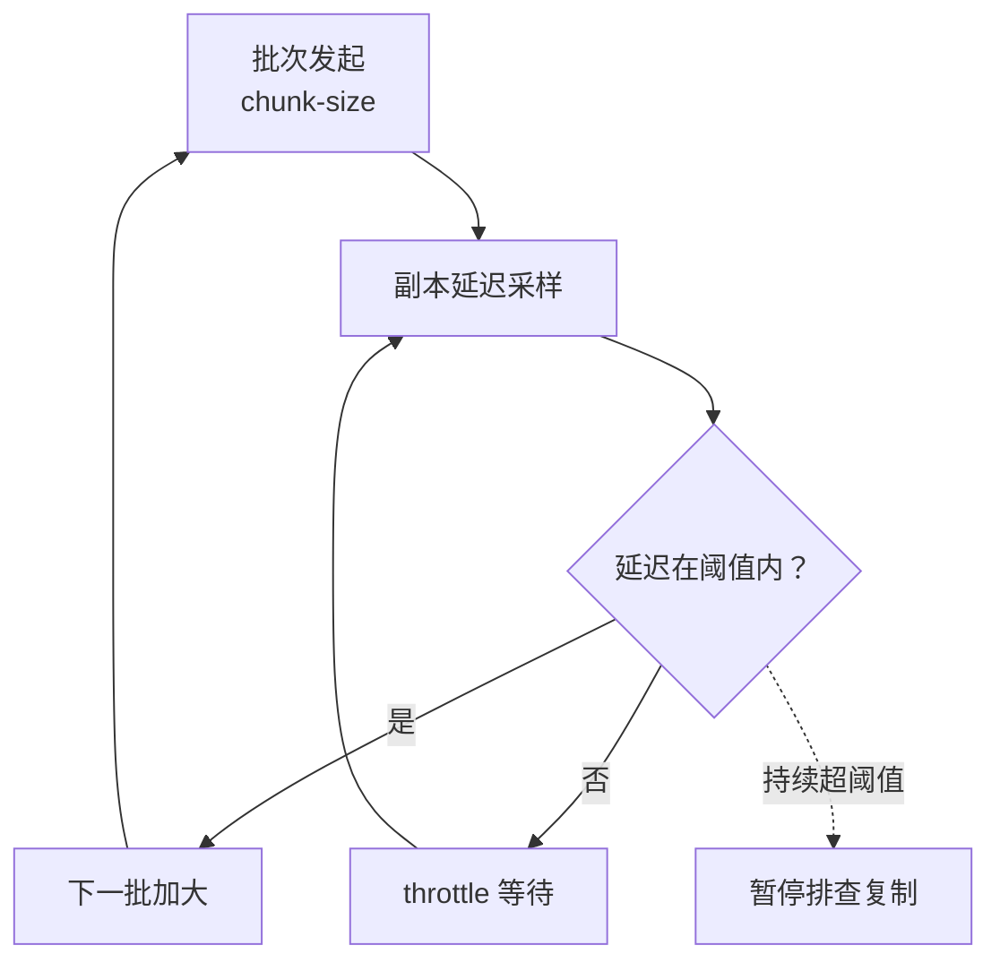
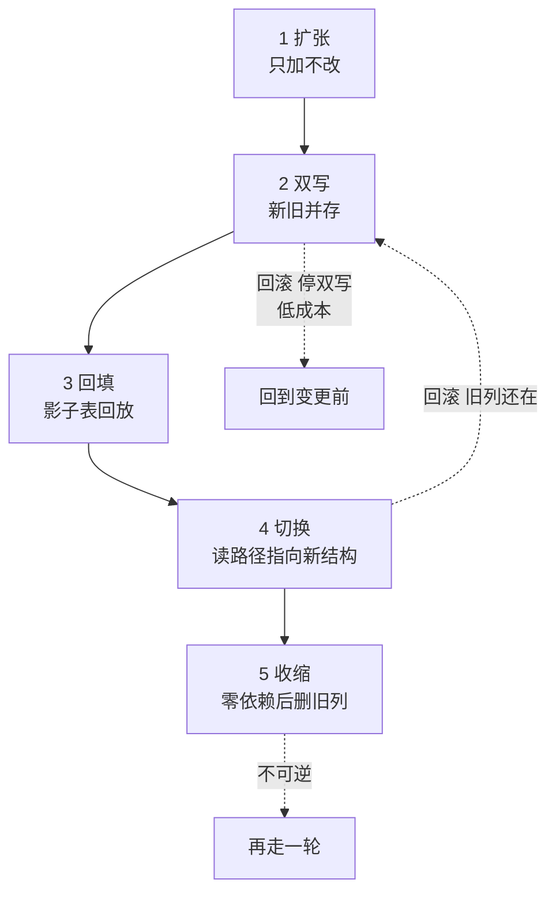

# 在线schema变更走expand与contract，不锁表是底线

**表结构变更（加列、改类型、加索引）在百万行以上的表上不能直接执行：原生 DDL（Data Definition Language，建表改表类 SQL：CREATE/ALTER/DROP 这类 DDL 命令）可能长时间持锁，锁住的是线上全部读写。**在线变更的方法论是 **expand-contract 两阶段**：**先扩张（新旧结构并存，双写或触发器同步），再收缩（确认无旧读者后删旧结构）。**中间用不锁表的工具做数据搬迁，**把"一次危险的 DDL"变成"一组可暂停、可回滚（把系统状态退回到改动之前的版本）的步骤"。**

**锁为什么不可接受：变更期间的锁与业务流量竞争，长事务持锁能让主从（一台主节点负责写入、其他从节点同步数据的部署形态）延迟堆积、连接池（预先建好连接反复取用、省去反复握手建连的开销）耗尽，故障形态是连锁的（锁等待扩散到上游调用方，超时层层放大）。**案例十一（上游修好了你这边没有）从另一个方向说明 schema 变更的风险：**变更修复在不同发行分支上不同步，环境间的结构漂移本身就是缺陷来源。**

## 要解决的问题：扩张与收缩两阶段各自做哪些事

**百万行以上的表执行原生结构变更时长时间持锁，锁住的是线上全部读写，而变更步骤在失败之后难以回退。**本篇回答：**扩张与收缩两阶段各自做什么、新旧结构并存期间读写怎样兼顾、数据搬迁在不锁表的前提下如何暂停与回滚，以及确认旧读者已消失的依据是什么。**

## 有哪四步流程

| 步骤 | 动作 | 关键检查 |
| --- | --- | --- |
| 1 扩张 | 新增列/表（只加不改），旧结构不动 | 加列是 DDL 里最安全的操作（元数据变更） |
| 2 双写（迁移期间同一份数据同时写入新旧两个存储） | 应用同时写新旧两份 | 双写的事务边界：同事务内，避免半写 |
| 3 回填 | 工具分批搬迁存量数据 | 批次大小随复制延迟动态调整 |
| 4 收缩 | 确认无旧读者后删旧列 | 删除前用访问审计确认零依赖 |

第 3 步回填是耗时主体，工程工具（gh-ost、pt-online-schema-change）的机制是**影子表加binlog（MySQL 服务层日志：记录逻辑变更、用于主从复制与恢复） 回放：建新结构影子表、增量数据从 binlog 持续拷贝、拷完原子切换改名。它不锁原表的原因是读写一直走原表，切换瞬间才换指向。**工具的选择与限制（复制延迟阈值**、磁盘空间要双份表**）在官方文档里各有明确边界。gh-ost 官方文档把它的三种连接模式画成一张图，连接对象决定变更压力落在哪台机器：

*图：gh-ost 官方架构图（来源：[github/gh-ost 仓库文档](https://github.com/github/gh-ost/blob/master/doc/images/gh-ost-operation-modes.png)，MIT 许可）。默认模式连接从库读 binlog、在主库应用变更，对主库侵入最小；直连主库是 binlog 格式不便时的退路；在从库上迁移测试则完全不动主库。*

**第 4 步收缩最容易被跳过——"新列已上线，旧列留着以后再说"，然后旧列永久驻留、双写永久化、 nobody 敢删。收缩要有明确触发：读路径审计（连续 N 天无访问）后才删**，审计方法与影响面估算同构，见 [[工程知识/缺陷分析：从个案到体系/影响判断/影响面估算先于修复——从改一行到伤多少服务]]。

来源：[腾讯云开发者社区《一篇文章讲透MySQL为什么要用B+树实现索引》](https://cloud.tencent.com/developer/article/1543335)（CC 4.0 BY-SA）

来源：[博客园《解密 Raft 算法》](https://www.cnblogs.com/traditional/p/12588733.html)（CC 4.0 BY-SA）

## 变更类型按什么分危险等级

| 变更 | 危险度 | 原因 |
| --- | --- | --- |
| 加可空列 | 低 | 元数据操作，不重写数据 |
| 加索引 | 低-中 | 在线建索引，但消耗 IO 与复制带宽 |
| 改列类型 | 高 | 全表重写，兼容性要双阶段 |
| 改列语义（单位/编码） | 最高 | 数据本身要变换，"结构没变数据变了" |
| 删列/删表 | 中（时机错则高） | 不可逆，依赖审计要先做 |

**语义变更（单位从分改成元）落在危险分级的顶档：schema 工具帮不了忙，因为它看到的数据"类型兼容"，必须走完整 expand-contract 且中间态里两套语义并存（列名带单位后缀），确认全部读路径切换后才清理。**

**什么时候必须走完整四步、什么时候可以走捷径**：加可空列在新版 MySQL（开源关系型数据库）里是纯元数据操作（INSTANT ALGORITHM，8.0 起），可以直接在线执行；**改列类型与语义变更没有捷径，任何发行版都要走完整 expand-contract。**判断依据落在两问上：**这个变更是否重写数据行（重写必有回填，回填必有批次控制）、新旧结构能否并存一个发布周期（并存要求读写代码兼容两套结构，做不到并存就要改应用先行）。两问任一答不上来，变更方案要退回设计阶段。**

回填阶段的流量控制是一道随复制延迟（从库同步速度落后于主库、读到旧数据的时间差）反馈调节的回路，批次大小是调节变量：

"批次大小随复制延迟动态调整"的调节机制：**回填在主库产生 binlog，副本回放速度决定延迟，延迟超阈值时工具降速或暂停（gh-ost 的 `max-load`/`max-lag` 参数就是这条回路的入口）**，回路断开（不看延迟全速搬迁）的代价是**读流量打到延迟副本上读到旧数据**。

## 这套说法在哪儿会失效

**在线变更的前提是复制架构健康：binlog 格式支持、主从延迟有余量、磁盘能容纳双份表。延迟敏感期（大促前）不做变更，变更窗口按业务日历排定，避开流量高峰周期。**

**多实例与多环境的结构一致性要靠声明式迁移脚本**（版本化的 migration 文件，每个环境按序执行），而不是手工在各环境执行。**迁移脚本的版本治理与 API 演进的兼容性要求同构**，见 [[工程知识/软件构建：让变化可以理解、验证与交付/架构与代码/API与Schema演进必须兼容新旧消费者]]：**脚本是代码，要过评审、要可回滚（每个 migration 配 down 脚本或明确标注不可逆）。**

## 怎么自己动手验证

四步里哪几步还退得回去、哪一步之后窗口关闭——可回滚边界在正文里只有一句话，画成状态转移才看得清：

**可回滚窗口的边界因此要写进变更方案：前两步退得回去，切换之后退回到双写，删了旧列就只剩再走一轮。**

**变更安全要与演练测量对账——预写四步各自耗时与主从延迟曲线应在阈值内，超出预期的批次大小要调小重跑，不能带阈值超标上线。**

**变更演练：在复制了线上数据规模的 staging 表上完整走一遍四步，测量每步耗时与主从延迟曲线。延迟超过阈值的批次大小要调小。**

**收缩审计验证：删列前开审计（general log 或 performance_schema 的表访问统计）跑一个完整业务周期，确认零访问再执行删除。**

**回滚验证：对每个 migration 预演回滚路径——expand 阶段的回滚是"停双写删新列"（低成本），contract 阶段的回滚是"重新启用旧列"（要求旧列还没删）。把可回滚窗口的边界写进变更方案。**

## 接着读哪几篇：在线运维的空间与容量前提

- 关系：[[工程知识/软件构建：让变化可以理解、验证与交付/架构与代码/API与Schema演进必须兼容新旧消费者]] · [[工程知识/缺陷分析：从个案到体系/影响判断/影响面估算先于修复——从改一行到伤多少服务]] · [[工程知识/数据系统：在并发与故障中保存事实/可靠性与运维/MySQL空间、容量与在线运维]] 的运维边界
- [[工程知识/数据系统：在并发与故障中保存事实/可靠性与运维/MySQL空间、容量与在线运维]] —— 在线运维的空间与容量前提
- [[工程知识/数据系统：在并发与故障中保存事实/可靠性与运维/InnoDB用日志连接事务、恢复与复制]] —— 变更工具依赖的 binlog 机制
- [[工程知识/软件构建：让变化可以理解、验证与交付/测试与交付/配置与特性开关分离部署与发布]] —— 双写开关的实现载体
- [[工程知识/缺陷分析：从个案到体系/兼容与升级/案例七：兼容与性能——滞后的依赖与放大的日志]] —— 结构漂移的代价实例
