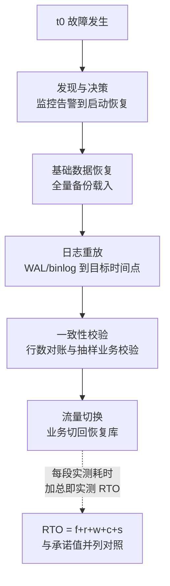
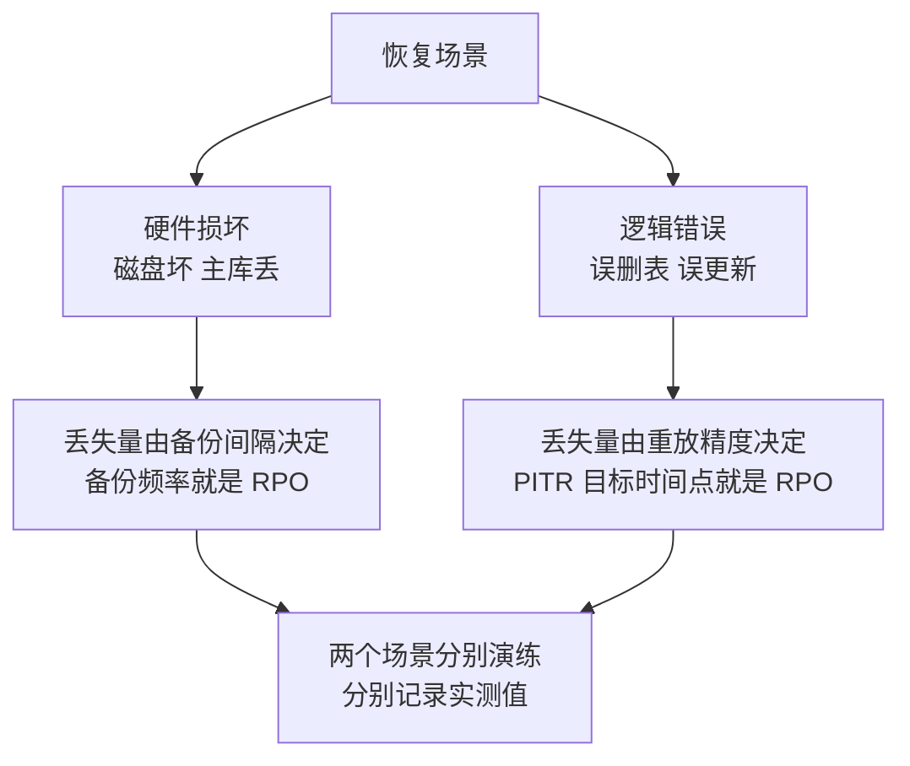

# 备份恢复是可验证的时间边界

它解决的是「有备份但恢复不了」或无法说明能恢复到哪个时间点的问题。**核心机制是把数据快照、日志、校验和恢复步骤绑定到 RPO（Recovery Point Objective，恢复点目标：最多丢多少数据）/RTO（Recovery Time Objective，恢复时间目标：出事后多久内必须恢复），并定期在隔离环境演练**；收益是**故障损失和恢复时间有证据**，代价是**额外存储、带宽和演练资源**，边界是**备份不能替代高可用、审计或业务重放**。**验证必须包含损坏、误删、密钥不可用和版本升级场景**。

**备份回答「最坏情况下能回到哪个时间点」，恢复回答「多久能重新提供可信服务」**。复制、快照、逻辑导出、WAL（预写日志：先把要做的改动记下来，再真正改数据，崩溃后能照着日志重做）/binlog（MySQL 服务层日志：记录逻辑变更、用于主从复制与恢复） 和异地副本具有不同的 RPO、RTO、隔离和误删传播边界，**不能把「有副本」当作「有备份」**。

## 要解决的问题：数据快照与日志与校验与恢复步骤怎样绑定到恢复目标

备份任务每天正常完成，真正需要恢复时发现数据缺失或步骤无法执行，也无法说明能恢复到哪一个时间点。本篇回答：数据快照（某一时刻的完整只读副本）与日志与校验与恢复步骤怎样绑定到恢复目标、恢复能力用什么方式定期确认、备份不覆盖哪些场景，以及损坏、误删、密钥不可用与版本升级各自需要怎样的验证。

## 动手之前要先定义哪几类目标

| 目标 | 含义 |
| --- | --- |
| RPO | 最多丢失多长时间的数据 |
| RTO | 故障后多长时间恢复服务 |
| PITR（Point-In-Time Recovery，按时间点恢复：恢复到事故发生前的任一时刻） | 能否恢复到指定时间点 |
| 保留/合规 | 多久可恢复、谁可访问、如何删除 |
| 完整性 | 校验和、加密、不可变/隔离和恢复后验证 |

恢复流程包括选择快照/日志、校验、重放、应用迁移、权限/密钥恢复、流量切换和一致性检查。**逻辑错误和恶意删除会被复制，因此至少保留与主系统权限和故障域隔离的副本**。

来源：[CSDN @bjmayor《图解分布式事务模式》](https://bjmayor.blog.csdn.net/article/details/154004146)（CC 4.0 BY-SA）

来源：[小林coding《MySQL 日志：undo log、redo log、binlog 有什么用？》](https://www.xiaolincoding.com/mysql/log/how_update.html)

## 最小恢复演练怎么做

恢复能力由日志给：**崩溃后数据能不能回到一致状态，取决于日志在崩溃前是否已按规则写完**。小林 coding 的决策图把恢复流程画成三次判定——**执行中崩溃走 undo 回滚（原子性），提交后崩溃走 redo 重做（持久性）**，每次判定的依据都是日志记录：

*图源：[小林 coding《MySQL 日志：一条 SQL 更新语句是如何执行的》](https://www.xiaolincoding.com/mysql/log/how_update.html)，原创图注明出处转载。*

恢复演练的本质是**「失败了能退回上一步」**。与 Saga（把长事务拆成一串本地事务、每步配一个补偿动作的模式） 的补偿同构：**每一步都要配一个明确的回退动作，并且这个回退动作本身要被验证过**。

**选定一个恢复时间点，记录备份开始和结束、可用日志范围、校验和、密钥版本及恢复后的数据计数**；**在隔离环境中执行全量恢复和时间点重放，再验证索引、权限、下游游标和业务不变量**。**若只验证「备份文件能下载」，并没有证明 RPO/RTO 或可用性**。

## 演练要覆盖哪些场景

**定期在隔离环境做全量恢复、时间点恢复、单表/租户恢复、主节点丢失、区域不可用、备份损坏和凭据失效**。**测实际 RPO/RTO、数据校验、客户端重连、旧主隔离和恢复后的索引/缓存重建**。

关系：[[工程知识/数据系统：在并发与故障中保存事实/可靠性与运维/InnoDB用日志连接事务、恢复与复制]] · [[工程知识/数据系统：在并发与故障中保存事实/可靠性与运维/多活架构按冲突类型选择一致性策略，而不是按距离]] · [[工程知识/后端系统：在并发、失败与变化中维持服务/分布式可靠性/复制分片与再平衡改变数据归属]] · [[工程知识/数据系统：在并发与故障中保存事实/可靠性与运维/备份的价值由恢复演练来验证]]
- [[工程知识/数据系统：在并发与故障中保存事实/事务与存储/SSD与HDD的IO特性差异：随机写与写放大.md]] —— SSD 磨损监控与备份的衔接

## 这些量在什么数量级：恢复时长的不对称账

**备份与恢复的时长不对称：全备 4 小时（吞吐预算内慢慢备），恢复同量数据要 4-8 小时（恢复含校验、日志重放、缓存预热，吞吐通常低于备份）；binlog 重放的速度按行变更数算（每秒 5-10 万行变更的库，1 天的 binlog 要回放 3-6 小时）**。**RTO 承诺前先做这道乘法：数据量 × 恢复系数 + 日志重放时长 + 验证时长——很多团队的 RTO 承诺是"备份完成了"的时刻，不是"业务可用了"的时刻，两者差的就是这道账**。

这道账画成时间线，RTO 的构成一目了然，哪一段超预算就改哪一段：

"RTO 承诺与实测差在哪"：**备份完成时刻只覆盖 r 段的入口，业务可用还要等 w、c、s 三段走完**；**实测 RTO 是五段耗时之和，演练逐段记时才能定位超预算的段（重放慢就提高日志回放并行度，校验慢就改抽样策略，发现慢就缩短告警到响应的间隔）**。

## 真实案例里发生了什么：时间账的姐妹篇

本篇与 [[工程知识/数据系统：在并发与故障中保存事实/可靠性与运维/恢复点目标要先算账：RPO 是数据的时间边界，不是备份频率的同义词]] 是一对：**RPO 管丢多少（恢复链的时间账），本篇管多久能用（恢复执行的时间账），两个账独立核算、合并承诺**。恢复演练的实录方法在 [[工程知识/数据系统：在并发与故障中保存事实/可靠性与运维/备份的价值由恢复演练来验证]]——**演练产出的实测恢复时长，就是 RTO 承诺唯一可信的来源**。

备份介质的实物形态就是"时间边界"的具象：一盘磁带只装一个时间点的备份，恢复到哪一盘，就回到哪一天。1959 年 NCR（National Cash Register，早期 Unix 诞生地之一） 304 计算机的开盘磁带盘是 RPO 这个抽象概念的实物写照：

*图源：Wikimedia Commons，Mark Greenia，CC BY-SA 4.0，https://commons.wikimedia.org/wiki/File:1959_NCR_304_Computer_Magnetic_Tape_Reel.jpg。*

## 动手跑一遍会看到什么：RPO/RTO 的实测账

承诺：RPO ≤ 5 分钟（最多丢 5 分钟数据）、RTO ≤ 30 分钟（最多停 30 分钟）。

实测（季度演练，通用流程）：

| 时刻 | 动作 |
| --- | --- |
| t0 | 模拟主库磁盘损坏（拔盘或停库，演练环境） |
| t0+2m | 发现故障，启动恢复（监控到启动的 2 分钟计入 RTO） |
| t0+9m | 从最近全量备份恢复基础数据 |
| t0+17m | 重放 WAL 到崩溃前最后一个事务（PITR 时间点恢复） |
| t0+19m | 校验数据一致性（行数对账 + 抽样业务校验），业务切回 |

结果：RPO = 3 分钟（最后重放的 WAL 距崩溃点），RTO = 19 分钟，达标。

另一次演练换场景：误删除表（逻辑错误，非硬件故障）。PITR 恢复到删除前 1 秒，RPO 由"备份间隔"变为"重放精度"决定。

备份不可恢复的实录形态——**备份任务天天绿、恢复从未演练，真出事时发现备份集损坏（静默失败数月）或恢复脚本依赖的旧版本工具已卸载**；**"备份存在"与"能恢复"之间隔着演练这道验证关，没有演练的备份只是占用存储的仪式**。时间边界的算账纪律与 [[工程知识/数据系统：在并发与故障中保存事实/可靠性与运维/数据库基准必须描述负载与资源边界.md]] 同源——**承诺之前先定边界、边界之后必须实测**。

**RPO 不是由同一个变量算出来的：硬件损坏那一支由备份间隔决定丢失量，逻辑误删那一支由重放精度决定，两个场景必须分别演练、分别记录**。

两个场景各自对账，承诺值才有对应的实测来源；混成一个数字时，改动的到底是哪一档就说不清了。

**恢复能力要与演练实测对账——预写按季度演练测得的实际丢失窗口与恢复耗时，与承诺值并列对照，对不上时修正承诺，改动记录没有意义**。

## 怎么自己动手验证

1. 目标对照：**把 RPO 与 RTO 写成具体数值，按季度执行一次演练，记录从发现故障到业务切回的每一步耗时，把实测的 RPO/RTO 与承诺值并列**。
2. 场景切换：**分别按硬件损坏与逻辑误删两种场景演练，确认前者由备份间隔决定数据丢失量、后者由重放精度决定，两种结果分开记录**。
3. 完整性校验：恢复完成后**核对行数、业务不变量与抽样账目，确认恢复结果可用而不是仅仅能启动**。
4. 依赖核查：**确认恢复脚本所依赖的工具版本、密钥与存储位置在演练当时仍然可用**。
5. 断言锚点：**承诺值与实测值都有记录，两类场景分别演练过，校验与依赖检查进入演练流程**。

## 接着读哪几篇：同在数据系统里的相邻问题

- [[工程知识/数据系统：在并发与故障中保存事实/可靠性与运维/误操作的第一响应是冻结现场：恢复顺序与时间赛跑.md]] —— 误操作事故的二次损害往往大于首次：误删表后慌忙重跑任务（把恢复需要的前像覆盖掉）、误提交后 force push 抹掉团队提交、rm -
