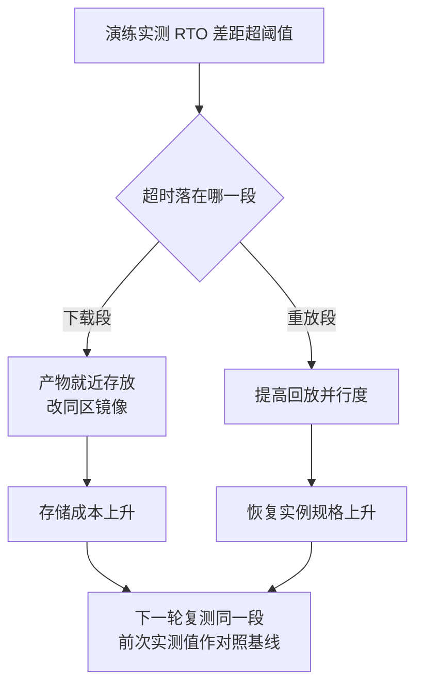
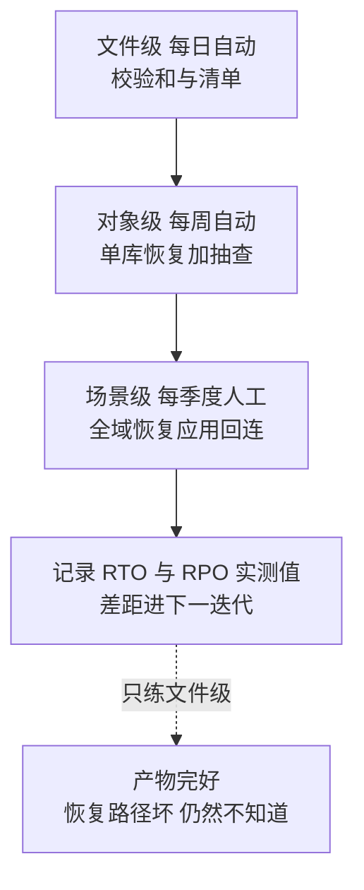

# 备份的价值由恢复演练来验证

备份策略文档写着"每日全量+实时归档"，真到恢复时刻恢复不出来——备份文件损坏、依赖的配置丢了、恢复步骤停在第八步等人工确认。要解决的问题：**未演练的备份是信念，演练过的备份才是资产**。备份系统的 SLA（服务等级协议，对外承诺的可用性与响应目标）只有一个指标：**RTO（恢复时间目标）与 RPO（恢复点目标）在演练中实测达标**。

## 备份链有哪三类静默损坏

1. 备份产物损坏：存储介质坏、校验和（对数据算出的指纹，用来发现传输或存储中的损坏）没记、跨桶复制截断。防线：备份完成即验校验和，恢复演练前先校验。

2. 备份内容漂移：库结构变更（新表、新序列）后备份脚本没覆盖到，恢复出来的库缺对象。防线：结构变更走 [[工程知识/数据系统：在并发与故障中保存事实/可靠性与运维/在线schema变更走expand与contract，不锁表是底线]] 的流程，备份脚本的结构校验跟着变更走。

3. 恢复路径损坏：恢复工具依赖的环境（密钥、依赖包版本、网络策略）随时间漂移，演练时才发现。防线：恢复环境版本化（容器化/脚本化），演练频率 ≥ 结构变更频率。

## 演练方案怎么设计才有效

**恢复演练的价值在于它是一次真实读取**。备份放在那里不动，和缓存放在那里不读一样，都没被验证过。

| 演练级 | 频率 | 验证什么 |
| --- | --- | --- |
| 文件级 | 每日自动 | 校验和、清单完整性 |
| 对象级 | 每周自动 | 单库恢复到临时实例 + 抽查行数/不变量 |
| 场景级 | 每季度人工 | 全域恢复 + 应用回连 + 故事级验证 |

**场景级演练要全真：真实备份产物、真实恢复环境、真实网络策略，只差最后一步不切流量**。演练记录 RTO/RPO 实测值与目标值的差距，**差距超阈值的改进项进下一迭代**。静默失真的检测原理与 [[工程知识/缺陷分析：从个案到体系/正确性/案例四十二：备份里的假账——恢复路径的静默损坏]] 的对账机制同源。

「备份产物单独存放」在生产工具链里的实物：pgBackRest 的灾备方案把备份仓库放在物理独立的实例上，主库故障时从备份仓库向备用节点恢复——仓库与数据库实例分离，目标机宕机时备份仓库依然可达，演练就是这个恢复路径的定期执行：

*图：Percona Distribution for PostgreSQL（开源关系型数据库）官方灾备方案架构图。三个实例各司其职：pg-primary（主数据库实例）把备份产物送到 pg-repo（远程备份仓库，pgBackRest 所在，物理独立部署），pg-secondary（备用实例）平时闲置，主库故障时从仓库恢复——备份仓库独立于数据库实例，是「备份价值在恢复时兑现」的部署前提。*

*图源：Percona 官方文档，[Backup and disaster recovery in Percona Distribution for PostgreSQL](https://github.com/gofullthrottle/postgresql-docs/blob/13/docs/solutions/backup-recovery.md)。*

「全真演练、只差真实」在灾备工程里的实物形态是灾备机房的定期切换演练：真实备份产物恢复到真实备用机房、真实网络策略回连应用，只差最后一步不切生产流量。演练记录实测 RTO/RPO 与目标的差距，恢复工具、密钥、网络策略漂没漂移，切换之前没人知道：

*图源：Wikimedia Commons，Andy Melton，CC BY-SA 2.0，https://commons.wikimedia.org/wiki/File:Sun_Fire_X4540_(Thumper)_-_Front.jpg。*

消防疏散演习是这件事最古老的版本：1973 年明尼阿波利斯图书馆那次演习，路线、引导、清点全按真走，唯一差别是没有火警——**真警铃响起那天，每个人只剩执行肌肉记忆**。**只练"文件级校验"的备份，等于只检查了警铃会不会响**。

演练超时的那一分钟落在哪一段，决定处置动作、代价科目与下一轮复测的对照基线（正常状态下的指标水平、用来对比异常）：

三笔代价都要由 RTO 目标与代价预算共同裁决，而裁决依据就是演练报告里那个超时段——处置完不复测，等于无法证明处置有效。

差距超阈值**之后的处置有固定走向**，按超时环节分三类：下载段超时改备份产物的就近存放（跨区拉取改同区镜像）；重放段超时提高回放并行度或缩短归档粒度；索引重建段超时把重建挪出 RTO 路径（恢复先对外、索引后台补建，前提是**业务能接受主动牺牲部分功能或精度的降级**）查询。三类处置各有代价——就近存放加存储成本、并行回放加恢复实例规格、降级（压力过大时关闭次要功能，保住主流程）查询加应用改造，**处置选择按 RTO 目标与代价预算共同裁决，演练报告里的超时段是裁决依据**。**处置完成之后下一轮演练要复测同一段，前次超时段的实测值是复测的对照基线，没有复测的处置无法证明有效**。

**演练的阶梯设计：文件级守住「产物没坏」，对象级守住「单库能恢复且数据对」，场景级守住「全域恢复加应用回连」——级别越高越接近真实故障**。虚线是最常见的假象：只停在文件级校验，备份文件完好、恢复路径（密钥、依赖、网络策略）早已漂移，故障那天才暴露。**三级各验证一层静默损坏，缺级就是缺口**。

恢复时到底要动哪些东西，pgBackRest 的数据流给了完整答案：PostgreSQL 把 WAL（预写日志，先把改动写进日志再改数据本身）持续送给 pgBackRest，完整备份与 WAL 归档进对象存储或本地存储；恢复时反方向走 RESTORE（恢复操作）取回备份、WAL Replay 重放到目标时间点——**演练验证的就是这条双向链路每一环都没断（存储可达、备份完整、WAL 连续、重放收敛）**：

*图源：DEV Community《PostgreSQL Backups and Point-in-Time Recovery with pgBackRest》文章题图（Mohd Hassaan），https://dev.to/mohhddhassan/postgresql-backups-and-point-in-time-recovery-with-pgbackrest-13gp。*

## 怎么自己动手验证

备份价值要与演练报告对账——**预写恢复起止时间、行数对账与校验和记录齐备，缺项与预期对不上，该备份不算通过验证**。

- 演练报告绑定真实证据：恢复起止时间、恢复实例的行数对账、不变量检查输出、恢复产物校验和验证记录，与 [[工程知识/软件构建：让变化可以理解、验证与交付/测试与交付/发布门禁必须绑定真实证据]] 同构。
- 恢复演练时间轴与 RTO 目标对比；超时环节定位（下载、重放、索引重建）。
- 随机抽查恢复产物：抽 3 个表 count(*) 与源库对比、抽业务不变量（如账户余额守恒）验证。

## 这套说法在哪儿会失效

- **RPO 由归档频率决定**：实时归档 PITR——Point-In-Time Recovery，按时间点恢复：恢复到事故发生前的任一时刻——RPO 可到秒级，每日快照（某一时刻的完整只读副本） RPO 最差 24h；**RPO 目标要先于备份频率决策**。
- 演练不能覆盖人为删除的窗口：rm -rf 或 DROP TABLE（SQL 删除整张表的命令）后归档仍在，恢复范围与误操作时间窗要配对分析。
- 多租户/多库环境的部分恢复：单库恢复不影响其他库的隔离性，演练要覆盖"只恢复一个库"的场景。

## 接着读哪几篇：RAID 与备份的故障域区分

- [[工程知识/缺陷分析：从个案到体系/正确性/案例四十二：备份里的假账——恢复路径的静默损坏]]：备份静默损坏的真实案例，本文的方法论版
- [[工程知识/数据系统：在并发与故障中保存事实/可靠性与运维/多活架构按冲突类型选择一致性策略，而不是按距离]]：备份是最后一道防线，多活是日常可用性，层级互补
- [[工程知识/软件构建：让变化可以理解、验证与交付/测试与交付/混沌工程验证系统是否真的能处理故障]]：演练思维在故障注入（主动向系统注入故障来验证容错能力的测试方法）上的同构应用
- [[工程知识/数据系统：在并发与故障中保存事实/可靠性与运维/RAID等级与数据可靠性：镜像与纠删的数学.md]] —— RAID 与备份的故障域区分
- [[工程知识/数据系统：在并发与故障中保存事实/可靠性与运维/复制的三种模式：主从、多主与无主的失败形态.md]] —— 复制与备份的分层防御
- [[工程知识/数据系统：在并发与故障中保存事实/可靠性与运维/单机备份与多机副本要分开看：副本不是备份.md]] —— 职责分界的设计面：副本守住机器坏，备份守住人犯错
- [[工程知识/数据系统：在并发与故障中保存事实/可靠性与运维/数据修复要按失效半径分层：行级订正、分区重建、全量重导.md]] —— 备份与权威源是修复体系的地基，修复动作按半径选级
