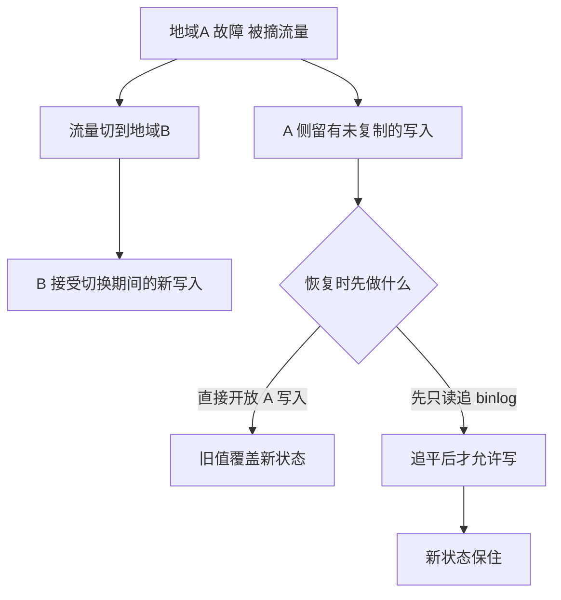

# 多活架构按冲突类型选择一致性策略，而不是按距离

多活（多地同时服务读写）的收益是**延迟与可用性：用户就近访问**，单地域故障不中断服务。**代价是跨地域复制的窗口内，同一数据在两地可能被并发修改——光速改不了，30ms 到 100ms 的复制延迟（从库同步速度落后于主库、读到旧数据的时间差）是物理底线。**多活设计的核心决策落在**每类数据在冲突窗口内允许什么**：**拒绝、覆盖、合并还是仲裁（由第三方投票打破平局、决定归属的机制）。**

按数据类型选策略的判据是冲突的业务后果，四类典型：

| 数据类型 | 冲突后果 | 策略 | 实现 |
| --- | --- | --- | --- |
| 追加型（事件、日志、计数明细） | 无冲突（各自追加） | 异步合并 | 无冲突复制（CRDT（Conflict-free Replicated Data Type，无冲突复制数据类型：多副本可独立写入自动合流） 思路），按时间戳合并 |
| 版本型（用户档案、配置） | 后写覆盖可能丢更新 | 版本向量检测 + 仲裁 | 检测到并发就交给业务规则或人工 |
| 约束型（库存、余额、配额） | 超卖/透支 | 单点授权或预分割 | 按用户/分片（把数据按规则切开存到不同节点）归属单写，或额度预分到各地域 |
| 独占型（用户名、唯一键） | 重复创建 | 全局仲裁 | 全局唯一服务或一致性哈希（节点增减时只迁移少量数据的分片路由）归属 |

这张表的要害在**分层混合：同一系统里，追加型数据可以各地域全活，约束型数据必须归属单点写。多数真实系统是混合体：把数据按冲突类型分层，各层用不同策略，比"整体多活"或"整体单写"都便宜且安全。**

## 要解决的问题：跨地域复制窗口内每类数据允许哪些结果

多地同时提供读写带来延迟与可用性收益，同时使同一份数据在复制窗口内被两地并发修改，**光速决定了这段窗口无法消除**。**本篇回答：跨地域复制窗口内每类数据允许什么结果、拒绝与覆盖与合并与仲裁各自适用于哪一类冲突、冲突判定的依据是什么，以及多活设计为什么从数据类型出发而不从地域数量出发。**

## 冲突窗口怎么量化

**多活的冲突类型取决于数据怎么切。**按地域切最容易理解：数据靠近使用它的用户，跨区访问变成本地访问，但**同一个键在两个区被写就成了冲突。**

*图源：Wikimedia Commons《CAP Theorem Euler Diagram》，作者 JamieMcCarthy，CC BY-SA 4.0，https://commons.wikimedia.org/wiki/File:CAP_Theorem_Euler_Diagram.png。这张图给出的是约束，不是答案：分区真的发生时，图上 CA（Certificate Authority，证书颁发机构） 那个交集不再可选，你只能在 C 和 A 之间挑一个。本文的主张是——挑哪个不该看机房离得多远，该看数据在冲突时会变成什么样。*

复制延迟决定冲突概率：**窗口 50ms、该 key 的写频率每秒 1 次，理论上冲突概率约 5%；写频率 100/s 的热点（访问集中在少数键或节点上的现象） key 在同窗口内冲突近乎必然。所以热点数据天然不适合无仲裁多活**——这与分库分表（把一张大表按规则分散到多个库或多张表）里"热点单独处理"的判断同构，见 [[工程知识/数据系统：在并发与故障中保存事实/事务与存储/分库分表只在单库成为瓶颈后使用]]。

**版本向量能检测并发写（两个地域各自带版本历史，历史互不包含即并发），但检测只解决"知道有冲突"，解决不了"该保留谁"。保留决策必须回到业务语义——数值取最新、集合取并集、互斥取仲裁**，这呼应了并发控制的根本原则：**先定义共享状态与完成条件**，见 [[工程知识/后端系统：在并发、失败与变化中维持服务/任务与并发/并发控制先定义共享状态和完成条件]]，跨地域只是把同一问题放大了窗口。

来源：[博客园《解密 Raft 算法》](https://www.cnblogs.com/traditional/p/12588733.html)（CC 4.0 BY-SA）

来源：[博客园《解密 Raft 算法》](https://www.cnblogs.com/traditional/p/12588733.html)（CC 4.0 BY-SA）

## 数据分层怎么实操

**分层从写路径审计开始：列出系统的全部写实体（用户档案、订单、库存、购物车、计数器），每类标注冲突类型与写频率，高频约束型数据（秒杀库存）标红——这类数据要么预分割额度（各地域先分到固定额度，用完向中心申请），要么单点写（写请求跨地域路由，读仍就近）。**

预分割的代价是**额度利用率下降（地域间额度不能实时调剂）**，收益是**冲突窗口归零**。**秒杀类场景这是标准解**；普通电商库存（冲突频率低）则可接受单点写或最后写入胜出LWW（Last-Write-Wins，最后写入覆盖：按时间戳取最新的冲突消解）加对账兜底。

秒杀库存按预分割跑起来的额度流转与回补：

```mermaid
flowchart TB
    c["中心额度池<br/>总库存 1000"] --> a["地域A 预分 400<br/>本地扣减零冲突"]
    c --> b["地域B 预分 400<br/>本地扣减零冲突"]
    c --> d["预留 200<br/>回补缓冲"]
    a -->|"额度耗尽"| r["向中心申请回补"]
    b -->|"额度耗尽"| r
    r --> d
    d -.->|"回补粒度决定<br/>跨地域申请频率"| a
    d -.-> b
```

**预分割如何把冲突窗口归零：扣减动作全部发生在本地额度内（无跨地域并发写同一数值），跨地域交互只剩回补请求这一条窄路径；回补粒度是新的调节变量（粒度大跨地域请求少但额度利用率更低），冲突问题转化成了额度调度问题。**

## 故障切换怎么保住数据完整性

**多活的可用性收益最终要靠故障切换兑现：某地域故障，流量切到其余地域。切换时的数据完整性检查常被忽略——故障地域可能有未复制出去的写入，切换后这些写丢了；恢复时该地域带着旧数据回来，把已经切换后的新状态覆盖回旧值（脑裂的持久化形态）。**防御机制：**恢复前先追平复制（该地域作为只读副本追binlog），追平后才允许写入**，这与租约（带过期时间的临时授权，过期即失效）+Fencing 的防过期持有者原则同构（见 [[工程知识/后端系统：在并发、失败与变化中维持服务/分布式可靠性/租约必须配合FencingToken阻止过期持有者]]）。

## 这套说法在哪儿会失效

切换与恢复这两步的先后决定了**数据会不会倒退**，同一场事故两种顺序两种结局：

追平与开放写入的先后顺序，就是切换演练必须验的那一条：顺序错了，多活的可用性收益换来的是持久化的脑裂（集群分裂成两半各自为政的故障）。

多活的成本下限是**运维复杂度：多地部署、监控、数据对账任务都要 N 份。****业务体量不到（单地域可用性已达标、跨地域延迟可接受）时，多活是负收益。**决策框架与通用的造与买权衡一样：**先量化收益（延迟降低多少、可用性提升几个九），再对比成本（对账系统、冲突处理的开发与维护）。**

一致性的代价边界见 [[工程知识/后端系统：在并发、失败与变化中维持服务/分布式可靠性/一致性模型与共识解决不同问题]]：**多活选的一致性层级要在 CAP（一致性、可用性、分区容忍性三者的取舍定理） 的分区容忍下成立，跨地域共识（每次写都跨地域仲裁）等于放弃多活的延迟收益——所以仲裁要窄（只约束独占型数据），不能宽（全部数据都仲裁）。**

## 怎么自己动手验证

**冲突策略要与注入实验对账——预写版本型冲突应被检测到、约束型应被单点拒绝，实测出现丢失更新（两个事务各写一份，其中一个的修改被另一个覆盖），与预期对不上，该策略不适用。**

**冲突注入实验：两个地域同时对同一 key 写入（版本型与约束型各一例），验证版本向量检测到并发、约束型被单点授权拒绝。切换演练：kill 一个地域，流量切换后检查数据完整性（对账两边记录数），恢复地域时验证先追平再写入的顺序生效。**

**对账常驻：多活系统的对账任务是必需品而非可选项——冲突策略的漏洞（LWW 丢的更新、预分割的额度误差）都靠对账暴露**，对账方法见 [[工程知识/缺陷分析：从个案到体系/正确性/静默失真的检测靠对账与不变量而不是报错]]。

## 接着读哪几篇：一致性层级的选型基础

- 关系：[[工程知识/后端系统：在并发、失败与变化中维持服务/分布式可靠性/复制分片与再平衡改变数据归属]] · [[工程知识/后端系统：在并发、失败与变化中维持服务/分布式可靠性/租约必须配合FencingToken阻止过期持有者]] · [[工程知识/缺陷分析：从个案到体系/正确性/案例三十：中间缺了一块——跨地域复制的 ack 空洞]]
- [[工程知识/后端系统：在并发、失败与变化中维持服务/分布式可靠性/一致性模型与共识解决不同问题]] —— 一致性层级的选型基础
- [[工程知识/数据系统：在并发与故障中保存事实/事务与存储/分库分表只在单库成为瓶颈后使用]] —— 数据归属切分的单库版原理
- [[工程知识/缺陷分析：从个案到体系/正确性/静默失真的检测靠对账与不变量而不是报错]] —— 多活对账的通用方法
- [[工程知识/后端系统：在并发、失败与变化中维持服务/任务与并发/并发控制先定义共享状态和完成条件]] —— 冲突判定的根本原则
