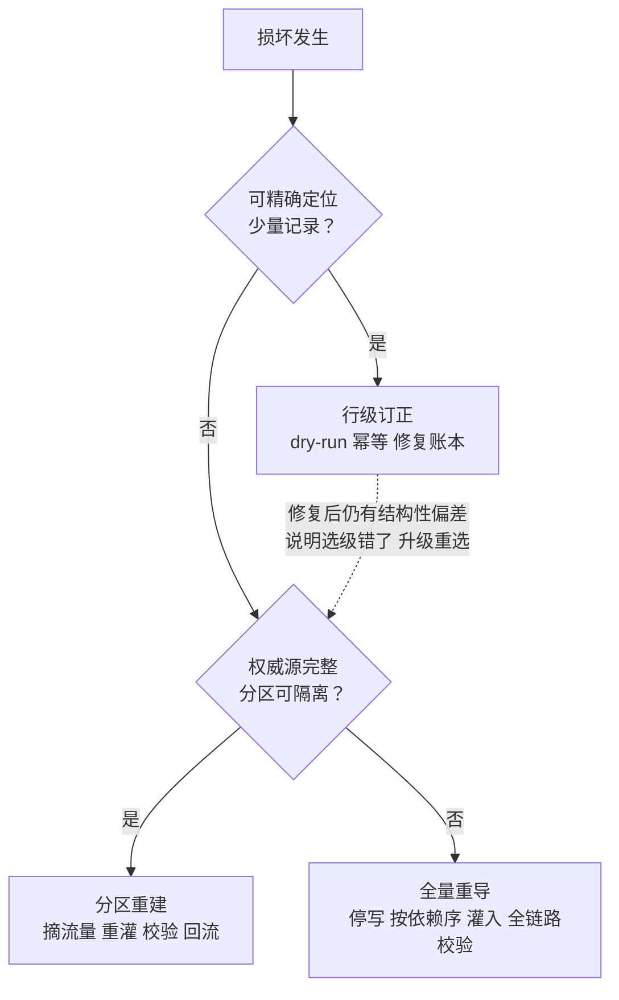

# 数据修复要按失效半径分层：行级订正、分区重建、全量重导

> **要点**：**数据修复的动作按失效半径分三级**——**行级订正（修复脚本 + 幂等 + 双写核账）**、**分区重建（从权威源重灌一个分区，服务可降级继续）**、**全量重导（停写 + 重灌 + 校验，最后手段）**；**选级的判据是"损坏范围 × 是否可定位 × 停写成本"**，跳级修复（该行级的做全量）与降级修复（该重导的靠脚本）是两类典型事故。

## 要解决的问题

**数据坏了之后的修复决策常被简化成"写个脚本改回来"**——**行级脚本对结构性损坏无效**（分区内一致性已破，单行订正引入新的不一致），**全量重导对可定位的损坏过度**（停写数小时修十行数据）。上游 BookKeeper 的一个复现改进是"recover 命令支持限速参数"（恢复动作与业务流量的资源竞争要有闸门）——**修复不只是"把数据改对"，还是一次与业务共享资源的运维操作**。本篇展开三级修复的动作设计与选级判据：**每级的适用条件、幂等（同一个操作执行一次和执行多次的结果相同，重复执行不会产生额外副作用）与核账的要求、修复限速**。

## 它是怎么做到的：三级的动作设计

分层修复的思路与数据仓库（面向分析、按主题整理好的历史数据存储）的分层同源：**每一层承担不同程度的加工，越往上数据越规整、重算代价也越高**。

三级里「分区重建、全量重导」这两级都依赖快照（某一时刻的完整只读副本）与重放，快照怎么做才不阻塞线上写，Redis（内存键值数据库，常当缓存与排行榜用） 的 bgsave（fork 子进程后台生成内存快照）把机制画得最清楚：**主进程 fork（复制出子进程的系统调用） 出子进程，子进程只继承父进程的页表（虚拟地址到物理地址的映射表）、与父进程共享同一份物理内存**，之后**父进程的写入按写时复制机制在修改处生成新页**——**子进程拿着 fork 那一瞬间的数据视图慢慢写 RDB，线上写入全程不停**：


*图源：[小林 coding《RDB 快照是怎么实现的》](https://www.xiaolincoding.com/redis/storage/rdb.html)，原创图注明出处转载。*


*图源：Azure 中文文档（docs.azure.cn），CC BY 4.0，https://docs.azure.cn/zh-cn/databricks/sql/get-started/data-warehousing-concepts。*

把这张图映射到修复上：青铜层是原始入库数据，出问题重导即可；白银层做过清洗整合，重建一个分区的成本已经不小；黄金层是面向消费的集市，动它等于动所有下游报表。**失效半径决定了该在哪一层动手**，而不是一律从源头重导。


*图示：Iceberg 的分区规范演化——分区方式改了之后，老数据不必重写，它继续留在旧规范下。图源：Apache Iceberg 官方文档《Partition Evolution》，Apache-2.0，https://iceberg.apache.org/docs/latest/evolution/。这张图给了"分区重建"一个现实前提：**分区是可整体替换的单元，且替换不必牵动历史数据**。下面三级里的第二级之所以成立，正是因为分区这一层有这种可替换性。*

**第一级：行级订正（半径：可枚举的少量记录）**。适用条件：**损坏记录可精确定位（对账差异清单、错误报告的 id 列表）、修复逻辑明确（值的正确来源可判定）**。动作要素：**修复脚本先跑 dry-run（输出将要修改的行与修改前后值，人工核对后执行）**、**幂等设计**（同一条修复跑两次结果一致：按唯一键 upsert，按条件更新）、**双写（迁移期间同一份数据同时写入新旧两个存储）核账**（修复前备份原值到修复记录表，修复后核对影响行数与预期一致）。**修复记录表**是行级修复的账本：谁、何时、改了什么、依据什么——**审计与回滚（把系统状态退回到改动之前的版本）都从这里出发**。

**第二级：分区重建（半径：一个分区/一批数据，服务可降级）**。适用条件：**损坏范围是结构性的（分区内索引与数据错配、批量错误导入），但权威源完整（上游表、另一存储的副本、原始消息可重放）**。动作要素：摘流量（该分区读路由到副本或降级服务）、**从权威源按原键重灌**（保序与批量提交参数决定灌入时长）、**灌入中只读挂起**（该分区的写暂停或进队列，防重灌与业务写交叉）、灌完跑一致性校验（行数、校验和、抽样比对）再回流量。**重建期间的服务降级预案**先行（该分区数据短暂不可见或只读，业务侧的通知与降级开关提前配好）。

**第三级：全量重导（半径：整库或整表，最后手段）**。适用条件：**结构性损坏扩散（存储引擎层损坏、元数据丢失）、分区重建无法隔离**。动作要素：**停写窗口**（上游进缓冲队列或拒绝窗口外写入）、全量导出权威源、**按依赖顺序重灌（先维表后事实表、先主数据后衍生数据）**、**全链路校验**（行数、业务对账、关键指标曲线对比）后恢复写入。**全量重导的演练要求**：它是最坏路径，**未演练过的全量重导在真事故时几乎必然超时或出错**——重导脚本、时长基线（正常状态下的指标水平、用来对比异常）、容量预估（本库备份恢复演练的时长预算）要按季度验证。

「修复先在隔离环境验证、通过后再回主链」在现代表格式里有官方图景：Iceberg 的审计分支先把写操作挂到 audit-branch 上跑完 Audit Workflow，验证通过后 Fast Forward Main 一次性把主分支指过去——**修复动作全程不碰主链，合并只在验证通过的那一刻发生**：


来源：Apache Iceberg 官方文档《Branching and Tagging》，Apache-2.0，https://iceberg.apache.org/docs/latest/branching/。修复的「摘流量 → 重灌 → 校验 → 回流量」四步与图上的「写分支 → 审计 → 快进」同构：隔离给校验一次完整跑完的机会，算不得拖延。


## 读完这一段你能判断什么：选级判据与修复限速

**选级的三问**：**损坏可定位吗（行级的前提）**？**权威源完整且分区可隔离吗（分区重建的前提）**？**停写窗口的业务成本可承受吗（全量的前提）**？——**从第一级往下问，能满足就停**，跳级与降级都禁止。

三问串成一条决策链，任何损坏从顶端进入，停在哪一问就是哪一级：



选级的判定顺序与两类事故的成因：从上往下问、能满足就停，**停在行级却仍见结构性偏差说明第一问答错了（可定位是假象，枚举出的清单只是冰山露出部分）**，跳级与降级的代价分别是停写数小时修十行、脚本修结构性损坏引入新偏差——两条歧路的入口都在三问答错的节点上。

**修复限速（recover 的闸门）**：**修复动作与业务共享 IO 与带宽**——行级修复的影响可忽略，分区重建与全量重导**必须限速**（批量大小 + 提交间隔参数化，上游 recover 的 rate limit 参数即此设计）：**限速值按业务流量的余量倒推**（本库"节流参数与容量匹配"的核算方法），**修复期间业务指标持续在管，劣化超阈值即降速**。

**修复与备份的关系**：行级与分区级修复的前提是"权威源或副本存在"——**备份与副本的完整性是修复体系的地基**（本库"备份的价值由恢复演练来验证"）；**修复方案的可行性评审先核权威源的可用性与新鲜度**。

## 这套说法在哪儿会失效

三条边界防止防线走形。

**修复脚本的权限要收窄**：行级**修复脚本的数据库账号只授目标表的最小权限（防误跨表）**、执行环境与业务发布隔离（修复不走发布通道，但要走变更审批）——**修复是高频高危操作**，**审批与 dry-run 是两道闸**。

**分区重建的幂等靠键不靠顺序**：重灌过程中断后重跑，**按唯一键 upsert 保证幂等**——**依赖"从头跑一遍"的顺序幂等在部分完成时失效**（重复灌入或半灌状态），**键级幂等才能支持断点续跑**。

**修复后的观察期**：**修复完成不等于事故结束**——观察期（按故障潜伏特征定：一致性偏差看天、性能回退看小时）内对账任务加密频次，**修复引入的新偏差**（修复脚本 bug、重灌顺序错）在观察期暴露的成本远低于再次事故。

## 怎么自己动手验证

可复现的验证路径：

1. 行级修复演练：对账环境制造 N 行差异，预期 dry-run 输出准确、幂等重跑结果一致、修复记录表账实相符；
2. 分区重建演练：损坏一个分区的一致性，预期摘流量 → 重灌 → 校验 → 回流全流程按预案走通、限速生效（业务侧 P99 尾延迟）劣化在阈值内；
3. 全量重导演练：按季度跑全量重导（演练环境或低峰窗口），预期时长与预估基线一致、断点续跑验证通过；
4. 断言锚点：**三级修复的预案文档与判据在库、修复脚本全部幂等且带 dry-run、重导演练按季度执行**——三件齐备，数据修复从"出事写脚本"变成"按半径选级、按预案执行"的工程动作。

```text
分级断言 = 三问定位最低够用的一级
幂等断言 = 修复可重跑且账实相符
限速断言 = 修复流量有闸门可调
```

**数据修复的工程化是把"改数据"变成分级决策**：**行级订正带账本、分区重建带闸门、全量重导带演练**——三级各自的动作要素配齐，修复的速度与安全才同时成立。

## 接着读哪几篇：修复体系的地基：权威源与副本

- [[工程知识/数据系统：在并发与故障中保存事实/可靠性与运维/备份的价值由恢复演练来验证]] —— 修复体系的地基：权威源与副本
- [[工程知识/数据系统：在并发与故障中保存事实/数据治理/数据质量规则挂在管道上：每条规则有等级与动作，不只有报警.md]] —— 损坏的发现端：等级-动作矩阵
- [[工程知识/性能工程：从用户等待到资源瓶颈/存储与网络/节流参数与容量匹配：全局限流值要按单点容量乘副本数算.md]] —— 修复限速的核算方法
- [[工程知识/数据系统：在并发与故障中保存事实/可靠性与运维/毒丸消息要隔离不能重试：死信队列是消费流水线的保险丝.md]] —— 重放侧的幂等与隔离，与修复同源
- [[工程知识/缺陷分析：从个案到体系/安全/最小权限把爆炸半径变成设计输入：从能力枚举到撤权闭环.md]] —— 修复账号按分层最小化授权：行级修复只授目标表，修复半径即能力半径
