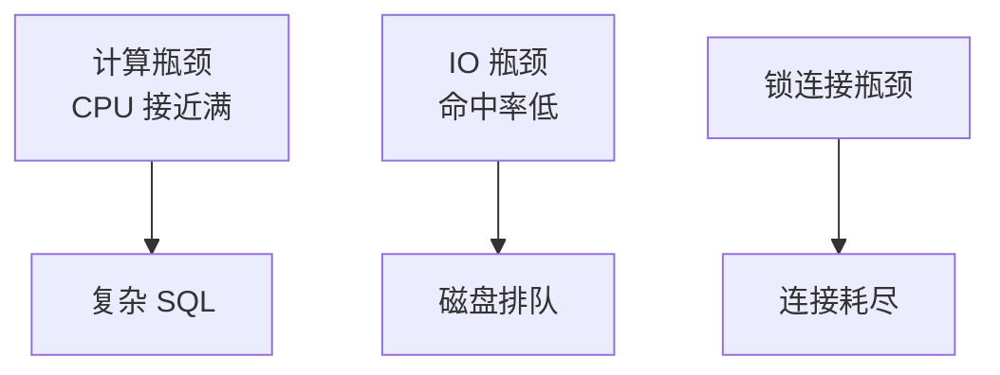
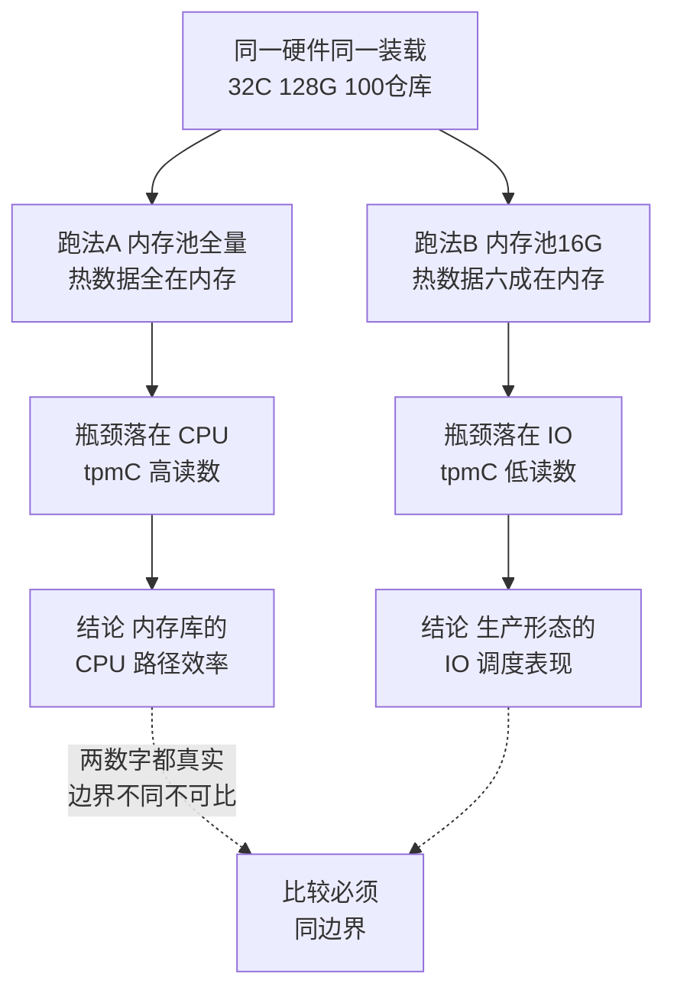
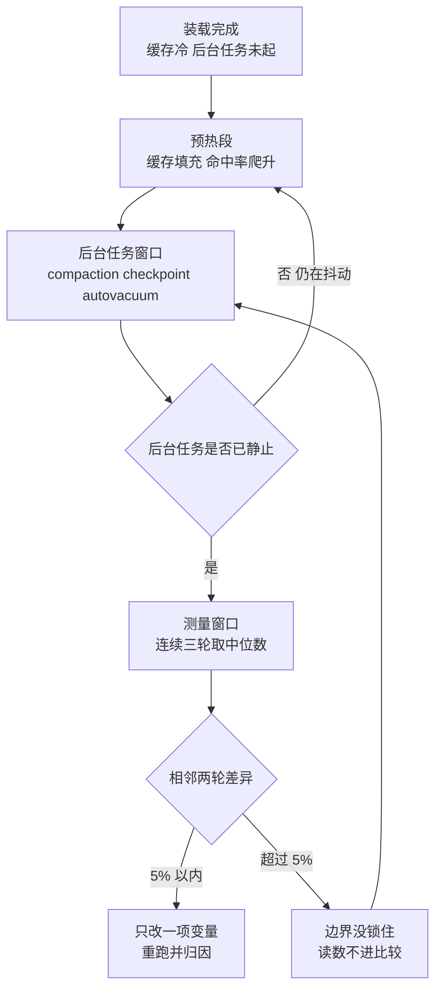

# 数据库基准必须描述负载与资源边界

**基准测试的价值是比较一个明确的变化，不是生成一个脱离负载的「数据库分数」**。**任何结果都必须同时说明工作负载、数据规模、并发、缓存状态、硬件、版本和正确性检查**。**读完你能设计一场可比较的基准，并把结果写成别人能复现的形式，而不是只留一个分数**。

## 要解决的问题：工作负载由哪些维度描述：跑分为什么骗人

**数据库性能数字被当作可迁移的结论使用，换到真实负载之后差异消失或者方向相反，无法判断两次测试之间究竟变了什么**。**本篇回答：工作负载由哪些维度描述、数据规模与并发与缓存状态怎样影响结果、硬件与版本为什么要一起记录、正确性检查为什么不能省略，以及比较要围绕哪一个明确的变更**。

## 性能数字怎么分层看：指标分层

**先把形状说成一件事：看数据库性能数字像医生看体检报告——单一指标（"心跳 90"）什么也诊断不了，要按层读：病人自己感觉怎样（用户体验层：p95 延迟、错误率）、一天干了多少活（吞吐层：QPS——每秒查询数，系统每秒处理的请求量——或 TPS）、脏器指标如何（数据库层：锁等待、缓存命中）、体重血压这些基础体征如何（系统层：CPU、磁盘队列）、以及这趟检查花了多少钱（成本层）**。**层与层之间有传导关系：脏器的问题最终会显形在病人的感觉上，但归因要从下往上查**。

**这个比喻到"按层读"为止——现实里各层之间还会互相掩盖：系统层忙不等于 SQL 差，诊断顺序要按信号锁定同一段时间窗口，这是现场排查一节的内容**。

| 层 | 指标 | 用来回答 |
| --- | --- | --- |
| 用户体验 | p50/p95/p99 延迟、错误率 | 用户是否感到变慢？尾部是否恶化？ |
| 吞吐 | QPS/TPS、提交事务数、队列等待 | 单位时间完成多少有效工作？ |
| 数据库 | rows examined、buffer pool 命中、锁等待、redo/checkpoint、复制延迟 | 数据库在哪一层受限？ |
| 系统 | CPU、内存带宽、磁盘延迟/队列、网络重传 | 是否是资源边界而非 SQL 本身？ |
| 成本 | 每千次请求资源和费用、恢复时间 | 改善是否值得？ |

**瓶颈落在哪一层，看的信号完全不同——判断错了层，加资源就是白加**：



**不要只看 Threads_connected（当前连接数）、平均延迟或 Seconds_Behind_Master（复制延迟秒数）一个数**。**先用 SHOW PROCESSLIST（查看当前所有连接在执行什么语句的命令）、慢日志、Performance Schema（MySQL 内置的性能事件采集器）、执行计划和系统指标锁定同一时间窗口，再判断根因**。


来源：[腾讯云开发者社区《一篇文章讲透MySQL为什么要用B+树实现索引》B 树结构一图](https://cloud.tencent.com/developer/article/1543335)（CC 4.0 BY-SA）


来源：[稀土掘金《看完这篇文章，别再说不懂索引了》](https://juejin.cn/post/7102419772200976414)（CC 4.0 BY-SA）


## 一场可比的基准怎么设计：基准设计

1. **明确目标：例如「p99 小于 200 ms 且错误率低于 0.1%」，而不是「尽可能高的 QPS（Queries Per Second）」**。
2. **固定版本、schema、索引、数据分布、客户端、连接池（预先建好连接反复取用、省去反复握手建连的开销）、隔离级别（并发事务互相可见程度的分级）和参数**。
3. **预热（上线前提前加载数据或建立连接，避免初期变慢）与正式阶段分开，记录缓存、checkpoint、后台刷盘（把内存中暂存的数据写入磁盘持久化）和复制是否稳定**。
4. **一次只改变一个关键变量；至少运行多轮并报告波动范围，而非只挑最好一次**。
5. **同时校验事务比例、结果正确性、约束、数据量和副作用，防止「跑得快但做错事」**。
6. **将原始报告和脚本放在来源层，把可复用的结论写回本页或对应主题页**。

**负载与边界决定数字的含义，公路上的收费站是实物注脚：杜家坎收费站以常态拥堵闻名——同一条路、同一批车，加一道闸之后通行时间完全改写**：


*图源：Wikimedia Commons，作者 N509FZ，CC BY-SA 4.0，https://commons.wikimedia.org/wiki/File:Dujiakan_Toll_Plaza_(20170114140841).jpg。*

**拿「不设收费站的通行时间」与「过杜家坎的通行时间」比快慢，比出来的差异来自那道闸，来自路的本身**。**数据库基准里未声明的 buffer pool 大小、连接数上限、磁盘型号就是那道没写进报告的收费站——两个数字都真实，但描述的从来都不同一条路**。

## 基准跑挂了先查哪几处：现场排查顺序

~~~text
用户延迟/错误
 -> 请求与 SQL 样本
 -> 执行计划和实际行数
 -> 锁/事务/连接池
 -> Buffer Pool、redo、磁盘和复制
 -> CPU、内存、网络和调度
 -> 单变量实验与回归
~~~

## 标准跑分怎么用才不作弊：TPC-C 的正确用法

**TPC-C（一种在线事务处理的公开基准测试）是特定在线事务负载和合规规则的基准，不等于所有业务的性能**。**使用 tpcc-MySQL（开源关系数据库）、BenchmarkSQL（两个开源的 TPC-C 基准测试工具）时，先核对工具实现是否符合目标规范，再记录事务混合、规模、预热、测量窗口和一致性检查**。**原始学习稿中的比例、延迟和数据规模只作为线索，不能直接当作官方门槛**。

## 动手跑一遍会看到什么：同一个基准两种结论

**TPC-C 类基准（订单-库存事务）在两种资源边界下跑，结论完全相反**：

```text
同一硬件（32C/128G/NVMe），同一 TPC-C 装载（100 仓库）：

跑法 A：无限内存池（buffer pool = 数据全量，热数据全在内存）
  → tpmC 45 万，瓶颈在 CPU —— 结论：**这库 CPU 效率高**

跑法 B：真实边界（buffer pool = 16G，数据 100G，热数据 60% 在内存）
  → tpmC 18 万，瓶颈在 IO —— 结论：**这库 IO 调度好**

差异的根源：跑法 A 测的是"内存数据库的 CPU 路径"，
跑法 B 才是生产形态（热数据从来不是 100%）。两个数字都真实，都不可比。
```

**跑一遍的收获：基准报告的每一行数字必须能回答三件事——负载是什么（事务构成、读写比、行数分布）、资源边界是什么（内存池、并发连接数、磁盘型号）、预热了多久（缓存冷热状态的差距自测一次即知：同一查询冷缓存与热缓存各跑一遍，延迟差以倍计）**。**答不出这三件事的数字没有比较价值**。

同一装载在两种资源边界下分出两条结论链，分岔点只在内存池一项：



**"两个数字都真实、都不可比"的机制：分岔点是 buffer pool 与数据量的比值（热数据占比），瓶颈随占比从 CPU 换到 IO，读数差异的来源是边界条件而非数据库本身——结论各自只在各自边界内成立，跨边界引用就是误用**。

## 差异怎么量化：量化锚点与案例回流


**一次基准从装载到能进比较要穿过哪几个时间窗口、5% 这道闸门卡在哪一步、抖动（性能指标不稳定的起伏）时回路回到哪一段，图上给出完整闭环**：



**测量窗口只能开在后台任务静止之后，超差的读数先回到稳定判定而不是直接进报告——这就是三轮中位数与 5% 闸门在时间轴上的位置**。

**可复现性的账：同一基准两次跑的差异应 <5%，超过就是边界没锁住——后台 compaction、checkpoint、autovacuum 都是噪声源；测三轮取中位数是最低纪律**。**容量类数字的换算：tpmC 到业务的换算要乘事务复杂度差（TPC-C 一个事务 5 张表、电商下单常 10+ 张），"tpmC 45 万等于支撑日均 4 亿单"这类直线换算是错的，正确用法只做同构对比（同负载模型下 A 与 B 比）**。

**案例衔接：**[[工程知识/数据系统：在并发与故障中保存事实/可靠性与运维/恢复点目标要先算账：RPO 是数据的时间边界，不是备份频率的同义词]] **的算账纪律与本篇同源——都是"承诺之前先定边界"**；[[工程知识/缺陷分析：从个案到体系/资源与容量/案例六：容量与泄漏——连接泄漏和 SST 堆积]] **是边界没锁住时容量假设失效的实录**。

**基准数字的价值取决于负载与资源边界是否被完整描述**，**本质问题在于后台任务与缓存状态这类未锁定的条件会把两次运行的差异做到超过测量本身**。

## 基准结论可信吗：验证

1. **负载描述：基准报告的每一行数字都能回答负载构成（事务类型、读写比、行数分布）、资源边界（内存池、连接数、磁盘型号）与预热时长三项，答不出的数字不进入比较**。
2. **可复现性：同一基准连续跑三轮，记录两次之间的差异，预期在 5% 以内；超出时先定位 compaction、checkpoint、autovacuum 等后台任务**。

3. **单变量对照：只改动一项条件（如内存池大小）再跑一次，记录瓶颈从 CPU 转移到 IO 的完整过程，确认差异可归因到该变量**。
4. **正确性断言：基准过程中同时校验数据正确性，避免吞吐数字建立在不一致的中间状态上**。
5. **断言锚点：报告含负载与资源边界描述，波动范围有记录，比较围绕单一变更，正确性检查与性能数字一并输出**。

## 描述齐全换来什么、要付什么：效果与代价

**把负载、规模、并发、缓存状态与版本一起记录，换来的是两次测试之间的差异可以归因到某一个变量，容量结论只在描述清楚的边界内成立**。**代价是基准脚本与报告需要连同数据分布和预热条件一并留存**，**正确性断言与波动范围也要进入报告，否则数字仍然不可比**。

## 接着读哪几篇：同在数据系统里的相邻问题

- [[工程知识/数据系统：在并发与故障中保存事实/查询与索引/一条SQL如何穿过优化器与存储引擎]]
- [[工程知识/数据系统：在并发与故障中保存事实/查询与索引/B+Tree索引为访问路径服务]]
- [[工程知识/数据系统：在并发与故障中保存事实/事务与存储/事务隔离决定并发读写能观察到什么]]
- [[工程知识/性能工程：从用户等待到资源瓶颈/观测与诊断/性能问题定位]]
- [[工程知识/软件构建：让变化可以理解、验证与交付/测试与交付/测试策略从风险选择证据]]
